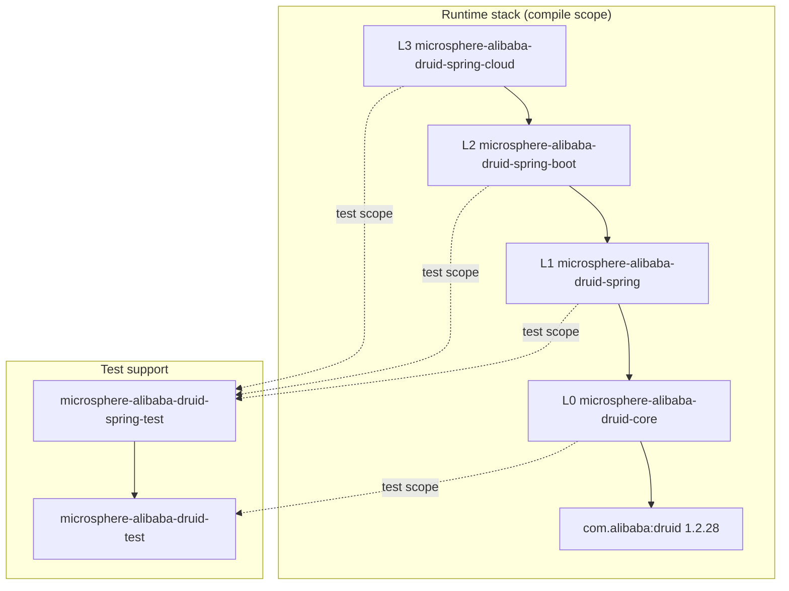
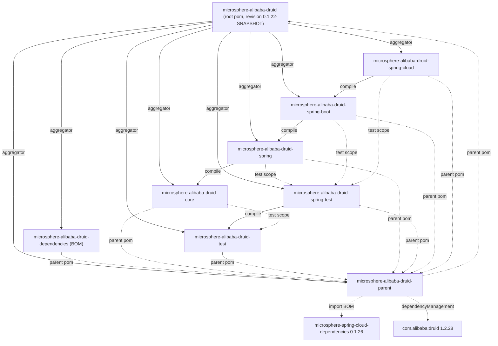

[中文](zh/README.md)

# Developer Guide — 1.x (`release-1.x` branch line)

This guide documents the **internal design** of Microsphere Alibaba Druid on the `release-1.x`
branch line (artifact versions `0.1.x`, documentation directory `1.x`): the layering, the module
dependency graph, the source-level behaviour of every public type, the design patterns in use, and
the extension points a contributor must respect.

It is *not* a usage manual. For installation, configuration properties and cookbook recipes see the
[User Guide](../user-guide/README.md).

- Repository home: [../../../README.md](../../../README.md)
- Newer line (`0.2.x` / `main`): [current developer guide](../../current/developer-guide/README.md)

---

## 1. What makes the 1.x line different

The Java sources of `release-1.x` are **identical** to the `main` working tree. The differences are
purely packaging, versioning and one test-class structure:

| Aspect | 1.x (`release-1.x`) | current (`main`) |
|---|---|---|
| Artifact line | `0.1.x` (latest release `0.1.21`, in-development `0.1.22-SNAPSHOT`) | `0.2.x` (`0.2.22-SNAPSHOT`) |
| Root `<parent>` | `microsphere-spring-cloud-parent:0.1.26` | `microsphere-spring-cloud-parent:0.2.26` |
| `java.version` | **not declared** in this repository | declared as `17` |
| Java baseline | **JDK 8** (inherited: `microsphere-spring-cloud:0.1.26` → `microsphere-build:0.3.14`, `maven.compiler.source/target=${java.version}=8`) | JDK 17 |
| Alibaba Druid | `1.2.28` | `1.2.28` |
| Auto-configuration discovery | `META-INF/spring/org.springframework.boot.autoconfigure.AutoConfiguration.imports` **plus** Boot 2.x style `META-INF/spring.factories` | `AutoConfiguration.imports` only |
| Spring Boot matrix | 2.3.12.RELEASE / 2.4.13 / 2.6.15 | 3.x |
| Spring Cloud matrix | Hoxton.SR12 / 2020.0.5 / 2021.0.9 | 2022.0.x – 2025.0.x |
| Test structure | `AlibabaDruidTestExtensionTest` declares the static-field-injection cases in the **top-level class** | the same cases live in `@Nested` classes |

Because the baseline is JDK 8, contributor code must avoid `var`, records, sealed types, text blocks,
`java.util.ServiceLoader.stream()`, `List.of`/`Map.of` (Java 9+) and any newer JDK API. Target
bytecode stays at class-file version 52, which is why the same 1.x jars still load on JDK 17/21/25.

### 1.1 Dual auto-configuration registration (1.x specific)

`microsphere-alibaba-druid-spring-boot` and `microsphere-alibaba-druid-spring-cloud` each ship
**two** discovery files:

```properties
# microsphere-alibaba-druid-spring-boot/src/main/resources/META-INF/spring.factories
org.springframework.boot.autoconfigure.EnableAutoConfiguration=\
io.microsphere.alibaba.druid.spring.boot.autoconfigure.AlibabaDruidAutoConfiguration
```

```properties
# microsphere-alibaba-druid-spring-cloud/src/main/resources/META-INF/spring.factories
org.springframework.boot.autoconfigure.EnableAutoConfiguration=\
io.microsphere.alibaba.druid.spring.cloud.autoconfigure.AlibabaDruidCloudAutoConfiguration
```

Both also keep `META-INF/spring/org.springframework.boot.autoconfigure.AutoConfiguration.imports`.
The compatibility contract is:

| Boot version | File read for auto-configuration | Effect |
|---|---|---|
| 2.3 – 2.6 (the matrix of this line) | `spring.factories` only | `AutoConfiguration.imports` is inert |
| 2.7 | both, then de-duplicated (`removeDuplicates` in `AutoConfigurationImportSelector`) | registered once |
| 3.x | `AutoConfiguration.imports` only | `spring.factories` auto-config key is ignored |

Do **not** delete either file on this branch: removing `spring.factories` breaks Boot 2.3–2.6,
removing `AutoConfiguration.imports` breaks 2.7+/3.x consumers of the same artifact.

---

## 2. Architecture and layering

The project is a strict vertical stack. Every layer only depends on the layer beneath it, and the
testing modules hang off the side of the stack:

| Layer | Module | Responsibility |
|---|---|---|
| L0 | `microsphere-alibaba-druid-core` | Druid `Filter` SPI implementations: statement interception template, SQL-to-resource-name resolution, property-name constants. No Spring dependency. |
| L1 | `microsphere-alibaba-druid-spring` | Spring Framework integration: `@EnableAlibabaDruid` + `ImportBeanDefinitionRegistrar` for multi-source `Filter` discovery, `DruidDataSourceBeanPostProcessor` for injection into `DruidDataSource`. |
| L2 | `microsphere-alibaba-druid-spring-boot` | Spring Boot auto-configuration, `@ConfigurationProperties`, composite `@Conditional` annotations, Actuator `DataSourcePoolMetadata`. |
| L3 | `microsphere-alibaba-druid-spring-cloud` | Spring Cloud packaging: conditional auto-configuration entry point plus `META-INF/config/default/features.yaml` metadata. |
| Support | `microsphere-alibaba-druid-test` | Non-Spring test infrastructure: `DruidDataSource` builders, abstract test template, JUnit 5 extension. |
| Support | `microsphere-alibaba-druid-spring-test` | Spring-aware test infrastructure: base class + `DruidDataSource` test configuration. |
| Build | `microsphere-alibaba-druid-parent`, `microsphere-alibaba-druid-dependencies`, root pom | Version/property management, BOM, aggregation. |



Key consequence: `core` knows nothing about Spring, so a plain `new DruidDataSource()` with
`getProxyFilters().add(new LoggingStatementFilter())` works without any container. Conversely,
`spring` adds no new interception logic — it only *wires* filters into data sources.

---

## 3. Module dependency graph (whole repository)

Solid edges = `compile` scope between reactor modules; dashed edges = `parent` inheritance, BOM
management or `test` scope.



### 3.1 `test`-scope edges worth understanding

- `core` → `test` (`${revision}`) : `AbstractStatementFilterTest` reuses `AbstractAlibabaDruidTest`.
  This is legal and **not** a cycle: `microsphere-alibaba-druid-test` has no compile dependency on
  `core`, so the Maven reactor sorts `test` before `core`.
- `spring`, `spring-boot`, `spring-cloud` → `spring-test` (`${revision}`) : all Spring tests extend
  `AbstractDruidSpringTest` and import `DruidDataSourceTestConfiguration`.
- Everything third-party inside `test` and `spring-test` is declared `<optional>true</optional>`,
  so downstream consumers must provide JUnit, Druid and H2 themselves.

### 3.2 External dependencies by module

| Module | Optional (compile-time) | Required | Test-only |
|---|---|---|---|
| core | `microsphere-annotation-processor`, `microsphere-java-core`, `druid` | — | `junit-jupiter`, `h2`, `microsphere-alibaba-druid-test`, `microsphere-logging-test`, `microsphere-logback`, `logback-classic` |
| test | `microsphere-annotation-processor`, `junit-jupiter`, `microsphere-java-test`, `microsphere-logging-test`, `druid`, `h2`, `logback-classic` | — | `microsphere-logback` |
| spring | `microsphere-annotation-processor`, `microsphere-spring-context`, `druid`, `spring-beans`, `spring-context`, `spring-test` | `microsphere-alibaba-druid-core` | `junit-jupiter`, `h2`, `microsphere-alibaba-druid-spring-test`, `microsphere-spring-test`, `microsphere-logback`, `logback-classic` |
| spring-test | `junit-jupiter`, `spring-test`, `spring-context`, `microsphere-spring-test`, `microsphere-spring-context`, `druid`, `h2`, `logback-classic` | `microsphere-alibaba-druid-test` | `microsphere-logback` |
| spring-boot | `microsphere-annotation-processor`, `microsphere-spring-boot-core`, `druid`, `spring-boot-starter`, `spring-boot-starter-actuator`, `spring-boot-configuration-processor`, `spring-boot-autoconfigure-processor` | `microsphere-alibaba-druid-spring` | `junit-jupiter`, `spring-boot-starter-test`, `microsphere-spring-boot-test`, `microsphere-alibaba-druid-spring-test`, `microsphere-logback`, `h2`, `logback-classic` |
| spring-cloud | `microsphere-annotation-processor`, `microsphere-spring-cloud-commons`, `druid`, `spring-cloud-commons`, `spring-boot-starter`, `spring-boot-starter-actuator`, `spring-boot-configuration-processor`, `spring-boot-autoconfigure-processor` | `microsphere-alibaba-druid-spring-boot` | `junit-jupiter`, `spring-boot-starter-test`, `microsphere-spring-boot-test`, `microsphere-alibaba-druid-spring-test`, `microsphere-logback`, `h2`, `logback-classic` |

---

## 4. Complex flows at a glance

| Flow | Where it is documented |
|---|---|
| SQL statement interception (`execute` template, `wrap(e, SQLException.class)`) | [core](microsphere-alibaba-druid-core.md#sql-interception-execution-flow) |
| `buildResourceName()` decision (validation short-circuit, `UNRECOGNIZED` fallback) | [core](microsphere-alibaba-druid-core.md#buildresourcename-decision-flow) |
| `@EnableAlibabaDruid` three-source registration with `switch` fall-through | [spring](microsphere-alibaba-druid-spring.md#enablealibabadruid-registration-flow) |
| Auto-configuration condition evaluation (factories vs imports, `@Conditional` chain) | [spring-boot](microsphere-alibaba-druid-spring-boot.md#auto-configuration-condition-evaluation-flow) |
| `@AlibabaDruidTest` extension lifecycle (Store / Namespace / ParameterResolver) | [test](microsphere-alibaba-druid-test.md#alibabadruidtest-extension-lifecycle) |

---

## 5. Design patterns used

| Pattern | Location | Notes |
|---|---|---|
| Template Method | `AbstractStatementFilter`, `AbstractAlibabaDruidTest`, `AnnotatedBeanCapableImportBeanDefinitionRegistrar` | `final` interception entry points, abstract `beforeExecute`/`afterExecute` hooks. |
| Chain of Responsibility | Druid `FilterChain` around `AbstractStatementFilter` | Every template method delegates to `super.<method>(chain, ...)`, i.e. to the next filter. |
| Bean Post Processor (hook) | `DruidDataSourceBeanPostProcessor` | `processBeforeInitialization` mutates `getProxyFilters()` before `DruidDataSource.init()`. |
| `@Import` + `ImportBeanDefinitionRegistrar` | `@EnableAlibabaDruid` → `AlibabaDruidRegistrar` | Registry-level bean definition registration, not `@Bean` methods. |
| Composite `@Conditional` meta-annotation | `ConditionalOnAlibabaDruidAvailable` = `ConditionalOnAlibabaDruidEnabled` + `ConditionalOnClass(name=...)` | Enables one-line gating reused by two auto-configurations. |
| Multi-source bean discovery | `BeanSource.{BEAN_FACTORY, SPRING_FACTORIES, JAVA_SERVICE_PROVIDER}` | The same `filterClasses` array is resolved against three registries. |
| `DataSourcePoolMetadataProvider` | `AlibabaDruidAutoConfiguration#druidDataSourcePoolMetadataProvider` | Adapter from Druid pool counters to Spring Boot Actuator metrics. |
| Strategy / Null Object | `customize(DruidDataSource)` (no-op), `Filter` class array default `{Filter.class}` | Subclasses opt in without breaking defaults. |
| JUnit 5 Extension | `AlibabaDruidTestExtension` | `BeforeAllCallback`, `AfterAllCallback`, `TestInstancePostProcessor`, `AfterEachCallback`, `ParameterResolver`, `Store` + `Namespace` + `StoreScope.EXTENSION_CONTEXT`. |
| Non-instantiable utility | `AlibabaDruidTestUtils` (`abstract class` + `private` constructor), `PropertyConstants` (interface) | |

---

## 6. Building and testing this line

Requirements: **JDK 8** (or a newer JDK, since sources are compiled with `-source/-target 8`), Maven
3.6+ with the external `microsphere-build` plugin configuration inherited from the parent chain.

```bash
# build one Spring Cloud generation
mvn --batch-mode clean verify -P spring-cloud-hoxton
mvn --batch-mode clean verify -P spring-cloud-2020
mvn --batch-mode clean verify -P spring-cloud-2021

# skip tests, resolve the reactor only
mvn --batch-mode clean install -DskipTests
```

The `spring-cloud-*` profiles and the `test` / `coverage` profiles are **declared in the external
parent chain**, not in this repository. On `release-1.x` they pin:

| Profile | Spring Boot | Spring Cloud |
|---|---|---|
| `spring-cloud-hoxton` | `2.3.12.RELEASE` | `Hoxton.SR12` |
| `spring-cloud-2020` | `2.4.13` | `2020.0.5` |
| `spring-cloud-2021` | `2.6.15` | `2021.0.9` |

`.github/workflows/maven-build.yml` on `release-1.x` runs the matrix
**JDK `8` / `11` / `17` / `21` / `25` × `spring-cloud-hoxton` / `spring-cloud-2020` / `spring-cloud-2021`**
and uploads coverage to Codecov, so a change must compile on JDK 8 *and* pass on the newest JDK.

Versioning is CI-friendly: every module declares `<version>${revision}</version>` and
`<revision>0.1.22-SNAPSHOT</revision>` lives in the root pom, so a release is a single property bump.

---

## 7. Conventions for contributors

- **Java 8 source level only** — no `var`, records, sealed classes, text blocks, `List.of`,
  `switch` expressions, or JDK 9+ APIs.
- **Optional-first dependencies** — anything that is not part of the module's own contract is
  `<optional>true</optional>` and versions come from `microsphere-alibaba-druid-parent`.
- **Internal reactor dependencies use `${revision}`** explicitly (Maven 3.6 flatten workflow).
- **License header** — every file starts with the Apache License 2.0 header.
- **`@author` + `@since`** on every type; `@since 1.0.0` on the API introduced before `0.1.x`.
- **Javadoc includes an `Example Usage` block** — keep it compilable, tests mirror it.
- **Never break the dual registration**: when adding an auto-configuration, register it in *both*
  `spring.factories` and `AutoConfiguration.imports`.
- **Keep interception stateless** — `AbstractStatementFilter` is a singleton shared by all
  connections; only per-data-source `init()` state (`dataSource`, `validationSQL`) may be cached.

---

## 8. Module documentation index

| Document | Contents |
|---|---|
| [microsphere-alibaba-druid-core](microsphere-alibaba-druid-core.md) | `AbstractStatementFilter` template, `LoggingStatementFilter`, `PropertyConstants`, resource-name algorithm. |
| [microsphere-alibaba-druid-spring](microsphere-alibaba-druid-spring.md) | `@EnableAlibabaDruid`, `AlibabaDruidRegistrar` fall-through semantics, `DruidDataSourceBeanPostProcessor`, test resource files. |
| [microsphere-alibaba-druid-spring-boot](microsphere-alibaba-druid-spring-boot.md) | `AlibabaDruidAutoConfiguration`, `AlibabaDruidProperties`, composite conditions, `DruidDataSourcePoolMetadata`. |
| [microsphere-alibaba-druid-spring-cloud](microsphere-alibaba-druid-spring-cloud.md) | Empty-shell `AlibabaDruidCloudAutoConfiguration`, `features.yaml` mechanism. |
| [microsphere-alibaba-druid-test](microsphere-alibaba-druid-test.md) | `AbstractAlibabaDruidTest`, `AlibabaDruidTestUtils`, `@AlibabaDruidTest` / `@AlibabaDruidRuntime` / `AlibabaDruidTestExtension`. |
| [microsphere-alibaba-druid-spring-test](microsphere-alibaba-druid-spring-test.md) | `AbstractDruidSpringTest`, `DruidDataSourceTestConfiguration`, prototype scope rationale. |
| [microsphere-alibaba-druid-parent](microsphere-alibaba-druid-parent.md) | Property/version management, external parent chain, JDK 8 baseline. |
| [microsphere-alibaba-druid-dependencies](microsphere-alibaba-druid-dependencies.md) | BOM layout and what an `import` actually brings. |

## Related

- [User Guide (1.x)](../user-guide/README.md)
- [Current-line developer guide (0.2.x)](../../current/developer-guide/README.md)
- [Repository README](../../../README.md)
- [Alibaba Druid](https://github.com/alibaba/druid)

---

## 中文

同一目录的中文镜像位于 [zh/README.md](zh/README.md)，逐模块中文文档见上表中的 `zh/` 前缀路径。
