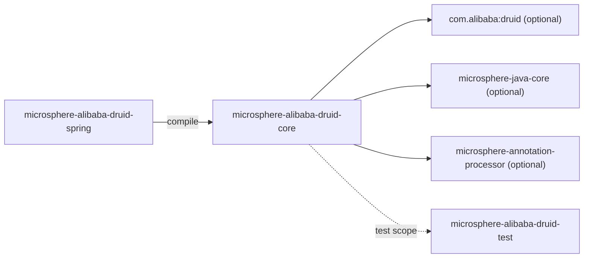
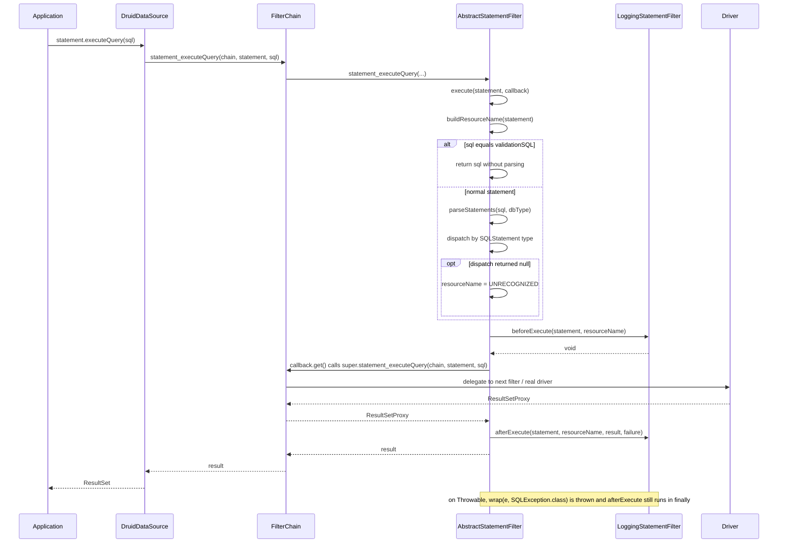
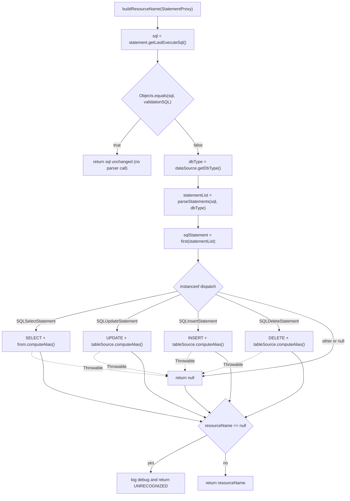
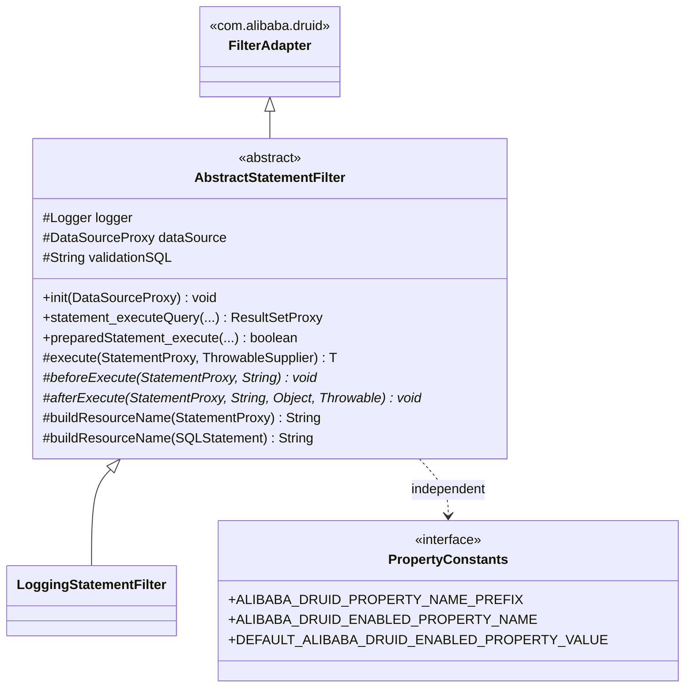

[中文](zh/microsphere-alibaba-druid-core.md)

# microsphere-alibaba-druid-core

> The foundation layer (L0): Druid `Filter` implementations and property-name constants.
> Package root: `io.microsphere.alibaba.druid`. Java baseline: **JDK 8** (inherited on this branch).
> Repository home: [../../../README.md](../../../README.md) · User-facing usage: [User Guide](../user-guide/README.md)

## Module view

`core` has **no compile dependency on any other reactor module** — it is the bottom of the stack. It
depends only on Druid and Microsphere Java utilities, both declared `optional`.



| Dependency | Scope | Why |
|---|---|---|
| `com.alibaba:druid` | optional | `Filter`, `FilterAdapter`, `FilterChain`, `StatementProxy`, `DruidDataSource`, `SQLUtils` parser. |
| `io.github.microsphere-projects:microsphere-java-core` | optional | `ThrowableSupplier`, `ListUtils.first`, `ExceptionUtils.wrap`, `Logger`/`LoggerFactory`, `@ConfigurationProperty`. |
| `microsphere-annotation-processor` | optional | Turns `@ConfigurationProperty` into `spring-configuration-metadata.json`-style metadata. |
| `microsphere-alibaba-druid-test`, `junit-jupiter`, `h2`, `microsphere-logging-test`, `microsphere-logback`, `logback-classic` | test | See [test module](microsphere-alibaba-druid-test.md). |

Because `druid` is `optional`, consumers get **no transitive Druid**; the data source library must be
declared by the application. This is deliberate — the project is an add-on, not a distributor.

## Source analysis

### `io.microsphere.alibaba.druid.constants.PropertyConstants`

```java
public interface PropertyConstants {
    String ALIBABA_DRUID_PROPERTY_NAME_PREFIX = MICROSPHERE_PROPERTY_NAME_PREFIX + "alibaba.druid";
    String DEFAULT_ALIBABA_DRUID_ENABLED_PROPERTY_VALUE = "true";
    @ConfigurationProperty(type = boolean.class,
            defaultValue = DEFAULT_ALIBABA_DRUID_ENABLED_PROPERTY_VALUE,
            source = APPLICATION_SOURCE)
    String ALIBABA_DRUID_ENABLED_PROPERTY_NAME = ALIBABA_DRUID_PROPERTY_NAME_PREFIX + DOT + ENABLED_PROPERTY_NAME;
}
```

- Declared as an `interface`, so all members are implicitly `public static final` and the type cannot
  be instantiated or implemented meaningfully — an idiom used across Microsphere for constant holders.
- Resolved values: prefix `microsphere.alibaba.druid`, enabled key `microsphere.alibaba.druid.enabled`.
  Both constants are **compile-time** `String` concatenations (the operands come from
  `io.microsphere.constants.PropertyConstants` / `SymbolConstants`), so they can be used in
  annotations such as `@ConfigurationProperties(prefix = ...)` and `@ConditionalOnProperty(name = ...)`.
- The `@ConfigurationProperty` annotation is metadata only; it is consumed by
  `microsphere-annotation-processor` at compile time, never at runtime.
- `PropertyConstantsTest` asserts the three literal values — treat a change here as a **breaking
  configuration change**, because both the user guide and the conditions in `spring-boot` depend on it.

### `io.microsphere.alibaba.druid.filter.AbstractStatementFilter`

```java
public abstract class AbstractStatementFilter extends FilterAdapter {
    protected final Logger logger = getLogger(getClass());
    protected DataSourceProxy dataSource;
    protected String validationSQL;

    @Override public final void init(DataSourceProxy dataSource);
    @Override public final boolean preparedStatement_execute(FilterChain chain, PreparedStatementProxy statement) throws SQLException;
    @Override public final ResultSetProxy preparedStatement_executeQuery(FilterChain chain, PreparedStatementProxy statement) throws SQLException;
    @Override public final int preparedStatement_executeUpdate(FilterChain chain, PreparedStatementProxy statement) throws SQLException;
    @Override public final ResultSetProxy statement_executeQuery(FilterChain chain, StatementProxy statement, String sql) throws SQLException;
    @Override public final boolean statement_execute(FilterChain chain, StatementProxy statement, String sql) throws SQLException;
    @Override public final boolean statement_execute(FilterChain chain, StatementProxy statement, String sql, int autoGeneratedKeys) throws SQLException;
    @Override public final boolean statement_execute(FilterChain chain, StatementProxy statement, String sql, int[] columnIndexes) throws SQLException;
    @Override public final boolean statement_execute(FilterChain chain, StatementProxy statement, String sql, String[] columnNames) throws SQLException;
    @Override public final int[] statement_executeBatch(FilterChain chain, StatementProxy statement) throws SQLException;
    @Override public final int statement_executeUpdate(FilterChain chain, StatementProxy statement, String sql) throws SQLException;
    @Override public final int statement_executeUpdate(FilterChain chain, StatementProxy statement, String sql, int autoGeneratedKeys) throws SQLException;
    @Override public final int statement_executeUpdate(FilterChain chain, StatementProxy statement, String sql, int[] columnIndexes) throws SQLException;
    @Override public final int statement_executeUpdate(FilterChain chain, StatementProxy statement, String sql, String[] columnNames) throws SQLException;

    protected <T> T execute(StatementProxy statement, ThrowableSupplier<T> callback) throws SQLException;
    protected abstract void beforeExecute(StatementProxy statement, String resourceName) throws Throwable;
    protected abstract void afterExecute(StatementProxy statement, String resourceName, Object result, Throwable failure);
    protected String buildResourceName(StatementProxy statement);
    protected String buildResourceName(SQLStatement sqlStatement);
    protected String buildResourceName(SQLSelectStatement selectStatement);
    protected String buildResourceName(SQLUpdateStatement updateStatement);
    protected String buildResourceName(SQLInsertStatement insertStatement);
    protected String buildResourceName(SQLDeleteStatement deleteStatement);
}
```

**Design intent.** The class is a *Template Method* over Druid's *Chain of Responsibility*:

1. All 13 Druid statement-execution callbacks are `final` and funnel into one
   `execute(statement, callback)` method. A subclass therefore **cannot** forget to forward the
   chain, and cannot override a single JDBC verb — it must express intent through the two hooks.
   If a subclass needs per-verb behaviour it must inspect
   `statement.getLastExecuteSql()` / `statement.get_executeCount()` or use `instanceof` on the
   `PreparedStatementProxy`.
2. Each `final` callback calls `super.<sameMethod>(chain, ...)`, which is `FilterAdapter`'s
   pass-through to `chain.<sameMethod>(...)` — i.e. the *next* filter in `FilterChainImpl`. This is
   what keeps the chain intact while still wrapping the call.
3. `beforeExecute` declares `throws Throwable` (a hook may fail without breaking the JDBC contract
   type); `afterExecute` declares no checked exception, so it is safe to run inside `finally`.

**`init(DataSourceProxy)` behaviour and boundaries.**

```java
public final void init(DataSourceProxy dataSource) {
    this.dataSource = dataSource;
    if (dataSource instanceof DruidDataSource) {
        this.validationSQL = ((DruidDataSource) dataSource).getValidationQuery();
    }
    if (logger.isTraceEnabled()) { ... }
}
```

- Called by `DruidDataSource.init()` for every filter in `proxyFilters`. This is the reason
  `DruidDataSourceBeanPostProcessor` must add filters *before* initialization (see
  [spring module](microsphere-alibaba-druid-spring.md)).
- `validationSQL` stays `null` when the proxy is not a `DruidDataSource` (e.g. `DruidDataSourceMBean`
  wrappers or a hand-built `DataSourceProxy`) — verified by
  `AbstractStatementFilterTest#testInitOnMockDataSource` which passes a JDK dynamic proxy and
  asserts `assertSame(dataSourceProxy, filter.dataSource)` plus `assertNull(filter.validationSQL)`.
- `logger` is created with `getClass()`, so each concrete subclass gets a logger named after itself —
  required by `microsphere-logging-test`'s `@LoggingLevelsClass` level switching in tests.
- The method is `final`: subclasses may not add their own init state here; they must re-read
  `dataSource` / `validationSQL` instead.

**`execute` — the interception core.**

```java
protected <T> T execute(StatementProxy statement, ThrowableSupplier<T> callback) throws SQLException {
    String resourceName = buildResourceName(statement);
    T result = null;
    Throwable failure = null;
    try {
        beforeExecute(statement, resourceName);
        result = callback.get();
    } catch (Throwable e) {
        failure = e;
        throw wrap(e, SQLException.class);
    } finally {
        if (logger.isTraceEnabled()) {
            logger.trace("Execute statement [value : {} , resource name : '{}'] : {}", statement.getLastExecuteSql(), resourceName, result, failure);
        }
        afterExecute(statement, resourceName, result, failure);
    }
    return result;
}
```

Implementation notes and edge cases a reviewer must keep in mind:

- `buildResourceName(statement)` runs **outside** the `try`, so a parse failure there escapes as an
  unchecked exception. In practice `buildResourceName` catches `Throwable` internally and degrades to
  `"UNRECOGNIZED"`, but `dataSource` being `null` (filter used without `init()`) would throw NPE.
- `wrap(e, SQLException.class)` (from `io.microsphere.util.ExceptionUtils`) adapts any `Throwable` to
  the declared `throws SQLException`: when `e` is already a `SQLException` it is returned as-is
  (preserving the original instance), otherwise it is re-thrown as a `SQLException` carrying `e` as
  the cause. Consequence for tests: `AbstractStatementFilterTest#testExecuteOnFailed` throws a plain
  `RuntimeException("For testing")` from the callback and asserts `assertThrows(SQLException.class, ...)`.
- `beforeExecute` is inside the `try`: a hook failure aborts the SQL execution **and** is itself
  wrapped into `SQLException`. That is intended (a rejecting filter must stop the statement) but it
  means a filter cannot signal "skip me" by throwing.
- `afterExecute` runs in `finally` and receives both `result` and `failure`; on failure `result` is
  `null`. Since `finally` swallows nothing, an exception thrown from `afterExecute` **replaces** the
  original `SQLException` — subclasses must not throw from the after hook.
- Only `SQLException` is declared; `ThrowableSupplier` lets the lambda call `super.*` methods without
  re-declaring checked exceptions.

**`buildResourceName` — the resource-name algorithm.**

```java
protected String buildResourceName(StatementProxy statement) {
    String sql = statement.getLastExecuteSql();
    if (Objects.equals(sql, validationSQL)) {
        return sql;
    }
    String dbType = dataSource.getDbType();
    List<SQLStatement> statementList = parseStatements(sql, dbType);
    SQLStatement sqlStatement = first(statementList);
    String resourceName = buildResourceName(sqlStatement);
    if (resourceName == null) {
        if (logger.isDebugEnabled()) { ... }
        resourceName = "UNRECOGNIZED";
    }
    return resourceName;
}
```

- **Validation-SQL short-circuit**: when the executed SQL equals the data source's
  `validationQuery`, the raw SQL is returned and **no parsing happens**. This keeps
  connection-test/keep-alive traffic from polluting resource-name metrics and avoids per-heartbeat
  parser cost.
- `dbType` comes from the data source, so `SQLUtils.parseStatements` uses the correct dialect grammar.
- `first(statementList)` (`io.microsphere.collection.ListUtils`) returns the element at index 0 or
  `null` for an empty list — multi-statement SQL is therefore named by its **first** statement only.
- **`UNRECOGNIZED` fallback**: any `null` from the type dispatch path yields the constant
  `"UNRECOGNIZED"` plus a `DEBUG` log; the filter never throws for an unknown grammar.
- The `Objects.equals(sql, validationSQL)` check also matches when **both** are `null`; in that
  situation the method returns `null` instead of a name (the validation query is unset and the
  proxy reports `null` SQL). Subclasses must tolerate a `null` resource name.

Overload dispatch:

```java
protected String buildResourceName(SQLStatement sqlStatement) {
    try {
        if (sqlStatement instanceof SQLSelectStatement)   return buildResourceName((SQLSelectStatement) sqlStatement);
        else if (sqlStatement instanceof SQLUpdateStatement) return buildResourceName((SQLUpdateStatement) sqlStatement);
        else if (sqlStatement instanceof SQLInsertStatement) return buildResourceName((SQLInsertStatement) sqlStatement);
        else if (sqlStatement instanceof SQLDeleteStatement) return buildResourceName((SQLDeleteStatement) sqlStatement);
    } catch (Throwable e) {
        if (logger.isDebugEnabled()) { logger.debug("The JDBC statement can't be parsed, sql : '{}'", sqlStatement, e); }
    }
    return null;
}
```

- The `instanceof` cascade is an **ordered, exhaustive-on-DML** dispatch; DDL (`SQLCreateTableStatement`),
  `MERGE`, `CALL`, and vendor-specific statements are intentionally not covered and land in
  `UNRECOGNIZED`.
- `instanceof` also filters out `null` (a `null` argument matches no branch), which is how an empty
  parse result becomes `null`.
- The `catch (Throwable)` is load-bearing: `new SQLSelectStatement()` has no query block, so
  `getSelect()`/`getFirstQueryBlock()` NPEs. `AbstractStatementFilterTest#testBuildResourceNameOnNullPointerException`
  asserts the method returns `null` — i.e. malformed ASTs degrade to `UNRECOGNIZED`, never crash.

Naming format (single-table granularity, `computeAlias()` falls back to the table name when no alias
is present):

| SQL | Resource name |
|---|---|
| `SELECT id, name FROM users` | `SELECT users` |
| `SELECT u.id FROM users u` | `SELECT u` |
| `UPDATE users SET name = 'Z' WHERE id = 5` | `UPDATE users` |
| `INSERT INTO users (id, name) VALUES (1, 'Mercy')` | `INSERT users` |
| `DELETE FROM users WHERE id = 1` | `DELETE users` |
| `TRUNCATE TABLE users` | `UNRECOGNIZED` |
| `SELECT 1` (== `validationQuery`) | `SELECT 1` |

Note that the SELECT branch uses `sqlSelect.getFirstQueryBlock()`, so a `UNION` is named by its first
branch, and a sub-query in `FROM` is named by the outer block's table source.

### `io.microsphere.alibaba.druid.filter.LoggingStatementFilter`

```java
public class LoggingStatementFilter extends AbstractStatementFilter {
    @Override protected void beforeExecute(StatementProxy statement, String resourceName) throws Throwable;
    @Override protected void afterExecute(StatementProxy statement, String resourceName, Object result, Throwable failure);
}
```

- The reference implementation of both hooks; it is the only filter the project ships.
- Both hooks are guarded by `logger.isDebugEnabled()` and log `statement.getLastExecuteSql()`,
  the resolved resource name, the result and the failure. There is no timing/measurement here — the
  class exists for diagnosis and as a template for metric filters (Sentinel/Resilience4j/Observability
  integrations listed in the repository README).
- `LoggingStatementFilterTest` exercises it through `AbstractAlibabaDruidTest`, i.e. against a real
  H2 `DruidDataSource`, asserting the log output captured by `microsphere-logging-test`.

## SQL interception execution flow



## buildResourceName decision flow



## Class structure



## Extension points

- **Metric/trace filters** (Sentinel resource entries, observation spans): extend
  `AbstractStatementFilter`, use the resource name as the metric dimension, and rely on
  `validationSQL` short-circuiting to exclude heartbeats.
- **Rejecting filters** (SQL firewall): throw from `beforeExecute`; the exception surfaces as
  `SQLException` to the caller without touching the driver.
- **Custom naming**: override `buildResourceName(StatementProxy)` (not the `SQLStatement` overload) to
  change the whole naming strategy while keeping the chain behaviour.
- **Non-statement interception** (`Connection`, `DataSource`, `ResultSet`): out of scope for this
  class — extend `FilterAdapter` directly, since `AbstractStatementFilter` only finalises statement
  verbs.

## 1.x notes

- Compiled with `-source/-target 8`: the code uses no Java 9+ constructs (no `List.of`, no `var`, no
  switch expressions); keep it that way. `Objects.equals`, `StringJoiner` and `instanceof` cascades
  are the idioms in use.
- `core` does **not** read `META-INF/spring.factories`; the added 1.x `spring.factories` files live in
  the `spring-boot` and `spring-cloud` modules only. `core` is JDK/Spring-agnostic and its classes are
  identical between the `0.1.x` and `0.2.x` lines.
- `microsphere-java-core` is `optional`, so the `ThrowableSupplier` / `ExceptionUtils.wrap` API level
  must stay compatible with the version managed by
  `microsphere-spring-cloud-dependencies:0.1.26`.

## Testing

| Test class | What it pins down |
|---|---|
| `PropertyConstantsTest` | Literal property names/prefix and default value. |
| `AbstractFilterTest` | Base wiring of Druid filter lifecycle. |
| `AbstractStatementFilterTest` | `init()` on a mock `DataSourceProxy`, `SQLException` wrapping on failure, `null` naming for a malformed `SQLSelectStatement`. |
| `LoggingStatementFilterTest` | End-to-end DEBUG output through a real H2 data source. |

Run only this module: `mvn -pl microsphere-alibaba-druid-core -am test -P spring-cloud-2021`
(`-am` also builds `microsphere-alibaba-druid-test`, which `core` needs in test scope).

## Related

- [Developer Guide index](README.md)
- [microsphere-alibaba-druid-spring](microsphere-alibaba-druid-spring.md)
- [microsphere-alibaba-druid-test](microsphere-alibaba-druid-test.md)
- [User Guide](../user-guide/README.md)
- [Repository README](../../../README.md)

---

## 中文

[中文版：microsphere-alibaba-druid-core](zh/microsphere-alibaba-druid-core.md)
