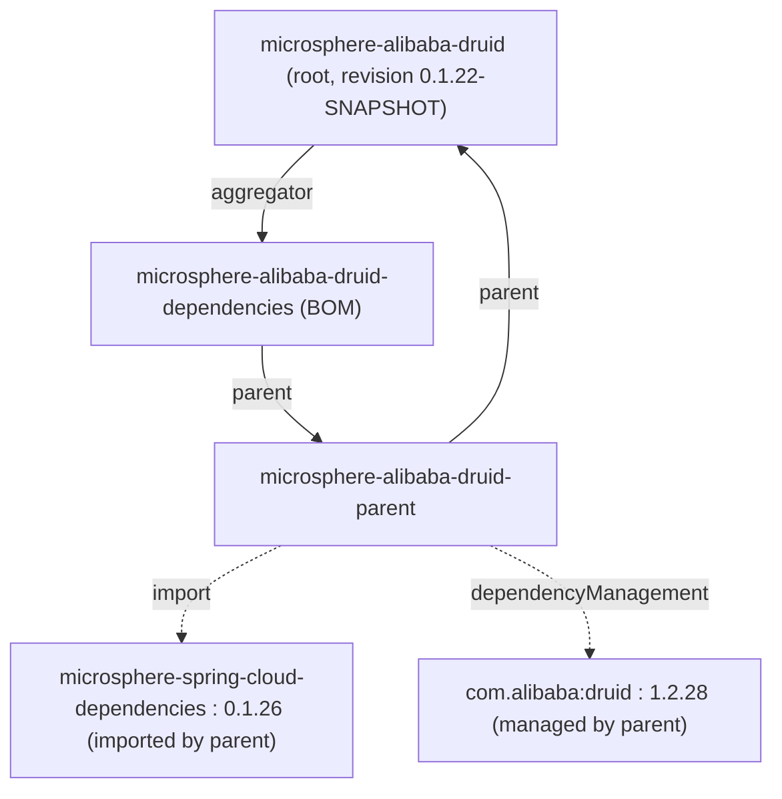
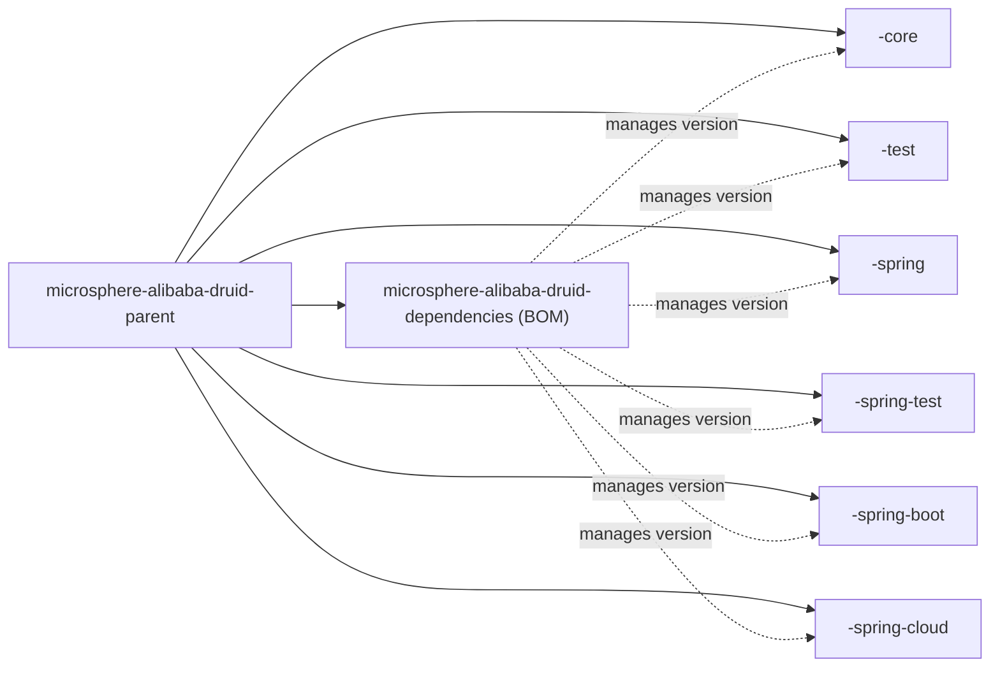

[中文](zh/microsphere-alibaba-druid-dependencies.md)

# microsphere-alibaba-druid-dependencies

> Build module: the **BOM** (bill of materials) for the project. It publishes the coordinates of the
> six published reactor artifacts under one `import`, so a consumer declares the version once and
> omits it per dependency.
> Packaging: `pom`. Parent: `microsphere-alibaba-druid-parent`.
> Repository home: [../../../README.md](../../../README.md) · [User Guide](../user-guide/README.md)

## Module view (what the BOM sits on)

The BOM inherits `microsphere-alibaba-druid-parent` (and therefore the root, the external Spring Cloud
parent chain, and Druid's version) — it does **not** stand alone. It manages only this project's own
artifact versions; third-party versions still come from the parent chain.



## Managed members

The BOM's `<dependencyManagement>` lists exactly **six** artifacts, all at `${revision}`:

| # | artifactId | Role |
|---|---|---|
| 1 | `microsphere-alibaba-druid-core` | L0 Druid `Filter` SPI implementations (`AbstractStatementFilter`, `LoggingStatementFilter`, `PropertyConstants`). |
| 2 | `microsphere-alibaba-druid-test` | Non-Spring test infrastructure (`AbstractAlibabaDruidTest`, `AlibabaDruidTestUtils`, JUnit 5 extension). |
| 3 | `microsphere-alibaba-druid-spring` | L1 Spring Framework integration (`@EnableAlibabaDruid`, `DruidDataSourceBeanPostProcessor`). |
| 4 | `microsphere-alibaba-druid-spring-test` | Spring-aware test infrastructure (`AbstractDruidSpringTest`, `DruidDataSourceTestConfiguration`). |
| 5 | `microsphere-alibaba-druid-spring-boot` | L2 Spring Boot auto-configuration. |
| 6 | `microsphere-alibaba-druid-spring-cloud` | L3 Spring Cloud packaging. |

The two `pom`-packaging modules — `microsphere-alibaba-druid-parent` (the version anchor) and
`microsphere-alibaba-druid-dependencies` (this BOM) — are deliberately **not** listed: you do not add
a BOM or a parent as a normal dependency. `com.alibaba:druid` is likewise **not** managed here — its
`1.2.28` version comes from the parent, per the [parent doc](microsphere-alibaba-druid-parent.md).

## Import usage

```xml
<dependencyManagement>
    <dependencies>
        <dependency>
            <groupId>io.github.microsphere-projects</groupId>
            <artifactId>microsphere-alibaba-druid-dependencies</artifactId>
            <version>${microsphere-alibaba-druid.version}</version>
            <type>pom</type>
            <scope>import</scope>
        </dependency>
    </dependencies>
</dependencyManagement>

<dependencies>
    <!-- no <version> needed; managed by the imported BOM -->
    <dependency>
        <groupId>io.github.microsphere-projects</groupId>
        <artifactId>microsphere-alibaba-druid-spring-boot</artifactId>
    </dependency>
</dependencies>
```

On `release-1.x` the resolved `${revision}` is the `0.1.x` line (latest release `0.1.21`,
in-development `0.1.22-SNAPSHOT`), so `microsphere-alibaba-druid.version` should be pinned to a
`0.1.x` value. Consumers on `main`/`release` use the `0.2.x` BOM instead.

## Relationship between the BOM and the other module POMs



Two distinct edges to be clear about:

- **Solid edges** (`parent → …`) are `<parent>` inheritance — every reactor module, including this
  BOM, inherits `microsphere-alibaba-druid-parent`.
- **Dashed edges** (`bom -.-> module`) are *version management* the BOM offers to **external**
  consumers who `import` it. Inside the reactor the modules don't need the BOM — they already share
  `${revision}` via the parent.

## Design points

- **Version indirection.** Every managed entry uses `${revision}`, never a literal, so the BOM stays
  consistent with the reactor automatically and requires no edits between releases.
- **Separation from `parent`.** The parent answers "what version is Druid / the Spring stack"; the
  BOM answers "what version are *our* six artifacts". Keeping them separate lets a non-Maven or
  parent-locked consumer still `import` a curated set of this project's coordinates.
- **Consumable, not build-driving.** Adding/removing a module here changes what `import`-ing
  consumers can resolve by artifactId, but changes nothing about how the reactor builds — the
  aggregator (root pom `<modules>`) controls that.

## 1.x notes

- This POM is **byte-identical** between `release-1.x` and `main` apart from line endings; the managed
  coordinates are all `${revision}` so the BOM body never encodes a version number. The difference a
  consumer sees is only which `0.1.x` (here) versus `0.2.x` (current) release they pin.
- Because the parent points at `microsphere-spring-cloud-dependencies:0.1.26` (via `parent`), importing
  this BOM does **not** transitively import that external BOM for the consumer — an `import` is
  single-level. Consumers wanting the Spring/Druid managed versions must import
  `microsphere-spring-cloud-dependencies` (or use `microsphere-alibaba-druid-parent` as their parent)
  themselves.

## Related

- [Developer Guide index](README.md)
- [microsphere-alibaba-druid-parent](microsphere-alibaba-druid-parent.md)
- [microsphere-alibaba-druid-core](microsphere-alibaba-druid-core.md)
- [microsphere-alibaba-druid-spring-boot](microsphere-alibaba-druid-spring-boot.md)
- [Repository README](../../../README.md)

---

## 中文

[中文版：microsphere-alibaba-druid-dependencies](zh/microsphere-alibaba-druid-dependencies.md)
