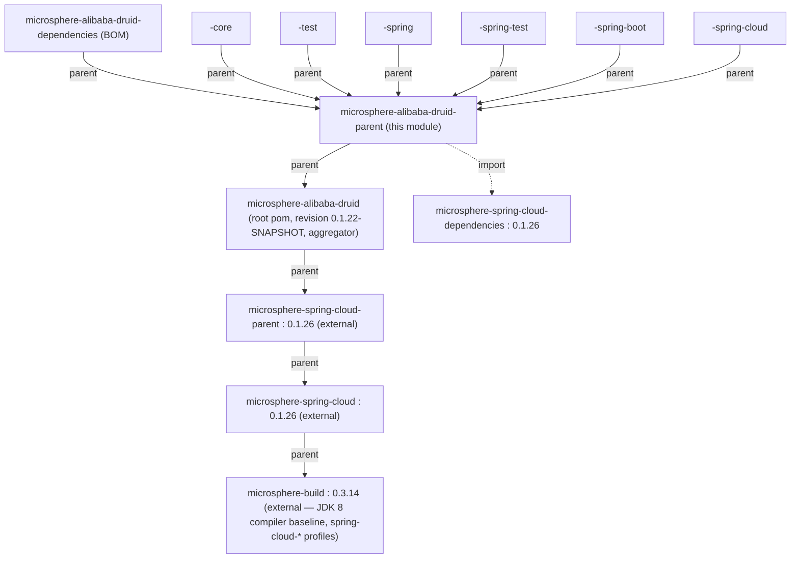

[中文](zh/microsphere-alibaba-druid-parent.md)

# microsphere-alibaba-druid-parent

> Build module: the shared `<parent>` of every reactor module. It centralises the third-party version
> pinning (Druid, the imported Microsphere Spring Cloud BOM) that all `*-alibaba-druid-*` artifacts
> inherit, and is itself a child of the repository root pom.
> Packaging: `pom`. Java baseline: **JDK 8** (inherited from the external parent chain).
> Repository home: [../../../README.md](../../../README.md) · [User Guide](../user-guide/README.md)

## Module view (position in the POM hierarchy)

`microsphere-alibaba-druid-parent` is the version/property anchor the *seven* child modules point at
with `<parent>`. Note it is **not** the aggregator: the aggregator is the root pom
(`microsphere-alibaba-druid`), and the parent pom's own `<parent>` is that root.



`microsphere-alibaba-druid-parent` is inherited by **all** of: `dependencies`, `core`, `test`,
`spring`, `spring-test`, `spring-boot`, `spring-cloud`. Each child declares
`<version>${revision}</version>` and points `<parent>` at it (with `<relativePath>../microsphere-alibaba-druid-parent/pom.xml</relativePath>`).

## POM analysis

The full `pom.xml` of this module on `release-1.x` is small and self-contained:

```xml
<parent>
    <groupId>io.github.microsphere-projects</groupId>
    <artifactId>microsphere-alibaba-druid</artifactId>
    <version>${revision}</version>
    <relativePath>../pom.xml</relativePath>
</parent>

<artifactId>microsphere-alibaba-druid-parent</artifactId>
<version>${revision}</version>
<packaging>pom</packaging>

<properties>
    <!-- BOM versions -->
    <microsphere-spring-cloud.version>0.1.26</microsphere-spring-cloud.version>
    <!-- Libraries -->
    <druid.version>1.2.28</druid.version>
</properties>

<dependencyManagement>
    <dependencies>
        <dependency>
            <groupId>com.alibaba</groupId>
            <artifactId>druid</artifactId>
            <version>${druid.version}</version>
        </dependency>
        <dependency>
            <groupId>io.github.microsphere-projects</groupId>
            <artifactId>microsphere-spring-cloud-dependencies</artifactId>
            <version>${microsphere-spring-cloud.version}</version>
            <type>pom</type>
            <scope>import</scope>
        </dependency>
    </dependencies>
</dependencyManagement>
```

Two managed things, nothing else:

| Managed entry | Value | Mechanism |
|---|---|---|
| `com.alibaba:druid` | `1.2.28` | Direct `<dependencyManagement>` version property `${druid.version}` — declared **in this repository**. |
| everything Spring/Boot/Microsphere | per `microsphere-spring-cloud-dependencies` | `import`-scope BOM at `${microsphere-spring-cloud.version}` = `0.1.26`. |

- **`${revision}` everywhere.** The module declares no literal version; the value `0.1.22-SNAPSHOT`
  lives only in the root pom's `<revision>` property, and every child (including this one) uses
  `<version>${revision}</version>`. This is the CI-friendly flattening setup (`.flattened-pom.xml`
  files are produced at build time), so a release is a single property bump at the root.
- **`druid.version` is a local property** so the version can be changed here without touching the
  imported BOM; `1.2.28` matches the [current line](../../current/developer-guide/README.md), i.e.
  the Druid version is *not* one of the differences between the two branch lines.
- **The `import` is the only transitive version source.** Spring, Spring Boot, Spring Cloud, JUnit,
  Microsphere utilities and `h2`/`logback` versions all resolve through
  `microsphere-spring-cloud-dependencies:0.1.26`, never declared in this repository — which is why a
  `release-1.x` consumer that changes this property sees an entirely different framework stack.

## The external parent chain (inherited, not declared here)

Neither the JDK baseline nor the Spring Cloud profiles are written in this repository. They are
inherited up the chain:

```
microsphere-alibaba-druid-parent
  → microsphere-alibaba-druid (root)
    → microsphere-spring-cloud-parent : 0.1.26        (external)
      → microsphere-spring-cloud : 0.1.26             (external)
        → microsphere-build : 0.3.14                  (external)
```

| Inherited concern | Where it is actually defined | Effect on `release-1.x` |
|---|---|---|
| `maven.compiler.source/target` | `microsphere-build:0.3.14` | `${java.version}` = **8** → class-file version 52, so the same jars load on JDK 8 through 25. |
| `<java.version>` | not set in this repo on 1.x | comes as `8` from `microsphere-build` (the `current` line overrides it to `17`). |
| `spring-cloud-hoxton` profile | external chain | Spring Boot `2.3.12.RELEASE` / Spring Cloud `Hoxton.SR12`. |
| `spring-cloud-2020` profile | external chain | Spring Boot `2.4.13` / Spring Cloud `2020.0.5`. |
| `spring-cloud-2021` profile | external chain | Spring Boot `2.6.15` / Spring Cloud `2021.0.9`. |
| `test` / `coverage` profiles | external chain | Surefire/coverage wiring used by CI. |

> These Boot/Cloud pairings are **inherited from the external POMs** (`microsphere-spring-cloud:0.1.26`
> → `microsphere-build:0.3.14`), *not* declared anywhere in this repository. Editing them requires an
> upstream release; do not add a local `<profiles>` block to "fix" them.

## CI build matrix

`.github/workflows/maven-build.yml` on `release-1.x` builds this reactor across:

```
java : 8 / 11 / 17 / 21 / 25
profile : spring-cloud-hoxton / spring-cloud-2020 / spring-cloud-2021
```

i.e. 5 JDKs × 3 Spring Cloud generations, each running
`mvn --batch-mode --update-snapshots test --activate-profiles test,coverage,<profile>` and uploading
coverage to Codecov. Because the compiler baseline is JDK 8 (from the chain), the sources must compile
under `-source/-target 8` *and* the tests must pass on every JDK up to 25 — that is the contributor
contract this parent enforces.

## Design points

- **Single anchor for inheritance, none for aggregation.** `parent` is what children `<parent>`; the
  root is the aggregator (`<modules>`). Keeping them separate means a consumer can `<parent>`-inherit
  the version management without dragging in the reactor module list.
- **`parent` vs `dependencies` (BOM).** `parent` = inheritance (properties + `dependencyManagement` a
  reactor child gets automatically). `dependencies` = importable BOM (the six reactor artifacts'
  coordinates, for *external* consumers). They serve different roles and are different modules — see
  [microsphere-alibaba-druid-dependencies](microsphere-alibaba-druid-dependencies.md).
- **Version indirection through two properties.** `druid.version` and
  `microsphere-spring-cloud.version` are the only knobs a release manager touches here; the framework
  matrix lives upstream.

## 1.x notes

- The distinguishing value on this line is `<microsphere-spring-cloud.version>0.1.26</microsphere-spring-cloud.version>`
  and root `<revision>0.1.22-SNAPSHOT</revision>`; on the `current` (`main`) line the same file reads
  `0.2.26` with `0.2.22-SNAPSHOT`. Everything else about the POM structure is identical.
- **JDK 8** is the compile contract enforced transitively via `microsphere-build:0.3.14`; there is no
  local `<java.version>` override here. Contributor code stays at the Java 8 language level.
- The three `spring-cloud-*` profiles and their Boot/Cloud version pairs are external — when
  documenting "which Spring Boot does 1.x support", cite Hoxton.SR12 / 2020.0.5 / 2021.0.9 as
  *inherited*, and never claim the repository declares them.

## Related

- [Developer Guide index](README.md)
- [microsphere-alibaba-druid-dependencies](microsphere-alibaba-druid-dependencies.md)
- [microsphere-alibaba-druid-spring-boot](microsphere-alibaba-druid-spring-boot.md)
- [Current-line developer guide](../../current/developer-guide/README.md)
- [Repository README](../../../README.md)

---

## 中文

[中文版：microsphere-alibaba-druid-parent](zh/microsphere-alibaba-druid-parent.md)
