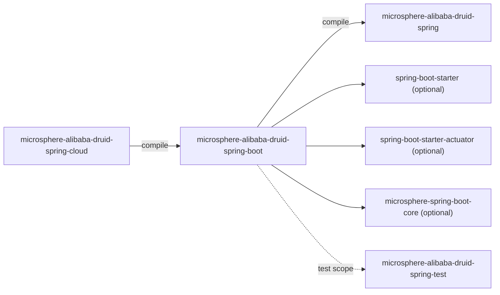
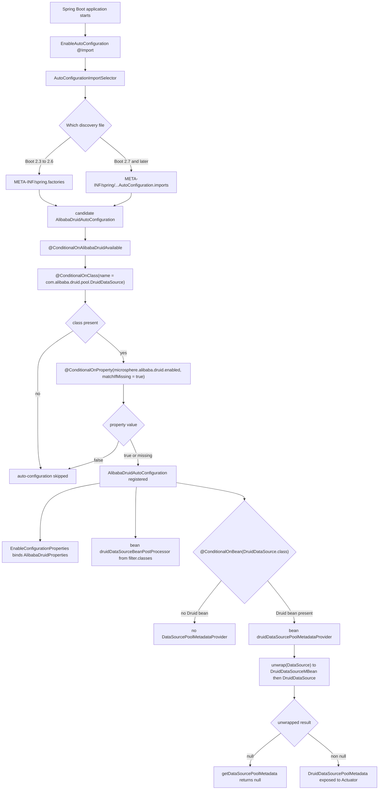

[中文](zh/microsphere-alibaba-druid-spring-boot.md)

# microsphere-alibaba-druid-spring-boot

> Layer L2: Spring Boot auto-configuration, externalised properties, composite conditions and
> Actuator pool metadata. Package roots: `io.microsphere.alibaba.druid.spring.boot` and
> `…spring.boot.autoconfigure` / `…condition` / `…metadata`.
> Repository home: [../../../README.md](../../../README.md) · [User Guide](../user-guide/README.md)

## Module view



Only `microsphere-alibaba-druid-spring` is a required dependency. Spring Boot, Actuator and the
Microsphere Boot helpers are `optional`, so the module compiles without forcing Boot onto a plain
Spring application; a Boot application supplies its own starters.

## Registration files (1.x specific)

Two discovery files ship side by side:

```properties
# src/main/resources/META-INF/spring/org.springframework.boot.autoconfigure.AutoConfiguration.imports
io.microsphere.alibaba.druid.spring.boot.autoconfigure.AlibabaDruidAutoConfiguration
```

```properties
# src/main/resources/META-INF/spring.factories  (added on release-1.x only)
org.springframework.boot.autoconfigure.EnableAutoConfiguration=\
io.microsphere.alibaba.druid.spring.boot.autoconfigure.AlibabaDruidAutoConfiguration
```

Why both: this line targets Spring Boot **2.3.12.RELEASE / 2.4.13 / 2.6.15** (see the
`spring-cloud-hoxton` / `-2020` / `-2021` profiles), which predate the `imports` file (introduced in
Boot 2.7) and read auto-configurations **only** from `spring.factories`. Boot 3.x, conversely, no
longer honours the `EnableAutoConfiguration` key in `spring.factories`. Since the produced classes are
Java 8 bytecode, the same 0.1.x artifact is consumable from 2.7+ and 3.x runtimes as well, so the
`imports` file is retained rather than replaced.

Maintainer rule: adding a new auto-configuration means editing **both** files. Deleting either one is
a compatibility break for half of the supported matrix. There is no `@AutoConfigureBefore` /
`@AutoConfigureAfter` ordering in this module, so registration order does not matter; duplicate class
entries are removed by `AutoConfigurationImportSelector.removeDuplicates` on Boot 2.7.

## Source analysis

### `io.microsphere.alibaba.druid.spring.boot.autoconfigure.AlibabaDruidAutoConfiguration`

```java
@ConditionalOnAlibabaDruidAvailable
@EnableConfigurationProperties(AlibabaDruidProperties.class)
public class AlibabaDruidAutoConfiguration {

    @Bean(name = BEAN_NAME)
    public BeanPostProcessor druidDataSourceBeanPostProcessor(AlibabaDruidProperties alibabaDruidProperties) {
        Filter filter = alibabaDruidProperties.getFilter();
        return new DruidDataSourceBeanPostProcessor(filter.getClasses());
    }

    @Bean
    @ConditionalOnBean(DruidDataSource.class)
    public DataSourcePoolMetadataProvider druidDataSourcePoolMetadataProvider() {
        return dataSource -> {
            DruidDataSource druidDataSource = unwrap(dataSource, DruidDataSourceMBean.class, DruidDataSource.class);
            return druidDataSource == null ? null : new DruidDataSourcePoolMetadata(druidDataSource);
        };
    }
}
```

- **No `@Configuration`** annotation. Auto-configuration classes discovered via `spring.factories` /
  `imports` are treated as configuration classes by `ConfigurationClassParser`; the annotation would
  only add noise. (The 1.x matrix spans Boot 2.3–2.6 where this is already the norm.)
- **`@ConditionalOnAlibabaDruidAvailable`** is the single class-level condition (composite, see below).
- **`@EnableConfigurationProperties(AlibabaDruidProperties.class)`** binds and registers the
  properties bean without requiring component scanning.
- `@Bean(name = BEAN_NAME)` reuses `DruidDataSourceBeanPostProcessor.BEAN_NAME`
  (`"druidDataSourceBeanPostProcessor"`), i.e. the *same* bean name the `@EnableAlibabaDruid`
  registrar writes. This is the de-duplication contract between L1 and L2: a user combining
  `@EnableAlibabaDruid` with Boot auto-configuration gets one post-processor definition, the later
  registration replacing the earlier one.
- The declared return type is `BeanPostProcessor` (the interface), not the concrete class — that is
  what lets Spring detect it as a post-processor from the bean *declaration* rather than the
  instantiation result, and it keeps the class a compile-time-only coupling to `spring`.
  Note the trade-off: down-stream injection by concrete type still works at runtime.
- Filter classes are taken from configuration, not from `@EnableAlibabaDruid`'s multi-source scan:
  auto-configuration does **not** run the `spring.factories`/`META-INF/services` discovery paths. If
  you need those, add `@EnableAlibabaDruid`.
- `druidDataSourcePoolMetadataProvider` is `@ConditionalOnBean(DruidDataSource.class)`, evaluated
  against bean definitions registered *earlier* in the refresh — a Druid data source declared later
  (e.g. by a user `@Configuration` processed after auto-configurations) can therefore suppress this
  bean. That is the documented reason the provider must be tolerant of `null` metadata anyway.
- `unwrap(dataSource, DruidDataSourceMBean.class, DruidDataSource.class)`
  (`org.springframework.boot.jdbc.DataSourceUnwrapper.unwrap`) probes the candidate types in order
  and unwraps proxies (`DataSourceProxy`, p6spy, `BeanFactory`-produced wrappers, JMX MBean
  adapters) until one type matches; if none matches, it returns `null` and the lambda returns `null`
  — which tells Boot's `DataSourcePoolMetadataProvidersConfiguration` chain that this provider does
  not own the data source. Returning `null` is required semantics, not an error path.
  Including `DruidDataSourceMBean.class` first is what allows a JMX-only-exposed Druid bean to be
  recognised.

### `io.microsphere.alibaba.druid.spring.boot.AlibabaDruidProperties`

```java
@ConfigurationProperties(prefix = ALIBABA_DRUID_PROPERTY_NAME_PREFIX)
public class AlibabaDruidProperties {
    private boolean enabled = true;
    private Filter filter = new Filter();
    public boolean isEnabled();  public void setEnabled(boolean enabled);
    public Filter getFilter();   public void setFilter(Filter filter);

    public static class Filter {
        private Class<? extends com.alibaba.druid.filter.Filter>[] classes = of(com.alibaba.druid.filter.Filter.class);
        public Class<? extends com.alibaba.druid.filter.Filter>[] getClasses();
        public void setClasses(Class<? extends com.alibaba.druid.filter.Filter>[] classes);
    }
}
```

- Prefix resolves to `microsphere.alibaba.druid`, consistent with `PropertyConstants`.
- Bound keys: `microsphere.alibaba.druid.enabled` (`boolean`, default `true`) and
  `microsphere.alibaba.druid.filter.classes` (array of class names, default `com.alibaba.druid.filter.Filter`).
  Boot's binder converts the comma-separated FQCN list into `Class[]` via its string-to-`Class`
  converter, which is why `assertArrayEquals(of(LoggingStatementFilter.class), classes)` succeeds in
  the integration test with `microsphere.alibaba.druid.filter.classes=io.microsphere.alibaba.druid.filter.LoggingStatementFilter`.
- The nested `Filter` class is instantiated eagerly (`new Filter()`) so that `getFilter()` is never
  `null` even with zero configuration; `classes` likewise defaults to the root `Filter` interface,
  meaning "add every filter bean".
- `Filter` must be a `static` nested class with a no-arg constructor to be bindable; it shadows the
  Druid type name on purpose, hence the fully-qualified `com.alibaba.druid.filter.Filter` in the
  signature. Keep both spellings when editing.
- `enabled` is **not** read by any Java code: the gate is `@ConditionalOnProperty` on the raw property
  name. The field exists for metadata, IDE completion and programmatic inspection. Changing the
  property name in `PropertyConstants` without updating `@ConditionalOnProperty` would leave the
  property bound but ineffective.
- `AlibabaDruidPropertiesTest` asserts the defaults and the setter round-trip.

### `io.microsphere.alibaba.druid.spring.boot.condition.ConditionalOnAlibabaDruidEnabled`

```java
@Target(TYPE)
@Retention(RUNTIME)
@Documented
@ConditionalOnProperty(name = ALIBABA_DRUID_ENABLED_PROPERTY_NAME, matchIfMissing = true)
public @interface ConditionalOnAlibabaDruidEnabled {
}
```

`matchIfMissing = true` — the feature is **on by default**; only an explicit
`microsphere.alibaba.druid.enabled=false` disables it. This is the property side of the gate.

### `io.microsphere.alibaba.druid.spring.boot.condition.ConditionalOnAlibabaDruidAvailable`

```java
@Target(TYPE)
@Retention(RUNTIME)
@Documented
@ConditionalOnAlibabaDruidEnabled
@ConditionalOnClass(name = {
        "com.alibaba.druid.pool.DruidDataSource"                   // Alibaba Druid API
})
public @interface ConditionalOnAlibabaDruidAvailable {
}
```

- **Composite `@Conditional` meta-annotation** pattern: two Spring Boot conditions are combined into
  one reusable, self-documenting annotation. Spring evaluates *all* meta-annotated conditions, so the
  semantics are AND: Druid classes present **and** the enabled flag not `false`.
- `@ConditionalOnClass(name = ...)` uses the **string** form instead of `value = DruidDataSource.class`.
  That is mandatory on this line: the condition class itself would otherwise reference the Druid type
  in its annotation descriptor and fail with `TypeNotPresentException`/`NoClassDefFoundError` before
  Boot can decide. Using `name` keeps the classpath check lazy and lets the module be deployed in an
  application without Druid.
- `@Target(TYPE)` restricts usage to classes (auto-configurations) — the two annotations are not
  applicable to methods by design.
- The same annotation is reused by `AlibabaDruidCloudAutoConfiguration`, which is why it lives in
  `…spring.boot.condition` and not inside `…spring.boot.autoconfigure`.

### `io.microsphere.alibaba.druid.spring.boot.metadata.DruidDataSourcePoolMetadata`

```java
public class DruidDataSourcePoolMetadata implements DataSourcePoolMetadata {
    private static final float ZERO = 0.0f;
    private static final float ONE = 1.0f;
    private final DruidDataSource dataSource;

    public Float getUsage()            // 0 when activeCount == 0, 1 when activeCount == maxActive, else active / (maxActive * ONE)
    public Integer getActive()         // dataSource.getActiveCount()
    public Integer getIdle()           // dataSource.getMaxIdle()
    public Integer getMax()            // dataSource.getMaxActive()
    public Integer getMin()            // dataSource.getMinIdle()
    public String getValidationQuery() // dataSource.getValidationQuery()
    public Boolean getDefaultAutoCommit() // dataSource.isDefaultAutoCommit()
}
```

- **`DataSourcePoolMetadataProvider` / `DataSourcePoolMetadata` adapter pattern**: it maps Druid's
  counter API onto the Actuator metric vocabulary so `/actuator/metrics/db.pool.*` works for Druid.
- `getUsage()` is deliberately branch-guarded: `active == 0` returns the cached `ZERO` and
  `active == maxActive` returns `ONE`, so the common extremes are exact and float division only runs
  in between. `maxActive * ONE` forces float arithmetic (integer division would yield `0`).
  Un-avoidable boundary: if `maxActive` is `0` and `activeCount != 0`, the result is
  `Infinity`/`NaN` — Druid's default `maxActive` is `8`, and the H2 test fixture leaves it at default,
  which is why `DruidDataSourcePoolMetadataTest` asserts `getMax() == 8`.
- **`getIdle()` returns `getMaxIdle()`**, not the live idle count. That is an intentional mapping
  (Druid exposes no plain "current idle" getter on the metric surface used here), but it means the
  Actuator `db.pool.idle` reading is a *capacity* number. Documented behaviour, not a bug to fix
  silently — changing it would alter dashboards.
- The class holds no mutable state and is not thread-wrapped: every call reads live counters, so
  concurrent metric scraping is safe.
- `getDefaultAutoCommit()` maps Druid's `isDefaultAutoCommit()` which returns `null` when the default
  was never set; the `Boolean` return type of the interface permits that.

## Auto-configuration condition evaluation flow



## Testing strategy

| Test | Mechanism | Assertion focus |
|---|---|---|
| `AlibabaDruidAutoConfigurationTest` | extends `io.microsphere.spring.boot.test.AutoConfigurationTest<AlibabaDruidAutoConfiguration>` under `@SpringBootTest(webEnvironment = NONE)` | declares `DruidDataSourceBeanPostProcessor` as the expected auto-configured class, `microsphere.alibaba.druid.enabled=false` as the global disable property, `DruidDataSource.class` as the global missing class — the base class then runs enabled/disabled/present/absent permutations against both registration files. |
| `AlibabaDruidAutoConfigurationIntegrationTest` | `@SpringBootTest` + `@EnableAutoConfiguration` with `properties = {"microsphere.alibaba.druid.enabled=true", "microsphere.alibaba.druid.filter.classes=io.microsphere.alibaba.druid.filter.LoggingStatementFilter"}`, extends `AbstractDruidSpringTest` | real SQL matrix executes through the auto-registered post-processor; asserts `AlibabaDruidProperties`, `LoggingStatementFilter` bean, `filter.classes` array and `provider.getDataSourcePoolMetadata(dataSource)` being a `DruidDataSourcePoolMetadata`. |
| `DruidDataSourcePoolMetadataTest` | direct instantiation over the default H2 data source | `usage`/`active`/`idle`/`max`/`min` values. |
| `AlibabaDruidPropertiesTest` | plain unit test | defaults and setters. |

`assertInstanceOf` (used by the integration test) is JUnit Jupiter 5.8+; the Jupiter version comes
from `microsphere-spring-cloud-dependencies:0.1.26`, not from this repository.

## Design patterns

- **Auto-configuration + `@Conditional`** (Boot idiom) with **composite meta-annotation** conditions.
- **`@EnableConfigurationProperties` / typesafe configuration binding** (`AlibabaDruidProperties`).
- **Provider/Strategy** — `DataSourcePoolMetadataProvider` as a pluggable strategy with `null` =
  "not mine".
- **Adapter** — `DruidDataSourcePoolMetadata` adapting Druid counters to Actuator's interface.
- **Delegating instantiation** — the `@Bean` method builds a `DruidDataSourceBeanPostProcessor` rather
  than registering the class, so constructor arguments come from properties.

## 1.x notes

- `spring.factories` in `src/main/resources/META-INF/` **exists only on `release-1.x`**; the current
  line relies on `AutoConfiguration.imports` alone. Do not cherry-pick its removal into 1.x.
- Java 8 source level: no `List.of`, no `var`; note `of(com.alibaba.druid.filter.Filter.class)` comes
  from `io.microsphere.util.ArrayUtils`.
- Boot 2.3–2.6 has no `@AutoConfiguration` annotation (added in Boot 2.7) — which is another reason
  the class carries no annotation of that kind; keep using plain conditional annotations here.
- `DataSourceUnwrapper.unwrap` with varargs of candidate classes is available since Boot 2.1, so all
  three matrix generations support it.

## Related

- [Developer Guide index](README.md)
- [microsphere-alibaba-druid-spring](microsphere-alibaba-druid-spring.md)
- [microsphere-alibaba-druid-spring-cloud](microsphere-alibaba-druid-spring-cloud.md)
- [microsphere-alibaba-druid-parent](microsphere-alibaba-druid-parent.md)
- [User Guide](../user-guide/README.md)
- [Repository README](../../../README.md)

---

## 中文

[中文版：microsphere-alibaba-druid-spring-boot](zh/microsphere-alibaba-druid-spring-boot.md)
