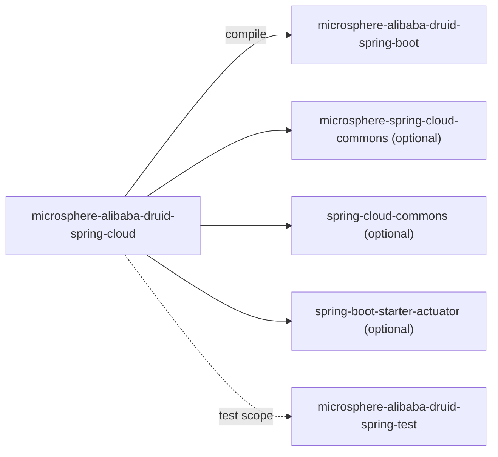
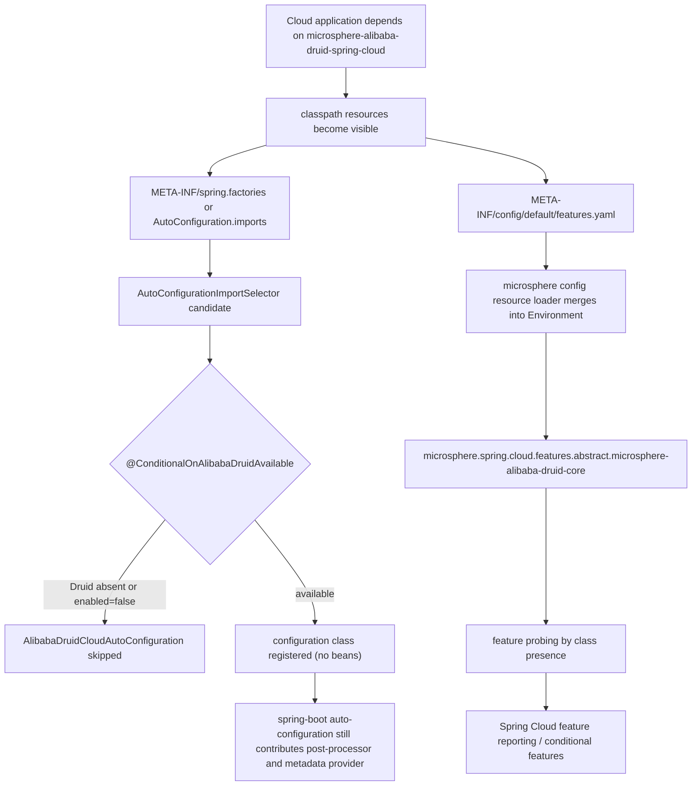

[中文](zh/microsphere-alibaba-druid-spring-cloud.md)

# microsphere-alibaba-druid-spring-cloud

> Layer L3: the Spring Cloud-facing packaging of the stack. It contributes **one conditional
> auto-configuration shell** plus a `features.yaml` descriptor; all real behaviour is inherited from
> lower layers. Package root: `io.microsphere.alibaba.druid.spring.cloud`.
> Repository home: [../../../README.md](../../../README.md) · [User Guide](../user-guide/README.md)

## Module view



`microsphere-alibaba-druid-spring-boot` (and transitively `-spring` and `-core`) is the only required
dependency; Spring Cloud, Spring Cloud Commons, Boot starters and the Actuator are all `optional`, so
adding this module to a non-Cloud application does not drag Cloud onto the classpath.

## Source analysis

### `io.microsphere.alibaba.druid.spring.cloud.autoconfigure.AlibabaDruidCloudAutoConfiguration`

```java
@ConditionalOnAlibabaDruidAvailable
public class AlibabaDruidCloudAutoConfiguration {
}
```

This is intentionally an **empty shell**. Reading it as "dead code" misses the three things it does:

1. **It is a registration subject.** Being listed in the discovery files means it participates in
   Boot's auto-configuration sort and condition evaluation, giving the module a well-defined place in
   the context lifecycle.
2. **It carries the gate.** `@ConditionalOnAlibabaDruidAvailable` (from the `spring-boot` module:
   `@ConditionalOnClass(name = "com.alibaba.druid.pool.DruidDataSource")` **AND**
   `@ConditionalOnProperty(name = "microsphere.alibaba.druid.enabled", matchIfMissing = true)`) means
   everything added to this class in the future is automatically disabled when Druid is absent or the
   feature is switched off. The condition is the extension point; the body is the payload.
3. **It anchors the module's metadata.** The artifact's classpath resource
   `META-INF/config/default/features.yaml` is only visible to Spring Cloud feature tooling when the
   jar is actually a dependency; the auto-configuration is the canonical "this module is active" hook
   that the cloud layer can key off.

It declares **no** `@Bean` methods, no `@EnableConfigurationProperties`, and does not re-declare
`@ConditionalOnClass` — it reuses the composite annotation, which is what keeps Boot's
`ConditionEvaluationReport` readable (one condition name for both auto-configurations).

Because the class defines no beans, the 1.x `spring.factories` entry and the `AutoConfiguration.imports`
entry produce a registered-but-empty configuration class on Boot 2.3–2.6. That is expected: the test
`AlibabaDruidCloudAutoConfigurationTest` asserts exactly this by supplying an *empty*
`configureAutoConfiguredClasses(Set<Class<?>>)` callback.

### `src/main/resources/META-INF/spring/org.springframework.boot.autoconfigure.AutoConfiguration.imports`

```
io.microsphere.alibaba.druid.spring.cloud.autoconfigure.AlibabaDruidCloudAutoConfiguration
```

### `src/main/resources/META-INF/spring.factories` (1.x only)

```properties
org.springframework.boot.autoconfigure.EnableAutoConfiguration=\
io.microsphere.alibaba.druid.spring.cloud.autoconfigure.AlibabaDruidCloudAutoConfiguration
```

Same dual-registration contract as the `spring-boot` module (Boot 2.x reads `spring.factories`,
Boot 2.7+ reads `imports` and de-duplicates, Boot 3.x ignores the `EnableAutoConfiguration` key). Both
files must be kept in sync; on `release-1.x` removing `spring.factories` silently disables the module
for every Boot 2.3–2.6 application.

### `src/main/resources/META-INF/config/default/features.yaml`

```yaml
microsphere:
  spring:
    cloud:
      features:
        abstract:
          microsphere-alibaba-druid-core:
            - com.alibaba.druid.pool.DruidDataSource
            - com.alibaba.druid.filter.Filter
```

Structure and semantics:

| Path segment | Meaning |
|---|---|
| `microsphere.spring.cloud.features` | Property prefix owned by `microsphere-spring-cloud-commons` (external). |
| `abstract` | The category of feature: *abstract* features are declared capabilities rather than instantiated beans. |
| `microsphere-alibaba-druid-core` | Feature key — here the **artifactId of the module that owns the capability**, even though the file lives in the `spring-cloud` jar. |
| list of strings | Fully-qualified class names whose **presence on the classpath** defines whether the feature is realised. |

Mechanically, this YAML is loaded by microsphere's classpath configuration-resource convention
(`META-INF/config/<profile>/features.yaml`, with `default` being the fallback profile directory) and
merged into the Spring `Environment` as `microsphere.spring.cloud.features.abstract.*` properties. The
feature machinery in `microsphere-spring-cloud-commons` then answers "is feature X available?" by
probing the listed classes, which is how Spring Cloud–level components (conditional feature gates,
capability reporting) can reason about Alibaba Druid without depending on the Druid API themselves.

Two consequences for contributors:

- **The consumer of this file is external** (`microsphere-spring-cloud-commons`), so its key layout must
  not be changed unilaterally; renaming `abstract` or the artifact key breaks upstream reporting.
- The feature is keyed on `microsphere-alibaba-druid-core` while the file ships in
  `microsphere-alibaba-druid-spring-cloud`. That is deliberate — the *capability* belongs to `core`
  (interception filters), the *declaration* belongs to the module that a Cloud application actually
  depends on.

## Cloud activation flow



## Testing

| Test | Focus |
|---|---|
| `AlibabaDruidCloudAutoConfigurationTest` | Extends `AutoConfigurationTest<AlibabaDruidCloudAutoConfiguration>`; registers **no** expected auto-configured class, disables via `microsphere.alibaba.druid.enabled=false`, simulates absence via `DruidDataSource.class` missing. Proves the shell is conditional and empty. |
| `AlibabaDruidCloudAutoConfigurationIntegrationTest` | Boots the context with the cloud module on the classpath and runs the inherited `AbstractDruidSpringTest` statement matrix, proving the auto-configurations from L2 remain effective in a Cloud context. |

Both run under the three `spring-cloud-*` profiles on `release-1.x`, so the class is compiled and
tested against Hoxton.SR12, 2020.0.5 and 2021.0.9.

## Design patterns

- **Marker/auto-configuration shell** — a conditional, behaviour-free class used as an extension hook
  and as a metadata anchor.
- **Composite `@Conditional` reuse** — the gate is defined once in `spring-boot` and applied here.
- **Externalised capability descriptor** — `features.yaml` as declarative metadata consumed by another
  library (Configuration File / Feature-Flag pattern rather than code coupling).
- **Layering by composition** — L3 adds no logic; it re-exports L0–L2 under the Cloud contract.

## 1.x notes

- The `spring.factories` file in this module is **1.x-only**; it is the reason this branch line exists
  as a separate artifact set (`0.1.x`) rather than a runtime flag.
- JDK 8 baseline: nothing here uses newer language features; the module compiles under
  `maven.compiler.source/target=8` inherited from `microsphere-build:0.3.14` through
  `microsphere-spring-cloud:0.1.26`.
- On Boot 2.3–2.6 the `@ConditionalOnClass` string form is essential; Boot 2.4 in particular changed
  `spring.factories` loading order for `EnableAutoConfiguration`, but the `imports`/`factories` pair
  keeps both paths consistent.

## Related

- [Developer Guide index](README.md)
- [microsphere-alibaba-druid-spring-boot](microsphere-alibaba-druid-spring-boot.md)
- [microsphere-alibaba-druid-parent](microsphere-alibaba-druid-parent.md)
- [User Guide](../user-guide/README.md)
- [Repository README](../../../README.md)

---

## 中文

[中文版：microsphere-alibaba-druid-spring-cloud](zh/microsphere-alibaba-druid-spring-cloud.md)
