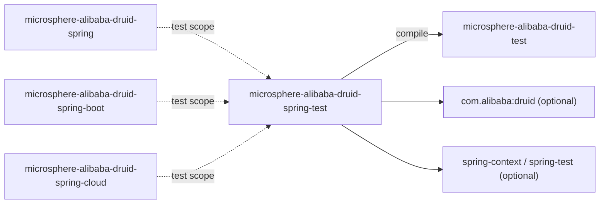
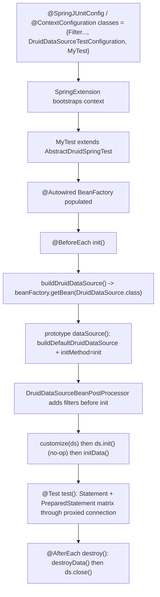

[中文](zh/microsphere-alibaba-druid-spring-test.md)

# microsphere-alibaba-druid-spring-test

> Support module (Spring-aware): a thin bridge that lets the non-Spring `AbstractAlibabaDruidTest`
> template obtain its `DruidDataSource` from a Spring `BeanFactory`, plus a reusable test
> configuration that produces the data-source bean.
> Package root: `io.microsphere.alibaba.druid.test.spring`. Java baseline: **JDK 8**.
> Repository home: [../../../README.md](../../../README.md) · [User Guide](../user-guide/README.md)

## Module view

`spring-test` has exactly **one required dependency**: `microsphere-alibaba-druid-test` (compile,
`${revision}`). Spring Framework, Spring `spring-test`, Druid and H2 are all `optional`, so it adds
Spring-awareness without forcing a Spring version onto consumers — the version comes from the parent
chain.



| Dependency | Scope | Why |
|---|---|---|
| `microsphere-alibaba-druid-test` | **compile (required)** | `AbstractDruidSpringTest` extends `AbstractAlibabaDruidTest` and reuses its lifecycle. |
| `spring-context`, `spring-test` | optional | `@Bean`/`@Scope`, `BeanFactory`, `SpringExtension`, `@ContextConfiguration`. |
| `com.alibaba:druid` | optional | The `DruidDataSource` type produced/consumed. |
| `microsphere-spring-context`, `microsphere-spring-test` | optional | Microsphere Spring test helpers (declared for the downstream Spring tests). |
| `h2`, `logback-classic` (optional), `microsphere-logback` (test) | optional / test | The in-memory DB and log backend used by the inherited SQL matrix. |

The three runtime modules (`spring`, `spring-boot`, `spring-cloud`) each depend on `spring-test` in
`test` scope, which is why every Spring-level integration test in this repository descends from
`AbstractDruidSpringTest` and lists `DruidDataSourceTestConfiguration` in its context.

## Source analysis

### `io.microsphere.alibaba.druid.test.spring.AbstractDruidSpringTest`

```java
public abstract class AbstractDruidSpringTest extends AbstractAlibabaDruidTest {

    @Autowired
    private BeanFactory beanFactory;

    @Override
    protected DruidDataSource buildDruidDataSource() {
        return beanFactory.getBean(DruidDataSource.class);
    }
}
```

- **The whole bridge is one method override.** Everything else — the `@BeforeEach` lifecycle
  (`buildDruidDataSource → customize → init → initData`), the `test()` SQL matrix, the `@AfterEach`
  (`destroyData → close`) — is inherited unchanged from
  [AbstractAlibabaDruidTest](microsphere-alibaba-druid-test.md#iomicrospherealibabadruidtestabstractalibabadruidtest).
  Overriding `buildDruidDataSource()` to pull the bean from the container is the single integration
  point between the Spring `BeanFactory` and the non-Spring test template.
- `beanFactory` is injected with `@Autowired`, so the class must run under a Spring test context
  (`SpringExtension` / `@ContextConfiguration`, or `@SpringBootTest` in the Boot/Cloud tests). Without
  the Spring bootstrap the field is `null` and `buildDruidDataSource()` NPEs at `@BeforeEach`.
- The override **drops the `throws IOException`** from the parent signature — `getBean` cannot throw
  it — but stays a legal narrowing.
- **Interaction with the base lifecycle**: because the base `@BeforeEach` still calls `ds.init()` and
  `@AfterEach` still calls `ds.close()`, the data-source returned by `buildDruidDataSource()` must
  tolerate double initialization / double closing. It does: `DruidDataSource.init()` short-circuits
  when already inited, and `AbstractAlibabaDruidTest`'s close is guarded. This is exactly why the
  companion configuration pairs a prototype scope with `initMethod`/`destroyMethod` (below) without
  conflict.

### `io.microsphere.alibaba.druid.test.spring.DruidDataSourceTestConfiguration`

```java
public class DruidDataSourceTestConfiguration {

    @Bean(initMethod = "init", destroyMethod = "close")
    @Scope(SCOPE_PROTOTYPE)
    public DruidDataSource dataSource() throws IOException {
        return buildDefaultDruidDataSource();
    }
}
```

- **Prototype scope is the load-bearing decision.** Each `beanFactory.getBean(DruidDataSource.class)`
  call (i.e. each `@BeforeEach`) yields a **fresh** `DruidDataSource`, configured from
  `AlibabaDruidTestUtils.buildDefaultDruidDataSource()`. That matters for two reasons:
  1. The inherited `initData()`/`destroyData()` create and drop the `users` table per test method — a
     per-instance source keeps that state from leaking between tests (no cross-test table races,
     no shared filter counters).
  2. `DruidDataSourceBeanPostProcessor` (see
     [spring module](microsphere-alibaba-druid-spring.md)) appends filters to `getProxyFilters()` with
     **no de-duplication and no idempotency guard**; a prototype gets a clean filter list every time,
     whereas a singleton re-initialized across tests would accumulate duplicates.
- **`initMethod = "init"`** runs at bean creation, so `customize`-installed filters (added by
  `getProxyFilters().add(...)` before the base `init()`) receive their `Filter.init(DataSourceProxy)`
  callback. `init()` then being called again by the base `@BeforeEach` is a no-op (Druid guards on the
  inited flag).
- **`destroyMethod = "close"`** is declared for completeness, but Spring does **not** track
  prototype-scoped beans for destruction callbacks — so in practice disposal comes from the base
  class's `@AfterEach close()`, which is idempotent. Declaring `destroyMethod` still suppresses
  Spring's "inferred destroy method" heuristic and documents intent.
- **No `@Configuration`** on the class: it is registered as a configuration *candidate* through
  `@ContextConfiguration(classes = { DruidDataSourceTestConfiguration.class, ... })`, i.e. Spring's
  "lite mode" `@Bean` processing. That keeps the fixture free of extra proxying while still exposing
  the `dataSource()` bean.

## How a Spring filter test is assembled



## Design patterns

- **Adapter / Bridge** — `AbstractDruidSpringTest` bridges Spring's `BeanFactory` into a framework-agnostic
  template method; the parent never knows the object came from a container.
- **Template Method (reused)** — no lifecycle logic is re-implemented; only the object source changes.
- **Test fixture configuration** — `DruidDataSourceTestConfiguration` is a reusable `@Bean` provider
  composed into many different contexts across the `spring`/`spring-boot`/`spring-cloud` test suites.
- **Prototype-per-test isolation** — the canonical Spring-test idiom of a stateful, per-invocation
  collaborator, chosen here specifically to keep the Druid filter list and table state clean.

## 1.x notes

- **Source-identical to the `current` line.** This module has no `spring.factories`, no auto-
  configuration and no version-specific API; the only `release-1.x` differences live in the
  `spring-boot`/`spring-cloud` registration files and the `microsphere-alibaba-druid-test` structure.
- **JDK 8 baseline**: `buildDefaultDruidDataSource()` and `dataSource()` simply throw `IOException`;
  no try-with-resources or Java 9+ constructs are needed here.
- Because downstream Spring tests import this configuration, a change to the bean's scope or lifecycle
  methods ripples into `EnableAlibabaDruidTest`, `DruidDataSourceBeanPostProcessorTest`,
  `AlibabaDruidAutoConfigurationIntegrationTest` and `AlibabaDruidCloudAutoConfigurationIntegrationTest`
  — treat this fixture as shared API.

## Testing

| Test class | Where | What it pins down |
|---|---|---|
| `DefaultDruidSpringTest` | this module (`src/test`) | `@ExtendWith(SpringExtension.class)` + `@ContextConfiguration({ DruidDataSourceTestConfiguration.class, DefaultDruidSpringTest.class })`, an empty subclass. Proves the container-sourced prototype runs the full inherited SQL matrix end-to-end. |
| `EnableAlibabaDruidTest`, `DruidDataSourceBeanPostProcessorTest` | `microsphere-alibaba-druid-spring` | Extend `AbstractDruidSpringTest` to exercise multi-source filter discovery against a Spring-managed source. |
| `AlibabaDruidAutoConfigurationIntegrationTest`, `AlibabaDruidCloudAutoConfigurationIntegrationTest` | `spring-boot` / `spring-cloud` | Extend `AbstractDruidSpringTest` under a Boot context, proving the auto-registered post-processor injects into the prototype source. |

Run only this module: `mvn -pl microsphere-alibaba-druid-spring-test -am test -P spring-cloud-2021`.

## Related

- [Developer Guide index](README.md)
- [microsphere-alibaba-druid-test](microsphere-alibaba-druid-test.md)
- [microsphere-alibaba-druid-spring](microsphere-alibaba-druid-spring.md)
- [microsphere-alibaba-druid-spring-boot](microsphere-alibaba-druid-spring-boot.md)
- [User Guide](../user-guide/README.md)
- [Repository README](../../../README.md)

---

## 中文

[中文版：microsphere-alibaba-druid-spring-test](zh/microsphere-alibaba-druid-spring-test.md)
