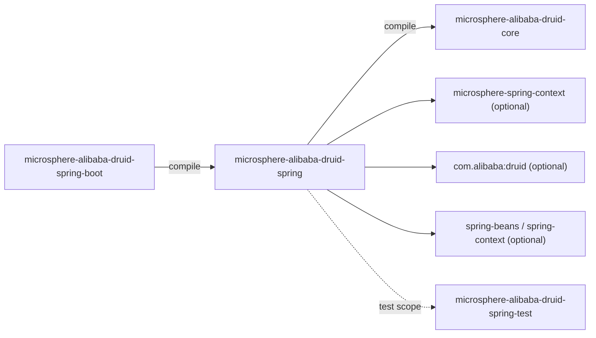
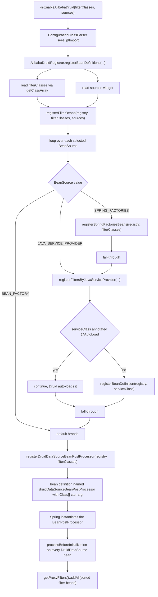

[中文](zh/microsphere-alibaba-druid-spring.md)

# microsphere-alibaba-druid-spring

> Layer L1: Spring Framework integration — multi-source `Filter` discovery and injection into every
> `DruidDataSource`. Package root: `io.microsphere.alibaba.druid.spring`.
> Repository home: [../../../README.md](../../../README.md) · [User Guide](../user-guide/README.md)

## Module view



| Dependency | Scope | Role |
|---|---|---|
| `microsphere-alibaba-druid-core` | **compile (required)** | The `Filter` types being discovered (`${revision}`). |
| `microsphere-spring-context` | optional | `BeanSource`, `AnnotatedBeanCapableImportBeanDefinitionRegistrar`, `BeanRegistrar`, `GenericBeanPostProcessorAdapter`, `ResolvablePlaceholderAnnotationAttributes`. |
| `spring-beans`, `spring-context` | optional | `BeanDefinitionRegistry`, `BeanNameGenerator`, `BeanFactory`, `AnnotationAwareOrderComparator`. |
| `druid` | optional | `Filter`, `AutoLoad`, `DruidDataSource`. |
| `spring-test` | optional | Used by test classes that live in `src/test`. |

The whole Spring stack being `optional` means the module can be compiled against any Spring version
managed by the parent BOM and that applications choose their own Spring; the only mandatory artifact
is `core`.

## Source analysis

### `io.microsphere.alibaba.druid.spring.context.annotation.EnableAlibabaDruid`

```java
@Target({TYPE, ANNOTATION_TYPE})
@Retention(RUNTIME)
@Documented
@Import(AlibabaDruidRegistrar.class)
public @interface EnableAlibabaDruid {
    Class<? extends Filter>[] filterClasses() default {Filter.class};
    BeanSource[] sources() default {BEAN_FACTORY, SPRING_FACTORIES};
}
```

- **`@Import` + `ImportBeanDefinitionRegistrar`** pattern: the annotation itself registers no beans;
  it imports the registrar, which writes bean definitions directly into the `BeanDefinitionRegistry`.
  This is what makes the filter classes *container-managed* (so they get `@Autowired`, `@Value`,
  lifecycle callbacks and `@Order` treatment) instead of being `new`-ed by the framework.
- `@Target({TYPE, ANNOTATION_TYPE})` allows the annotation to be used as a **meta-annotation**, so a
  project can define `@EnableMyDruid` that pre-selects sources.
- `filterClasses()` defaults to `{Filter.class}` — the root interface, so **all** discoverable filters
  are candidates by default; narrowing it (e.g. `AbstractStatementFilter.class`) restricts the search.
- `sources()` defaults to `{BEAN_FACTORY, SPRING_FACTORIES}`; `BEAN_FACTORY` is what triggers the
  `DruidDataSourceBeanPostProcessor` registration.
- Because the attribute types are `Class[]` / enum arrays wrapped by
  `ResolvablePlaceholderAnnotationAttributes`, values are read **after** placeholder resolution —
  the registrar must use `annotationAttributes.getClassArray(...)` / `.get(...)`, not the raw
  `AnnotationMetadata`.

### `io.microsphere.alibaba.druid.spring.context.annotation.AlibabaDruidRegistrar`

Package-private (`class AlibabaDruidRegistrar extends
AnnotatedBeanCapableImportBeanDefinitionRegistrar<EnableAlibabaDruid>`), so it is only reachable
through `@EnableAlibabaDruid` — deliberate encapsulation; contributors cannot import the registrar
directly and expect stable behaviour.

```java
@Override
protected void registerBeanDefinitions(AnnotationMetadata metadata, BeanDefinitionRegistry registry,
                                       BeanNameGenerator importBeanNameGenerator,
                                       ResolvablePlaceholderAnnotationAttributes<EnableAlibabaDruid> annotationAttributes) {
    Class<? extends Filter>[] filterClasses = (Class<? extends Filter>[]) annotationAttributes.getClassArray("filterClasses");
    BeanSource[] sources = (BeanSource[]) annotationAttributes.get("sources");
    registerFilterBeans(registry, filterClasses, sources);
}

private void registerFilterBeans(BeanDefinitionRegistry registry, Class<? extends Filter>[] filterClasses, BeanSource[] sources) {
    for (BeanSource source : sources) {
        switch (source) {
            case SPRING_FACTORIES:
                registerFiltersBySpringFactories(registry, filterClasses);
            case JAVA_SERVICE_PROVIDER:
                registerFiltersByJavaServiceProvider(registry, filterClasses);
            case BEAN_FACTORY:
            default:
                registerDruidDataSourceBeanPostProcessor(registry, filterClasses);
        }
    }
}
```

**The `switch` fall-through is intentional and is the single most misunderstood piece of this module.**
There are no `break` statements, so each iteration runs a *cascade*:

| Selected `sources` | Effective work per element |
|---|---|
| `SPRING_FACTORIES` | factories registration **+** service-loader registration **+** post-processor registration |
| `JAVA_SERVICE_PROVIDER` | service-loader registration **+** post-processor registration |
| `BEAN_FACTORY` | post-processor registration only |
| anything unknown (`default`) | post-processor registration only |

Consequences a contributor must preserve:

1. The `DruidDataSourceBeanPostProcessor` bean definition is registered **whenever any source is
   selected** — it is the tail of the fall-through and the `default` branch. An empty `sources`
   array registers nothing at all.
2. Selecting `SPRING_FACTORIES` *also* performs service-loader scanning; you cannot get "factories
   only".
3. Adding a `break` after `case SPRING_FACTORIES` would silently change behaviour for existing users —
   treat the fall-through as API.
4. `registerDruidDataSourceBeanPostProcessor` always uses the fixed name `BEAN_NAME`, so repeated
   `@EnableAlibabaDruid` annotations (e.g. two configs on the same hierarchy) collapse into **one**
   bean definition: the last registration wins for the constructor argument, because a bean definition
   with the same name replaces the previous one.

**Service-loader path with `@AutoLoad` exemption:**

```java
private void registerFiltersByJavaServiceProvider(BeanDefinitionRegistry registry, Class<? extends Filter>[] filterClasses) {
    for (Class<? extends Filter> filterClass : filterClasses) {
        Set<? extends Class<? extends Filter>> serviceClasses = getServiceClasses(filterClass, classLoader);
        for (Class<? extends Filter> serviceClass : serviceClasses) {
            if (serviceClass.isAnnotationPresent(AutoLoad.class)) {
                // Any filter class annotated @AutoLoad will be added into DruidDataSource automatically,
                // so it will be ignored here.
                continue;
            }
            registerBeanDefinition(registry, serviceClass);
        }
    }
}
```

- `getServiceClasses(...)` (`io.microsphere.util.ServiceLoaderUtils`) reads
  `META-INF/services/<filterClassName>` and returns the **classes** (not instances) so that Spring,
  not `ServiceLoader`, owns instantiation — that is what lets filters be injected.
- The `classLoader` field is inherited from the microsphere registrar base class.
- **`@AutoLoad` exemption**: Druid itself scans `@AutoLoad` filters and adds them to every
  `DruidDataSource` it creates. Registering such a filter as a Spring bean *and* letting Druid
  auto-load it would attach it **twice** (double logging, double counters), hence the `continue`.
  This is exactly why the test fixture provides `AutoLoadFilter` (`@AutoLoad`, must *not* become a
  bean) and `LoadFilter` (no annotation, must become a bean).
- The filters' own `init(DataSourceProxy)` is still invoked by `DruidDataSource.init()`, so the
  exemption only concerns registration, not lifecycle.

**Spring Factories path:** `registerSpringFactoriesBeans(registry, filterClasses)` delegates to
`BeanRegistrar` and uses each `filterClasses` entry as the **factories key**. The test resource proves
the contract — the key is the type name, the value is a comma/backslash-continued list of implementations:

```properties
# microsphere-alibaba-druid-spring/src/test/resources/META-INF/spring.factories
io.microsphere.alibaba.druid.filter.AbstractStatementFilter=\
io.microsphere.alibaba.druid.filter.TestStatementFilter
```

Note this is *not* the Boot `EnableAutoConfiguration` key — here `spring.factories` is used as a
generic Microsphere/Spring `SpringFactoriesLoader` registry for the `Filter` SPI.

**Post-processor path:**

```java
private void registerDruidDataSourceBeanPostProcessor(BeanDefinitionRegistry registry, Class<? extends Filter>[] filterClasses) {
    String beanName = BEAN_NAME;
    Class<?> beanClass = DruidDataSourceBeanPostProcessor.class;
    Object argument = filterClasses;
    registerBeanDefinition(registry, beanName, beanClass, argument);
}
```

A constructor-argument bean definition (not a supplier/`@Bean`), which is why
`DruidDataSourceBeanPostProcessor` must keep its `Class<? extends Filter>[]` constructor.

### `io.microsphere.alibaba.druid.spring.beans.factory.config.DruidDataSourceBeanPostProcessor`

```java
public class DruidDataSourceBeanPostProcessor extends GenericBeanPostProcessorAdapter<DruidDataSource> implements BeanFactoryAware {

    public static final String BEAN_NAME = "druidDataSourceBeanPostProcessor";
    private static final Logger logger = getLogger(DruidDataSourceBeanPostProcessor.class);
    private final Class<? extends Filter>[] filterBeanClasses;
    private BeanFactory beanFactory;

    public DruidDataSourceBeanPostProcessor()                                  // of(Filter.class)
    public DruidDataSourceBeanPostProcessor(Class<? extends Filter>[] filterBeanClasses)
    @Override protected void processBeforeInitialization(DruidDataSource druidDataSource, String beanName) throws BeansException
    protected void initializeFilterBeans(DruidDataSource druidDataSource)
    @Override public void setBeanFactory(BeanFactory beanFactory) throws BeansException
}
```

- **BeanPostProcessor hook pattern**: `GenericBeanPostProcessorAdapter<DruidDataSource>` narrows
  Spring's `BeanPostProcessor` to type-matched beans and exposes `processBeforeInitialization`, so
  the code does not need `instanceof`/casting.
- "Before initialization" is the **only valid moment**: `DruidDataSource.init()` iterates
  `proxyFilters` and calls `Filter.init(DataSourceProxy)`; filters added afterwards never receive
  `init()` and therefore keep `dataSource == null`, which makes `buildResourceName` throw NPE.
- `initializeFilterBeans`:

```java
protected void initializeFilterBeans(DruidDataSource druidDataSource) {
    List<Filter> filterBeans = new LinkedList<>();
    for (Class<? extends Filter> filterBeanClass : filterBeanClasses) {
        filterBeans.addAll(getSortedBeans(this.beanFactory, filterBeanClass));
    }
    sort(filterBeans);
    if (logger.isTraceEnabled()) { ... }
    druidDataSource.getProxyFilters().addAll(filterBeans);
}
```

  - `getSortedBeans(BeanFactory, Class)` collects *all* matching beans of that type and already sorts
    them; the outer `AnnotationAwareOrderComparator.sort(filterBeans)` (statically imported from
    Spring) re-sorts the **combined** list, because ordering across different `filterBeanClasses`
    buckets is not established by the per-type lookup alone.
  - `AnnotationAwareOrderComparator` honours, in order: the `Ordered` interface (and
    `PriorityOrdered`), the `@Order` annotation, and finally natural/registration order. So filter
    precedence in the Druid chain is controlled by `@Order` on the filter bean — documented behaviour
    to preserve when adding new filters.
  - `LinkedList` is used for cheap head/tail mutation and insertion-order stability before sorting.
  - **No de-duplication**: if `filterBeanClasses` contains both `Filter.class` and
    `LoggingStatementFilter.class`, the same bean is matched by both lookups and added twice to
    `getProxyFilters()`. Keep the configured array disjoint (or rely on a single root type).
  - **No idempotency guard**: the processor appends unconditionally. `@Scope("prototype")` data
    sources (as in the test configuration) get a fresh filter list per instance; a data source that
    is initialized twice would see duplicates.
  - `implements BeanFactoryAware`: the lookup happens lazily at post-processing time, not at
    construction, so filters registered later in the same refresh are still found — but a filter
    bean is *forced into instantiation* while the data source is being created (potential
    circular-reference source if a filter `@Autowired`s the data source).
- `BEAN_NAME` is referenced from `spring-boot` (`@Bean(name = BEAN_NAME)`) so that both the
  `@EnableAlibabaDruid` registrar and Boot auto-configuration produce the **same** bean name and
  therefore do not double-register.

## @EnableAlibabaDruid registration flow



## Test fixtures as behavioural specification

| Fixture | Declared in | Expected outcome |
|---|---|---|
| `TestStatementFilter` | `src/test/resources/META-INF/spring.factories` under key `io.microsphere.alibaba.druid.filter.AbstractStatementFilter` | becomes a bean when `SPRING_FACTORIES` selected |
| `AutoLoadFilter` (`@AutoLoad`) | `src/test/resources/META-INF/services/io.microsphere.alibaba.druid.filter.AbstractStatementFilter` | service file lists it, but the registrar **skips** it |
| `LoadFilter` (plain) | same service file | becomes a bean |

`EnableAlibabaDruidTest` combines all three sources
(`sources = {BEAN_FACTORY, SPRING_FACTORIES, JAVA_SERVICE_PROVIDER}`) with
`filterClasses = AbstractStatementFilter.class`, runs under `@SpringJUnitConfig(classes = {LoggingStatementFilter.class, DruidDataSourceTestConfiguration.class, EnableAlibabaDruidTest.class})`
and inherits the full statement matrix from `AbstractDruidSpringTest` — so the test *is* the
integration proof that discovery, registration, ordering and injection all work together.
`DruidDataSourceBeanPostProcessorTest` covers the manual path (post-processor class listed directly in
`@ContextConfiguration`).

## Design patterns

- **`@Import` + `ImportBeanDefinitionRegistrar`** — annotation-driven registry mutation with placeholder-resolvable attributes.
- **Chain of Responsibility (adapter side)** — the post-processor only *assembles* the Druid chain; ordering is delegated to `AnnotationAwareOrderComparator` + Druid's `FilterChainImpl`.
- **BeanPostProcessor hook** — cross-cutting augmentation of third-party beans without subclassing them.
- **Multi-source bean discovery** — `BeanSource.{BEAN_FACTORY, SPRING_FACTORIES, JAVA_SERVICE_PROVIDER}`, three registries resolved for the same type array.
- **Template Method (base class)** — `AnnotatedBeanCapableImportBeanDefinitionRegistrar` owns `registerBeanDefinitions` plumbing (class loader, attribute resolution); the subclass implements only the delta.
- **Fall-through cascade as implicit strategy composition** — each `BeanSource` selects a *prefix* of the work list.

## 1.x notes

- No `spring.factories` is added to this module on `release-1.x`: the 1.x-specific `spring.factories`
  files are in `microsphere-alibaba-druid-spring-boot` / `-spring-cloud` and carry the Boot
  `EnableAutoConfiguration` key. The `spring.factories` you see under this module's **test**
  resources exists on both lines and is a `SpringFactoriesLoader` fixture, not auto-configuration.
- Java 8 source level: `switch` on enums is used *without* arrow syntax and without `break` — do not
  "modernise" it to a switch expression while keeping the fall-through semantics.
- Spring API usage (`AnnotationAwareOrderComparator`, `BeanDefinitionRegistry`) is stable across the
  Boot 2.3–2.6 matrix pinned by the `spring-cloud-hoxton/2020/2021` profiles.

## Related

- [Developer Guide index](README.md)
- [microsphere-alibaba-druid-core](microsphere-alibaba-druid-core.md)
- [microsphere-alibaba-druid-spring-boot](microsphere-alibaba-druid-spring-boot.md)
- [microsphere-alibaba-druid-spring-test](microsphere-alibaba-druid-spring-test.md)
- [User Guide](../user-guide/README.md)
- [Repository README](../../../README.md)

---

## 中文

[中文版：microsphere-alibaba-druid-spring](zh/microsphere-alibaba-druid-spring.md)
