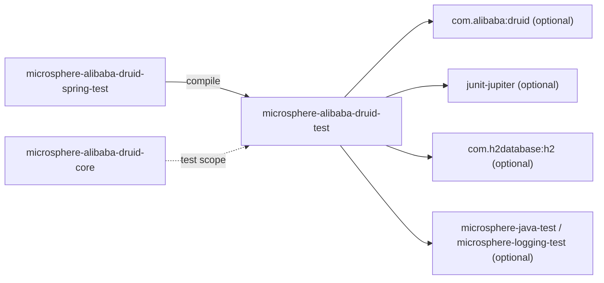
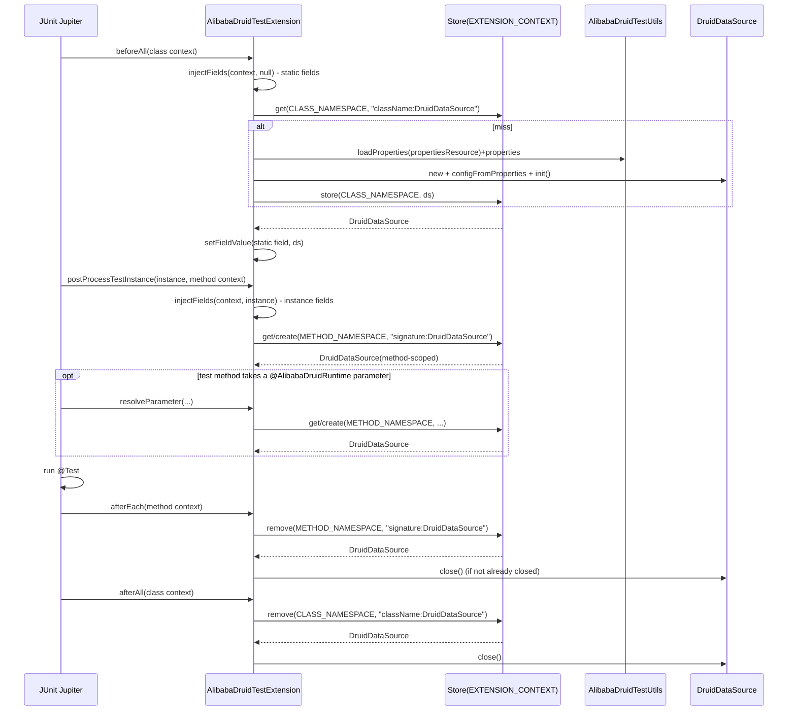

[中文](zh/microsphere-alibaba-druid-test.md)

# microsphere-alibaba-druid-test

> Support module (non-Spring): the test infrastructure for Druid `Filter`/interception testing — a
> reusable lifecycle template (`AbstractAlibabaDruidTest`), a builder/util class
> (`AlibabaDruidTestUtils`) and a self-contained JUnit 5 extension trio (`@AlibabaDruidTest` /
> `@AlibabaDruidRuntime` / `AlibabaDruidTestExtension`).
> Package roots: `io.microsphere.alibaba.druid.test` and `…test.junit.jupiter`. Java baseline: **JDK 8**.
> Repository home: [../../../README.md](../../../README.md) · [User Guide](../user-guide/README.md)

## Module view

`test` depends on **no other reactor module** in compile scope — that is what lets `core` use it in
`test` scope without creating a cycle (see the [Developer Guide index](README.md#31-test-scope-edges-worth-understanding)).
Everything it needs (Druid, JUnit, H2, Microsphere test utilities) is declared `optional`, so
downstream consumers must provide those themselves.



| Dependency | Scope | Why |
|---|---|---|
| `com.alibaba:druid` | optional | `DruidDataSource` is the object under construction in every test path. |
| `org.junit.jupiter:junit-jupiter` | optional | `@BeforeEach`/`@AfterEach`/`@Test`, the `Extension` SPI, `ExtensionContext`, `Store`/`Namespace`. |
| `com.h2database:h2` | optional | The default in-memory database the `META-INF/druid/h2.properties` fixture points at. |
| `microsphere-java-test`, `microsphere-logging-test` | optional | Throwable-aware helpers (`ThrowableConsumer`), field/method reflection utilities, log-capture assertions. |
| `microsphere-annotation-processor` | optional | Compile-time metadata only. |
| `ch.qos.logback:logback-classic` | optional / `microsphere-logback` test | Logging backend for captured-output tests. |

`test` has no required artifact: a pure builder + extension set that degrades to "you supply the
libraries" semantics, consistent with the rest of the project's optional-first convention.

## Source analysis

### `io.microsphere.alibaba.druid.test.AbstractAlibabaDruidTest`

```java
public abstract class AbstractAlibabaDruidTest {
    private DruidDataSource dataSource;

    @BeforeEach public void init() throws Throwable;
    protected DruidDataSource buildDruidDataSource() throws IOException;
    protected void customize(DruidDataSource dataSource);
    protected DruidDataSource getDruidDataSource();
    private void initData() throws Throwable;

    @Test public void test() throws Throwable;
    protected void testExecuteStatement() throws Throwable;
    protected void testExecutePreparedStatement() throws Throwable;

    protected void executePreparedStatement(String sql, ThrowableConsumer<PreparedStatement> consumer) throws Throwable;
    protected void executeStatement(ThrowableConsumer<Statement> consumer) throws Throwable;
    protected void executeConnection(ThrowableConsumer<Connection> consumer) throws Throwable;

    @AfterEach public void destroy() throws Throwable;
    private void destroyData() throws Throwable;
}
```

**Template Method lifecycle.** This is the single most reused type in the whole test surface —
`core`'s filter tests, the `spring` integration tests and the `spring-boot`/`spring-cloud`
integration tests all descend from it (directly or via `AbstractDruidSpringTest`). Its contract is a
fixed order, and a subclass may only open the two hooks:

1. `@BeforeEach init()` runs **`buildDruidDataSource()` → `customize(ds)` → `ds.init()` →
   `initData()`**, assigning the field *before* `initData()` so the SQL helpers see a live source.
   `init()` declares `throws Throwable` because `DruidDataSource.init()` itself can throw checked
   errors; `buildDruidDataSource()` declares `throws IOException` for the properties load.
2. `customize(DruidDataSource)` is the **no-op strategy hook** — subclasses add their
   `getProxyFilters().add(new XxxFilter())` here. It runs *after* the source is built but *before*
   `init()`, which is the only moment Druid will call `Filter.init(DataSourceProxy)` for those
   filters (the same ordering constraint `DruidDataSourceBeanPostProcessor` respects, see
   [spring module](microsphere-alibaba-druid-spring.md)).
3. `initData()` (private) issues `CREATE TABLE users (id INT, name VARCHAR(50))` through the
   `executeStatement`/`executeConnection` helpers — so even schema setup is executed *through the
   proxied connection*, meaning a filter installed in `customize` intercepts it too.
4. `@Test test()` delegates to `testExecuteStatement()` + `testExecutePreparedStatement()`. A
   subclass that wants the full JDBC matrix simply inherits this method; it never re-declares
   `@Test`, so there is exactly one test method per concrete class unless overridden.
5. `@AfterEach destroy()` runs `destroyData()` (private, `DROP TABLE users`) **then** `ds.close()` —
   teardown order is the mirror of setup, and the table drop happens while the source is still open.

**The JDBC matrix is the behavioural spec for every filter.** `testExecuteStatement()` exercises
`executeUpdate` (all four overloads: none, `String[]`, `int[]`, `NO_GENERATED_KEYS`), `addBatch` +
`executeBatch` (asserts `int[]{1,1}`), `executeQuery`, `execute` (plain and the generated-keys
overloads) and a `DELETE FROM users` sweep. `testExecutePreparedStatement()` parameterises
`INSERT`/`SELECT` via `?` and covers both `prepareStatement(sql, TYPE_FORWARD_ONLY)` and
`prepareStatement(sql, TYPE_FORWARD_ONLY, CONCUR_UPDATABLE)`. Combined with
`buildResourceName`'s table-alias naming this is what
`LoggingStatementFilterTest` asserts against — see
[core module](microsphere-alibaba-druid-core.md).

**Resource handling.** The three `executeXxx` helpers are nested and each owns exactly one
`finally`-close:

```java
protected void executeConnection(ThrowableConsumer<Connection> consumer) throws Throwable {
    DataSource dataSource = getDruidDataSource();
    Connection connection = dataSource.getConnection();
    try {
        consumer.accept(connection);
    } finally {
        connection.close();
    }
}
```

`executeStatement`/`executePreparedStatement` build on `executeConnection` and close their
`Statement`/`PreparedStatement` in their own `finally`. This layering is why `customize`-installed
filters observe a correct `getConnection → statement → execute → close` sequence, and why
`ThrowableConsumer` (not `Consumer`) is used — JDBC throws checked `SQLException`, and the base
method signatures propagate `Throwable` rather than swallowing it.

**Overridability for downstream wiring.** `buildDruidDataSource()` is what a subclass (or
`AbstractDruidSpringTest`) replaces to source the data object from elsewhere; the default delegates
to `AlibabaDruidTestUtils.buildDefaultDruidDataSource()`. `getDruidDataSource()` is the accessor
both the SQL helpers and the `@Nested FieldTest` (see the extension test below) rely on.

### `io.microsphere.alibaba.druid.test.AlibabaDruidTestUtils`

```java
public abstract class AlibabaDruidTestUtils {
    public static final String H2_PROPERTIES_RESOURCE = "META-INF/druid/h2.properties";
    public static final String DEFAULT_PROPERTIES_RESOURCE = H2_PROPERTIES_RESOURCE;
    public static final String PACKAGE_NAME_PREFIX = "com.alibaba.druid.";

    @Nonnull public static Properties getDefaultProperties() throws IOException;
    @Nonnull public static Properties loadProperties(String resourceName) throws IOException;
    @Nonnull public static Properties loadProperties(String[] keyValuePairs) throws IOException;
    @Nonnull static Properties properties(String content) throws IOException;      // package-private
    @Nonnull public static DruidDataSource buildDefaultDruidDataSource() throws IOException;
    @Nonnull public static DruidDataSource buildDruidDataSource(Properties properties);

    private AlibabaDruidTestUtils() { }
}
```

- **Non-instantiable utility idiom**: declared `abstract` with a `private` constructor so it can be
  neither instantiated nor accidentally subclassed-with-construction. Same idiom as
  `PropertyConstants`/`AlibabaDruidTestExtension`.
- **The H2 fixture** `META-INF/druid/h2.properties` ships *in this module's jar*, so any consumer
  that depends on `microsphere-alibaba-druid-test` inherits it on the classpath:

```properties
druid.name=h2
druid.url=jdbc:h2:mem:test_mem
druid.username=sa
druid.password=
druid.driverClassName=org.h2.Driver
```

  The `druid.*` keys are the property names Druid itself consumes in
  `DruidDataSource.configFromProperties(Properties)` — so `buildDruidDataSource(properties)` is a
  one-line data-source factory with no JDBC-URL boilerplate in test code.
- `loadProperties(String resourceName)` reads the classpath resource via
  `io.microsphere.util.ClassLoaderUtils.getResource(...)`, copies it to a String with
  `IOUtils.copyToString(inputStream, DEFAULT_CHARSET)` and parses it through `properties(...)`; a
  missing resource yields an NPE from `resource.openStream()` (the util does not tolerate absent
  resources — deliberate, since a typo'd resource name should fail fast).
- `loadProperties(String[] keyValuePairs)` joins the pairs with
  `SeparatorConstants.LINE_SEPARATOR` and parses the same way — this is the path
  `@AlibabaDruidTest(properties = {...})` uses for inline overrides.
- `buildDruidDataSource(Properties)` returns an **un-initialised** `DruidDataSource` (it only calls
  `configFromProperties`); the caller (`AbstractAlibabaDruidTest.init()`, or the JUnit extension's
  own build path) decides when to `init()`.

### The JUnit 5 trio

#### `@AlibabaDruidTest`

```java
@Target(TYPE)
@Retention(RUNTIME)
@ExtendWith(AlibabaDruidTestExtension.class)
@Inherited
public @interface AlibabaDruidTest {
    String[] properties() default {};
    String propertiesResource() default DEFAULT_PROPERTIES_RESOURCE;
    String[] filters() default {};
}
```

- Purely a **declarative registration annotation**: `@ExtendWith(AlibabaDruidTestExtension.class)`
  turns any class it annotates into a Druid-runtime-enabled test, and `@Inherited` lets the
  registration propagate to subclasses.
- `propertiesResource()` defaults to `AlibabaDruidTestUtils.DEFAULT_PROPERTIES_RESOURCE` (the H2
  fixture); `properties()` supplies inline `key=value` overrides. The extension's build path loads
  the resource first, then loads the inline array and **`putAll`s it over the resource**, so inline
  values win — this is the Javadoc's "override the properties defined in `propertiesResource()`".
- **`filters()` is currently inert.** The extension `buildDruidDataSource(AlibabaDruidTest)` reads
  only `propertiesResource()` and `properties()`; it never calls `DruidDataSource.setFilters(...)`
  with the `filters()` array. To actually attach Druid's built-in named filters, set the `druid.filters`
  key via `properties()`/`propertiesResource()` (e.g. `"druid.filters=stat,wall"`), which
  `configFromProperties` does honour. Keep this in mind before relying on `filters = {"log","stat"}`.

#### `@AlibabaDruidRuntime`

```java
@Target(value = {FIELD, PARAMETER})
@Retention(RUNTIME)
public @interface AlibabaDruidRuntime {
}
```

- The injection marker. It can target a **static field, an instance field, or a method parameter**;
  the component types it resolves are computed from the `DruidDataSource` type hierarchy filtered by
  `isAlibabaDruidClass` — i.e. anything `DataSource`-assignable or under the `com.alibaba.druid.`
  package. The Javadoc table lists the four documented targets: `DataSource`,
  `ConnectionPoolDataSource`, `DataSourceProxy`, `DruidDataSource`, each injectable as static field,
  instance field and method parameter.

#### `AlibabaDruidTestExtension`

Package-private (`class AlibabaDruidTestExtension implements BeforeAllCallback, AfterAllCallback,
TestInstancePostProcessor, AfterEachCallback, ParameterResolver`) — reachable only through
`@AlibabaDruidTest`, so the SPI surface stays encapsulated. Its key internals:

```java
private static final Namespace METHOD_NAMESPACE = create(AlibabaDruidTestExtension.class, "METHOD");
private static final Namespace CLASS_NAMESPACE  = create(AlibabaDruidTestExtension.class, "CLASS");
static List<Class<?>> candidateTypes = findAllClasses(DruidDataSource.class, AlibabaDruidTestExtension::isAlibabaDruidClass);
```

- **Two namespaces, one Store scope.** Both `CLASS_NAMESPACE` and `METHOD_NAMESPACE` are created from
  `(AlibabaDruidTestExtension.class, "CLASS"|"METHOD")`, and `getStore(...)` always fetches them with
  `context.getStore(EXTENSION_CONTEXT, namespace)`. `StoreScope.EXTENSION_CONTEXT` attaches the store
  to the context where the extension is registered (the test class), so it survives across all test
  methods of the class — but the CLASS vs METHOD namespace split plus the **key** below separate the
  two lifetimes.
- **The key encodes the lifetime.** `buildKey(context, componentClass)` is a `StringJoiner(":")`
  producing `"<sig-or-class>:<componentClassName>"`:
  - when `context.getTestMethod()` is absent (class-level context: static-field injection) the first
    segment is `testClass.getName()`;
  - when a test method is present (instance-field / parameter injection) the first segment is
    `MethodUtils.getSignature(method)`.
  So a class-shared `DruidDataSource` (static injection) is keyed by class name in `CLASS_NAMESPACE`,
  while each test method's `DruidDataSource` is keyed by method signature in `METHOD_NAMESPACE`.
- **Get-or-create**: `getDruidDataSource(context, forClass, forRemoval)` looks up the store; on a miss
  it calls `buildDruidDataSource(context)` (which reads `@AlibabaDruidTest` via
  `getAlibabaDruidTest(...)`, falling back to the enclosing class) and `store(...)`s it. This is the
  whole "one source per key" mechanism.
- **Injection callbacks**: `beforeAll` → `injectFields(context, null)` sets **static** annotated
  fields; `postProcessTestInstance` → `injectFields(context, testInstance)` sets **instance** fields.
  `findCandidateFields` picks the field set with `MemberUtils::isStatic` vs `isNonStatic`, `and`-ed
  with `isCandidateField` (`@AlibabaDruidRuntime` **and** `candidateTypes.contains(field.getType())`).
  Field writes go through `FieldUtils.setFieldValue(true /*makeAccessible*/, target, field, ds)`.
- **Parameter resolution**: `supportsParameter` → `isCandidateParameter` (annotation + candidate type);
  `resolveParameter` returns the method-scoped `getDruidDataSource(extensionContext, false, false)`
  wrapped in `ThrowableSupplier.execute(...)` so the checked `SQLException`/`IOException` become a
  JUnit-friendly failure.
- **Teardown**: `afterEach` retrieves the **method**-scoped source with `forRemoval=true` and
  `close`s it; `afterAll` does the same for the **class**-scoped source. `close(ds)` is null-safe and
  guarded by `!ds.isClosed()`, so calling it twice is harmless — exactly what the static-field test
  (`close(x); close(x);`) relies on.

## AlibabaDruidTest extension lifecycle



## Design patterns

- **Template Method** — `AbstractAlibabaDruidTest` fixes the build → customize → init → initData →
  test → destroy lifecycle; subclasses override only `customize` and/or `buildDruidDataSource`.
- **Strategy / Null Object** — no-op `customize(DruidDataSource)` lets opt-in wiring without breaking
  defaults.
- **Non-instantiable utility** — `AlibabaDruidTestUtils` (abstract + private ctor).
- **JUnit 5 Extension** — `AlibabaDruidTestExtension` implements five SPIs and orchestrates a
  get-or-create `Store` with two namespaces and a method/class-signature key.
- **Declarative registration annotation** — `@AlibabaDruidTest` = `@ExtendWith(...)` + attribute
  bag; `@AlibabaDruidRuntime` = a type-safe injection marker.
- **Resource-externalised configuration** — the H2 `Properties` live in a classpath file and are
  consumed by Druid's own `configFromProperties`, so no builder DSL is invented here.

## 1.x notes

- **Test-class structure differs on this line.** `AlibabaDruidTestExtensionTest` on `release-1.x`
  declares the **static-field-injection cases in the top-level class** (the
  `@AlibabaDruidRuntime private static DruidDataSource` / `static DataSource` fields and the
  `@Test @DisplayName("Test : Static Field Injection") void test()` method live directly on the outer
  class, together with `@Nested FieldTest` and `@Nested ParameterTest`). On the `current` (`main`)
  line those same static-field cases were moved into a dedicated `@Nested StaticFieldTest` class.
  When porting changes between lines, keep the static-injection coverage intact — the extension's
  `beforeAll`/static path is exactly what that test exercises.
- **JDK 8 source level** — the extension uses method references, `Predicate`, `StringJoiner` and
  `orElse` (all Java 8), but no `List.of`, `var`, records or switch expressions; `candidateTypes` is a
  plain `List<Class<?>>` populated via `findAllClasses`.
- **No `spring.factories` here** — this module contributes no auto-configuration; the 1.x-specific
  `spring.factories` files live in `microsphere-alibaba-druid-spring-boot` and `-spring-cloud` only.
- `JUnit 5` API availability (`StoreScope.EXTENSION_CONTEXT`, `Namespace.create`) comes from the
  Jupiter version managed by `microsphere-spring-cloud-dependencies:0.1.26`, not declared here.

## Testing

| Test class | What it pins down |
|---|---|
| `AlibabaDruidTestUtilsTest` | The three constants' literal values, every property parsed from the H2 fixture (`name=h2`, `url=jdbc:h2:mem:test_mem`, `username=sa`, empty `password`, `driverClassName=org.h2.Driver`), and inline `loadProperties(String[])`. |
| `DefaultAlibabaDruidTest` | The bare lifecycle: an empty subclass inherits `test()` against the default H2 source — proves setup/teardown and the full SQL matrix run without any filter. |
| `AlibabaDruidTestExtensionTest` | Instance-field, static-field and parameter injection through `@AlibabaDruidRuntime`; `isCandidateParameter` on a non-Druid parameter; `getAlibabaDruidTest` resolution; idempotent `close`. |

Run only this module: `mvn -pl microsphere-alibaba-druid-test -am test -P spring-cloud-2021`.

## Related

- [Developer Guide index](README.md)
- [microsphere-alibaba-druid-core](microsphere-alibaba-druid-core.md)
- [microsphere-alibaba-druid-spring-test](microsphere-alibaba-druid-spring-test.md)
- [User Guide](../user-guide/README.md)
- [Repository README](../../../README.md)

---

## 中文

[中文版：microsphere-alibaba-druid-test](zh/microsphere-alibaba-druid-test.md)
