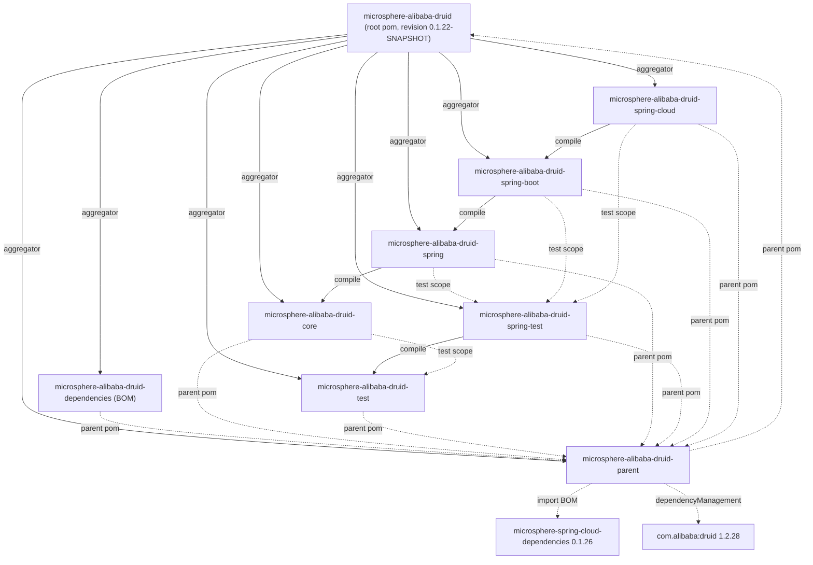

[English](../README.md)

# 开发者指南 —— 1.x（`release-1.x` 分支线）

本指南记录 `release-1.x` 分支线（构件版本 `0.1.x`，文档目录 `1.x`）上 Microsphere Alibaba Druid 的
**内部设计**：分层结构、模块依赖图、每个公共类型的源码级行为、所使用的设计模式，以及贡献者必须遵守的
扩展点。

它*不是*使用手册。安装、配置属性与烹饪式配方请见[用户指南](../../user-guide/zh/README.md)。

- 仓库主页：[../../../../README.md](../../../../README.md)
- 更新分支线（`0.2.x` / `main`）：[current 开发者指南](../../../current/developer-guide/README.md)

---

## 1. 1.x 线的独特之处

`release-1.x` 的 Java 源码与 `main` 工作树**完全一致**。差异纯粹在于打包、版本化以及一处测试类结构：

| 方面 | 1.x（`release-1.x`） | current（`main`） |
|---|---|---|
| 构件线 | `0.1.x`（最新发布 `0.1.21`，开发中 `0.1.22-SNAPSHOT`） | `0.2.x`（`0.2.22-SNAPSHOT`） |
| 根 `<parent>` | `microsphere-spring-cloud-parent:0.1.26` | `microsphere-spring-cloud-parent:0.2.26` |
| `java.version` | 本仓库**未声明** | 声明为 `17` |
| Java 基线 | **JDK 8**（继承自：`microsphere-spring-cloud:0.1.26` → `microsphere-build:0.3.14`，`maven.compiler.source/target=${java.version}=8`） | JDK 17 |
| Alibaba Druid | `1.2.28` | `1.2.28` |
| 自动配置发现 | `META-INF/spring/org.springframework.boot.autoconfigure.AutoConfiguration.imports` **加上** Boot 2.x 风格的 `META-INF/spring.factories` | 仅 `AutoConfiguration.imports` |
| Spring Boot 矩阵 | 2.3.12.RELEASE / 2.4.13 / 2.6.15 | 3.x |
| Spring Cloud 矩阵 | Hoxton.SR12 / 2020.0.5 / 2021.0.9 | 2022.0.x – 2025.0.x |
| 测试结构 | `AlibabaDruidTestExtensionTest` 把静态字段注入用例声明在**顶层类**中 | 相同用例位于 `@Nested` 类 |

由于基线是 JDK 8，贡献者代码必须避免 `var`、record、密封类型、文本块、`java.util.ServiceLoader.stream()`、
`List.of`/`Map.of`（Java 9+）以及任何更新 JDK 的 API。目标字节码保持为 class-file 版本 52，这正是同一批 1.x
jar 仍能在 JDK 17/21/25 上加载的原因。

### 1.1 双自动配置注册（1.x 特有）

`microsphere-alibaba-druid-spring-boot` 与 `microsphere-alibaba-druid-spring-cloud` 各自携带
**两个**发现文件：

```properties
# microsphere-alibaba-druid-spring-boot/src/main/resources/META-INF/spring.factories
org.springframework.boot.autoconfigure.EnableAutoConfiguration=\
io.microsphere.alibaba.druid.spring.boot.autoconfigure.AlibabaDruidAutoConfiguration
```

```properties
# microsphere-alibaba-druid-spring-cloud/src/main/resources/META-INF/spring.factories
org.springframework.boot.autoconfigure.EnableAutoConfiguration=\
io.microsphere.alibaba.druid.spring.cloud.autoconfigure.AlibabaDruidCloudAutoConfiguration
```

两者也都保留 `META-INF/spring/org.springframework.boot.autoconfigure.AutoConfiguration.imports`。
兼容契约如下：

| Boot 版本 | 用于自动配置的文件 | 效果 |
|---|---|---|
| 2.3 – 2.6（本线的矩阵） | 仅 `spring.factories` | `AutoConfiguration.imports` 不起作用 |
| 2.7 | 两个都读，随后去重（`AutoConfigurationImportSelector` 中的 `removeDuplicates`） | 注册一次 |
| 3.x | 仅 `AutoConfiguration.imports` | `spring.factories` 的自动配置键被忽略 |

在本分支上**不要**删除其中任何一个文件：移除 `spring.factories` 会破坏 Boot 2.3–2.6，移除
`AutoConfiguration.imports` 会破坏同一构件的 2.7+/3.x 消费者。

---

## 2. 架构与分层

本项目是一个严格的垂直栈。每一层只依赖其下一层，而测试模块则挂在栈的侧面：

| 层 | 模块 | 职责 |
|---|---|---|
| L0 | `microsphere-alibaba-druid-core` | Druid `Filter` SPI 实现：语句拦截模板、SQL 到资源名的解析、属性名常量。无 Spring 依赖。 |
| L1 | `microsphere-alibaba-druid-spring` | Spring Framework 集成：用于多源 `Filter` 发现的 `@EnableAlibabaDruid` + `ImportBeanDefinitionRegistrar`，用于注入 `DruidDataSource` 的 `DruidDataSourceBeanPostProcessor`。 |
| L2 | `microsphere-alibaba-druid-spring-boot` | Spring Boot 自动配置、`@ConfigurationProperties`、组合式 `@Conditional` 注解、Actuator `DataSourcePoolMetadata`。 |
| L3 | `microsphere-alibaba-druid-spring-cloud` | Spring Cloud 打包：条件化自动配置入口，外加 `META-INF/config/default/features.yaml` 元数据。 |
| 支持 | `microsphere-alibaba-druid-test` | 非 Spring 测试基础设施：`DruidDataSource` 构建器、抽象测试模板、JUnit 5 扩展。 |
| 支持 | `microsphere-alibaba-druid-spring-test` | Spring 感知的测试基础设施：基类 + `DruidDataSource` 测试配置。 |
| 构建 | `microsphere-alibaba-druid-parent`、`microsphere-alibaba-druid-dependencies`、根 pom | 版本/属性管理、BOM、聚合。 |

```mermaid
graph TD
    subgraph "Runtime stack (compile scope)"
        L3["L3 microsphere-alibaba-druid-spring-cloud"]
        L2["L2 microsphere-alibaba-druid-spring-boot"]
        L1["L1 microsphere-alibaba-druid-spring"]
        L0["L0 microsphere-alibaba-druid-core"]
        DRUID["com.alibaba:druid 1.2.28"]
    end
    subgraph "Test support"
        T2["microsphere-alibaba-druid-spring-test"]
        T1["microsphere-alibaba-druid-test"]
    end
    L3 --> L2
    L2 --> L1
    L1 --> L0
    L0 --> DRUID
    T2 --> T1
    L3 -.->|test scope| T2
    L2 -.->|test scope| T2
    L1 -.->|test scope| T2
    L0 -.->|test scope| T1
```



关键结论：`core` 完全不知道 Spring 的存在，因此一个普通的 `new DruidDataSource()` 加上
`getProxyFilters().add(new LoggingStatementFilter())` 无需任何容器即可工作。反过来，`spring` 不增加任何
新的拦截逻辑 —— 它只把 filter *装配*到数据源中。

---

## 3. 模块依赖图（整个仓库）

实线边 = 反应堆模块之间的 `compile` 作用域；虚线边 = `parent` 继承、BOM 管理或 `test` 作用域。



### 3.1 值得理解的 `test` 作用域边

- `core` → `test`（`${revision}`）：`AbstractStatementFilterTest` 复用 `AbstractAlibabaDruidTest`。
  这是合法且**不是**环：`microsphere-alibaba-druid-test` 对 `core` 没有 compile 依赖，所以 Maven 反应堆
  把 `test` 排在 `core` 之前。
- `spring`、`spring-boot`、`spring-cloud` → `spring-test`（`${revision}`）：所有 Spring 测试都继承
  `AbstractDruidSpringTest` 并导入 `DruidDataSourceTestConfiguration`。
- `test` 与 `spring-test` 内部所有第三方依赖都声明为 `<optional>true</optional>`，所以下游消费者必须自行
  提供 JUnit、Druid 与 H2。

### 3.2 各模块的外部依赖

| 模块 | Optional（编译期） | Required | 仅测试 |
|---|---|---|---|
| core | `microsphere-annotation-processor`、`microsphere-java-core`、`druid` | — | `junit-jupiter`、`h2`、`microsphere-alibaba-druid-test`、`microsphere-logging-test`、`microsphere-logback`、`logback-classic` |
| test | `microsphere-annotation-processor`、`junit-jupiter`、`microsphere-java-test`、`microsphere-logging-test`、`druid`、`h2`、`logback-classic` | — | `microsphere-logback` |
| spring | `microsphere-annotation-processor`、`microsphere-spring-context`、`druid`、`spring-beans`、`spring-context`、`spring-test` | `microsphere-alibaba-druid-core` | `junit-jupiter`、`h2`、`microsphere-alibaba-druid-spring-test`、`microsphere-spring-test`、`microsphere-logback`、`logback-classic` |
| spring-test | `junit-jupiter`、`spring-test`、`spring-context`、`microsphere-spring-test`、`microsphere-spring-context`、`druid`、`h2`、`logback-classic` | `microsphere-alibaba-druid-test` | `microsphere-logback` |
| spring-boot | `microsphere-annotation-processor`、`microsphere-spring-boot-core`、`druid`、`spring-boot-starter`、`spring-boot-starter-actuator`、`spring-boot-configuration-processor`、`spring-boot-autoconfigure-processor` | `microsphere-alibaba-druid-spring` | `junit-jupiter`、`spring-boot-starter-test`、`microsphere-spring-boot-test`、`microsphere-alibaba-druid-spring-test`、`microsphere-logback`、`h2`、`logback-classic` |
| spring-cloud | `microsphere-annotation-processor`、`microsphere-spring-cloud-commons`、`druid`、`spring-cloud-commons`、`spring-boot-starter`、`spring-boot-starter-actuator`、`spring-boot-configuration-processor`、`spring-boot-autoconfigure-processor` | `microsphere-alibaba-druid-spring-boot` | `junit-jupiter`、`spring-boot-starter-test`、`microsphere-spring-boot-test`、`microsphere-alibaba-druid-spring-test`、`microsphere-logback`、`h2`、`logback-classic` |

---

## 4. 一眼看懂的复杂流程

| 流程 | 记录位置 |
|---|---|
| SQL 语句拦截（`execute` 模板、`wrap(e, SQLException.class)`） | [core](microsphere-alibaba-druid-core.md#sql-拦截执行流程) |
| `buildResourceName()` 判定（校验短路、`UNRECOGNIZED` 兜底） | [core](microsphere-alibaba-druid-core.md#buildresourcename-决策流程) |
| `@EnableAlibabaDruid` 三源注册及 `switch` 贯穿 | [spring](microsphere-alibaba-druid-spring.md#enablealibabadruid-注册流程) |
| 自动配置条件评估（factories 与 imports、`@Conditional` 链） | [spring-boot](microsphere-alibaba-druid-spring-boot.md#自动配置条件评估流程) |
| `@AlibabaDruidTest` 扩展生命周期（Store / Namespace / ParameterResolver） | [test](microsphere-alibaba-druid-test.md#alibabadruidtest-扩展生命周期) |

---

## 5. 所使用的设计模式

| 模式 | 位置 | 备注 |
|---|---|---|
| 模板方法 | `AbstractStatementFilter`、`AbstractAlibabaDruidTest`、`AnnotatedBeanCapableImportBeanDefinitionRegistrar` | `final` 拦截入口，抽象的 `beforeExecute`/`afterExecute` 钩子。 |
| 责任链 | 围绕 `AbstractStatementFilter` 的 Druid `FilterChain` | 每个模板方法都委托给 `super.<method>(chain, ...)`，即下一个 filter。 |
| Bean 后置处理器（钩子） | `DruidDataSourceBeanPostProcessor` | `processBeforeInitialization` 在 `DruidDataSource.init()` 之前修改 `getProxyFilters()`。 |
| `@Import` + `ImportBeanDefinitionRegistrar` | `@EnableAlibabaDruid` → `AlibabaDruidRegistrar` | 注册表级的 bean 定义注册，而非 `@Bean` 方法。 |
| 组合式 `@Conditional` 元注解 | `ConditionalOnAlibabaDruidAvailable` = `ConditionalOnAlibabaDruidEnabled` + `ConditionalOnClass(name=...)` | 让一行式门控被两个自动配置复用。 |
| 多源 bean 发现 | `BeanSource.{BEAN_FACTORY, SPRING_FACTORIES, JAVA_SERVICE_PROVIDER}` | 同一个 `filterClasses` 数组针对三个注册表解析。 |
| `DataSourcePoolMetadataProvider` | `AlibabaDruidAutoConfiguration#druidDataSourcePoolMetadataProvider` | 从 Druid 池计数器到 Spring Boot Actuator 指标的适配器。 |
| 策略 / 空对象 | `customize(DruidDataSource)`（空实现）、`Filter` 类数组默认 `{Filter.class}` | 子类可选择加入而不破坏默认。 |
| JUnit 5 扩展 | `AlibabaDruidTestExtension` | `BeforeAllCallback`、`AfterAllCallback`、`TestInstancePostProcessor`、`AfterEachCallback`、`ParameterResolver`、`Store` + `Namespace` + `StoreScope.EXTENSION_CONTEXT`。 |
| 不可实例化工具类 | `AlibabaDruidTestUtils`（`abstract class` + `private` 构造器）、`PropertyConstants`（接口） | |

---

## 6. 构建与测试本分支线

要求：**JDK 8**（或更新的 JDK，因为源码以 `-source/-target 8` 编译）、Maven 3.6+，并继承父链外部
`microsphere-build` 插件配置。

```bash
# build one Spring Cloud generation
mvn --batch-mode clean verify -P spring-cloud-hoxton
mvn --batch-mode clean verify -P spring-cloud-2020
mvn --batch-mode clean verify -P spring-cloud-2021

# skip tests, resolve the reactor only
mvn --batch-mode clean install -DskipTests
```

`spring-cloud-*` profile 以及 `test` / `coverage` profile 都**声明在外部父链**，而非本仓库。在
`release-1.x` 上它们锁定：

| Profile | Spring Boot | Spring Cloud |
|---|---|---|
| `spring-cloud-hoxton` | `2.3.12.RELEASE` | `Hoxton.SR12` |
| `spring-cloud-2020` | `2.4.13` | `2020.0.5` |
| `spring-cloud-2021` | `2.6.15` | `2021.0.9` |

`release-1.x` 上的 `.github/workflows/maven-build.yml` 运行矩阵
**JDK `8` / `11` / `17` / `21` / `25` × `spring-cloud-hoxton` / `spring-cloud-2020` / `spring-cloud-2021`**
并把覆盖率上传到 Codecov，因此一处改动必须能在 JDK 8 上编译 *并且* 在最新 JDK 上通过。

版本化对 CI 友好：每个模块都声明 `<version>${revision}</version>`，而 `<revision>0.1.22-SNAPSHOT</revision>`
只存在于根 pom，所以一次发布就是单个属性的一次抬升。

---

## 7. 贡献者约定

- **仅 Java 8 源码级别** —— 不使用 `var`、record、密封类、文本块、`List.of`、`switch` 表达式或 JDK 9+ API。
- **优先可选依赖** —— 凡不属于模块自身契约的，都声明 `<optional>true</optional>`，版本来自
  `microsphere-alibaba-druid-parent`。
- **内部反应堆依赖显式使用 `${revision}`**（Maven 3.6 flatten 工作流）。
- **License 头** —— 每个文件都以 Apache License 2.0 头开始。
- **每个类型都带 `@author` + `@since`**；`0.1.x` 之前引入的 API 标 `@since 1.0.0`。
- **Javadoc 含一个 `Example Usage` 块** —— 保持可编译，测试与之一一对应。
- **绝不破坏双注册**：新增自动配置时，需在 `spring.factories` 和 `AutoConfiguration.imports` *两者*中注册。
- **保持拦截无状态** —— `AbstractStatementFilter` 是被所有连接共享的单例；只允许缓存每数据源的 `init()`
  状态（`dataSource`、`validationSQL`）。

---

## 8. 模块文档索引

| 文档 | 内容 |
|---|---|
| [microsphere-alibaba-druid-core](microsphere-alibaba-druid-core.md) | `AbstractStatementFilter` 模板、`LoggingStatementFilter`、`PropertyConstants`、资源名算法。 |
| [microsphere-alibaba-druid-spring](microsphere-alibaba-druid-spring.md) | `@EnableAlibabaDruid`、`AlibabaDruidRegistrar` 贯穿语义、`DruidDataSourceBeanPostProcessor`、测试资源文件。 |
| [microsphere-alibaba-druid-spring-boot](microsphere-alibaba-druid-spring-boot.md) | `AlibabaDruidAutoConfiguration`、`AlibabaDruidProperties`、组合条件、`DruidDataSourcePoolMetadata`。 |
| [microsphere-alibaba-druid-spring-cloud](microsphere-alibaba-druid-spring-cloud.md) | 空壳 `AlibabaDruidCloudAutoConfiguration`、`features.yaml` 机制。 |
| [microsphere-alibaba-druid-test](microsphere-alibaba-druid-test.md) | `AbstractAlibabaDruidTest`、`AlibabaDruidTestUtils`、`@AlibabaDruidTest` / `@AlibabaDruidRuntime` / `AlibabaDruidTestExtension`。 |
| [microsphere-alibaba-druid-spring-test](microsphere-alibaba-druid-spring-test.md) | `AbstractDruidSpringTest`、`DruidDataSourceTestConfiguration`、prototype 作用域的理由。 |
| [microsphere-alibaba-druid-parent](microsphere-alibaba-druid-parent.md) | 属性/版本管理、外部父链、JDK 8 基线。 |
| [microsphere-alibaba-druid-dependencies](microsphere-alibaba-druid-dependencies.md) | BOM 布局以及一次 `import` 实际带来什么。 |

## 相关

- [用户指南 (1.x)](../../user-guide/zh/README.md)
- [current 线开发者指南 (0.2.x)](../../../current/developer-guide/README.md)
- [仓库 README](../../../../README.md)
- [Alibaba Druid](https://github.com/alibaba/druid)

---

## English

- [English version of this document](../README.md)
