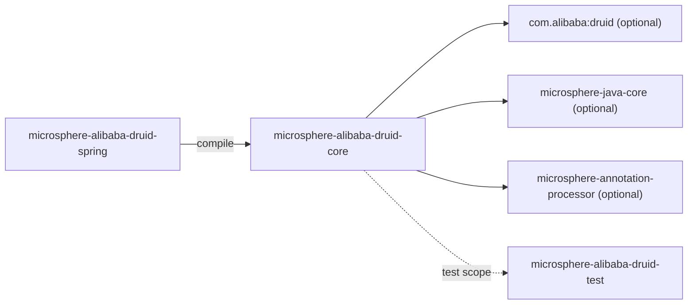
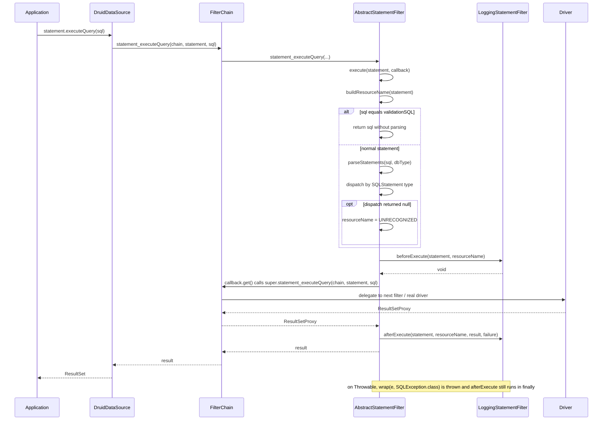
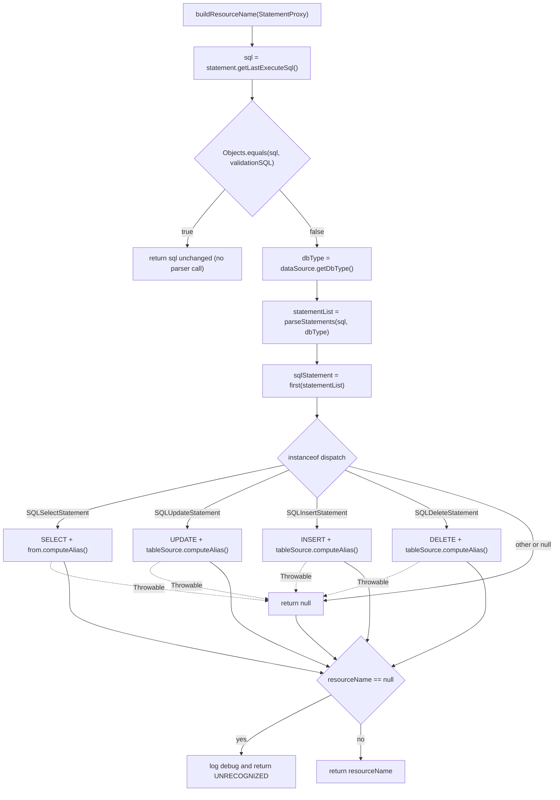
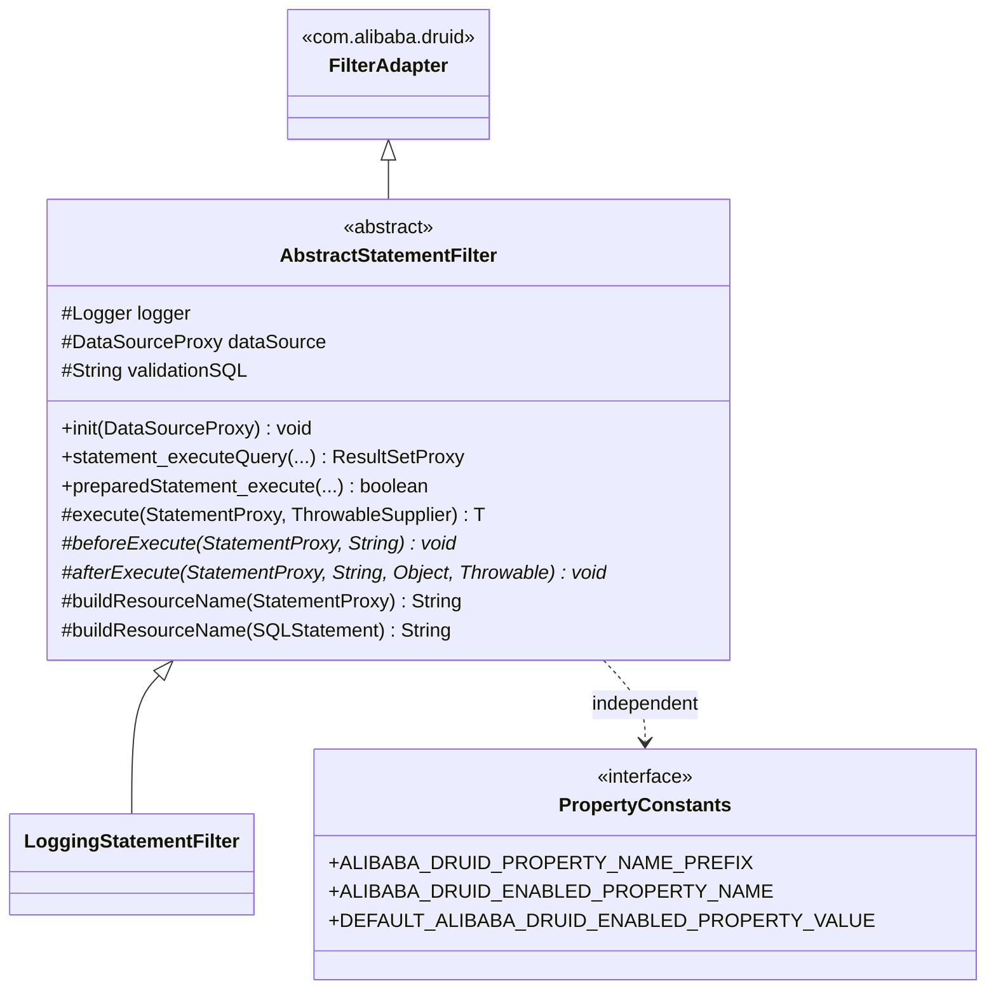

[English](../microsphere-alibaba-druid-core.md)

# microsphere-alibaba-druid-core

> 基础层（L0）：Druid `Filter` 实现与属性名常量。
> 包根：`io.microsphere.alibaba.druid`。Java 基线：**JDK 8**（本分支上为继承而来）。
> 仓库主页：[../../../../README.md](../../../../README.md) · 面向使用的文档：[用户指南](../../user-guide/zh/README.md)

## 模块视角

`core` **对任何其它反应堆模块都没有 compile 依赖** —— 它位于栈的最底层。它只依赖 Druid 与 Microsphere
Java 工具类，二者都声明为 `optional`。



| 依赖 | 作用域 | 原因 |
|---|---|---|
| `com.alibaba:druid` | optional | `Filter`、`FilterAdapter`、`FilterChain`、`StatementProxy`、`DruidDataSource`、`SQLUtils` 解析器。 |
| `io.github.microsphere-projects:microsphere-java-core` | optional | `ThrowableSupplier`、`ListUtils.first`、`ExceptionUtils.wrap`、`Logger`/`LoggerFactory`、`@ConfigurationProperty`。 |
| `microsphere-annotation-processor` | optional | 把 `@ConfigurationProperty` 转换成 `spring-configuration-metadata.json` 风格的元数据。 |
| `microsphere-alibaba-druid-test`、`junit-jupiter`、`h2`、`microsphere-logging-test`、`microsphere-logback`、`logback-classic` | test | 见[test 模块](microsphere-alibaba-druid-test.md)。 |

因为 `druid` 是 `optional`，消费者**不会**传递性地获得 Druid；数据源库必须由应用自行声明。这是有意为之 ——
本项目是一个附加组件，而非发行版。

## 源码分析

### `io.microsphere.alibaba.druid.constants.PropertyConstants`

```java
public interface PropertyConstants {
    String ALIBABA_DRUID_PROPERTY_NAME_PREFIX = MICROSPHERE_PROPERTY_NAME_PREFIX + "alibaba.druid";
    String DEFAULT_ALIBABA_DRUID_ENABLED_PROPERTY_VALUE = "true";
    @ConfigurationProperty(type = boolean.class,
            defaultValue = DEFAULT_ALIBABA_DRUID_ENABLED_PROPERTY_VALUE,
            source = APPLICATION_SOURCE)
    String ALIBABA_DRUID_ENABLED_PROPERTY_NAME = ALIBABA_DRUID_PROPERTY_NAME_PREFIX + DOT + ENABLED_PROPERTY_NAME;
}
```

- 声明为 `interface`，因此所有成员隐式为 `public static final`，且该类型既不能被实例化，也不能有意义地被实现
  —— 这是 Microsphere 用来承载常量的惯用法。
- 解析出的值：前缀 `microsphere.alibaba.druid`，enabled 键 `microsphere.alibaba.druid.enabled`。两个常量都是
  **编译期** 的 `String` 拼接（操作数来自 `io.microsphere.constants.PropertyConstants` / `SymbolConstants`），
  所以它们可用于 `@ConfigurationProperties(prefix = ...)` 和 `@ConditionalOnProperty(name = ...)` 这类注解。
- `@ConfigurationProperty` 注解只是元数据；它由 `microsphere-annotation-processor` 在编译期消费，运行时永不读取。
- `PropertyConstantsTest` 断言这三个字面值 —— 把此处的一次改动视作一次**破坏性配置变更**，因为用户指南与
  `spring-boot` 中的条件都依赖它。

### `io.microsphere.alibaba.druid.filter.AbstractStatementFilter`

```java
public abstract class AbstractStatementFilter extends FilterAdapter {
    protected final Logger logger = getLogger(getClass());
    protected DataSourceProxy dataSource;
    protected String validationSQL;

    @Override public final void init(DataSourceProxy dataSource);
    @Override public final boolean preparedStatement_execute(FilterChain chain, PreparedStatementProxy statement) throws SQLException;
    @Override public final ResultSetProxy preparedStatement_executeQuery(FilterChain chain, PreparedStatementProxy statement) throws SQLException;
    @Override public final int preparedStatement_executeUpdate(FilterChain chain, PreparedStatementProxy statement) throws SQLException;
    @Override public final ResultSetProxy statement_executeQuery(FilterChain chain, StatementProxy statement, String sql) throws SQLException;
    @Override public final boolean statement_execute(FilterChain chain, StatementProxy statement, String sql) throws SQLException;
    @Override public final boolean statement_execute(FilterChain chain, StatementProxy statement, String sql, int autoGeneratedKeys) throws SQLException;
    @Override public final boolean statement_execute(FilterChain chain, StatementProxy statement, String sql, int[] columnIndexes) throws SQLException;
    @Override public final boolean statement_execute(FilterChain chain, StatementProxy statement, String sql, String[] columnNames) throws SQLException;
    @Override public final int[] statement_executeBatch(FilterChain chain, StatementProxy statement) throws SQLException;
    @Override public final int statement_executeUpdate(FilterChain chain, StatementProxy statement, String sql) throws SQLException;
    @Override public final int statement_executeUpdate(FilterChain chain, StatementProxy statement, String sql, int autoGeneratedKeys) throws SQLException;
    @Override public final int statement_executeUpdate(FilterChain chain, StatementProxy statement, String sql, int[] columnIndexes) throws SQLException;
    @Override public final int statement_executeUpdate(FilterChain chain, StatementProxy statement, String sql, String[] columnNames) throws SQLException;

    protected <T> T execute(StatementProxy statement, ThrowableSupplier<T> callback) throws SQLException;
    protected abstract void beforeExecute(StatementProxy statement, String resourceName) throws Throwable;
    protected abstract void afterExecute(StatementProxy statement, String resourceName, Object result, Throwable failure);
    protected String buildResourceName(StatementProxy statement);
    protected String buildResourceName(SQLStatement sqlStatement);
    protected String buildResourceName(SQLSelectStatement selectStatement);
    protected String buildResourceName(SQLUpdateStatement updateStatement);
    protected String buildResourceName(SQLInsertStatement insertStatement);
    protected String buildResourceName(SQLDeleteStatement deleteStatement);
}
```

**设计意图。** 该类是在 Druid 的*责任链*之上的一层*模板方法*：

1. 全部 13 个 Druid 语句执行回调都是 `final`，并汇入一个 `execute(statement, callback)` 方法。因此子类
   **不可能**忘记转发链，也不可能只覆写某一个 JDBC 动词 —— 它必须通过两个钩子来表达意图。若子类需要按动词区分
   行为，必须去查看 `statement.getLastExecuteSql()` / `statement.get_executeCount()`，或对
   `PreparedStatementProxy` 使用 `instanceof`。
2. 每个 `final` 回调都调用 `super.<sameMethod>(chain, ...)`，即 `FilterAdapter` 对
   `chain.<sameMethod>(...)` 的透传 —— 也就是 `FilterChainImpl` 中的*下一个* filter。这正是让链在包装调用的
   同时保持完整的原因。
3. `beforeExecute` 声明 `throws Throwable`（钩子可以失败而不破坏 JDBC 契约类型）；`afterExecute` 不声明受检
   异常，因此在 `finally` 中运行是安全的。

**`init(DataSourceProxy)` 的行为与边界。**

```java
public final void init(DataSourceProxy dataSource) {
    this.dataSource = dataSource;
    if (dataSource instanceof DruidDataSource) {
        this.validationSQL = ((DruidDataSource) dataSource).getValidationQuery();
    }
    if (logger.isTraceEnabled()) { ... }
}
```

- 由 `DruidDataSource.init()` 对 `proxyFilters` 中每个 filter 调用。这就是为什么
  `DruidDataSourceBeanPostProcessor` 必须在初始化*之前*添加 filter（见
  [spring 模块](microsphere-alibaba-druid-spring.md)）。
- 当代理不是 `DruidDataSource` 时 `validationSQL` 保持 `null`（例如 `DruidDataSourceMBean` 包装器或手工构建的
  `DataSourceProxy`）—— 由 `AbstractStatementFilterTest#testInitOnMockDataSource` 验证，它传入一个 JDK 动态
  代理并断言 `assertSame(dataSourceProxy, filter.dataSource)` 及 `assertNull(filter.validationSQL)`。
- `logger` 以 `getClass()` 创建，所以每个具体子类都得到一个以自身命名的 logger —— 这是
  `microsphere-logging-test` 在测试中通过 `@LoggingLevelsClass` 切换级别所要求的。
- 该方法为 `final`：子类不能在此添加自己的 init 状态；它们必须改为重新读取 `dataSource` / `validationSQL`。

**`execute` —— 拦截核心。**

```java
protected <T> T execute(StatementProxy statement, ThrowableSupplier<T> callback) throws SQLException {
    String resourceName = buildResourceName(statement);
    T result = null;
    Throwable failure = null;
    try {
        beforeExecute(statement, resourceName);
        result = callback.get();
    } catch (Throwable e) {
        failure = e;
        throw wrap(e, SQLException.class);
    } finally {
        if (logger.isTraceEnabled()) {
            logger.trace("Execute statement [value : {} , resource name : '{}'] : {}", statement.getLastExecuteSql(), resourceName, result, failure);
        }
        afterExecute(statement, resourceName, result, failure);
    }
    return result;
}
```

实现要点与评审者必须记住的边界：

- `buildResourceName(statement)` 运行在 `try` **之外**，所以此处的解析失败会以非受检异常逃逸。实践中
  `buildResourceName` 内部会捕获 `Throwable` 并降级为 `"UNRECOGNIZED"`，但若 `dataSource` 为 `null`（filter 未经
  `init()` 使用）会抛 NPE。
- `wrap(e, SQLException.class)`（来自 `io.microsphere.util.ExceptionUtils`）把任意 `Throwable` 适配为声明的
  `throws SQLException`：当 `e` 已是 `SQLException` 时原样返回（保留原始实例），否则以携带 `e` 为 cause 的
  `SQLException` 重新抛出。对测试而言的后果：`AbstractStatementFilterTest#testExecuteOnFailed` 从回调抛出普通的
  `RuntimeException("For testing")` 并断言 `assertThrows(SQLException.class, ...)`。
- `beforeExecute` 在 `try` 之内：钩子失败会中断 SQL 执行 **并且** 自身也被包装成 `SQLException`。这是预期的
  （一个拒绝式 filter 必须阻止该语句），但也意味着 filter 不能通过抛异常来暗示“跳过我”。
- `afterExecute` 在 `finally` 中运行，并同时接收 `result` 与 `failure`；失败时 `result` 为 `null`。由于 `finally`
  不吞掉任何东西，从 `afterExecute` 抛出的异常会**替换**原始的 `SQLException` —— 子类不得在 after 钩子中抛出。
- 只声明 `SQLException`；`ThrowableSupplier` 让 lambda 调用 `super.*` 方法而无需重新声明受检异常。

**`buildResourceName` —— 资源名算法。**

```java
protected String buildResourceName(StatementProxy statement) {
    String sql = statement.getLastExecuteSql();
    if (Objects.equals(sql, validationSQL)) {
        return sql;
    }
    String dbType = dataSource.getDbType();
    List<SQLStatement> statementList = parseStatements(sql, dbType);
    SQLStatement sqlStatement = first(statementList);
    String resourceName = buildResourceName(sqlStatement);
    if (resourceName == null) {
        if (logger.isDebugEnabled()) { ... }
        resourceName = "UNRECOGNIZED";
    }
    return resourceName;
}
```

- **校验 SQL 短路**：当执行的 SQL 等于数据源的 `validationQuery` 时，返回原始 SQL 且**不解析**。这让连接
  测试/保活流量不会污染资源名指标，并避免每次心跳的解析开销。
- `dbType` 来自数据源，因此 `SQLUtils.parseStatements` 使用正确的方言语法。
- `first(statementList)`（`io.microsphere.collection.ListUtils`）返回下标 0 的元素，空列表则返回 `null` —— 因此
  多语句 SQL 仅以其**第一个**语句命名。
- **`UNRECOGNIZED` 兜底**：类型分派路径返回的任何 `null` 都会得到常量 `"UNRECOGNIZED"` 外加一条 `DEBUG` 日志；
  filter 从不因未知语法而抛异常。
- `Objects.equals(sql, validationSQL)` 检查在二者**都**为 `null` 时也会命中；在那种情况下该方法返回 `null` 而非
  一个名字（校验查询未设置且代理报告 `null` SQL）。子类必须容忍一个 `null` 资源名。

重载分派：

```java
protected String buildResourceName(SQLStatement sqlStatement) {
    try {
        if (sqlStatement instanceof SQLSelectStatement)   return buildResourceName((SQLSelectStatement) sqlStatement);
        else if (sqlStatement instanceof SQLUpdateStatement) return buildResourceName((SQLUpdateStatement) sqlStatement);
        else if (sqlStatement instanceof SQLInsertStatement) return buildResourceName((SQLInsertStatement) sqlStatement);
        else if (sqlStatement instanceof SQLDeleteStatement) return buildResourceName((SQLDeleteStatement) sqlStatement);
    } catch (Throwable e) {
        if (logger.isDebugEnabled()) { logger.debug("The JDBC statement can't be parsed, sql : '{}'", sqlStatement, e); }
    }
    return null;
}
```

- `instanceof` 级联是一个**有序、对 DML 穷尽**的分派；DDL（`SQLCreateTableStatement`）、`MERGE`、`CALL` 以及
  厂商特有语句有意不覆盖，都会落入 `UNRECOGNIZED`。
- `instanceof` 也会过滤掉 `null`（一个 `null` 参数匹配任何分支），这就是空解析结果变成 `null` 的方式。
- `catch (Throwable)` 是承重的：`new SQLSelectStatement()` 没有查询块，所以 `getSelect()`/`getFirstQueryBlock()`
  会 NPE。`AbstractStatementFilterTest#testBuildResourceNameOnNullPointerException` 断言该方法返回 `null` ——
  即畸形 AST 降级为 `UNRECOGNIZED`，绝不崩溃。

命名格式（单表粒度，无别名时 `computeAlias()` 回退为表名）：

| SQL | 资源名 |
|---|---|
| `SELECT id, name FROM users` | `SELECT users` |
| `SELECT u.id FROM users u` | `SELECT u` |
| `UPDATE users SET name = 'Z' WHERE id = 5` | `UPDATE users` |
| `INSERT INTO users (id, name) VALUES (1, 'Mercy')` | `INSERT users` |
| `DELETE FROM users WHERE id = 1` | `DELETE users` |
| `TRUNCATE TABLE users` | `UNRECOGNIZED` |
| `SELECT 1`（== `validationQuery`） | `SELECT 1` |

注意 SELECT 分支使用 `sqlSelect.getFirstQueryBlock()`，所以 `UNION` 以其第一个分支命名，而 `FROM` 中的子查询以
外层块的表源命名。

### `io.microsphere.alibaba.druid.filter.LoggingStatementFilter`

```java
public class LoggingStatementFilter extends AbstractStatementFilter {
    @Override protected void beforeExecute(StatementProxy statement, String resourceName) throws Throwable;
    @Override protected void afterExecute(StatementProxy statement, String resourceName, Object result, Throwable failure);
}
```

- 两个钩子的参考实现；它是本项目唯一发行的 filter。
- 两个钩子都以 `logger.isDebugEnabled()` 守护，并记录 `statement.getLastExecuteSql()`、解析出的资源名、结果与
  异常。这里没有时间/度量 —— 该类用于诊断，并作为度量 filter（仓库 README 中列出的 Sentinel/Resilience4j/
  Observability 集成）的模板。
- `LoggingStatementFilterTest` 通过 `AbstractAlibabaDruidTest` 对它施加测试，即针对真实的 H2 `DruidDataSource`，
  并断言由 `microsphere-logging-test` 捕获的日志输出。

## SQL 拦截执行流程



## buildResourceName 决策流程



## 类结构



## 扩展点

- **度量/链路 filter**（Sentinel 资源条目、观测 span）：继承 `AbstractStatementFilter`，用资源名作为度量维度，
  并依赖 `validationSQL` 短路来排除心跳。
- **拒绝式 filter**（SQL 防火墙）：从 `beforeExecute` 抛异常；异常以 `SQLException` 形式浮现给调用方而不触及驱动。
- **自定义命名**：覆写 `buildResourceName(StatementProxy)`（而非 `SQLStatement` 重载）以改变整个命名策略，同时保持
  链行为。
- **非语句拦截**（`Connection`、`DataSource`、`ResultSet`）：超出本类范围 —— 直接继承 `FilterAdapter`，因为
  `AbstractStatementFilter` 只 final 化了语句动词。

## 1.x 说明

- 以 `-source/-target 8` 编译：代码不使用任何 Java 9+ 构造（无 `List.of`、无 `var`、无 switch 表达式）；请保持
  如此。`Objects.equals`、`StringJoiner` 与 `instanceof` 级联是所用惯用法。
- `core` **不**读取 `META-INF/spring.factories`；新增的 1.x `spring.factories` 文件位于 `spring-boot` 和
  `spring-cloud` 模块。`core` 与 JDK/Spring 无关，其类在 `0.1.x` 与 `0.2.x` 两线之间完全一致。
- `microsphere-java-core` 是 `optional`，所以 `ThrowableSupplier` / `ExceptionUtils.wrap` API 级别必须与
  `microsphere-spring-cloud-dependencies:0.1.26` 管理的版本保持兼容。

## 测试

| 测试类 | 它钉住的内容 |
|---|---|
| `PropertyConstantsTest` | 字面属性名/前缀与默认值。 |
| `AbstractFilterTest` | Druid filter 生命周期装配的基类。 |
| `AbstractStatementFilterTest` | 在 mock `DataSourceProxy` 上 `init()`、失败时的 `SQLException` 包装、畸形 `SQLSelectStatement` 的 `null` 命名。 |
| `LoggingStatementFilterTest` | 通过真实 H2 数据源的端到端 DEBUG 输出。 |

只运行本模块：`mvn -pl microsphere-alibaba-druid-core -am test -P spring-cloud-2021`
（`-am` 会一并构建 `core` 在 test 作用域需要的 `microsphere-alibaba-druid-test`）。

## 相关

- [开发者指南索引](README.md)
- [microsphere-alibaba-druid-spring](microsphere-alibaba-druid-spring.md)
- [microsphere-alibaba-druid-test](microsphere-alibaba-druid-test.md)
- [用户指南](../../user-guide/zh/README.md)
- [仓库 README](../../../../README.md)

---

## English

- [English version of this document](../microsphere-alibaba-druid-core.md)
