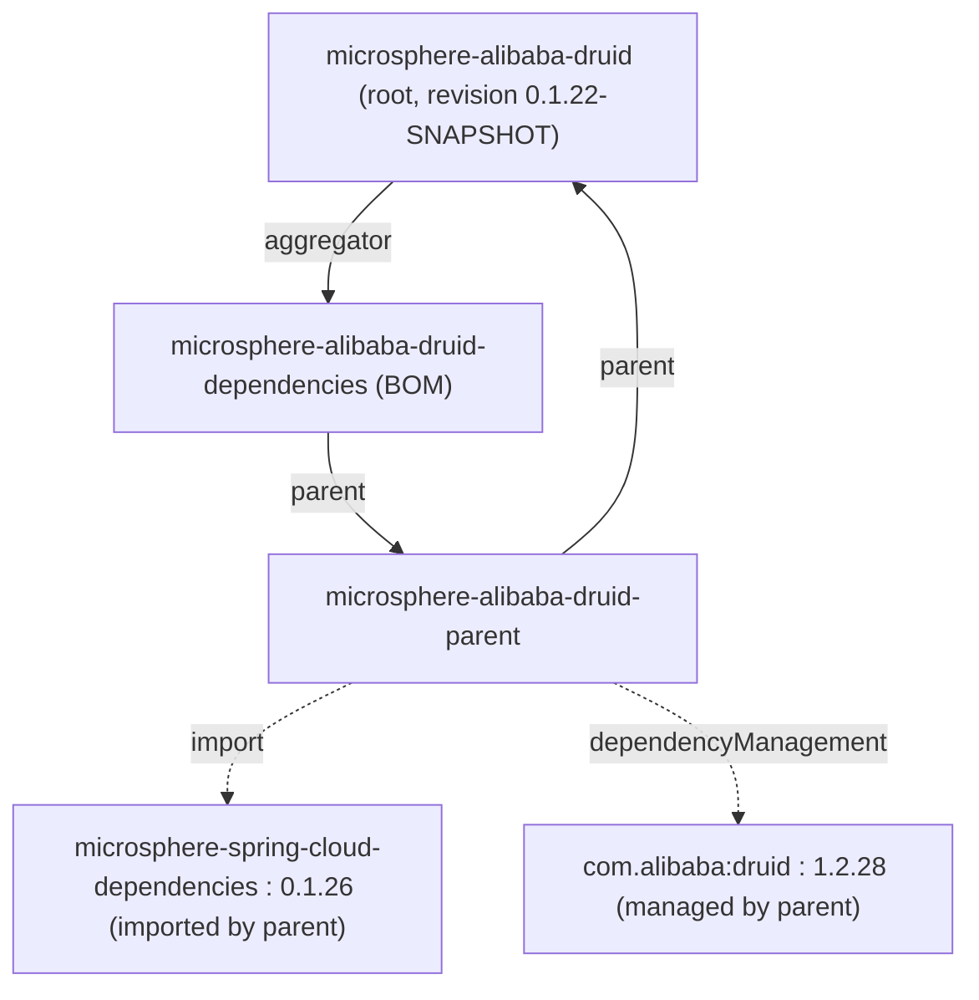
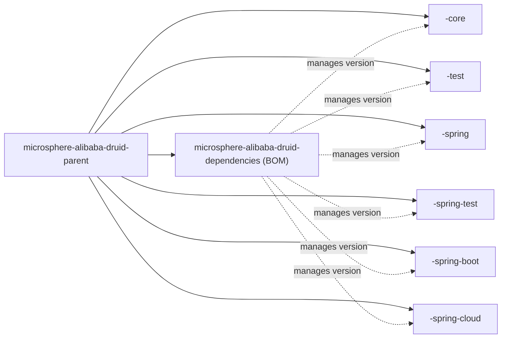

[English](../microsphere-alibaba-druid-dependencies.md)

# microsphere-alibaba-druid-dependencies

> 构建模块：本项目的 **BOM**（物料清单）。它用一个 `import` 发布六个已发行反应堆构件的坐标，使消费者只声明一次版本，
> 之后逐依赖省略版本。
> 打包方式：`pom`。父级：`microsphere-alibaba-druid-parent`。
> 仓库主页：[../../../../README.md](../../../../README.md) · [用户指南](../../user-guide/zh/README.md)

## 模块视角（BOM 立于何之上）

BOM 继承 `microsphere-alibaba-druid-parent`（因而继承根、外部 Spring Cloud 父链，以及 Druid 的版本）—— 它**不**独立存在。
它只管理本项目自身构件的版本；第三方版本仍来自父链。



## 受管成员

BOM 的 `<dependencyManagement>` 恰好列出**六个**构件，全部以 `${revision}`：

| # | artifactId | 角色 |
|---|---|---|
| 1 | `microsphere-alibaba-druid-core` | L0 Druid `Filter` SPI 实现（`AbstractStatementFilter`、`LoggingStatementFilter`、`PropertyConstants`）。 |
| 2 | `microsphere-alibaba-druid-test` | 非 Spring 测试基础设施（`AbstractAlibabaDruidTest`、`AlibabaDruidTestUtils`、JUnit 5 扩展）。 |
| 3 | `microsphere-alibaba-druid-spring` | L1 Spring Framework 集成（`@EnableAlibabaDruid`、`DruidDataSourceBeanPostProcessor`）。 |
| 4 | `microsphere-alibaba-druid-spring-test` | Spring 感知的测试基础设施（`AbstractDruidSpringTest`、`DruidDataSourceTestConfiguration`）。 |
| 5 | `microsphere-alibaba-druid-spring-boot` | L2 Spring Boot 自动配置。 |
| 6 | `microsphere-alibaba-druid-spring-cloud` | L3 Spring Cloud 打包。 |

两个 `pom` 打包模块 —— `microsphere-alibaba-druid-parent`（版本锚）与 `microsphere-alibaba-druid-dependencies`（本 BOM）——
刻意**不**列出：你不会把 BOM 或 parent 当作普通依赖添加。`com.alibaba:druid` 同样**不**在此受管 —— 它的 `1.2.28` 版本来自
parent，见 [parent 文档](microsphere-alibaba-druid-parent.md)。

## 导入用法

```xml
<dependencyManagement>
    <dependencies>
        <dependency>
            <groupId>io.github.microsphere-projects</groupId>
            <artifactId>microsphere-alibaba-druid-dependencies</artifactId>
            <version>${microsphere-alibaba-druid.version}</version>
            <type>pom</type>
            <scope>import</scope>
        </dependency>
    </dependencies>
</dependencyManagement>

<dependencies>
    <!-- no <version> needed; managed by the imported BOM -->
    <dependency>
        <groupId>io.github.microsphere-projects</groupId>
        <artifactId>microsphere-alibaba-druid-spring-boot</artifactId>
    </dependency>
</dependencies>
```

在 `release-1.x` 上解析出的 `${revision}` 是 `0.1.x` 线（最新发布 `0.1.21`，开发中 `0.1.22-SNAPSHOT`），所以
`microsphere-alibaba-druid.version` 应锁定到一个 `0.1.x` 值。在 `main`/`release` 上的消费者则使用 `0.2.x` BOM。

## BOM 与其它模块 POM 的关系



需明确的两种不同边：

- **实线边**（`parent → …`）是 `<parent>` 继承 —— 每个反应堆模块，含本 BOM，都继承 `microsphere-alibaba-druid-parent`。
- **虚线边**（`bom -.-> module`）是 BOM 提供给 `import` 它的**外部**消费者的*版本管理*。在反应堆内部，模块并不需要 BOM ——
  它们已经通过 parent 共享 `${revision}`。

## 设计要点

- **版本间接化。** 每个受管条目都用 `${revision}`，绝不写字面值，所以 BOM 自动与反应堆保持一致，跨发布无需编辑。
- **与 `parent` 分离。** parent 回答“Druid / Spring 栈是什么版本”；BOM 回答“*我们的*六个构件是什么版本”。把它们分开，
  使一个非 Maven 或被 parent 锁死的消费者仍能 `import` 本项目一组精心挑选的坐标。
- **可消费，不驱动构建。** 在此增删一个模块会改变 `import` 消费者能按 artifactId 解析到什么，但完全不改变反应堆如何
  构建 —— 那由聚合器（根 pom `<modules>`）控制。

## 1.x 说明

- 本 POM 在 `release-1.x` 与 `main` 之间除换行符外**逐字节一致**；受管坐标全是 `${revision}`，所以 BOM 主体从不编码一个
  版本号。消费者看到的差异只是锁定 `0.1.x`（此处）还是 `0.2.x`（current）发布。
- 由于 parent 指向 `microsphere-spring-cloud-dependencies:0.1.26`（经由 `parent`），`import` 本 BOM **不**会为消费者传递性
  导入那个外部 BOM —— `import` 是单层的。想要 Spring/Druid 受管版本的消费者必须自行 `import`
  `microsphere-spring-cloud-dependencies`（或把 `microsphere-alibaba-druid-parent` 作为其 parent）。

## 相关

- [开发者指南索引](README.md)
- [microsphere-alibaba-druid-parent](microsphere-alibaba-druid-parent.md)
- [microsphere-alibaba-druid-core](microsphere-alibaba-druid-core.md)
- [microsphere-alibaba-druid-spring-boot](microsphere-alibaba-druid-spring-boot.md)
- [仓库 README](../../../../README.md)

---

## English

- [English version of this document](../microsphere-alibaba-druid-dependencies.md)
