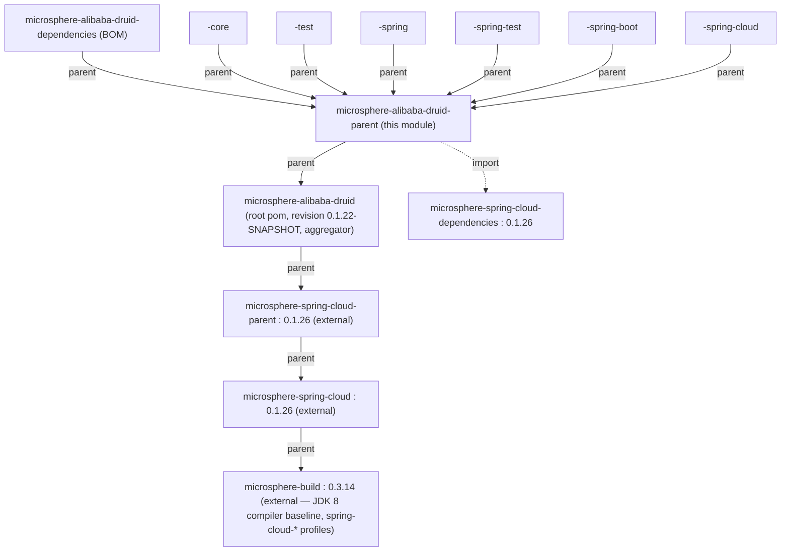

[English](../microsphere-alibaba-druid-parent.md)

# microsphere-alibaba-druid-parent

> 构建模块：每个反应堆模块共享的 `<parent>`。它集中管理所有 `*-alibaba-druid-*` 构件所继承的第三方版本锁定
> （Druid、被导入的 Microsphere Spring Cloud BOM），而它本身是仓库根 pom 的子级。
> 打包方式：`pom`。Java 基线：**JDK 8**（继承自外部父链）。
> 仓库主页：[../../../../README.md](../../../../README.md) · [用户指南](../../user-guide/zh/README.md)

## 模块视角（在 POM 层次中的位置）

`microsphere-alibaba-druid-parent` 是*七个*子模块用 `<parent>` 指向的版本/属性锚。注意它**不是**聚合器：聚合器是根
pom（`microsphere-alibaba-druid`），而 parent pom 自己的 `<parent>` 正是那个根。



`microsphere-alibaba-druid-parent` 被以下**全部**继承：`dependencies`、`core`、`test`、`spring`、`spring-test`、
`spring-boot`、`spring-cloud`。每个子模块都声明 `<version>${revision}</version>` 并把 `<parent>` 指向它（带
`<relativePath>../microsphere-alibaba-druid-parent/pom.xml</relativePath>`）。

## POM 分析

本模块在 `release-1.x` 上完整的 `pom.xml` 小而自足：

```xml
<parent>
    <groupId>io.github.microsphere-projects</groupId>
    <artifactId>microsphere-alibaba-druid</artifactId>
    <version>${revision}</version>
    <relativePath>../pom.xml</relativePath>
</parent>

<artifactId>microsphere-alibaba-druid-parent</artifactId>
<version>${revision}</version>
<packaging>pom</packaging>

<properties>
    <!-- BOM versions -->
    <microsphere-spring-cloud.version>0.1.26</microsphere-spring-cloud.version>
    <!-- Libraries -->
    <druid.version>1.2.28</druid.version>
</properties>

<dependencyManagement>
    <dependencies>
        <dependency>
            <groupId>com.alibaba</groupId>
            <artifactId>druid</artifactId>
            <version>${druid.version}</version>
        </dependency>
        <dependency>
            <groupId>io.github.microsphere-projects</groupId>
            <artifactId>microsphere-spring-cloud-dependencies</artifactId>
            <version>${microsphere-spring-cloud.version}</version>
            <type>pom</type>
            <scope>import</scope>
        </dependency>
    </dependencies>
</dependencyManagement>
```

只管两样，别无其它：

| 受管条目 | 值 | 机制 |
|---|---|---|
| `com.alibaba:druid` | `1.2.28` | 直接的 `<dependencyManagement>` 版本属性 `${druid.version}` —— **本仓库声明**。 |
| 一切 Spring/Boot/Microsphere | 按 `microsphere-spring-cloud-dependencies` | `import` 作用域 BOM，`${microsphere-spring-cloud.version}` = `0.1.26`。 |

- **`${revision}` 随处可见。** 本模块不声明字面版本；`0.1.22-SNAPSHOT` 只存在于根 pom 的 `<revision>` 属性，每个子模块
  （含本模块）都用 `<version>${revision}</version>`。这是对 CI 友好的 flatten 设置（构建时产出 `.flattened-pom.xml`），
  所以一次发布就是根上单个属性的一次抬升。
- **`druid.version` 是一个本地属性**，因此无需改动被导入的 BOM 就能在此改版本；`1.2.28` 与
  [current 线](../../../current/developer-guide/README.md)一致，即 Druid 版本*不是*两条分支线之间的差异之一。
- **这个 `import` 是唯一的传递版本来源。** Spring、Spring Boot、Spring Cloud、JUnit、Microsphere 工具与 `h2`/`logback`
  版本全部经 `microsphere-spring-cloud-dependencies:0.1.26` 解析，本仓库从声明 —— 这正是为何一个改了这个属性的
  `release-1.x` 消费者会看到一整套不同的框架栈。

## 外部父链（继承，而非在此声明）

JDK 基线与 Spring Cloud profile 都不写在本仓库。它们沿链继承而来：

```
microsphere-alibaba-druid-parent
  → microsphere-alibaba-druid (root)
    → microsphere-spring-cloud-parent : 0.1.26        (external)
      → microsphere-spring-cloud : 0.1.26             (external)
        → microsphere-build : 0.3.14                  (external)
```

| 继承的关注点 | 实际定义处 | 对 `release-1.x` 的效果 |
|---|---|---|
| `maven.compiler.source/target` | `microsphere-build:0.3.14` | `${java.version}` = **8** → class-file 版本 52，所以同一 jar 在 JDK 8 到 25 都能加载。 |
| `<java.version>` | 本仓库在 1.x 未设 | 作为 `8` 来自 `microsphere-build`（`current` 线把它覆写为 `17`）。 |
| `spring-cloud-hoxton` profile | 外部链 | Spring Boot `2.3.12.RELEASE` / Spring Cloud `Hoxton.SR12`。 |
| `spring-cloud-2020` profile | 外部链 | Spring Boot `2.4.13` / Spring Cloud `2020.0.5`。 |
| `spring-cloud-2021` profile | 外部链 | Spring Boot `2.6.15` / Spring Cloud `2021.0.9`。 |
| `test` / `coverage` profile | 外部链 | CI 使用的 Surefire/覆盖率装配。 |

> 这些 Boot/Cloud 配对是**从外部 POM 继承**的（`microsphere-spring-cloud:0.1.26` → `microsphere-build:0.3.14`），
> *并非*本仓库声明。要编辑它们需要上游的一次发布；不要为了“修正”它们而在本地加一个 `<profiles>` 块。

## CI 构建矩阵

`release-1.x` 上的 `.github/workflows/maven-build.yml` 横跨以下矩阵构建本反应堆：

```
java : 8 / 11 / 17 / 21 / 25
profile : spring-cloud-hoxton / spring-cloud-2020 / spring-cloud-2021
```

即 5 个 JDK × 3 个 Spring Cloud 代次，每个都运行
`mvn --batch-mode --update-snapshots test --activate-profiles test,coverage,<profile>` 并把覆盖率上传到 Codecov。
由于编译基线是 JDK 8（来自链），源码必须能在 `-source/-target 8` 下编译，*并且*测试必须在直到 JDK 25 的每个 JDK 上通过 ——
这正是本 parent 所强制的贡献者契约。

## 设计要点

- **单一继承锚，无聚合。** `parent` 是子模块 `<parent>` 的对象；根才是聚合器（`<modules>`）。把二者分开意味着消费者可以
  `<parent>` 继承版本管理，而不用把反应堆模块列表一并拖进来。
- **`parent` 对 `dependencies`（BOM）。** `parent` = 继承（一个反应堆子自动获得的属性 + `dependencyManagement`）。
  `dependencies` = 可导入的 BOM（六个反应堆构件的坐标，供*外部*消费者）。二者角色不同、模块也不同 —— 见
  [microsphere-alibaba-druid-dependencies](microsphere-alibaba-druid-dependencies.md)。
- **经由两个属性的版本间接化。** `druid.version` 与 `microsphere-spring-cloud.version` 是发布经理在此唯一触及的旋钮；
  框架矩阵活在上游。

## 1.x 说明

- 本线的区分性取值是 `<microsphere-spring-cloud.version>0.1.26</microsphere-spring-cloud.version>` 与根
  `<revision>0.1.22-SNAPSHOT</revision>`；在 `current`（`main`）线上同一文件写作 `0.2.26` 与 `0.2.22-SNAPSHOT`。
  POM 结构的其余部分完全一致。
- **JDK 8** 是经 `microsphere-build:0.3.14` 传递强制的编译契约；此处没有本地 `<java.version>` 覆写。贡献者代码保持在
  Java 8 语言级别。
- 三个 `spring-cloud-*` profile 及其 Boot/Cloud 版本对是外部的 —— 在记录“1.x 支持哪些 Spring Boot”时，把
  Hoxton.SR12 / 2020.0.5 / 2021.0.9 引用为*继承*的，绝不要声称由仓库声明。

## 相关

- [开发者指南索引](README.md)
- [microsphere-alibaba-druid-dependencies](microsphere-alibaba-druid-dependencies.md)
- [microsphere-alibaba-druid-spring-boot](microsphere-alibaba-druid-spring-boot.md)
- [current 线开发者指南](../../../current/developer-guide/README.md)
- [仓库 README](../../../../README.md)

---

## English

- [English version of this document](../microsphere-alibaba-druid-parent.md)
