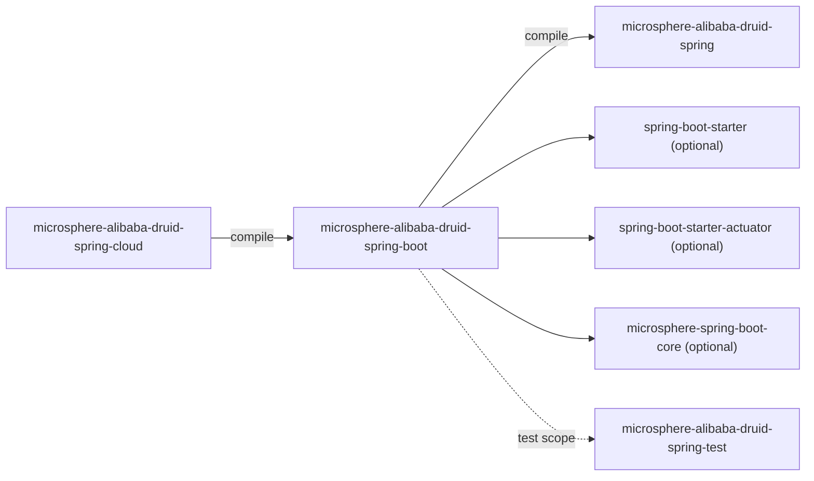
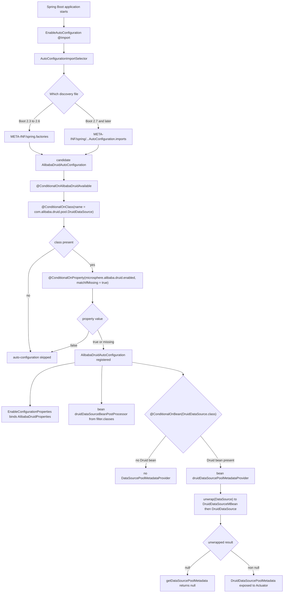

[English](../microsphere-alibaba-druid-spring-boot.md)

# microsphere-alibaba-druid-spring-boot

> 层 L2：Spring Boot 自动配置、外部化属性、组合条件与 Actuator 池元数据。
> 包根：`io.microsphere.alibaba.druid.spring.boot` 与 `…spring.boot.autoconfigure` / `…condition` / `…metadata`。
> 仓库主页：[../../../../README.md](../../../../README.md) · [用户指南](../../user-guide/zh/README.md)

## 模块视角



只有 `microsphere-alibaba-druid-spring` 是必需依赖。Spring Boot、Actuator 与 Microsphere Boot 辅助类都是
`optional`，所以本模块编译时不会把 Boot 强加给一个普通 Spring 应用；Boot 应用自行提供其 starter。

## 注册文件（1.x 特有）

两个发现文件并排发行：

```properties
# src/main/resources/META-INF/spring/org.springframework.boot.autoconfigure.AutoConfiguration.imports
io.microsphere.alibaba.druid.spring.boot.autoconfigure.AlibabaDruidAutoConfiguration
```

```properties
# src/main/resources/META-INF/spring.factories  (added on release-1.x only)
org.springframework.boot.autoconfigure.EnableAutoConfiguration=\
io.microsphere.alibaba.druid.spring.boot.autoconfigure.AlibabaDruidAutoConfiguration
```

为何两者都要：本线针对 Spring Boot **2.3.12.RELEASE / 2.4.13 / 2.6.15**（见
`spring-cloud-hoxton` / `-2020` / `-2021` profile），它们早于 `imports` 文件（Boot 2.7 引入），并且**只**从
`spring.factories` 读取自动配置。反过来，Boot 3.x 不再承认 `spring.factories` 中的 `EnableAutoConfiguration`
键。由于产出的类是 Java 8 字节码，同一批 0.1.x 构件也能被 2.7+ 与 3.x 运行时消费，所以 `imports` 文件被保留而非替换。

维护者规则：新增一个自动配置意味着要编辑**两个**文件。删除其中任何一个，都是对支持矩阵一半的破坏。本模块没有
`@AutoConfigureBefore` / `@AutoConfigureAfter` 排序，所以注册顺序无关紧要；在 Boot 2.7 上重复的类条目会被
`AutoConfigurationImportSelector.removeDuplicates` 移除。

## 源码分析

### `io.microsphere.alibaba.druid.spring.boot.autoconfigure.AlibabaDruidAutoConfiguration`

```java
@ConditionalOnAlibabaDruidAvailable
@EnableConfigurationProperties(AlibabaDruidProperties.class)
public class AlibabaDruidAutoConfiguration {

    @Bean(name = BEAN_NAME)
    public BeanPostProcessor druidDataSourceBeanPostProcessor(AlibabaDruidProperties alibabaDruidProperties) {
        Filter filter = alibabaDruidProperties.getFilter();
        return new DruidDataSourceBeanPostProcessor(filter.getClasses());
    }

    @Bean
    @ConditionalOnBean(DruidDataSource.class)
    public DataSourcePoolMetadataProvider druidDataSourcePoolMetadataProvider() {
        return dataSource -> {
            DruidDataSource druidDataSource = unwrap(dataSource, DruidDataSourceMBean.class, DruidDataSource.class);
            return druidDataSource == null ? null : new DruidDataSourcePoolMetadata(druidDataSource);
        };
    }
}
```

- **无 `@Configuration`** 注解。通过 `spring.factories` / `imports` 发现的自动配置类会被
  `ConfigurationClassParser` 当作配置类处理；加注解只会增加噪音。（1.x 矩阵横跨 Boot 2.3–2.6，此时这已是常态。）
- **`@ConditionalOnAlibabaDruidAvailable`** 是唯一的类级条件（组合式，见下）。
- **`@EnableConfigurationProperties(AlibabaDruidProperties.class)`** 绑定并注册属性 bean，无需组件扫描。
- `@Bean(name = BEAN_NAME)` 复用 `DruidDataSourceBeanPostProcessor.BEAN_NAME`
  （`"druidDataSourceBeanPostProcessor"`），即 `@EnableAlibabaDruid` registrar 写入的*同一个* bean 名。这是 L1 与
  L2 之间的去重契约：把 `@EnableAlibabaDruid` 与 Boot 自动配置组合起来的用户会得到一个 post-processor 定义，后一次
  注册替换前一次。
- 声明的返回类型是 `BeanPostProcessor`（接口），而非具体类 —— 这正是让 Spring 从 bean *声明*（而非实例化结果）
  中把它检测为 post-processor，并保持本类对 `spring` 仅是编译期耦合。注意权衡：下游按具体类型注入在运行时仍然可行。
- filter 类来自配置，而非 `@EnableAlibabaDruid` 的多源扫描：自动配置**不**运行 `spring.factories`/`META-INF/services`
  发现路径。若你需要那些，请加上 `@EnableAlibabaDruid`。
- `druidDataSourcePoolMetadataProvider` 是 `@ConditionalOnBean(DruidDataSource.class)`，针对 refresh 中*更早*注册的
  bean 定义求值 —— 因此稍后声明的 Druid 数据源（例如被某个在自动配置之后处理的用户 `@Configuration`）可能抑制这个
  bean。这正是该 provider 无论如何都必须容忍 `null` 元数据的 documented 原因。
- `unwrap(dataSource, DruidDataSourceMBean.class, DruidDataSource.class)`
  （`org.springframework.boot.jdbc.DataSourceUnwrapper.unwrap`）依序探测候选类型，并解开代理（`DataSourceProxy`、
  p6spy、`BeanFactory` 产生的包装器、JMX MBean 适配器）直到某个类型匹配；若无匹配则返回 `null`，lambda 也返回 `null`
  —— 这告诉 Boot 的 `DataSourcePoolMetadataProvidersConfiguration` 链本 provider 不拥有该数据源。返回 `null` 是必需
  语义，而非错误路径。把 `DruidDataSourceMBean.class` 放在首位，正是为了让仅通过 JMX 暴露的 Druid bean 也能被识别。

### `io.microsphere.alibaba.druid.spring.boot.AlibabaDruidProperties`

```java
@ConfigurationProperties(prefix = ALIBABA_DRUID_PROPERTY_NAME_PREFIX)
public class AlibabaDruidProperties {
    private boolean enabled = true;
    private Filter filter = new Filter();
    public boolean isEnabled();  public void setEnabled(boolean enabled);
    public Filter getFilter();   public void setFilter(Filter filter);

    public static class Filter {
        private Class<? extends com.alibaba.druid.filter.Filter>[] classes = of(com.alibaba.druid.filter.Filter.class);
        public Class<? extends com.alibaba.druid.filter.Filter>[] getClasses();
        public void setClasses(Class<? extends com.alibaba.druid.filter.Filter>[] classes);
    }
}
```

- 前缀解析为 `microsphere.alibaba.druid`，与 `PropertyConstants` 一致。
- 绑定的键：`microsphere.alibaba.druid.enabled`（`boolean`，默认 `true`）与
  `microsphere.alibaba.druid.filter.classes`（类名数组，默认 `com.alibaba.druid.filter.Filter`）。Boot 的 binder 通过
  其 string→`Class` 转换器把逗号分隔的 FQCN 列表转成 `Class[]`，这就是为何集成测试里
  `microsphere.alibaba.druid.filter.classes=io.microsphere.alibaba.druid.filter.LoggingStatementFilter` 能让
  `assertArrayEquals(of(LoggingStatementFilter.class), classes)` 成功。
- 嵌套的 `Filter` 类被急切实例化（`new Filter()`），所以即使零配置 `getFilter()` 也永不 `null`；`classes` 同样默认为
  根 `Filter` 接口，意味着“添加所有 filter bean”。
- `Filter` 必须是一个带无参构造的 `static` 嵌套类才能被绑定；它刻意遮蔽了 Druid 的类型名，故签名中使用全限定的
  `com.alibaba.druid.filter.Filter`。编辑时请同时保留两种写法。
- `enabled` **不**被任何 Java 代码读取：门控是在原始属性名上的 `@ConditionalOnProperty`。该字段的存在是为了元数据、
  IDE 补全与程序化检查。改 `PropertyConstants` 里的属性名却不更新 `@ConditionalOnProperty`，会让属性被绑定却无效。
- `AlibabaDruidPropertiesTest` 断言默认值与 setter 往返。

### `io.microsphere.alibaba.druid.spring.boot.condition.ConditionalOnAlibabaDruidEnabled`

```java
@Target(TYPE)
@Retention(RUNTIME)
@Documented
@ConditionalOnProperty(name = ALIBABA_DRUID_ENABLED_PROPERTY_NAME, matchIfMissing = true)
public @interface ConditionalOnAlibabaDruidEnabled {
}
```

`matchIfMissing = true` —— 该功能**默认开启**；只有显式的 `microsphere.alibaba.druid.enabled=false` 才关闭它。这是门控
的属性侧。

### `io.microsphere.alibaba.druid.spring.boot.condition.ConditionalOnAlibabaDruidAvailable`

```java
@Target(TYPE)
@Retention(RUNTIME)
@Documented
@ConditionalOnAlibabaDruidEnabled
@ConditionalOnClass(name = {
        "com.alibaba.druid.pool.DruidDataSource"                   // Alibaba Druid API
})
public @interface ConditionalOnAlibabaDruidAvailable {
}
```

- **组合式 `@Conditional` 元注解** 模式：把两个 Spring Boot 条件组合成一个可复用、自文档化的注解。Spring 会评估
  *所有*被元注解的条件，所以语义是 AND：Druid 类存在 **且** enabled 标志不为 `false`。
- `@ConditionalOnClass(name = ...)` 使用 **字符串** 形式而非 `value = DruidDataSource.class`。这在本线上是强制的：
  否则条件类本身会在其注解描述符里引用 Druid 类型，在 Boot 来得及判断之前就以 `TypeNotPresentException`/
  `NoClassDefFoundError` 失败。使用 `name` 让 classpath 检查保持惰性，并使本模块可部署在无 Druid 的应用中。
- `@Target(TYPE)` 把使用限制在类（自动配置）上 —— 按设计这两个注解不适用于方法。
- 同一注解被 `AlibabaDruidCloudAutoConfiguration` 复用，这就是它位于 `…spring.boot.condition` 而非
  `…spring.boot.autoconfigure` 内部的原因。

### `io.microsphere.alibaba.druid.spring.boot.metadata.DruidDataSourcePoolMetadata`

```java
public class DruidDataSourcePoolMetadata implements DataSourcePoolMetadata {
    private static final float ZERO = 0.0f;
    private static final float ONE = 1.0f;
    private final DruidDataSource dataSource;

    public Float getUsage()            // 0 when activeCount == 0, 1 when activeCount == maxActive, else active / (maxActive * ONE)
    public Integer getActive()         // dataSource.getActiveCount()
    public Integer getIdle()           // dataSource.getMaxIdle()
    public Integer getMax()            // dataSource.getMaxActive()
    public Integer getMin()            // dataSource.getMinIdle()
    public String getValidationQuery() // dataSource.getValidationQuery()
    public Boolean getDefaultAutoCommit() // dataSource.isDefaultAutoCommit()
}
```

- **`DataSourcePoolMetadataProvider` / `DataSourcePoolMetadata` 适配器模式**：它把 Druid 的计数器 API 映射到
  Actuator 的指标词汇，使 `/actuator/metrics/db.pool.*` 对 Druid 生效。
- `getUsage()` 刻意分支守护：`active == 0` 返回缓存的 `ZERO`，`active == maxActive` 返回 `ONE`，所以常见极值是精确的，
  只有介于其间才做浮点除法。`maxActive * ONE` 强制浮点运算（整数除法会得到 `0`）。不可避免的边界：若 `maxActive` 为
  `0` 且 `activeCount != 0`，结果是 `Infinity`/`NaN` —— Druid 默认 `maxActive` 为 `8`，H2 测试夹具保持默认，这正是
  `DruidDataSourcePoolMetadataTest` 断言 `getMax() == 8` 的原因。
- **`getIdle()` 返回 `getMaxIdle()`**，而非实时空闲计数。这是一次刻意的映射（Druid 在此使用的指标面上没有普通的
  “当前空闲” getter），但它意味着 Actuator 的 `db.pool.idle` 读数是一个*容量*数字。这是文档化行为，而非待修的 bug
  —— 改变它会扭曲仪表盘。
- 该类不持有可变状态且未做线程包装：每次调用都读实时计数器，所以并发指标抓取是安全的。
- `getDefaultAutoCommit()` 映射 Druid 的 `isDefaultAutoCommit()`，其在默认值从未被设置时返回 `null`；接口的 `Boolean`
  返回类型允许这一点。

## 自动配置条件评估流程



## 测试策略

| 测试 | 机制 | 断言重点 |
|---|---|---|
| `AlibabaDruidAutoConfigurationTest` | 在 `@SpringBootTest(webEnvironment = NONE)` 下继承 `io.microsphere.spring.boot.test.AutoConfigurationTest<AlibabaDruidAutoConfiguration>` | 声明 `DruidDataSourceBeanPostProcessor` 为期望的自动配置类，`microsphere.alibaba.druid.enabled=false` 为全局禁用属性，`DruidDataSource.class` 为全局缺失类 —— 基类随后针对两个注册文件运行 enabled/disabled/present/absent 的排列组合。 |
| `AlibabaDruidAutoConfigurationIntegrationTest` | `@SpringBootTest` + `@EnableAutoConfiguration`，配 `properties = {"microsphere.alibaba.druid.enabled=true", "microsphere.alibaba.druid.filter.classes=io.microsphere.alibaba.druid.filter.LoggingStatementFilter"}`，继承 `AbstractDruidSpringTest` | 真实 SQL 矩阵通过自动注册的 post-processor 执行；断言 `AlibabaDruidProperties`、`LoggingStatementFilter` bean、`filter.classes` 数组以及 `provider.getDataSourcePoolMetadata(dataSource)` 是一个 `DruidDataSourcePoolMetadata`。 |
| `DruidDataSourcePoolMetadataTest` | 直接在默认 H2 数据源上实例化 | `usage`/`active`/`idle`/`max`/`min` 值。 |
| `AlibabaDruidPropertiesTest` | 普通单元测试 | 默认值与 setter。 |

`assertInstanceOf`（被集成测试使用）是 JUnit Jupiter 5.8+；Jupiter 版本来自
`microsphere-spring-cloud-dependencies:0.1.26`，而非本仓库。

## 设计模式

- **自动配置 + `@Conditional`**（Boot 惯用法），配合**组合式元注解**条件。
- **`@EnableConfigurationProperties` / 类型安全配置绑定**（`AlibabaDruidProperties`）。
- **Provider/策略** —— `DataSourcePoolMetadataProvider` 作为可插拔策略，`null` = “不是我的”。
- **适配器** —— `DruidDataSourcePoolMetadata` 把 Druid 计数器适配到 Actuator 的接口。
- **委托式实例化** —— `@Bean` 方法构建一个 `DruidDataSourceBeanPostProcessor` 而非注册类，所以构造函数参数来自属性。

## 1.x 说明

- `src/main/resources/META-INF/` 下的 `spring.factories` **仅在 `release-1.x` 存在**；current 线只依赖
  `AutoConfiguration.imports`。不要把它删除的改动 cherry-pick 到 1.x。
- Java 8 源码级别：无 `List.of`，无 `var`；注意 `of(com.alibaba.druid.filter.Filter.class)` 来自
  `io.microsphere.util.ArrayUtils`。
- Boot 2.3–2.6 没有 `@AutoConfiguration` 注解（Boot 2.7 引入）—— 这也是该类不带那种注解的另一个原因；在此请继续
  使用普通条件注解。
- 带候选类变参的 `DataSourceUnwrapper.unwrap` 自 Boot 2.1 起可用，所以三个矩阵代次都支持它。

## 相关

- [开发者指南索引](README.md)
- [microsphere-alibaba-druid-spring](microsphere-alibaba-druid-spring.md)
- [microsphere-alibaba-druid-spring-cloud](microsphere-alibaba-druid-spring-cloud.md)
- [microsphere-alibaba-druid-parent](microsphere-alibaba-druid-parent.md)
- [用户指南](../../user-guide/zh/README.md)
- [仓库 README](../../../../README.md)

---

## English

- [English version of this document](../microsphere-alibaba-druid-spring-boot.md)
