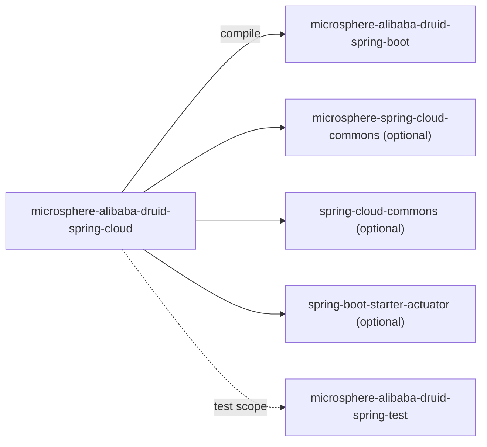
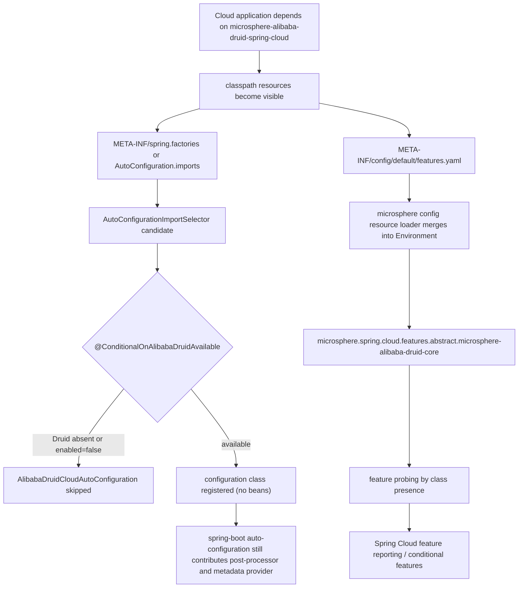

[English](../microsphere-alibaba-druid-spring-cloud.md)

# microsphere-alibaba-druid-spring-cloud

> 层 L3：面向 Spring Cloud 的打包。它贡献**一个条件化自动配置壳**外加一个 `features.yaml` 描述符；所有真实行为
> 都继承自下层。包根：`io.microsphere.alibaba.druid.spring.cloud`。
> 仓库主页：[../../../../README.md](../../../../README.md) · [用户指南](../../user-guide/zh/README.md)

## 模块视角



`microsphere-alibaba-druid-spring-boot`（并传递地 `-spring` 与 `-core`）是唯一必需依赖。Spring Cloud、
Spring Cloud Commons、Boot starter 与 Actuator 都是 `optional`，所以把本模块加入一个非 Cloud 应用不会把 Cloud
拖到 classpath 上。

## 源码分析

### `io.microsphere.alibaba.druid.spring.cloud.autoconfigure.AlibabaDruidCloudAutoConfiguration`

```java
@ConditionalOnAlibabaDruidAvailable
public class AlibabaDruidCloudAutoConfiguration {
}
```

这刻意是一个**空壳**。把它读成“死代码”会错过它所做的三件事：

1. **它是一个注册主体。** 被列于发现文件意味着它参与 Boot 的自动配置排序与条件求值，给模块在上下文生命周期中一个
   明确的位置。
2. **它携带门控。** `@ConditionalOnAlibabaDruidAvailable`（来自 `spring-boot` 模块：
   `@ConditionalOnClass(name = "com.alibaba.druid.pool.DruidDataSource")` **AND**
   `@ConditionalOnProperty(name = "microsphere.alibaba.druid.enabled", matchIfMissing = true)`）意味着本类将来新增的
   一切都会在 Druid 缺失或功能被关闭时自动禁用。条件是扩展点，主体才是载荷。
3. **它锚定模块的元数据。** 构件的 classpath 资源 `META-INF/config/default/features.yaml` 只有在该 jar 确实是依赖时
   才对 Spring Cloud feature 工具可见；自动配置是 cloud 层可据以判定“本模块已激活”的规范钩子。

它声明**没有** `@Bean` 方法、没有 `@EnableConfigurationProperties`，也不重新声明 `@ConditionalOnClass` —— 它复用组合
注解，这正是让 Boot 的 `ConditionEvaluationReport` 保持可读的原因（两个自动配置只有一个条件名）。

由于该类不定义任何 bean，1.x 的 `spring.factories` 条目与 `AutoConfiguration.imports` 条目在 Boot 2.3–2.6 上都会产出一个
已注册但空的配置类。这是预期的：测试 `AlibabaDruidCloudAutoConfigurationTest` 通过提供一个*空*的
`configureAutoConfiguredClasses(Set<Class<?>>)` 回调，恰好断言了这一点。

### `src/main/resources/META-INF/spring/org.springframework.boot.autoconfigure.AutoConfiguration.imports`

```
io.microsphere.alibaba.druid.spring.cloud.autoconfigure.AlibabaDruidCloudAutoConfiguration
```

### `src/main/resources/META-INF/spring.factories`（仅 1.x）

```properties
org.springframework.boot.autoconfigure.EnableAutoConfiguration=\
io.microsphere.alibaba.druid.spring.cloud.autoconfigure.AlibabaDruidCloudAutoConfiguration
```

与 `spring-boot` 模块相同的双注册契约（Boot 2.x 读 `spring.factories`，Boot 2.7+ 读 `imports` 并去重，Boot 3.x 忽略
`EnableAutoConfiguration` 键）。两个文件必须保持同步；在 `release-1.x` 上删除 `spring.factories` 会对每个 Boot
2.3–2.6 应用静默禁用本模块。

### `src/main/resources/META-INF/config/default/features.yaml`

```yaml
microsphere:
  spring:
    cloud:
      features:
        abstract:
          microsphere-alibaba-druid-core:
            - com.alibaba.druid.pool.DruidDataSource
            - com.alibaba.druid.filter.Filter
```

结构与语义：

| 路径段 | 含义 |
|---|---|
| `microsphere.spring.cloud.features` | 由外部 `microsphere-spring-cloud-commons` 拥有的属性前缀。 |
| `abstract` | feature 的类别：*abstract* feature 是声明的能力而非实例化的 bean。 |
| `microsphere-alibaba-druid-core` | feature 键 —— 此处是**拥有该能力模块的 artifactId**，尽管文件位于 `spring-cloud` jar。 |
| 字符串列表 | 其**在 classpath 上的存在**决定该 feature 是否被实现的全限定类名。 |

机械地说，这个 YAML 由 microsphere 的 classpath 配置资源约定加载
（`META-INF/config/<profile>/features.yaml`，其中 `default` 是回退 profile 目录），并作为
`microsphere.spring.cloud.features.abstract.*` 属性合并进 Spring `Environment`。`microsphere-spring-cloud-commons` 中
的 feature 机制随后通过探测所列类回答“feature X 是否可用？”，这就是 Spring Cloud 层组件（条件 feature 门控、能力报告）
如何在自身不依赖 Druid API 的情况下推理 Alibaba Druid。

对贡献者的两个后果：

- **本文件的消费者是外部的**（`microsphere-spring-cloud-commons`），所以其键布局不能单方面改变；重命名 `abstract`
  或 artifact 键会破坏上游报告。
- feature 以 `microsphere-alibaba-druid-core` 为键，而文件却随 `microsphere-alibaba-druid-spring-cloud` 发行。这是刻意的
  —— *能力*属于 `core`（拦截 filter），*声明*属于 Cloud 应用实际依赖的那个模块。

## Cloud 激活流程



## 测试

| 测试 | 重点 |
|---|---|
| `AlibabaDruidCloudAutoConfigurationTest` | 继承 `AutoConfigurationTest<AlibabaDruidCloudAutoConfiguration>`；**不**注册期望的自动配置类，通过 `microsphere.alibaba.druid.enabled=false` 禁用，通过缺失 `DruidDataSource.class` 模拟不可用。证明该壳既条件化又为空。 |
| `AlibabaDruidCloudAutoConfigurationIntegrationTest` | 在 cloud 模块位于 classpath 上时启动上下文，并运行继承自 `AbstractDruidSpringTest` 的语句矩阵，证明来自 L2 的自动配置在 Cloud 上下文中仍然有效。 |

两者都在 `release-1.x` 的三个 `spring-cloud-*` profile 下运行，所以该类针对 Hoxton.SR12、2020.0.5 与 2021.0.9 编译并测试。

## 设计模式

- **标记/自动配置壳** —— 一个条件化、无行为的类，用作扩展钩子与元数据锚。
- **组合式 `@Conditional` 复用** —— 门控在 `spring-boot` 中定义一次并应用于此。
- **外部化能力描述符** —— `features.yaml` 作为由另一个库消费的声明式元数据（配置文件 / feature-flag 模式而非代码耦合）。
- **以组合方式分层** —— L3 不添加逻辑；它在 Cloud 契约下重新导出 L0–L2。

## 1.x 说明

- 本模块的 `spring.factories` 文件是 **1.x 独有**的；它正是这条分支线作为独立构件集（`0.1.x`）而非运行期开关存在的
  原因。
- JDK 8 基线：此处没有使用更新的语言特性；该模块在经由 `microsphere-spring-cloud:0.1.26` 从 `microsphere-build:0.3.14`
  继承的 `maven.compiler.source/target=8` 下编译。
- 在 Boot 2.3–2.6 上 `@ConditionalOnClass` 的字符串形式至关重要；尤其 Boot 2.4 改变了 `spring.factories` 中
  `EnableAutoConfiguration` 的加载顺序，但 `imports`/`factories` 配对让两条路径保持一致。

## 相关

- [开发者指南索引](README.md)
- [microsphere-alibaba-druid-spring-boot](microsphere-alibaba-druid-spring-boot.md)
- [microsphere-alibaba-druid-parent](microsphere-alibaba-druid-parent.md)
- [用户指南](../../user-guide/zh/README.md)
- [仓库 README](../../../../README.md)

---

## English

- [English version of this document](../microsphere-alibaba-druid-spring-cloud.md)
