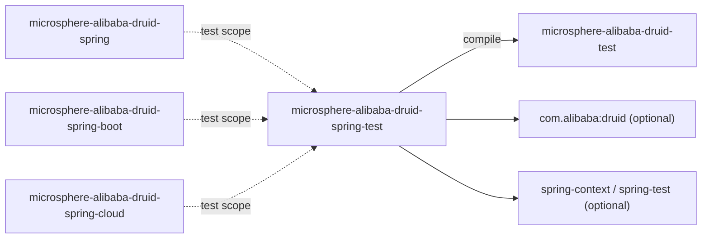
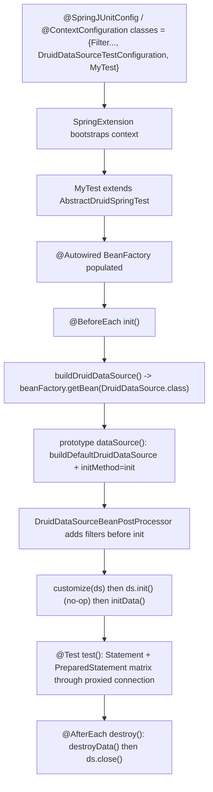

[English](../microsphere-alibaba-druid-spring-test.md)

# microsphere-alibaba-druid-spring-test

> 支持模块（Spring 感知）：一个薄桥接层，让非 Spring 的 `AbstractAlibabaDruidTest` 模板从 Spring `BeanFactory`
> 取得它的 `DruidDataSource`，外加一个可复用的测试配置，用于产出数据源 bean。
> 包根：`io.microsphere.alibaba.druid.test.spring`。Java 基线：**JDK 8**。
> 仓库主页：[../../../../README.md](../../../../README.md) · [用户指南](../../user-guide/zh/README.md)

## 模块视角

`spring-test` 恰有**一个必需依赖**：`microsphere-alibaba-druid-test`（compile，`${revision}`）。Spring Framework、
Spring `spring-test`、Druid 与 H2 都是 `optional`，所以它增加 Spring 感知而不把某个 Spring 版本强加给消费者 —— 版本
来自父链。



| 依赖 | 作用域 | 原因 |
|---|---|---|
| `microsphere-alibaba-druid-test` | **compile（必需）** | `AbstractDruidSpringTest` 继承 `AbstractAlibabaDruidTest` 并复用其生命周期。 |
| `spring-context`、`spring-test` | optional | `@Bean`/`@Scope`、`BeanFactory`、`SpringExtension`、`@ContextConfiguration`。 |
| `com.alibaba:druid` | optional | 被产出/消费的 `DruidDataSource` 类型。 |
| `microsphere-spring-context`、`microsphere-spring-test` | optional | Microsphere Spring 测试辅助类（为下游 Spring 测试声明）。 |
| `h2`、`logback-classic`（optional）、`microsphere-logback`（test） | optional / test | 被继承 SQL 矩阵所用的内存 DB 与日志后端。 |

三个运行时模块（`spring`、`spring-boot`、`spring-cloud`）各自在 `test` 作用域依赖 `spring-test`，这正是为何本仓库里
每个 Spring 级集成测试都从 `AbstractDruidSpringTest` 继承，并在其上下文中列出 `DruidDataSourceTestConfiguration`。

## 源码分析

### `io.microsphere.alibaba.druid.test.spring.AbstractDruidSpringTest`

```java
public abstract class AbstractDruidSpringTest extends AbstractAlibabaDruidTest {

    @Autowired
    private BeanFactory beanFactory;

    @Override
    protected DruidDataSource buildDruidDataSource() {
        return beanFactory.getBean(DruidDataSource.class);
    }
}
```

- **整座桥就是一个方法覆写。** 其它一切 —— `@BeforeEach` 生命周期（`buildDruidDataSource → customize → init →
  initData`）、`test()` SQL 矩阵、`@AfterEach`（`destroyData → close`）—— 都从
  [AbstractAlibabaDruidTest](microsphere-alibaba-druid-test.md#iomicrospherealibabadruidtestabstractalibabadruidtest)
  原样继承。把 `buildDruidDataSource()` 覆写为从容器拉取 bean，是 Spring `BeanFactory` 与非 Spring 测试模板之间的唯一
  集成点。
- `beanFactory` 用 `@Autowired` 注入，所以本类必须在 Spring 测试上下文下运行（`SpringExtension` /
  `@ContextConfiguration`，或 Boot/Cloud 测试中的 `@SpringBootTest`）。没有 Spring 引导时字段为 `null`，
  `buildDruidDataSource()` 会在 `@BeforeEach` 抛 NPE。
- 覆写**去掉了**父签名的 `throws IOException` —— `getBean` 不会抛它 —— 但仍是一次合法的收窄。
- **与基类生命周期的交互**：由于基类 `@BeforeEach` 仍调用 `ds.init()` 且 `@AfterEach` 仍调用 `ds.close()`，
  `buildDruidDataSource()` 返回的数据源必须容忍重复初始化 / 重复关闭。它确实如此：`DruidDataSource.init()` 在已初始化时
  短路，而 `AbstractAlibabaDruidTest` 的 close 有守护。这正是配套配置把 prototype 作用域与 `initMethod`/`destroyMethod`
  配对却不冲突的原因（见下）。

### `io.microsphere.alibaba.druid.test.spring.DruidDataSourceTestConfiguration`

```java
public class DruidDataSourceTestConfiguration {

    @Bean(initMethod = "init", destroyMethod = "close")
    @Scope(SCOPE_PROTOTYPE)
    public DruidDataSource dataSource() throws IOException {
        return buildDefaultDruidDataSource();
    }
}
```

- **Prototype 作用域是承重的决定。** 每次 `beanFactory.getBean(DruidDataSource.class)` 调用（即每次 `@BeforeEach`）
  都产出一个**全新**的 `DruidDataSource`，由 `AlibabaDruidTestUtils.buildDefaultDruidDataSource()` 配置。这很重要，有两个
  原因：
  1. 继承来的 `initData()`/`destroyData()` 会跨测试方法创建并删除 `users` 表 —— 每实例的数据源让那份状态不会跨测试泄漏
     （没有测试间表竞争，没有共享 filter 计数器）。
  2. `DruidDataSourceBeanPostProcessor`（见 [spring 模块](microsphere-alibaba-druid-spring.md)）以**不去重、无幂等守护**
     的方式把 filter 追加到 `getProxyFilters()`；prototype 每次都得到一份干净的 filter 列表，而一个跨测试被重新初始化的
     singleton 会累积重复。
- **`initMethod = "init"`** 在 bean 创建时运行，所以 `customize`-安装的 filter（在基类 `init()` 之前经
  `getProxyFilters().add(...)` 添加）会收到它们的 `Filter.init(DataSourceProxy)` 回调。之后基类 `@BeforeEach` 再调 `init()`
  是 no-op（Druid 以 inited 标志守护）。
- **`destroyMethod = "close"`** 出于完整性被声明，但 Spring **不**跟踪 prototype 作用域 bean 以做销毁回调 —— 所以实践上
  处置来自基类 `@AfterEach` 的 `close()`，它是幂等的。声明 `destroyMethod` 仍能抑制 Spring 的“推断销毁方法”启发式并表明意图。
- 类上**无 `@Configuration`**：它通过 `@ContextConfiguration(classes = { DruidDataSourceTestConfiguration.class, ... })`
  作为配置*候选*注册，即 Spring 的 “lite mode” `@Bean` 处理。这让夹具免于额外代理，同时仍暴露 `dataSource()` bean。

## 一个 Spring filter 测试如何组装



## 设计模式

- **适配器 / 桥接** —— `AbstractDruidSpringTest` 把 Spring 的 `BeanFactory` 桥入一个框架无关的模板方法；父类永远不知道
  该对象来自容器。
- **模板方法（复用）** —— 不重新实现任何生命周期逻辑；只改变对象来源。
- **测试夹具配置** —— `DruidDataSourceTestConfiguration` 是一个可复用的 `@Bean` 提供者，被组合进 `spring`/`spring-boot`/
  `spring-cloud` 测试套件的许多不同上下文中。
- **每测试的 prototype 隔离** —— 有状态、每调用一次的协作者这一 Spring 测试经典惯用法，在此专门用于保持 Druid filter
  列表与表状态干净。

## 1.x 说明

- **与 `current` 线源码一致。** 本模块没有 `spring.factories`、没有自动配置、没有版本特定 API；仅有的 `release-1.x`
  差异位于 `spring-boot`/`spring-cloud` 注册文件与 `microsphere-alibaba-druid-test` 结构中。
- **JDK 8 基线**：`buildDefaultDruidDataSource()` 与 `dataSource()` 只是抛 `IOException`；这里无需 try-with-resources
  或 Java 9+ 构造。
- 由于下游 Spring 测试导入本配置，对该 bean 作用域或生命周期方法的一次改动会波及
  `EnableAlibabaDruidTest`、`DruidDataSourceBeanPostProcessorTest`、`AlibabaDruidAutoConfigurationIntegrationTest` 与
  `AlibabaDruidCloudAutoConfigurationIntegrationTest` —— 请把该夹具视作共享 API。

## 测试

| 测试类 | 位置 | 它钉住的内容 |
|---|---|---|
| `DefaultDruidSpringTest` | 本模块（`src/test`） | `@ExtendWith(SpringExtension.class)` + `@ContextConfiguration({ DruidDataSourceTestConfiguration.class, DefaultDruidSpringTest.class })`，一个空子类。证明容器来源的 prototype 端到端跑通完整继承的 SQL 矩阵。 |
| `EnableAlibabaDruidTest`、`DruidDataSourceBeanPostProcessorTest` | `microsphere-alibaba-druid-spring` | 继承 `AbstractDruidSpringTest`，针对 Spring 管理的数据源演练多源 filter 发现。 |
| `AlibabaDruidAutoConfigurationIntegrationTest`、`AlibabaDruidCloudAutoConfigurationIntegrationTest` | `spring-boot` / `spring-cloud` | 在 Boot 上下文下继承 `AbstractDruidSpringTest`，证明自动注册的 post-processor 注入到 prototype 数据源。 |

只运行本模块：`mvn -pl microsphere-alibaba-druid-spring-test -am test -P spring-cloud-2021`。

## 相关

- [开发者指南索引](README.md)
- [microsphere-alibaba-druid-test](microsphere-alibaba-druid-test.md)
- [microsphere-alibaba-druid-spring](microsphere-alibaba-druid-spring.md)
- [microsphere-alibaba-druid-spring-boot](microsphere-alibaba-druid-spring-boot.md)
- [用户指南](../../user-guide/zh/README.md)
- [仓库 README](../../../../README.md)

---

## English

- [English version of this document](../microsphere-alibaba-druid-spring-test.md)
