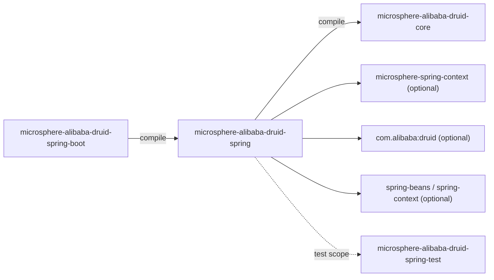
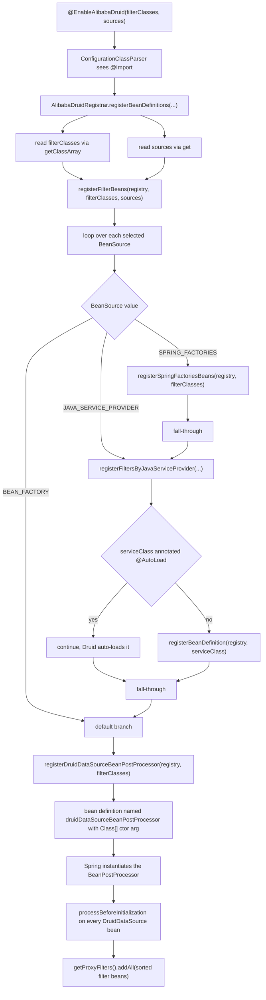

[English](../microsphere-alibaba-druid-spring.md)

# microsphere-alibaba-druid-spring

> 层 L1：Spring Framework 集成 —— 多源 `Filter` 发现并注入到每个 `DruidDataSource`。
> 包根：`io.microsphere.alibaba.druid.spring`。
> 仓库主页：[../../../../README.md](../../../../README.md) · [用户指南](../../user-guide/zh/README.md)

## 模块视角



| 依赖 | 作用域 | 角色 |
|---|---|---|
| `microsphere-alibaba-druid-core` | **compile（必需）** | 被发现的 `Filter` 类型（`${revision}`）。 |
| `microsphere-spring-context` | optional | `BeanSource`、`AnnotatedBeanCapableImportBeanDefinitionRegistrar`、`BeanRegistrar`、`GenericBeanPostProcessorAdapter`、`ResolvablePlaceholderAnnotationAttributes`。 |
| `spring-beans`、`spring-context` | optional | `BeanDefinitionRegistry`、`BeanNameGenerator`、`BeanFactory`、`AnnotationAwareOrderComparator`。 |
| `druid` | optional | `Filter`、`AutoLoad`、`DruidDataSource`。 |
| `spring-test` | optional | 由位于 `src/test` 的测试类使用。 |

整个 Spring 栈都是 `optional`，意味着本模块可针对父 BOM 管理的任意 Spring 版本编译，应用自行选择 Spring；
唯一强制的构件是 `core`。

## 源码分析

### `io.microsphere.alibaba.druid.spring.context.annotation.EnableAlibabaDruid`

```java
@Target({TYPE, ANNOTATION_TYPE})
@Retention(RUNTIME)
@Documented
@Import(AlibabaDruidRegistrar.class)
public @interface EnableAlibabaDruid {
    Class<? extends Filter>[] filterClasses() default {Filter.class};
    BeanSource[] sources() default {BEAN_FACTORY, SPRING_FACTORIES};
}
```

- **`@Import` + `ImportBeanDefinitionRegistrar`** 模式：注解本身不注册任何 bean；它导入 registrar，由
  registrar 把 bean 定义直接写入 `BeanDefinitionRegistry`。正是这让 filter 类成为*容器管理*的（从而获得
  `@Autowired`、`@Value`、生命周期回调与 `@Order` 处理），而非被框架 `new` 出来。
- `@Target({TYPE, ANNOTATION_TYPE})` 允许该注解用作**元注解**，所以项目可以定义一个预选 sources 的
  `@EnableMyDruid`。
- `filterClasses()` 默认为 `{Filter.class}` —— 根接口，因此默认**所有**可发现的 filter 都是候选；收窄它
  （例如 `AbstractStatementFilter.class`）会限制搜索。
- `sources()` 默认为 `{BEAN_FACTORY, SPRING_FACTORIES}`；`BEAN_FACTORY` 正是触发 `DruidDataSourceBeanPostProcessor`
  注册的那个。
- 因为属性类型是被 `ResolvablePlaceholderAnnotationAttributes` 包装的 `Class[]` / 枚举数组，值是**在**占位符解析
  *之后*读取的 —— registrar 必须使用 `annotationAttributes.getClassArray(...)` / `.get(...)`，而非原始
  `AnnotationMetadata`。

### `io.microsphere.alibaba.druid.spring.context.annotation.AlibabaDruidRegistrar`

包私有（`class AlibabaDruidRegistrar extends
AnnotatedBeanCapableImportBeanDefinitionRegistrar<EnableAlibabaDruid>`），因此只能通过 `@EnableAlibabaDruid`
到达 —— 这是刻意的封装；贡献者不能直接导入 registrar 并期望稳定的行为。

```java
@Override
protected void registerBeanDefinitions(AnnotationMetadata metadata, BeanDefinitionRegistry registry,
                                       BeanNameGenerator importBeanNameGenerator,
                                       ResolvablePlaceholderAnnotationAttributes<EnableAlibabaDruid> annotationAttributes) {
    Class<? extends Filter>[] filterClasses = (Class<? extends Filter>[]) annotationAttributes.getClassArray("filterClasses");
    BeanSource[] sources = (BeanSource[]) annotationAttributes.get("sources");
    registerFilterBeans(registry, filterClasses, sources);
}

private void registerFilterBeans(BeanDefinitionRegistry registry, Class<? extends Filter>[] filterClasses, BeanSource[] sources) {
    for (BeanSource source : sources) {
        switch (source) {
            case SPRING_FACTORIES:
                registerFiltersBySpringFactories(registry, filterClasses);
            case JAVA_SERVICE_PROVIDER:
                registerFiltersByJavaServiceProvider(registry, filterClasses);
            case BEAN_FACTORY:
            default:
                registerDruidDataSourceBeanPostProcessor(registry, filterClasses);
        }
    }
}
```

**这个 `switch` 贯穿是有意的，也是本模块最容易被误解的地方。**没有 `break` 语句，所以每次迭代都运行一次*级联*：

| 选中的 `sources` | 每个元素的有效工作 |
|---|---|
| `SPRING_FACTORIES` | factories 注册 **+** service-loader 注册 **+** post-processor 注册 |
| `JAVA_SERVICE_PROVIDER` | service-loader 注册 **+** post-processor 注册 |
| `BEAN_FACTORY` | 仅 post-processor 注册 |
| 任何未知值（`default`） | 仅 post-processor 注册 |

贡献者必须保留的后果：

1. 只要选中**任何** source，`DruidDataSourceBeanPostProcessor` 的 bean 定义都会被注册 —— 它是贯穿的尾部兼
   `default` 分支。空的 `sources` 数组什么都不注册。
2. 选择 `SPRING_FACTORIES` *同时*执行 service-loader 扫描；你无法得到“仅 factories”。
3. 在 `case SPRING_FACTORIES` 后加 `break` 会为既有用户悄悄改变行为 —— 把贯穿视作 API。
4. `registerDruidDataSourceBeanPostProcessor` 始终使用固定名 `BEAN_NAME`，所以重复的 `@EnableAlibabaDruid`
   注解（例如同一层次上的两个配置）会折叠为**一个** bean 定义：由于同名 bean 定义会替换前一个，构造函数参数以
   最后一次注册为准。

**带 `@AutoLoad` 例外的 service-loader 路径：**

```java
private void registerFiltersByJavaServiceProvider(BeanDefinitionRegistry registry, Class<? extends Filter>[] filterClasses) {
    for (Class<? extends Filter> filterClass : filterClasses) {
        Set<? extends Class<? extends Filter>> serviceClasses = getServiceClasses(filterClass, classLoader);
        for (Class<? extends Filter> serviceClass : serviceClasses) {
            if (serviceClass.isAnnotationPresent(AutoLoad.class)) {
                // Any filter class annotated @AutoLoad will be added into DruidDataSource automatically,
                // so it will be ignored here.
                continue;
            }
            registerBeanDefinition(registry, serviceClass);
        }
    }
}
```

- `getServiceClasses(...)`（`io.microsphere.util.ServiceLoaderUtils`）读取
  `META-INF/services/<filterClassName>` 并返回**类**（而非实例），以便由 Spring 而非 `ServiceLoader` 掌控实例化
  —— 这正是让 filter 能被注入的原因。
- `classLoader` 字段继承自 microsphere 的 registrar 基类。
- **`@AutoLoad` 例外**：Druid 自身会扫描 `@AutoLoad` 的 filter 并把它们加入它创建的每个 `DruidDataSource`。把这样
  一个 filter 注册为 Spring bean *又*让 Druid 自动加载，会把它**挂两次**（双重日志、双重新计数），因此 `continue`。
  这正是测试夹具提供 `AutoLoadFilter`（`@AutoLoad`，*不得*成为 bean）与 `LoadFilter`（无注解，必须成为 bean）的
  原因。
- filter 自身的 `init(DataSourceProxy)` 仍由 `DruidDataSource.init()` 调用，所以该例外只关乎注册，不关乎生命周期。

**Spring Factories 路径：** `registerSpringFactoriesBeans(registry, filterClasses)` 委托给 `BeanRegistrar`，并把
每个 `filterClasses` 条目作为**factories 键**。测试资源证明了契约 —— 键是类型名，值是逗号/反斜杠续行的实现列表：

```properties
# microsphere-alibaba-druid-spring/src/test/resources/META-INF/spring.factories
io.microsphere.alibaba.druid.filter.AbstractStatementFilter=\
io.microsphere.alibaba.druid.filter.TestStatementFilter
```

注意这*不是* Boot 的 `EnableAutoConfiguration` 键 —— 此处 `spring.factories` 被当作针对 `Filter` SPI 的通用
Microsphere/Spring `SpringFactoriesLoader` 注册表。

**Post-processor 路径：**

```java
private void registerDruidDataSourceBeanPostProcessor(BeanDefinitionRegistry registry, Class<? extends Filter>[] filterClasses) {
    String beanName = BEAN_NAME;
    Class<?> beanClass = DruidDataSourceBeanPostProcessor.class;
    Object argument = filterClasses;
    registerBeanDefinition(registry, beanName, beanClass, argument);
}
```

是一个构造函数参数 bean 定义（而非 supplier / `@Bean`），这就是为什么
`DruidDataSourceBeanPostProcessor` 必须保留它的 `Class<? extends Filter>[]` 构造函数。

### `io.microsphere.alibaba.druid.spring.beans.factory.config.DruidDataSourceBeanPostProcessor`

```java
public class DruidDataSourceBeanPostProcessor extends GenericBeanPostProcessorAdapter<DruidDataSource> implements BeanFactoryAware {

    public static final String BEAN_NAME = "druidDataSourceBeanPostProcessor";
    private static final Logger logger = getLogger(DruidDataSourceBeanPostProcessor.class);
    private final Class<? extends Filter>[] filterBeanClasses;
    private BeanFactory beanFactory;

    public DruidDataSourceBeanPostProcessor()                                  // of(Filter.class)
    public DruidDataSourceBeanPostProcessor(Class<? extends Filter>[] filterBeanClasses)
    @Override protected void processBeforeInitialization(DruidDataSource druidDataSource, String beanName) throws BeansException
    protected void initializeFilterBeans(DruidDataSource druidDataSource)
    @Override public void setBeanFactory(BeanFactory beanFactory) throws BeansException
}
```

- **BeanPostProcessor 钩子模式**：`GenericBeanPostProcessorAdapter<DruidDataSource>` 把 Spring 的
  `BeanPostProcessor` 收窄到类型匹配的 bean，并暴露 `processBeforeInitialization`，因此代码无需 `instanceof`/强转。
- “初始化之前”是**唯一有效的时刻**：`DruidDataSource.init()` 遍历 `proxyFilters` 并调用 `Filter.init(DataSourceProxy)`；
  之后添加的 filter 永远不会收到 `init()`，因此保持 `dataSource == null`，这会让 `buildResourceName` 抛 NPE。
- `initializeFilterBeans`：

```java
protected void initializeFilterBeans(DruidDataSource druidDataSource) {
    List<Filter> filterBeans = new LinkedList<>();
    for (Class<? extends Filter> filterBeanClass : filterBeanClasses) {
        filterBeans.addAll(getSortedBeans(this.beanFactory, filterBeanClass));
    }
    sort(filterBeans);
    if (logger.isTraceEnabled()) { ... }
    druidDataSource.getProxyFilters().addAll(filterBeans);
}
```

  - `getSortedBeans(BeanFactory, Class)` 收集*所有*该类型的匹配 bean 并已排序；外层
    `AnnotationAwareOrderComparator.sort(filterBeans)`（静态导入自 Spring）对**合并后**的列表重新排序，因为跨不同
    `filterBeanClasses` 桶的顺序无法仅靠按类型查找建立。
  - `AnnotationAwareOrderComparator` 依序遵循：`Ordered` 接口（以及 `PriorityOrdered`）、`@Order` 注解，最后是
    自然/注册顺序。所以 filter 在 Druid 链中的优先级由 filter bean 上的 `@Order` 控制 —— 这是新增 filter 时应保留的
    文档化行为。
  - `LinkedList` 用于廉价的头/尾修改与排序前的插入顺序稳定性。
  - **不去重**：若 `filterBeanClasses` 同时含 `Filter.class` 与 `LoggingStatementFilter.class`，同一个 bean 会被两次
    查找匹配并两次加入 `getProxyFilters()`。保持配置的数组互斥（或依赖单一根类型）。
  - **无幂等守护**：处理器无条件追加。（如测试配置那样的）`@Scope("prototype")` 数据源每个实例获得一份全新的 filter
    列表；一个被初始化两次的数据源会看到重复。
  - `implements BeanFactoryAware`：查找在 post-processing 时惰性发生，而非构造时，所以同一 refresh 中稍后注册的
    filter 仍会被找到 —— 但一个 filter bean 会在数据源被创建期间*被迫实例化*（若 filter `@Autowired` 数据源则可能
    成为循环引用来源）。
- `BEAN_NAME` 被 `spring-boot` 引用（`@Bean(name = BEAN_NAME)`），使 `@EnableAlibabaDruid` registrar 与 Boot
  自动配置产出**同一个** bean 名，从而不重复注册。

## @EnableAlibabaDruid 注册流程



## 以测试夹具作为行为规格

| 夹具 | 声明于 | 预期结果 |
|---|---|---|
| `TestStatementFilter` | `src/test/resources/META-INF/spring.factories`，键 `io.microsphere.alibaba.druid.filter.AbstractStatementFilter` | 选中 `SPRING_FACTORIES` 时成为 bean |
| `AutoLoadFilter`（`@AutoLoad`） | `src/test/resources/META-INF/services/io.microsphere.alibaba.druid.filter.AbstractStatementFilter` | service 文件列出它，但 registrar **跳过**它 |
| `LoadFilter`（普通） | 同一 service 文件 | 成为 bean |

`EnableAlibabaDruidTest` 组合三个 sources（`sources = {BEAN_FACTORY, SPRING_FACTORIES, JAVA_SERVICE_PROVIDER}`）配合
`filterClasses = AbstractStatementFilter.class`，运行在
`@SpringJUnitConfig(classes = {LoggingStatementFilter.class, DruidDataSourceTestConfiguration.class, EnableAlibabaDruidTest.class})`
之下，并从 `AbstractDruidSpringTest` 继承完整的语句矩阵 —— 所以该测试*就是*发现、注册、排序与注入协同工作的
集成证明。`DruidDataSourceBeanPostProcessorTest` 覆盖手工路径（post-processor 类直接列于 `@ContextConfiguration`）。

## 设计模式

- **`@Import` + `ImportBeanDefinitionRegistrar`** —— 属性驱动的注册表变更，属性可解析占位符。
- **责任链（适配器侧）** —— post-processor 只*装配* Druid 链；顺序委托给 `AnnotationAwareOrderComparator` + Druid 的 `FilterChainImpl`。
- **BeanPostProcessor 钩子** —— 无需子类化即可横切增强第三方 bean。
- **多源 bean 发现** —— `BeanSource.{BEAN_FACTORY, SPRING_FACTORIES, JAVA_SERVICE_PROVIDER}`，同一类型数组针对三个注册表解析。
- **模板方法（基类）** —— `AnnotatedBeanCapableImportBeanDefinitionRegistrar` 拥有 `registerBeanDefinitions` 的管道（class loader、属性解析）；子类只实现增量。
- **作为隐式策略组合的贯穿级联** —— 每个 `BeanSource` 选择工作列表的一个*前缀*。

## 1.x 说明

- `release-1.x` 上不给本模块添加 `spring.factories`：1.x 特有的 `spring.factories` 文件在
  `microsphere-alibaba-druid-spring-boot` / `-spring-cloud` 中，携带 Boot 的 `EnableAutoConfiguration` 键。你在
  本模块 **test** 资源下看到的 `spring.factories` 在两线上都存在，且它是一个 `SpringFactoriesLoader` 夹具，而非
  自动配置。
- Java 8 源码级别：对枚举的 `switch` *不带*箭头语法也不带 `break` 使用 —— 不要把它“现代化”为 switch 表达式而
  同时保留贯穿语义。
- Spring API 用法（`AnnotationAwareOrderComparator`、`BeanDefinitionRegistry`）在
  `spring-cloud-hoxton/2020/2021` profile 锁定的 Boot 2.3–2.6 矩阵上保持稳定。

## 相关

- [开发者指南索引](README.md)
- [microsphere-alibaba-druid-core](microsphere-alibaba-druid-core.md)
- [microsphere-alibaba-druid-spring-boot](microsphere-alibaba-druid-spring-boot.md)
- [microsphere-alibaba-druid-spring-test](microsphere-alibaba-druid-spring-test.md)
- [用户指南](../../user-guide/zh/README.md)
- [仓库 README](../../../../README.md)

---

## English

- [English version of this document](../microsphere-alibaba-druid-spring.md)
