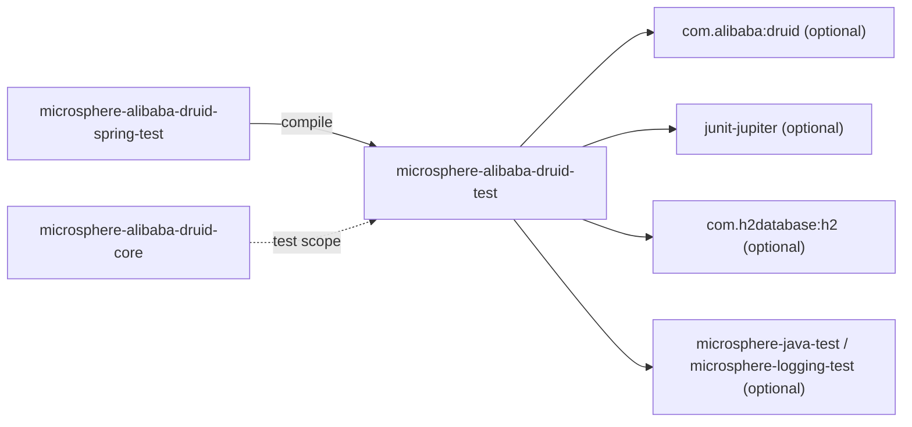
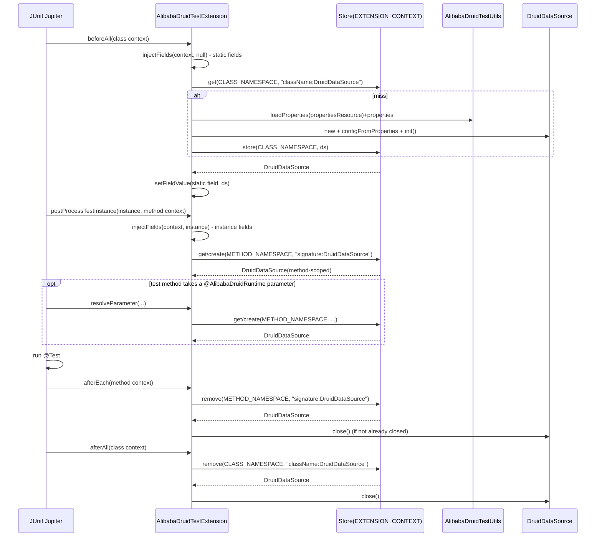

[English](../microsphere-alibaba-druid-test.md)

# microsphere-alibaba-druid-test

> 支持模块（非 Spring）：针对 Druid `Filter`/拦截测试的测试基础设施 —— 一个可复用的生命周期模板
> （`AbstractAlibabaDruidTest`）、一个构建器/工具类（`AlibabaDruidTestUtils`）以及一套自足的 JUnit 5 扩展三件套
> （`@AlibabaDruidTest` / `@AlibabaDruidRuntime` / `AlibabaDruidTestExtension`）。
> 包根：`io.microsphere.alibaba.druid.test` 与 `…test.junit.jupiter`。Java 基线：**JDK 8**。
> 仓库主页：[../../../../README.md](../../../../README.md) · [用户指南](../../user-guide/zh/README.md)

## 模块视角

`test` 在 compile 作用域**不依赖任何其它反应堆模块** —— 这正是让 `core` 能在 `test` 作用域使用它而不形成环的原因
（见[开发者指南索引](README.md)）。它所需的（Druid、JUnit、H2、Microsphere 测试工具）都声明为 `optional`，所以
下游消费者必须自行提供这些。



| 依赖 | 作用域 | 原因 |
|---|---|---|
| `com.alibaba:druid` | optional | `DruidDataSource` 是每条测试路径中被构建的对象。 |
| `org.junit.jupiter:junit-jupiter` | optional | `@BeforeEach`/`@AfterEach`/`@Test`、`Extension` SPI、`ExtensionContext`、`Store`/`Namespace`。 |
| `com.h2database:h2` | optional | `META-INF/druid/h2.properties` 夹具所指向的默认内存数据库。 |
| `microsphere-java-test`、`microsphere-logging-test` | optional | Throwable 感知的辅助类（`ThrowableConsumer`）、字段/方法反射工具、日志捕获断言。 |
| `microsphere-annotation-processor` | optional | 仅编译期元数据。 |
| `ch.qos.logback:logback-classic` | optional / `microsphere-logback` test | 用于捕获输出测试的日志后端。 |

`test` 没有必需构件：一组纯构建器 + 扩展，降级为“你自备库”的语义，与项目其余部分的“优先可选依赖”约定一致。

## 源码分析

### `io.microsphere.alibaba.druid.test.AbstractAlibabaDruidTest`

```java
public abstract class AbstractAlibabaDruidTest {
    private DruidDataSource dataSource;

    @BeforeEach public void init() throws Throwable;
    protected DruidDataSource buildDruidDataSource() throws IOException;
    protected void customize(DruidDataSource dataSource);
    protected DruidDataSource getDruidDataSource();
    private void initData() throws Throwable;

    @Test public void test() throws Throwable;
    protected void testExecuteStatement() throws Throwable;
    protected void testExecutePreparedStatement() throws Throwable;

    protected void executePreparedStatement(String sql, ThrowableConsumer<PreparedStatement> consumer) throws Throwable;
    protected void executeStatement(ThrowableConsumer<Statement> consumer) throws Throwable;
    protected void executeConnection(ThrowableConsumer<Connection> consumer) throws Throwable;

    @AfterEach public void destroy() throws Throwable;
    private void destroyData() throws Throwable;
}
```

**模板方法生命周期。** 这是整个测试面上复用最多的类型 —— `core` 的 filter 测试、`spring` 的集成测试以及
`spring-boot`/`spring-cloud` 的集成测试都继承自它（直接或经由 `AbstractDruidSpringTest`）。它的契约是一个固定顺序，
子类只能打开两个钩子：

1. `@BeforeEach init()` 运行 **`buildDruidDataSource()` → `customize(ds)` → `ds.init()` → `initData()`**，
   在 `initData()` **之前**赋值字段，以便 SQL 辅助方法看到一个活的数据源。`init()` 声明 `throws Throwable`，因为
   `DruidDataSource.init()` 本身会抛受检错误；`buildDruidDataSource()` 为属性加载声明 `throws IOException`。
2. `customize(DruidDataSource)` 是**空实现策略钩子** —— 子类在此加自己的
   `getProxyFilters().add(new XxxFilter())`。它在数据源被构建*之后*、`init()`*之前*运行，而这正是 Druid 会为这些
   filter 调用 `Filter.init(DataSourceProxy)` 的唯一时刻（`DruidDataSourceBeanPostProcessor` 遵守的同一顺序约束，见
   [spring 模块](microsphere-alibaba-druid-spring.md)）。
3. `initData()`（私有）通过 `executeStatement`/`executeConnection` 辅助方法发出
   `CREATE TABLE users (id INT, name VARCHAR(50))` —— 所以连 schema 设置都是*经代理连接*执行的，意味着在
   `customize` 中安装的 filter 也会拦截它。
4. `@Test test()` 委托给 `testExecuteStatement()` + `testExecutePreparedStatement()`。想要完整 JDBC 矩阵的子类只需
   继承本方法；它从不重新声明 `@Test`，所以除非覆写，每个具体类恰有一个测试方法。
5. `@AfterEach destroy()` 运行 `destroyData()`（私有，`DROP TABLE users`）**然后** `ds.close()` —— 拆卸顺序是装配的
   镜像，且删表发生在数据源仍打开时。

**JDBC 矩阵是每个 filter 的行为规格。** `testExecuteStatement()` 演练 `executeUpdate`（全部四个重载：无、
`String[]`、`int[]`、`NO_GENERATED_KEYS`）、`addBatch` + `executeBatch`（断言 `int[]{1,1}`）、`executeQuery`、
`execute`（普通与 generated-keys 重载）以及一次 `DELETE FROM users` 清扫。`testExecutePreparedStatement()` 通过 `?`
参数化 `INSERT`/`SELECT`，覆盖 `prepareStatement(sql, TYPE_FORWARD_ONLY)` 与
`prepareStatement(sql, TYPE_FORWARD_ONLY, CONCUR_UPDATABLE)`。结合 `buildResourceName` 的表别名命名，这正是
`LoggingStatementFilterTest` 所断言的 —— 见 [core 模块](microsphere-alibaba-druid-core.md)。

**资源处理。** 三个 `executeXxx` 辅助方法是嵌套的，各自持有一个 `finally`-close：

```java
protected void executeConnection(ThrowableConsumer<Connection> consumer) throws Throwable {
    DataSource dataSource = getDruidDataSource();
    Connection connection = dataSource.getConnection();
    try {
        consumer.accept(connection);
    } finally {
        connection.close();
    }
}
```

`executeStatement`/`executePreparedStatement` 建立在 `executeConnection` 之上，并在各自的 `finally` 中关闭其
`Statement`/`PreparedStatement`。这一分层是为何 `customize`-安装的 filter 观察到正确的
`getConnection → statement → execute → close` 序列，也是为何使用 `ThrowableConsumer`（而非 `Consumer`）—— JDBC 抛受检
`SQLException`，而基方法签名传播 `Throwable` 而非吞掉它。

**面向下游装配的可覆写性。** `buildDruidDataSource()` 正是子类（或 `AbstractDruidSpringTest`）替换的对象，以便从别处
取得被测对象；默认委托给 `AlibabaDruidTestUtils.buildDefaultDruidDataSource()`。`getDruidDataSource()` 是 SQL 辅助方法
与下面的 `@Nested FieldTest`（见扩展测试）都依赖的访问器。

### `io.microsphere.alibaba.druid.test.AlibabaDruidTestUtils`

```java
public abstract class AlibabaDruidTestUtils {
    public static final String H2_PROPERTIES_RESOURCE = "META-INF/druid/h2.properties";
    public static final String DEFAULT_PROPERTIES_RESOURCE = H2_PROPERTIES_RESOURCE;
    public static final String PACKAGE_NAME_PREFIX = "com.alibaba.druid.";

    @Nonnull public static Properties getDefaultProperties() throws IOException;
    @Nonnull public static Properties loadProperties(String resourceName) throws IOException;
    @Nonnull public static Properties loadProperties(String[] keyValuePairs) throws IOException;
    @Nonnull static Properties properties(String content) throws IOException;      // package-private
    @Nonnull public static DruidDataSource buildDefaultDruidDataSource() throws IOException;
    @Nonnull public static DruidDataSource buildDruidDataSource(Properties properties);

    private AlibabaDruidTestUtils() { }
}
```

- **不可实例化工具惯用法**：声明为 `abstract` 且带 `private` 构造器，因此既不能被实例化，也不能被意外地子类化并构造。
  与 `PropertyConstants`/`AlibabaDruidTestExtension` 同一惯用法。
- **H2 夹具** `META-INF/druid/h2.properties` *随本模块的 jar* 发行，所以任何依赖 `microsphere-alibaba-druid-test` 的
  消费者都会在 classpath 上继承它：

```properties
druid.name=h2
druid.url=jdbc:h2:mem:test_mem
druid.username=sa
druid.password=
druid.driverClassName=org.h2.Driver
```

  `druid.*` 键是 Druid 自身在 `DruidDataSource.configFromProperties(Properties)` 中消费的属性名 —— 所以
  `buildDruidDataSource(properties)` 是一行式数据源工厂，测试代码里无需 JDBC-URL 样板。
- `loadProperties(String resourceName)` 经由 `io.microsphere.util.ClassLoaderUtils.getResource(...)` 读取 classpath
  资源，用 `IOUtils.copyToString(inputStream, DEFAULT_CHARSET)` 拷贝成 String，再通过 `properties(...)` 解析；缺失资源
  会从 `resource.openStream()` 抛 NPE（工具不容忍缺失资源 —— 这是刻意的，因为拼错的资源名应快速失败）。
- `loadProperties(String[] keyValuePairs)` 用 `SeparatorConstants.LINE_SEPARATOR` 拼接这些键值对并以同样方式解析 ——
  这是 `@AlibabaDruidTest(properties = {...})` 用于内联覆盖所走的路径。
- `buildDruidDataSource(Properties)` 返回一个**未初始化**的 `DruidDataSource`（它只调用 `configFromProperties`）；调用方
  （`AbstractAlibabaDruidTest.init()`，或 JUnit 扩展自己的构建路径）决定何时 `init()`。

### JUnit 5 三件套

#### `@AlibabaDruidTest`

```java
@Target(TYPE)
@Retention(RUNTIME)
@ExtendWith(AlibabaDruidTestExtension.class)
@Inherited
public @interface AlibabaDruidTest {
    String[] properties() default {};
    String propertiesResource() default DEFAULT_PROPERTIES_RESOURCE;
    String[] filters() default {};
}
```

- 纯粹是一个**声明式注册注解**：`@ExtendWith(AlibabaDruidTestExtension.class)` 把它所注解的任何类变成一个启用
  Druid-运行时 的测试，而 `@Inherited` 让注册传播到子类。
- `propertiesResource()` 默认为 `AlibabaDruidTestUtils.DEFAULT_PROPERTIES_RESOURCE`（H2 夹具）；`properties()` 提供内联
  `key=value` 覆盖。扩展的构建路径先加载资源，再加载内联数组并把它 **`putAll` 覆盖到资源之上**，所以内联值胜出 ——
  这就是 Javadoc 的“override the properties defined in `propertiesResource()`”。
- **`filters()` 当前是惰性的。** 扩展 `buildDruidDataSource(AlibabaDruidTest)` 只读 `propertiesResource()` 与
  `properties()`；它从不用 `filters()` 数组调用 `DruidDataSource.setFilters(...)`。要真正挂上 Druid 内建的具名 filter，
  请通过 `properties()`/`propertiesResource()` 设置 `druid.filters` 键（例如 `"druid.filters=stat,wall"`），
  `configFromProperties` 确实会承认它。在依赖 `filters = {"log","stat"}` 之前请记住这点。

#### `@AlibabaDruidRuntime`

```java
@Target(value = {FIELD, PARAMETER})
@Retention(RUNTIME)
public @interface AlibabaDruidRuntime {
}
```

- 注入标记。它可以针对**静态字段、实例字段或方法参数**；其解析的组件类型由 `DruidDataSource` 类型层次经
  `isAlibabaDruidClass` 过滤算出 —— 即任何 `DataSource`-可赋值的，或位于 `com.alibaba.druid.` 包下的类型。Javadoc
  表列出四个文档化目标：`DataSource`、`ConnectionPoolDataSource`、`DataSourceProxy`、`DruidDataSource`，每个都可作
  静态字段、实例字段与方法参数注入。

#### `AlibabaDruidTestExtension`

包私有（`class AlibabaDruidTestExtension implements BeforeAllCallback, AfterAllCallback, TestInstancePostProcessor,
AfterEachCallback, ParameterResolver`）—— 只能通过 `@AlibabaDruidTest` 到达，所以 SPI 面保持封装。其关键内部：

```java
private static final Namespace METHOD_NAMESPACE = create(AlibabaDruidTestExtension.class, "METHOD");
private static final Namespace CLASS_NAMESPACE  = create(AlibabaDruidTestExtension.class, "CLASS");
static List<Class<?>> candidateTypes = findAllClasses(DruidDataSource.class, AlibabaDruidTestExtension::isAlibabaDruidClass);
```

- **两个 namespace，一个 Store 作用域。** `CLASS_NAMESPACE` 与 `METHOD_NAMESPACE` 都以
  `(AlibabaDruidTestExtension.class, "CLASS"|"METHOD")` 创建，而 `getStore(...)` 始终以
  `context.getStore(EXTENSION_CONTEXT, namespace)` 获取。`StoreScope.EXTENSION_CONTEXT` 把 store 附着到扩展被注册的
  上下文（测试类），所以它跨该类的所有测试方法存活 —— 但 CLASS 与 METHOD 的 namespace 划分加上**下面的键**，区分开
  两种生命周期。
- **键编码了生命周期。** `buildKey(context, componentClass)` 是一个 `StringJoiner(":")`，产出
  `"<sig-or-class>:<componentClassName>"`：
  - 当 `context.getTestMethod()` 缺失（类级上下文：静态字段注入）时，首段是 `testClass.getName()`；
  - 当存在测试方法（实例字段 / 参数注入）时，首段是 `MethodUtils.getSignature(method)`。
  所以一个类共享的 `DruidDataSource`（静态注入）以类名为键，存于 `CLASS_NAMESPACE`；而每个测试方法的
  `DruidDataSource` 以方法签名为键，存于 `METHOD_NAMESPACE`。
- **取或建**：`getDruidDataSource(context, forClass, forRemoval)` 查找 store；未命中时调用 `buildDruidDataSource(context)`
  （它经 `getAlibabaDruidTest(...)` 读取 `@AlibabaDruidTest`，必要时回退到外层类）并 `store(...)` 之。这就是整个
  “一键一源”机制。
- **注入回调**：`beforeAll` → `injectFields(context, null)` 设置**静态**注解字段；`postProcessTestInstance` →
  `injectFields(context, testInstance)` 设置**实例**字段。`findCandidateFields` 用 `MemberUtils::isStatic` 与
  `isNonStatic`、再 `and` 上 `isCandidateField`（`@AlibabaDruidRuntime` **且** `candidateTypes.contains(field.getType())`）
  挑选字段集。字段写入通过 `FieldUtils.setFieldValue(true /*makeAccessible*/, target, field, ds)`。
- **参数解析**：`supportsParameter` → `isCandidateParameter`（注解 + 候选类型）；`resolveParameter` 返回方法作用域的
  `getDruidDataSource(extensionContext, false, false)`，包裹在 `ThrowableSupplier.execute(...)` 中，使受检
  `SQLException`/`IOException` 变成 JUnit 友好的失败。
- **拆卸**：`afterEach` 以 `forRemoval=true` 取出**方法**作用域的数据源并 `close`；`afterAll` 对**类**作用域的数据源
  同样处理。`close(ds)` 是 null 安全的且由 `!ds.isClosed()` 守护，所以调用两次无害 —— 这正是静态字段测试
  （`close(x); close(x);`）所依赖的。

## AlibabaDruidTest 扩展生命周期



## 设计模式

- **模板方法** —— `AbstractAlibabaDruidTest` 固定 build → customize → init → initData → test → destroy 生命周期；子类
  只覆写 `customize` 和/或 `buildDruidDataSource`。
- **策略 / 空对象** —— 空实现 `customize(DruidDataSource)` 让选择性装配加入而不破坏默认。
- **不可实例化工具类** —— `AlibabaDruidTestUtils`（abstract + private ctor）。
- **JUnit 5 扩展** —— `AlibabaDruidTestExtension` 实现五个 SPI，并编排一个取或建的 `Store`，带两个 namespace 和
  一个方法/类签名键。
- **声明式注册注解** —— `@AlibabaDruidTest` = `@ExtendWith(...)` + 属性包；`@AlibabaDruidRuntime` = 类型安全的注入标记。
- **资源外部化配置** —— H2 `Properties` 位于 classpath 文件并由 Druid 自身的 `configFromProperties` 消费，所以这里不
  发明构建器 DSL。

## 1.x 说明

- **测试类结构在本线不同。** `release-1.x` 上的 `AlibabaDruidTestExtensionTest` 把**静态字段注入用例声明在顶层类**
  中（`@AlibabaDruidRuntime private static DruidDataSource` / `static DataSource` 字段，以及
  `@Test @DisplayName("Test : Static Field Injection") void test()` 方法都直接位于外层类，连同 `@Nested FieldTest` 与
  `@Nested ParameterTest`）。在 `current`（`main`）线上，这些静态字段用例被移入了专门的 `@Nested StaticFieldTest` 类。
  在两线之间移植改动时，请保持静态注入覆盖完整 —— 扩展的 `beforeAll`/静态路径正是那个测试所演练的。
- **JDK 8 源码级别** —— 扩展使用方法引用、`Predicate`、`StringJoiner` 与 `orElse`（皆为 Java 8），但不使用 `List.of`、
  `var`、record 或 switch 表达式；`candidateTypes` 是一个普通 `List<Class<?>>`，经 `findAllClasses` 填充。
- **此处无 `spring.factories`** —— 本模块不贡献自动配置；1.x 特有的 `spring.factories` 文件只位于
  `microsphere-alibaba-druid-spring-boot` 与 `-spring-cloud`。
- `JUnit 5` API 可用性（`StoreScope.EXTENSION_CONTEXT`、`Namespace.create`）来自
  `microsphere-spring-cloud-dependencies:0.1.26` 管理的 Jupiter 版本，而非此处声明。

## 测试

| 测试类 | 它钉住的内容 |
|---|---|
| `AlibabaDruidTestUtilsTest` | 三个常量的字面值、从 H2 夹具解析出的每个属性（`name=h2`、`url=jdbc:h2:mem:test_mem`、`username=sa`、空 `password`、`driverClassName=org.h2.Driver`），以及内联 `loadProperties(String[])`。 |
| `DefaultAlibabaDruidTest` | 裸生命周期：一个空子类针对默认 H2 数据源继承 `test()` —— 证明装配/拆卸与完整 SQL 矩阵在任何 filter 缺席时都能运行。 |
| `AlibabaDruidTestExtensionTest` | 通过 `@AlibabaDruidRuntime` 的实例字段、静态字段与参数注入；对非 Druid 参数的 `isCandidateParameter`；`getAlibabaDruidTest` 解析；幂等 `close`。 |

只运行本模块：`mvn -pl microsphere-alibaba-druid-test -am test -P spring-cloud-2021`。

## 相关

- [开发者指南索引](README.md)
- [microsphere-alibaba-druid-core](microsphere-alibaba-druid-core.md)
- [microsphere-alibaba-druid-spring-test](microsphere-alibaba-druid-spring-test.md)
- [用户指南](../../user-guide/zh/README.md)
- [仓库 README](../../../../README.md)

---

## English

- [English version of this document](../microsphere-alibaba-druid-test.md)
