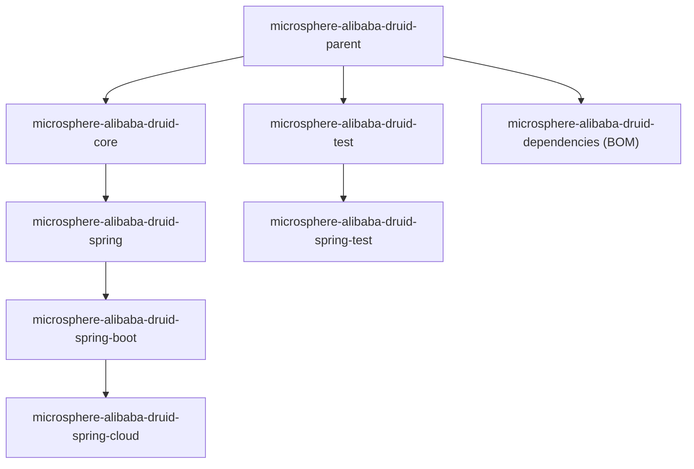

# Microsphere Alibaba Druid — User Guide (`1.x` line)

[中文](zh/README.md)

This guide is written for **users** of Microsphere Alibaba Druid on the `1.x` documentation line, i.e. the artifacts
built from the `release-1.x` branch (`0.1.x`). It tells you what to put in your `pom.xml`, which classes and
annotations to use, and which properties to set. Architecture and internals are covered by the
[Developer Guide](../developer-guide/README.md).

Microsphere Alibaba Druid builds on [Alibaba Druid](https://github.com/alibaba/druid), a high-performance JDBC
connection pool, and adds SQL **statement interception** support (`AbstractStatementFilter`), Spring / Spring Boot /
Spring Cloud integration, connection-pool metrics for the Actuator, and a set of testing utilities.

> **The Java API is the same as on the `current` line.** Everything documented here is source-compatible with
> `0.2.x`; what differs is packaging and platform support: `spring.factories` registration for Boot 2.x, a JDK 8
> baseline, and a Spring Boot 2 / Spring Cloud `Hoxton` – `2021.0.x` matrix. If you are on Spring Boot 3 / JDK 17+,
> use the [current User Guide](../../current/user-guide/README.md) instead.

## Documents in this guide

| Document | Module | What it gives you |
|---|---|---|
| [microsphere-alibaba-druid-core.md](microsphere-alibaba-druid-core.md) | `microsphere-alibaba-druid-core` | `AbstractStatementFilter` / `LoggingStatementFilter` and the `microsphere.alibaba.druid` property-name constants |
| [microsphere-alibaba-druid-spring.md](microsphere-alibaba-druid-spring.md) | `microsphere-alibaba-druid-spring` | `@EnableAlibabaDruid` and `DruidDataSourceBeanPostProcessor`: inject `Filter` beans into every `DruidDataSource` |
| [microsphere-alibaba-druid-spring-boot.md](microsphere-alibaba-druid-spring-boot.md) | `microsphere-alibaba-druid-spring-boot` | Auto-configuration (Boot 2.x + Boot 3.x registration), `AlibabaDruidProperties`, `DruidDataSourcePoolMetadata` |
| [microsphere-alibaba-druid-spring-cloud.md](microsphere-alibaba-druid-spring-cloud.md) | `microsphere-alibaba-druid-spring-cloud` | Spring Cloud auto-configuration and the `/actuator/features` entries declared in `features.yaml` |
| [microsphere-alibaba-druid-test.md](microsphere-alibaba-druid-test.md) | `microsphere-alibaba-druid-test` | `AbstractAlibabaDruidTest`, `AlibabaDruidTestUtils`, `@AlibabaDruidTest`, `@AlibabaDruidRuntime` |
| [microsphere-alibaba-druid-spring-test.md](microsphere-alibaba-druid-spring-test.md) | `microsphere-alibaba-druid-spring-test` | `AbstractDruidSpringTest` and `DruidDataSourceTestConfiguration` for Spring-based tests |
| [microsphere-alibaba-druid-parent.md](microsphere-alibaba-druid-parent.md) | `microsphere-alibaba-druid-parent` | Parent POM: Druid `1.2.28` version management plus the Microsphere Spring Cloud BOM `0.1.26` import |
| [microsphere-alibaba-druid-dependencies.md](microsphere-alibaba-druid-dependencies.md) | `microsphere-alibaba-druid-dependencies` | Bill of Materials (BOM): the list of artifacts whose versions it pins |

## Quick Start

### 1. Import the BOM

`microsphere-alibaba-druid-dependencies` is the Bill of Materials of this project. Importing it means you never write a
version for a Microsphere Alibaba Druid artifact again.

```xml
<properties>
    <microsphere-alibaba-druid.version>0.1.21</microsphere-alibaba-druid.version>
</properties>

<dependencyManagement>
    <dependencies>
        <dependency>
            <groupId>io.github.microsphere-projects</groupId>
            <artifactId>microsphere-alibaba-druid-dependencies</artifactId>
            <version>${microsphere-alibaba-druid.version}</version>
            <type>pom</type>
            <scope>import</scope>
        </dependency>
    </dependencies>
</dependencyManagement>
```

With Gradle:

```kotlin
implementation(platform("io.github.microsphere-projects:microsphere-alibaba-druid-dependencies:0.1.21"))
```

> The BOM pins only the modules of this repository. Druid itself (`com.alibaba:druid`) and the Spring Boot / Spring
> Cloud versions come from `microsphere-alibaba-druid-parent`, so declare `com.alibaba:druid` and the H2/MySQL driver
> you use as normal dependencies in your application. See
> [microsphere-alibaba-druid-dependencies.md](microsphere-alibaba-druid-dependencies.md) and
> [microsphere-alibaba-druid-parent.md](microsphere-alibaba-druid-parent.md).

### 2. Add one module

A Spring Boot application normally needs only the Spring Boot module, which transitively brings in `core` and `spring`:

```xml
<dependencies>
    <dependency>
        <groupId>io.github.microsphere-projects</groupId>
        <artifactId>microsphere-alibaba-druid-spring-boot</artifactId>
    </dependency>

    <dependency>
        <groupId>com.alibaba</groupId>
        <artifactId>druid</artifactId>
    </dependency>

    <dependency>
        <groupId>com.h2database</groupId>
        <artifactId>h2</artifactId>
        <scope>runtime</scope>
    </dependency>
</dependencies>
```

The modules declare Druid / Spring / Spring Boot as **optional** dependencies, so they are *not* transitively brought
in — you add them yourself.

### 3. Minimal Spring Boot application

```java
@SpringBootApplication
public class DruidDemoApplication {

    public static void main(String[] args) {
        SpringApplication.run(DruidDemoApplication.class, args);
    }
}
```

`src/main/resources/application.properties`:

```properties
spring.datasource.type=com.alibaba.druid.pool.DruidDataSource
spring.datasource.url=jdbc:h2:mem:test_mem
spring.datasource.driver-class-name=org.h2.Driver

microsphere.alibaba.druid.enabled=true
microsphere.alibaba.druid.filter.classes=io.microsphere.alibaba.druid.filter.LoggingStatementFilter

management.endpoints.web.exposure.include=health,features
```

That is enough: on this line `AlibabaDruidAutoConfiguration` is discovered through
`META-INF/spring.factories` (Boot 2.3 – 2.6) *and* through
`META-INF/spring/org.springframework.boot.autoconfigure.AutoConfiguration.imports` (Boot 2.7+), so no extra
`@Import` is required. It registers a `DruidDataSourceBeanPostProcessor` that injects every matching `Filter` bean
into each `DruidDataSource` bean before it is initialized, plus a `DataSourcePoolMetadataProvider` that exposes the
Druid pool to Spring Boot Actuator metrics.

### 4. Add your own SQL interception logic

Extend `AbstractStatementFilter` (see
[microsphere-alibaba-druid-core.md](microsphere-alibaba-druid-core.md)), declare it as a Spring bean, and list it in
`microsphere.alibaba.druid.filter.classes` — or use `@EnableAlibabaDruid` in a plain Spring application (see
[microsphere-alibaba-druid-spring.md](microsphere-alibaba-druid-spring.md)).

## Configuration Properties Summary

| Property | Type | Default | Defined by | Consumed by |
|---|---|---|---|---|
| `microsphere.alibaba.druid.enabled` | `boolean` | `true` | `PropertyConstants` (core) | `@ConditionalOnAlibabaDruidEnabled`, `AlibabaDruidProperties` |
| `microsphere.alibaba.druid.filter.classes` | `Class<? extends com.alibaba.druid.filter.Filter>[]` | `[com.alibaba.druid.filter.Filter]` | `AlibabaDruidProperties.Filter` (spring-boot) | `AlibabaDruidAutoConfiguration` |

## Module Structure



Compile-scope chain of the runtime modules: `core` → `spring` → `spring-boot` → `spring-cloud`. The testing modules are
`test` → `spring-test`.

## Version Information

| Item | Value |
|---|---|
| Documentation line | `1.x` (generated from the `release-1.x` branch) |
| Latest released version | `0.1.21` |
| `release-1.x` branch version | `0.1.22-SNAPSHOT` (`<revision>` in the root `pom.xml`, not published) |
| Root `<parent>` | `io.github.microsphere-projects:microsphere-spring-cloud-parent:0.1.26` |
| Java baseline | `8` — **inherited** from the external parent chain (`microsphere-spring-cloud:0.1.26` → `microsphere-build:0.3.14`), not declared in this repository |
| CI JDK matrix | `8`, `11`, `17`, `21`, `25` (`.github/workflows/maven-build.yml`) |
| Alibaba Druid | `1.2.28`, managed by `microsphere-alibaba-druid-parent` |
| groupId of every artifact | `io.github.microsphere-projects` |
| Auto-configuration registration | Boot 2.x style `META-INF/spring.factories` **plus** `META-INF/spring/org.springframework.boot.autoconfigure.AutoConfiguration.imports` (both modules `spring-boot` and `spring-cloud`) |

## Compatibility Range

The `1.x` line is compatible with **Spring Cloud `Hoxton` – `2021.0.x`** (and therefore Spring Boot `2.3.x` – `2.6.x`).
The build is verified against three profiles:

| Profile | Spring Boot | Spring Cloud |
|---|---|---|
| `spring-cloud-hoxton` | `2.3.12.RELEASE` | `Hoxton.SR12` |
| `spring-cloud-2020` | `2.4.13` | `2020.0.5` |
| `spring-cloud-2021` | `2.6.15` | `2021.0.9` |

> These concrete Boot/Cloud versions are **inherited from the external parent POM chain**
> `io.github.microsphere-projects:microsphere-spring-cloud-parent:0.1.26`; the `spring-cloud-*` profiles are declared
> there as well, not in this repository.

On JDK 17+ with Spring Cloud `2022.0.x` – `2025.0.x`, use the `current` line instead:
[current User Guide](../../current/user-guide/README.md).

## 1.x versus current

| Aspect | `1.x` (this guide) | `current` |
|---|---|---|
| Artifact line | `0.1.21` (branch: `0.1.22-SNAPSHOT`) | `0.2.21` (branch: `0.2.22-SNAPSHOT`) |
| Spring Cloud | `Hoxton` – `2021.0.x` | `2022.0.x` – `2025.0.x` |
| Java baseline | JDK 8 (inherited) | JDK 17 (`<java.version>17</java.version>`) |
| Auto-configuration discovery | `spring.factories` + `AutoConfiguration.imports` | `AutoConfiguration.imports` only |
| Alibaba Druid | `1.2.28` | `1.2.28` |
| Public Java API | identical | identical |

## Related Documents

- [Project README (repository root)](../../../README.md)
- [Developer Guide (1.x)](../developer-guide/README.md) — architecture and internals of the same modules
- [current User Guide (`0.2.x`)](../../current/user-guide/README.md)

## 中文

- [简体中文版用户文档](zh/README.md)
