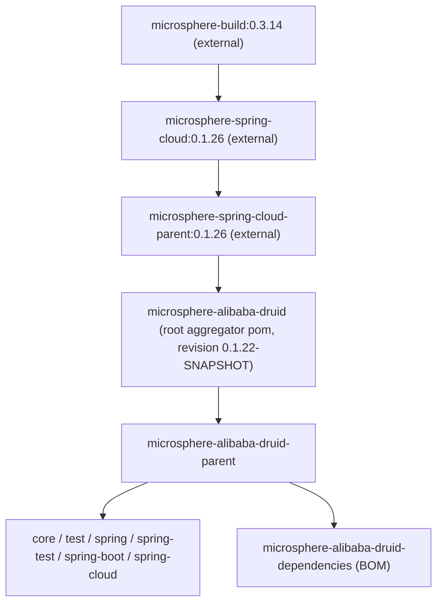

# microsphere-alibaba-druid-parent (`1.x`)

[中文](zh/microsphere-alibaba-druid-parent.md)

## Purpose

`microsphere-alibaba-druid-parent` is the `pom` artifact every module of this repository inherits from. It owns two
things and nothing else:

1. **Version properties** — `druid.version` (`1.2.28`) and `microsphere-spring-cloud.version` (`0.1.26` on the `1.x`
   line).
2. **`<dependencyManagement>`** — the `com.alibaba:druid` entry plus an `import` of the
   `microsphere-spring-cloud-dependencies` BOM, which is what supplies the Spring Boot / Spring Cloud / Microsphere
   versions used by the modules.

It contains no Java code, no plugins and no resource configuration: build plugins, compiler settings (including the
JDK 8 baseline) and the `spring-cloud-*` profiles all come from the **external** parent chain above it.

## Maven Coordinates

```xml
<parent>
    <groupId>io.github.microsphere-projects</groupId>
    <artifactId>microsphere-alibaba-druid-parent</artifactId>
    <version>0.1.21</version>
</parent>
```

| Item | Value |
|---|---|
| groupId | `io.github.microsphere-projects` |
| artifactId | `microsphere-alibaba-druid-parent` |
| Version | `${revision}` — `0.1.21` released, `0.1.22-SNAPSHOT` on the `release-1.x` branch |
| Packaging | `pom` |
| Its own parent | `io.github.microsphere-projects:microsphere-alibaba-druid` (the root aggregator pom, `../pom.xml`) |
| Modules that inherit it | `core`, `test`, `spring`, `spring-test`, `spring-boot`, `spring-cloud`, `dependencies` |

## What It Manages

The full `dependencyManagement` of the artifact (version values are the `1.x` ones):

| Entry | Version | Kind |
|---|---|---|
| `com.alibaba:druid` | `${druid.version}` = `1.2.28` | direct entry |
| `io.github.microsphere-projects:microsphere-spring-cloud-dependencies` | `${microsphere-spring-cloud.version}` = `0.1.26` | `<type>pom</type>` `<scope>import</scope>` — transitively supplies every Microsphere, Spring and Spring Boot/Cloud version |

Properties it declares:

```xml
<properties>
    <!-- BOM versions -->
    <microsphere-spring-cloud.version>0.1.26</microsphere-spring-cloud.version>
    <!-- Libraries -->
    <druid.version>1.2.28</druid.version>
</properties>
```

Because of the BOM import, a module (or your application, if you inherit from this parent) can write
`<dependency><groupId>com.alibaba</groupId><artifactId>druid</artifactId></dependency>` with **no** version.

## Inheritance Chain on the `1.x` Line



| Level | Artifact | What it contributes on `1.x` |
|---|---|---|
| 1 | `microsphere-build:0.3.14` (external) | Build plugins, `maven.compiler.source/target` = `${java.version}` = `8` |
| 2 | `microsphere-spring-cloud:0.1.26` (external) | Microsphere dependency/version management |
| 3 | `microsphere-spring-cloud-parent:0.1.26` (external) | Declared `<parent>` of the root pom; owns the `spring-cloud-hoxton` / `spring-cloud-2020` / `spring-cloud-2021`, `test` and `coverage` profiles |
| 4 | `microsphere-alibaba-druid` (this repo, root) | Aggregates the 8 modules; declares `<revision>0.1.22-SNAPSHOT</revision>`; **does not** declare `<java.version>` |
| 5 | `microsphere-alibaba-druid-parent` (this artifact) | `druid.version`, `microsphere-spring-cloud.version`, `com.alibaba:druid` management, Microsphere BOM import |

> The JDK 8 baseline of this branch line is therefore **inherited, not declared here**: the root pom of `release-1.x`
> has no `java.version` property at all, so the value comes from `microsphere-build:0.3.14` through
> `microsphere-spring-cloud:0.1.26`.

## Usage

### In this repository

You never depend on this artifact — it is already the `<parent>` of every module:

```xml
<parent>
    <groupId>io.github.microsphere-projects</groupId>
    <artifactId>microsphere-alibaba-druid-parent</artifactId>
    <version>${revision}</version>
    <relativePath>../microsphere-alibaba-druid-parent/pom.xml</relativePath>
</parent>
```

Internal module dependencies are then declared with `${revision}` explicitly, e.g.
`microsphere-alibaba-druid-spring` depends on `microsphere-alibaba-druid-core` at version `${revision}`, and test
support modules are wired with `<scope>test</scope>` + `${revision}`.

### In your own application

Two options. Prefer the BOM if you only need versions pinned:

```xml
<!-- Option A (recommended): import the BOM, keep your own parent -->
<dependencyManagement>
    <dependencies>
        <dependency>
            <groupId>io.github.microsphere-projects</groupId>
            <artifactId>microsphere-alibaba-druid-dependencies</artifactId>
            <version>0.1.21</version>
            <type>pom</type>
            <scope>import</scope>
        </dependency>
    </dependencies>
</dependencyManagement>
```

```xml
<!-- Option B: inherit from this parent, so druid.version and the Microsphere BOM are available too -->
<parent>
    <groupId>io.github.microsphere-projects</groupId>
    <artifactId>microsphere-alibaba-druid-parent</artifactId>
    <version>0.1.21</version>
</parent>
```

With option B, no `<relativePath>` is required (or set it to empty) and `com.alibaba:druid` becomes version-less:

```xml
<dependencies>
    <dependency>
        <groupId>io.github.microsphere-projects</groupId>
        <artifactId>microsphere-alibaba-druid-spring-boot</artifactId>
    </dependency>

    <dependency>
        <groupId>com.alibaba</groupId>
        <artifactId>druid</artifactId>
    </dependency>
</dependencies>
```

With Gradle, there is no parent-POM equivalent — import the BOM as a platform instead (see
[microsphere-alibaba-druid-dependencies.md](microsphere-alibaba-druid-dependencies.md)).

## Building This Line

```bash
# build one Spring Cloud generation
mvn --batch-mode clean verify -P spring-cloud-hoxton
mvn --batch-mode clean verify -P spring-cloud-2020
mvn --batch-mode clean verify -P spring-cloud-2021

# skip tests, resolve the reactor only
mvn --batch-mode clean install -DskipTests
```

| Profile | Spring Boot | Spring Cloud |
|---|---|---|
| `spring-cloud-hoxton` | `2.3.12.RELEASE` | `Hoxton.SR12` |
| `spring-cloud-2020` | `2.4.13` | `2020.0.5` |
| `spring-cloud-2021` | `2.6.15` | `2021.0.9` |

`.github/workflows/maven-build.yml` on `release-1.x` runs **JDK `8` / `11` / `17` / `21` / `25` × the three profiles**,
so the parent chain must keep `-source/-target 8` while the tests still pass on the newest JDK.

## Configuration Properties

None — this artifact contributes no runtime properties. For the properties of the runtime modules see
[microsphere-alibaba-druid-spring-boot.md](microsphere-alibaba-druid-spring-boot.md).

| Item | Value |
|---|---|
| `microsphere.alibaba.druid.enabled` | not affected by the parent POM |
| `microsphere.alibaba.druid.filter.classes` | not affected by the parent POM |

## Version Information

| Item | Value |
|---|---|
| Documentation line | `1.x` (generated from the `release-1.x` branch) |
| Latest released version | `0.1.21` (`0.1.22-SNAPSHOT` is the unpublished branch version) |
| Managed `druid.version` | `1.2.28` |
| Managed `microsphere-spring-cloud.version` | `0.1.26` |
| Root `<parent>` above it | `microsphere-spring-cloud-parent:0.1.26` |
| Java baseline | `8` — inherited (`microsphere-spring-cloud:0.1.26` → `microsphere-build:0.3.14`), **not declared** in this repository |
| Versioning scheme | CI-friendly: every module uses `<version>${revision}</version>`, `<revision>` lives in the root pom |

## Compatibility Range

| Dimension | Value on the `1.x` line |
|---|---|
| Maven | 3.6+ (`${revision}` + parent `relativePath` resolution) |
| Java | compiles at source/target `8`; the CI matrix proves 8 / 11 / 17 / 21 / 25 |
| Spring Boot | `2.3.12.RELEASE`, `2.4.13`, `2.6.15` (from the external profiles) |
| Spring Cloud | `Hoxton.SR12`, `2020.0.5`, `2021.0.9` (from the external profiles) |
| Alibaba Druid | `1.2.28` |
| Microsphere Spring Cloud BOM | `microsphere-spring-cloud-dependencies:0.1.26` |

## Differences from the `current` line

Same structure, different numbers: on `current` the parent imports `microsphere-spring-cloud-dependencies:0.2.26`,
the artifact line is `0.2.21`, and the root pom declares `<java.version>17</java.version>` instead of inheriting
JDK 8.

## See Also

- [User Guide index](README.md)
- [microsphere-alibaba-druid-dependencies.md](microsphere-alibaba-druid-dependencies.md)
- [microsphere-alibaba-druid-core.md](microsphere-alibaba-druid-core.md)
- [microsphere-alibaba-druid-spring-boot.md](microsphere-alibaba-druid-spring-boot.md)
- [Project README](../../../README.md)
- [current-line version of this document](../../current/user-guide/microsphere-alibaba-druid-parent.md)
- Developer Guide: [../developer-guide/microsphere-alibaba-druid-parent.md](../developer-guide/microsphere-alibaba-druid-parent.md)

## 中文

- [简体中文：microsphere-alibaba-druid-parent](zh/microsphere-alibaba-druid-parent.md)
