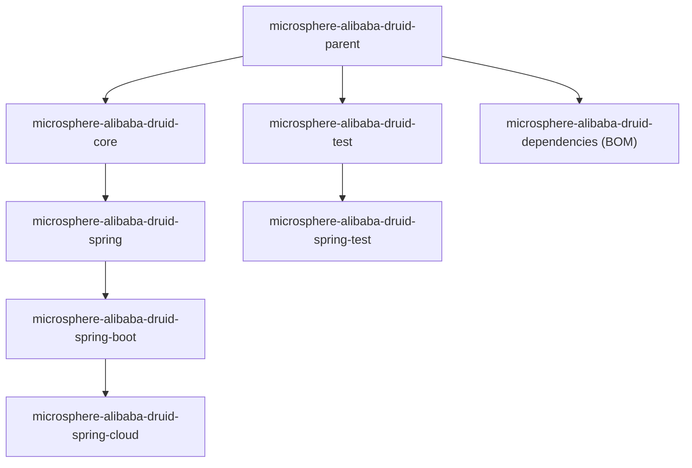

# Microsphere Alibaba Druid —— 用户文档（`1.x` 文档线）

[English](../README.md)

本文档面向 `1.x` 文档线（即 `release-1.x` 分支构建出的 `0.1.x` 制品）的**使用者**，说明 `pom.xml` 应该怎么写、
该用哪些类与注解、该配置哪些属性。架构与内部实现见
[开发者文档](../../developer-guide/zh/README.md)。

Microsphere Alibaba Druid 构建于 [Alibaba Druid](https://github.com/alibaba/druid)（高性能 JDBC 连接池）之上，
增加了 SQL **语句拦截**能力（`AbstractStatementFilter`）、Spring / Spring Boot / Spring Cloud 集成、面向 Actuator
的连接池指标，以及一组测试工具。

> **Java API 与 `current` 文档线完全一致。** 本文档所描述的内容与 `0.2.x` 源码兼容，差异只在打包与平台支持：
> 为 Boot 2.x 提供的 `spring.factories` 注册方式、JDK 8 基线，以及 Spring Boot 2 / Spring Cloud
> `Hoxton` – `2021.0.x` 矩阵。若你使用 Spring Boot 3 / JDK 17+，请改用
> [current 用户文档](../../../current/user-guide/zh/README.md)。

## 本指南包含的文档

| 文档 | 模块 | 提供的能力 |
|---|---|---|
| [microsphere-alibaba-druid-core.md](microsphere-alibaba-druid-core.md) | `microsphere-alibaba-druid-core` | `AbstractStatementFilter` / `LoggingStatementFilter` 与 `microsphere.alibaba.druid` 属性名常量 |
| [microsphere-alibaba-druid-spring.md](microsphere-alibaba-druid-spring.md) | `microsphere-alibaba-druid-spring` | `@EnableAlibabaDruid` 与 `DruidDataSourceBeanPostProcessor`：把 `Filter` Bean 注入每个 `DruidDataSource` |
| [microsphere-alibaba-druid-spring-boot.md](microsphere-alibaba-druid-spring-boot.md) | `microsphere-alibaba-druid-spring-boot` | 自动配置（Boot 2.x + Boot 3.x 双注册）、`AlibabaDruidProperties`、`DruidDataSourcePoolMetadata` |
| [microsphere-alibaba-druid-spring-cloud.md](microsphere-alibaba-druid-spring-cloud.md) | `microsphere-alibaba-druid-spring-cloud` | Spring Cloud 自动配置与 `features.yaml` 声明的 `/actuator/features` 条目 |
| [microsphere-alibaba-druid-test.md](microsphere-alibaba-druid-test.md) | `microsphere-alibaba-druid-test` | `AbstractAlibabaDruidTest`、`AlibabaDruidTestUtils`、`@AlibabaDruidTest`、`@AlibabaDruidRuntime` |
| [microsphere-alibaba-druid-spring-test.md](microsphere-alibaba-druid-spring-test.md) | `microsphere-alibaba-druid-spring-test` | 面向 Spring 测试的 `AbstractDruidSpringTest` 与 `DruidDataSourceTestConfiguration` |
| [microsphere-alibaba-druid-parent.md](microsphere-alibaba-druid-parent.md) | `microsphere-alibaba-druid-parent` | 父 POM：Druid `1.2.28` 版本管理，并导入 Microsphere Spring Cloud BOM `0.1.26` |
| [microsphere-alibaba-druid-dependencies.md](microsphere-alibaba-druid-dependencies.md) | `microsphere-alibaba-druid-dependencies` | BOM：被其锁定版本的构件清单 |

## 快速开始

### 1. 导入 BOM

`microsphere-alibaba-druid-dependencies` 是本项目的 BOM，导入后所有 Microsphere Alibaba Druid 构件都无需再写版本号。

```xml
<properties>
    <microsphere-alibaba-druid.version>0.1.21</microsphere-alibaba-druid.version>
</properties>

<dependencyManagement>
    <dependencies>
        <dependency>
            <groupId>io.github.microsphere-projects</groupId>
            <artifactId>microsphere-alibaba-druid-dependencies</artifactId>
            <version>${microsphere-alibaba-druid.version}</version>
            <type>pom</type>
            <scope>import</scope>
        </dependency>
    </dependencies>
</dependencyManagement>
```

Gradle 写法：

```kotlin
implementation(platform("io.github.microsphere-projects:microsphere-alibaba-druid-dependencies:0.1.21"))
```

> BOM 只锁定本仓库的模块。Druid（`com.alibaba:druid`）以及 Spring Boot / Spring Cloud 的版本由
> `microsphere-alibaba-druid-parent` 管理，因此需要你在应用中自行声明 `com.alibaba:druid` 与所使用的
> H2/MySQL 驱动。参见 [microsphere-alibaba-druid-dependencies.md](microsphere-alibaba-druid-dependencies.md) 与
> [microsphere-alibaba-druid-parent.md](microsphere-alibaba-druid-parent.md)。

### 2. 添加一个模块

Spring Boot 应用通常只需 Spring Boot 模块，它会传递引入 `core` 与 `spring`：

```xml
<dependencies>
    <dependency>
        <groupId>io.github.microsphere-projects</groupId>
        <artifactId>microsphere-alibaba-druid-spring-boot</artifactId>
    </dependency>

    <dependency>
        <groupId>com.alibaba</groupId>
        <artifactId>druid</artifactId>
    </dependency>

    <dependency>
        <groupId>com.h2database</groupId>
        <artifactId>h2</artifactId>
        <scope>runtime</scope>
    </dependency>
</dependencies>
```

各模块把 Druid / Spring / Spring Boot 声明为 **optional** 依赖，因此不会被传递引入——必须由你自己添加。

### 3. 最小 Spring Boot 应用

```java
@SpringBootApplication
public class DruidDemoApplication {

    public static void main(String[] args) {
        SpringApplication.run(DruidDemoApplication.class, args);
    }
}
```

`src/main/resources/application.properties`：

```properties
spring.datasource.type=com.alibaba.druid.pool.DruidDataSource
spring.datasource.url=jdbc:h2:mem:test_mem
spring.datasource.driver-class-name=org.h2.Driver

microsphere.alibaba.druid.enabled=true
microsphere.alibaba.druid.filter.classes=io.microsphere.alibaba.druid.filter.LoggingStatementFilter

management.endpoints.web.exposure.include=health,features
```

这样就够了：在本文档线上，`AlibabaDruidAutoConfiguration` 既通过 `META-INF/spring.factories`
（Boot 2.3 – 2.6）被发现，也通过 `META-INF/spring/org.springframework.boot.autoconfigure.AutoConfiguration.imports`
（Boot 2.7+）被发现，因此无需额外的 `@Import`。它会注册 `DruidDataSourceBeanPostProcessor`，在每个
`DruidDataSource` Bean 初始化之前把匹配的 `Filter` Bean 注入进去；同时注册 `DataSourcePoolMetadataProvider`，
把 Druid 连接池暴露给 Spring Boot Actuator 指标。

### 4. 编写自己的 SQL 拦截逻辑

继承 `AbstractStatementFilter`（见 [microsphere-alibaba-druid-core.md](microsphere-alibaba-druid-core.md)），
将其声明为 Spring Bean，并写入 `microsphere.alibaba.druid.filter.classes`；或者在纯 Spring 应用中使用
`@EnableAlibabaDruid`（见 [microsphere-alibaba-druid-spring.md](microsphere-alibaba-druid-spring.md)）。

## 配置属性汇总

| 属性 | 类型 | 默认值 | 定义位置 | 消费位置 |
|---|---|---|---|---|
| `microsphere.alibaba.druid.enabled` | `boolean` | `true` | `PropertyConstants`（core） | `@ConditionalOnAlibabaDruidEnabled`、`AlibabaDruidProperties` |
| `microsphere.alibaba.druid.filter.classes` | `Class<? extends com.alibaba.druid.filter.Filter>[]` | `[com.alibaba.druid.filter.Filter]` | `AlibabaDruidProperties.Filter`（spring-boot） | `AlibabaDruidAutoConfiguration` |

## 模块结构



运行时模块的 compile 依赖链：`core` → `spring` → `spring-boot` → `spring-cloud`；测试模块为 `test` → `spring-test`。

## 版本信息

| 项目 | 值 |
|---|---|
| 文档线 | `1.x`（由 `release-1.x` 分支生成） |
| 最新已发布版本 | `0.1.21` |
| `release-1.x` 分支版本 | `0.1.22-SNAPSHOT`（根 `pom.xml` 的 `<revision>`，未发布） |
| 根 `<parent>` | `io.github.microsphere-projects:microsphere-spring-cloud-parent:0.1.26` |
| Java 基线 | `8` —— **继承**自外部父 POM 链（`microsphere-spring-cloud:0.1.26` → `microsphere-build:0.3.14`），本仓库未声明 |
| CI JDK 矩阵 | `8`、`11`、`17`、`21`、`25`（`.github/workflows/maven-build.yml`） |
| Alibaba Druid | `1.2.28`，由 `microsphere-alibaba-druid-parent` 管理 |
| 所有构件的 groupId | `io.github.microsphere-projects` |
| 自动配置注册方式 | Boot 2.x 风格 `META-INF/spring.factories` **加上** `META-INF/spring/org.springframework.boot.autoconfigure.AutoConfiguration.imports`（`spring-boot` 与 `spring-cloud` 两个模块都有） |

## 兼容范围

`1.x` 文档线兼容 **Spring Cloud `Hoxton` – `2021.0.x`**（即 Spring Boot `2.3.x` – `2.6.x`），构建按以下三个 profile 验证：

| Profile | Spring Boot | Spring Cloud |
|---|---|---|
| `spring-cloud-hoxton` | `2.3.12.RELEASE` | `Hoxton.SR12` |
| `spring-cloud-2020` | `2.4.13` | `2020.0.5` |
| `spring-cloud-2021` | `2.6.15` | `2021.0.9` |

> 这些具体的 Boot/Cloud 版本**继承自外部父 POM 链** `io.github.microsphere-projects:microsphere-spring-cloud-parent:0.1.26`；
> `spring-cloud-*` profile 同样声明在那里，本仓库并未声明。

如果你使用 JDK 17+ 与 Spring Cloud `2022.0.x` – `2025.0.x`，请改用 `current` 文档线：
[current 用户文档](../../../current/user-guide/zh/README.md)。

## 1.x 与 current 对比

| 维度 | `1.x`（本文档） | `current` |
|---|---|---|
| 制品线 | `0.1.21`（分支：`0.1.22-SNAPSHOT`） | `0.2.21`（分支：`0.2.22-SNAPSHOT`） |
| Spring Cloud | `Hoxton` – `2021.0.x` | `2022.0.x` – `2025.0.x` |
| Java 基线 | JDK 8（继承而来） | JDK 17（`<java.version>17</java.version>`） |
| 自动配置发现 | `spring.factories` + `AutoConfiguration.imports` | 仅 `AutoConfiguration.imports` |
| Alibaba Druid | `1.2.28` | `1.2.28` |
| 公开 Java API | 一致 | 一致 |

## 相关文档

- [项目 README（仓库根）](../../../../README.md)
- [开发者文档（1.x）](../../developer-guide/zh/README.md) —— 同一批模块的架构与内部实现
- [current 用户文档（`0.2.x`）](../../../current/user-guide/zh/README.md)

## English

- [English version of this document](../README.md)
