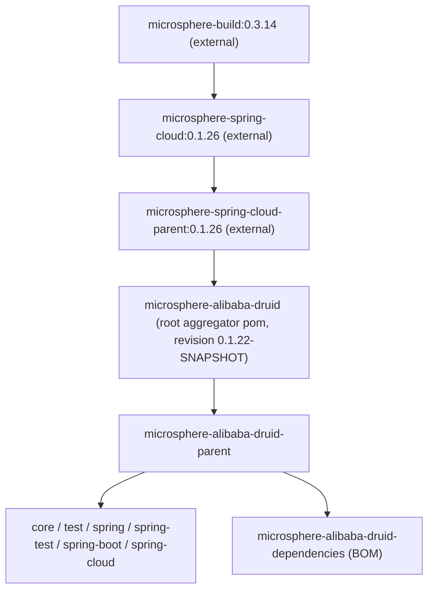

# microsphere-alibaba-druid-parent（`1.x`）

[English](../microsphere-alibaba-druid-parent.md)

## 模块用途

`microsphere-alibaba-druid-parent` 是本仓库所有模块继承的 `pom` 制品，它只负责两件事：

1. **版本属性** —— `druid.version`（`1.2.28`）与 `microsphere-spring-cloud.version`（`1.x` 文档线为 `0.1.26`）。
2. **`<dependencyManagement>`** —— `com.alibaba:druid` 条目，外加对 `microsphere-spring-cloud-dependencies` BOM 的
   `import`，后者才是各模块所用 Spring Boot / Spring Cloud / Microsphere 版本的来源。

它不含任何 Java 代码、插件或资源配置：构建插件、编译设置（包括 JDK 8 基线）以及 `spring-cloud-*` profile
全部来自它之上的**外部**父 POM 链。

## Maven 坐标

```xml
<parent>
    <groupId>io.github.microsphere-projects</groupId>
    <artifactId>microsphere-alibaba-druid-parent</artifactId>
    <version>0.1.21</version>
</parent>
```

| 项目 | 值 |
|---|---|
| groupId | `io.github.microsphere-projects` |
| artifactId | `microsphere-alibaba-druid-parent` |
| 版本 | `${revision}` —— 已发布 `0.1.21`，`release-1.x` 分支为 `0.1.22-SNAPSHOT` |
| 打包方式 | `pom` |
| 它的父 POM | `io.github.microsphere-projects:microsphere-alibaba-druid`（根聚合 pom，`../pom.xml`） |
| 继承它的模块 | `core`、`test`、`spring`、`spring-test`、`spring-boot`、`spring-cloud`、`dependencies` |

## 它管理的内容

该制品 `dependencyManagement` 的完整条目（版本取 `1.x` 值）：

| 条目 | 版本 | 类型 |
|---|---|---|
| `com.alibaba:druid` | `${druid.version}` = `1.2.28` | 直接条目 |
| `io.github.microsphere-projects:microsphere-spring-cloud-dependencies` | `${microsphere-spring-cloud.version}` = `0.1.26` | `<type>pom</type>` `<scope>import</scope>` —— 间接提供全部 Microsphere、Spring、Spring Boot/Cloud 版本 |

它声明的属性：

```xml
<properties>
    <!-- BOM versions -->
    <microsphere-spring-cloud.version>0.1.26</microsphere-spring-cloud.version>
    <!-- Libraries -->
    <druid.version>1.2.28</druid.version>
</properties>
```

正因为导入了这个 BOM，模块（或继承了本 parent 的应用）可以只写
`<dependency><groupId>com.alibaba</groupId><artifactId>druid</artifactId></dependency>` 而**不写**版本。

## `1.x` 文档线的继承链



| 层级 | 制品 | 在 `1.x` 上贡献的内容 |
|---|---|---|
| 1 | `microsphere-build:0.3.14`（外部） | 构建插件，`maven.compiler.source/target` = `${java.version}` = `8` |
| 2 | `microsphere-spring-cloud:0.1.26`（外部） | Microsphere 依赖/版本管理 |
| 3 | `microsphere-spring-cloud-parent:0.1.26`（外部） | 根 pom 声明的 `<parent>`；持有 `spring-cloud-hoxton` / `spring-cloud-2020` / `spring-cloud-2021`、`test`、`coverage` 等 profile |
| 4 | `microsphere-alibaba-druid`（本仓库根 pom） | 聚合 8 个模块；声明 `<revision>0.1.22-SNAPSHOT</revision>`；**未**声明 `<java.version>` |
| 5 | `microsphere-alibaba-druid-parent`（本制品） | `druid.version`、`microsphere-spring-cloud.version`、`com.alibaba:druid` 管理、Microsphere BOM 导入 |

> 因此本文档线的 JDK 8 基线是**继承而来、并非本仓库声明**：`release-1.x` 的根 pom 完全没有 `java.version` 属性，
> 该值来自 `microsphere-build:0.3.14`（经 `microsphere-spring-cloud:0.1.26` 传入）。

## 使用方式

### 在本仓库中

你不需要依赖该制品 —— 它已经是所有模块的 `<parent>`：

```xml
<parent>
    <groupId>io.github.microsphere-projects</groupId>
    <artifactId>microsphere-alibaba-druid-parent</artifactId>
    <version>${revision}</version>
    <relativePath>../microsphere-alibaba-druid-parent/pom.xml</relativePath>
</parent>
```

模块间依赖随后显式使用 `${revision}`，例如 `microsphere-alibaba-druid-spring` 依赖
`microsphere-alibaba-druid-core` 的版本写作 `${revision}`；测试支持模块则以 `<scope>test</scope>` + `${revision}` 接入。

### 在你自己的应用中

两种方式；若只需要版本锁定，优先使用 BOM：

```xml
<!-- Option A (recommended): import the BOM, keep your own parent -->
<dependencyManagement>
    <dependencies>
        <dependency>
            <groupId>io.github.microsphere-projects</groupId>
            <artifactId>microsphere-alibaba-druid-dependencies</artifactId>
            <version>0.1.21</version>
            <type>pom</type>
            <scope>import</scope>
        </dependency>
    </dependencies>
</dependencyManagement>
```

```xml
<!-- Option B: inherit from this parent, so druid.version and the Microsphere BOM are available too -->
<parent>
    <groupId>io.github.microsphere-projects</groupId>
    <artifactId>microsphere-alibaba-druid-parent</artifactId>
    <version>0.1.21</version>
</parent>
```

采用方式 B 时无需 `<relativePath>`（或将其置空），并且 `com.alibaba:druid` 可以不写版本：

```xml
<dependencies>
    <dependency>
        <groupId>io.github.microsphere-projects</groupId>
        <artifactId>microsphere-alibaba-druid-spring-boot</artifactId>
    </dependency>

    <dependency>
        <groupId>com.alibaba</groupId>
        <artifactId>druid</artifactId>
    </dependency>
</dependencies>
```

Gradle 没有父 POM 的等价机制 —— 请改用 platform 方式导入 BOM，见
[microsphere-alibaba-druid-dependencies.md](microsphere-alibaba-druid-dependencies.md)。

## 构建本文档线

```bash
# build one Spring Cloud generation
mvn --batch-mode clean verify -P spring-cloud-hoxton
mvn --batch-mode clean verify -P spring-cloud-2020
mvn --batch-mode clean verify -P spring-cloud-2021

# skip tests, resolve the reactor only
mvn --batch-mode clean install -DskipTests
```

| Profile | Spring Boot | Spring Cloud |
|---|---|---|
| `spring-cloud-hoxton` | `2.3.12.RELEASE` | `Hoxton.SR12` |
| `spring-cloud-2020` | `2.4.13` | `2020.0.5` |
| `spring-cloud-2021` | `2.6.15` | `2021.0.9` |

`release-1.x` 上的 `.github/workflows/maven-build.yml` 运行的是 **JDK `8` / `11` / `17` / `21` / `25` × 三个 profile**
矩阵，因此父 POM 链必须保持 `-source/-target 8`，同时测试还要能在最新 JDK 上通过。

## 配置属性

无 —— 本制品不贡献任何运行时属性。运行时模块的属性见
[microsphere-alibaba-druid-spring-boot.md](microsphere-alibaba-druid-spring-boot.md)。

| 项目 | 值 |
|---|---|
| `microsphere.alibaba.druid.enabled` | 不受父 POM 影响 |
| `microsphere.alibaba.druid.filter.classes` | 不受父 POM 影响 |

## 版本信息

| 项目 | 值 |
|---|---|
| 文档线 | `1.x`（由 `release-1.x` 分支生成） |
| 最新已发布版本 | `0.1.21`（`0.1.22-SNAPSHOT` 是分支上未发布的开发版） |
| 管理的 `druid.version` | `1.2.28` |
| 管理的 `microsphere-spring-cloud.version` | `0.1.26` |
| 其上的根 `<parent>` | `microsphere-spring-cloud-parent:0.1.26` |
| Java 基线 | `8` —— 继承（`microsphere-spring-cloud:0.1.26` → `microsphere-build:0.3.14`），**本仓库未声明** |
| 版本方案 | CI 友好：所有模块使用 `<version>${revision}</version>`，`<revision>` 只写在根 pom |

## 兼容范围

| 维度 | `1.x` 文档线取值 |
|---|---|
| Maven | 3.6+（`${revision}` 与父 pom `relativePath` 解析） |
| Java | 以 source/target `8` 编译；CI 矩阵验证 8 / 11 / 17 / 21 / 25 |
| Spring Boot | `2.3.12.RELEASE`、`2.4.13`、`2.6.15`（来自外部 profile） |
| Spring Cloud | `Hoxton.SR12`、`2020.0.5`、`2021.0.9`（来自外部 profile） |
| Alibaba Druid | `1.2.28` |
| Microsphere Spring Cloud BOM | `microsphere-spring-cloud-dependencies:0.1.26` |

## 与 current 文档线的差异

结构相同、数值不同：`current` 线上该 parent 导入的是 `microsphere-spring-cloud-dependencies:0.2.26`，
制品线为 `0.2.21`，并且根 pom 声明了 `<java.version>17</java.version>`，而不是继承 JDK 8。

## 另见

- [用户文档索引](README.md)
- [microsphere-alibaba-druid-dependencies.md](microsphere-alibaba-druid-dependencies.md)
- [microsphere-alibaba-druid-core.md](microsphere-alibaba-druid-core.md)
- [microsphere-alibaba-druid-spring-boot.md](microsphere-alibaba-druid-spring-boot.md)
- [项目 README](../../../../README.md)
- [current 文档线的同名文档](../../../current/user-guide/zh/microsphere-alibaba-druid-parent.md)
- [开发者文档](../../developer-guide/zh/microsphere-alibaba-druid-parent.md)

## English

- [English version of this document](../microsphere-alibaba-druid-parent.md)
