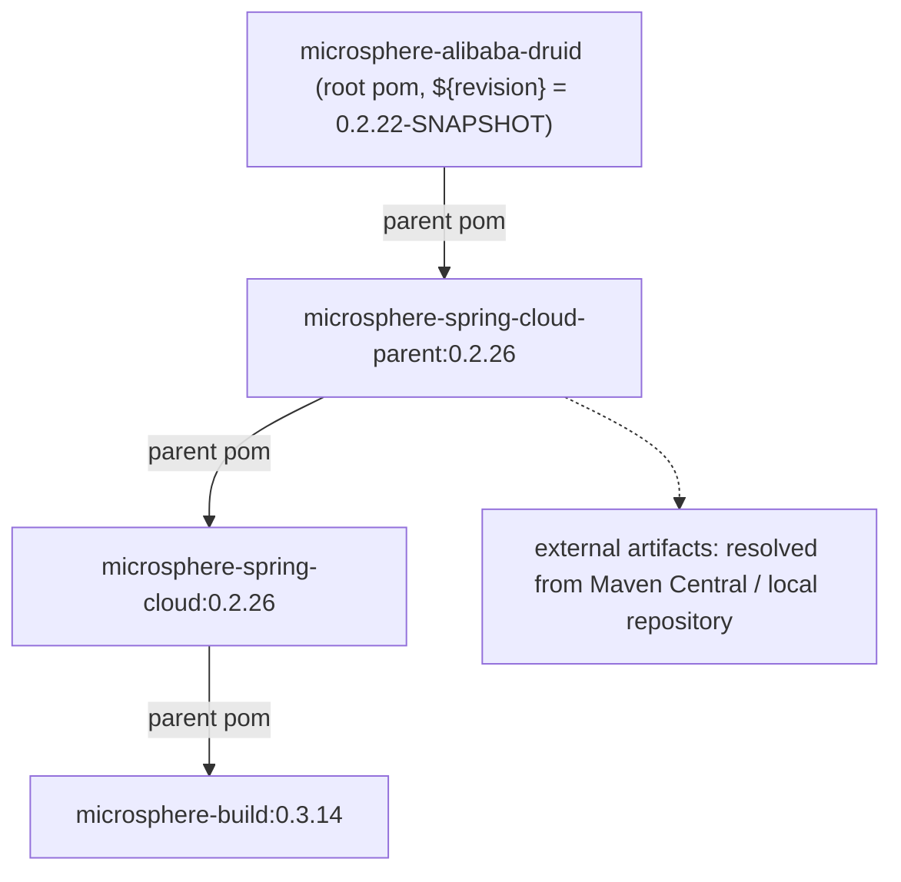
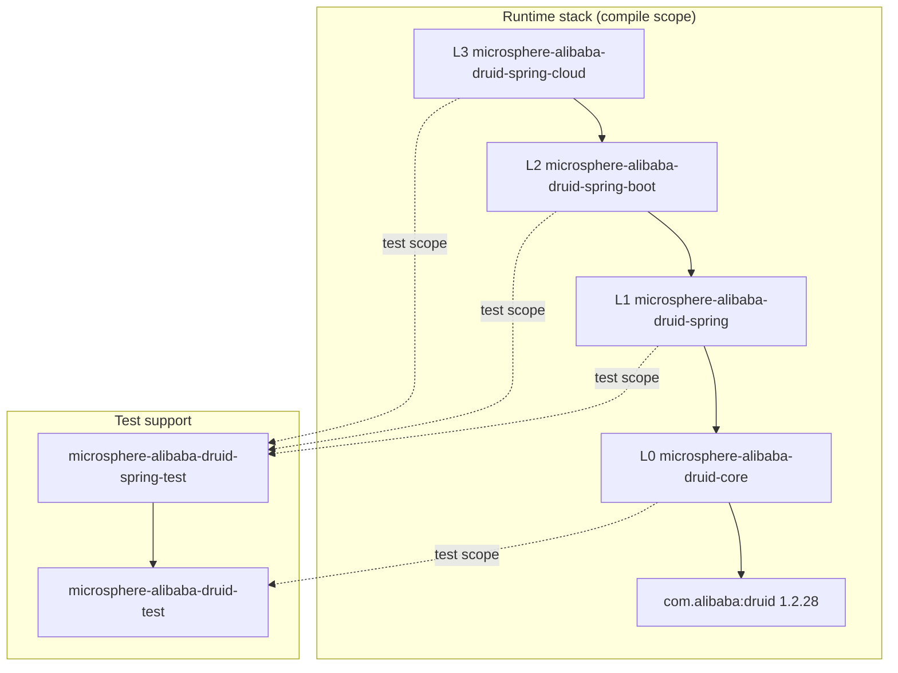
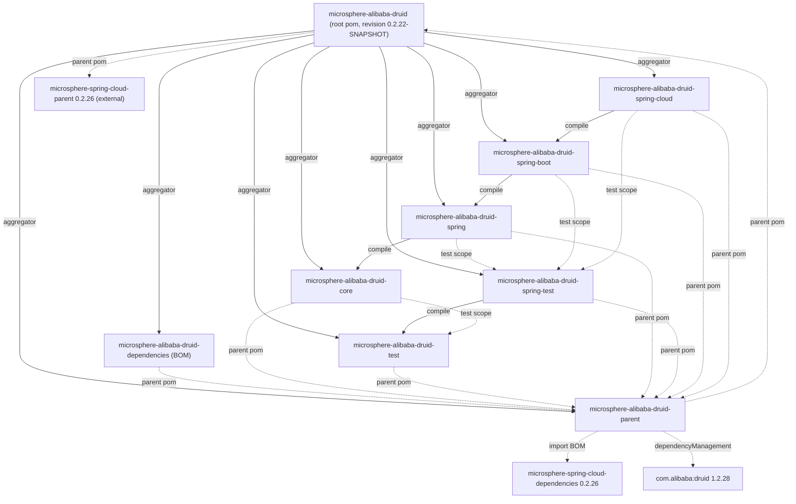

[中文](zh/README.md)

# Developer Guide — current (`release` branch line, `0.2.x`)

This guide documents the **internal design** of Microsphere Alibaba Druid on the `current` documentation line:
the layering, the whole-repository module dependency graph, the source-level behaviour of every public type,
the design patterns in use, the complex control flows, the test strategy and the extension points a contributor
must respect.

It is *not* a usage manual. For installation, configuration properties and cookbook recipes see the
[User Guide](../user-guide/README.md).

- Repository home: [../../../README.md](../../../README.md)
- Older line (`0.1.x` / `release-1.x`): [1.x developer guide](../../1.x/developer-guide/README.md)

---

## 1. Version facts of this line

| Fact | Value | Declared where |
|---|---|---|
| Latest released version | `0.2.21` | [../../../README.md](../../../README.md) + `release-notes.md` |
| In-development version | `0.2.22-SNAPSHOT` | root pom `<revision>` |
| Java baseline | `17` | root pom `<java.version>`, overridden onto `maven.compiler.source/target` inherited from `microsphere-build:0.3.14` |
| Alibaba Druid | `1.2.28` | `microsphere-alibaba-druid-parent` property `druid.version` |
| Microsphere Spring Cloud BOM | `0.2.26` | `microsphere-alibaba-druid-parent` property `microsphere-spring-cloud.version` (imported BOM) |
| Spring Boot / Spring Cloud versions | **not declared here** | inherited from the external parent chain, per `spring-cloud-*` profile (see §5) |

The Java sources in the `main` working tree are byte-identical to the `release` branch; the only structural
differences versus `release-1.x` are packaging and versioning — most visibly that this line ships
**only** `META-INF/spring/org.springframework.boot.autoconfigure.AutoConfiguration.imports` (Boot 3 style)
and has **no** `spring.factories` auto-configuration registration in `spring-boot` / `spring-cloud`.

### 1.1 External parent chain (inherited, not owned by this repository)



All four `spring-cloud-*` profiles, the `test` and `coverage` profiles, the compiler plugin configuration,
the flatten-maven-plugin setup and the dependency versions of JUnit / Spring / Microsphere come from this
chain, **not** from files in this repository. Never re-declare them locally.

---

## 2. Architecture and layering

The project is a strict vertical stack. Every runtime layer only depends on the layer beneath it; the testing
modules hang off the side of the stack and are wired back into it through `test`-scope edges.

| Layer | Module | Responsibility |
|---|---|---|
| L0 | `microsphere-alibaba-druid-core` | Druid `Filter` SPI implementations: `AbstractStatementFilter` interception template, `LoggingStatementFilter`, `microsphere.alibaba.druid.*` property-name constants. Zero Spring dependency. |
| L1 | `microsphere-alibaba-druid-spring` | Spring Framework integration: `@EnableAlibabaDruid` + `AlibabaDruidRegistrar` (multi-source `Filter` discovery), `DruidDataSourceBeanPostProcessor` (inject filters before `init()`). |
| L2 | `microsphere-alibaba-druid-spring-boot` | Boot auto-configuration (`AlibabaDruidAutoConfiguration`), `AlibabaDruidProperties`, composite `@Conditional` annotations, Actuator `DruidDataSourcePoolMetadata`. |
| L3 | `microsphere-alibaba-druid-spring-cloud` | Spring Cloud packaging: conditional empty-shell auto-configuration plus `META-INF/config/default/features.yaml` feature catalogue. |
| Support | `microsphere-alibaba-druid-test` | Non-Spring test infrastructure: `DruidDataSource` builders, `AbstractAlibabaDruidTest` template, `@AlibabaDruidTest` JUnit 5 extension. |
| Support | `microsphere-alibaba-druid-spring-test` | Spring-aware test infrastructure: `AbstractDruidSpringTest`, prototype-scoped `DruidDataSourceTestConfiguration`. |
| Build | `microsphere-alibaba-druid-parent`, `microsphere-alibaba-druid-dependencies`, root pom | Property/version management, BOM, aggregation. |



Two consequences to internalise before changing anything:

- `core` knows nothing about Spring: `new DruidDataSource()` + `getProxyFilters().add(new LoggingStatementFilter())`
  + `init()` works with no container at all.
- `spring` and above add **no** interception logic — they only *discover*, *register* and *inject* filters.

---

## 3. Module dependency graph (whole repository)

Solid edges = `compile` scope between reactor modules; dashed edges = `parent` inheritance, BOM import or
`test` scope.



### 3.1 Scope table per module

| Module | Required (`compile`) | `optional` (compile-time, non-transitive) | `test` scope |
|---|---|---|---|
| core | — | `microsphere-annotation-processor`, `microsphere-java-core`, `druid` | `junit-jupiter`, `h2`, `microsphere-alibaba-druid-test`, `microsphere-logging-test`, `microsphere-logback`, `logback-classic` |
| test | — | `microsphere-annotation-processor`, `junit-jupiter`, `microsphere-java-test`, `microsphere-logging-test`, `druid`, `h2`, `logback-classic` | `microsphere-logback` |
| spring | `microsphere-alibaba-druid-core` | `microsphere-annotation-processor`, `microsphere-spring-context`, `druid`, `spring-beans`, `spring-context`, `spring-test` | `junit-jupiter`, `h2`, `microsphere-alibaba-druid-spring-test`, `microsphere-spring-test`, `microsphere-logback`, `logback-classic` |
| spring-test | `microsphere-alibaba-druid-test` | `junit-jupiter`, `spring-test`, `spring-context`, `microsphere-spring-test`, `microsphere-spring-context`, `druid`, `h2`, `logback-classic` | `microsphere-logback` |
| spring-boot | `microsphere-alibaba-druid-spring` | `microsphere-annotation-processor`, `microsphere-spring-boot-core`, `druid`, `spring-boot-starter`, `spring-boot-starter-actuator`, `spring-boot-configuration-processor`, `spring-boot-autoconfigure-processor` | `junit-jupiter`, `spring-boot-starter-test`, `microsphere-spring-boot-test`, `microsphere-alibaba-druid-spring-test`, `microsphere-logback`, `h2`, `logback-classic` |
| spring-cloud | `microsphere-alibaba-druid-spring-boot` | `microsphere-annotation-processor`, `microsphere-spring-cloud-commons`, `druid`, `spring-cloud-commons`, `spring-boot-starter`, `spring-boot-starter-actuator`, `spring-boot-configuration-processor`, `spring-boot-autoconfigure-processor` | `junit-jupiter`, `spring-boot-starter-test`, `microsphere-spring-boot-test`, `microsphere-alibaba-druid-spring-test`, `microsphere-logback`, `h2`, `logback-classic` |
| parent | — | — | — (manages `druid:1.2.28`, imports `microsphere-spring-cloud-dependencies:0.2.26`) |
| dependencies (BOM) | — | — | — (manages the six reactor artifacts at `${revision}`) |

### 3.2 `test`-scope edges worth understanding

- `core` → `microsphere-alibaba-druid-test` (`${revision}`, `test`): `AbstractFilterTest` extends
  `AbstractAlibabaDruidTest`. Legal and **not** a cycle — `test` has no compile dependency on `core`, so the
  reactor sorts `test` before `core`.
- `spring`, `spring-boot`, `spring-cloud` → `microsphere-alibaba-druid-spring-test` (`${revision}`, `test`):
  all Spring tests extend `AbstractDruidSpringTest` and import `DruidDataSourceTestConfiguration`.
- `spring-test` → `test` is a **compile** edge (the Spring test base class extends the non-Spring one), which is
  why `microsphere-alibaba-druid-test` is published as a normal artifact.
- Everything third-party inside `test` and `spring-test` is `optional`, so downstream consumers must provide
  JUnit, Druid, Spring Test and H2 themselves.

---

## 4. Complex flows at a glance

| Flow | Diagram type | Where documented |
|---|---|---|
| SQL statement interception (`final` overrides → `execute` template → `beforeExecute`/callback/`finally afterExecute`, `wrap(e, SQLException.class)`) | sequence | [core — SQL interception execution flow](microsphere-alibaba-druid-core.md#sql-interception-execution-flow) |
| `buildResourceName()` decision (validation-SQL short-circuit, type dispatch, `UNRECOGNIZED` fallback) | flowchart | [core — buildResourceName decision flow](microsphere-alibaba-druid-core.md#buildresourcename-decision-flow) |
| `@EnableAlibabaDruid` registration with `switch` fall-through + `BeanPostProcessor` injection | sequence + flowchart | [spring — @EnableAlibabaDruid registration flow](microsphere-alibaba-druid-spring.md#enablealibabadruid-registration-flow) |
| Boot auto-configuration condition evaluation (`@ConditionalOnAlibabaDruidAvailable`, `@ConditionalOnBean`) | flowchart | [spring-boot — Auto-configuration condition evaluation flow](microsphere-alibaba-druid-spring-boot.md#auto-configuration-condition-evaluation-flow) |
| Spring Cloud feature catalogue → `NamedFeature` beans | sequence | [spring-cloud — Cloud features activation flow](microsphere-alibaba-druid-spring-cloud.md#cloud-features-activation-flow) |
| `@AlibabaDruidTest` JUnit 5 extension lifecycle (Store / Namespace / ParameterResolver) | sequence | [test — AlibabaDruidTest extension lifecycle](microsphere-alibaba-druid-test.md#alibabadruidtest-extension-lifecycle) |

---

## 5. Building and CI

### 5.1 Local build

Requirements: **JDK 17+** (the compiler baseline is `17`), Maven 3.6+ (use `./mvnw`), and network or local-repo
access to the external parent chain artifacts.

```bash
# full reactor against one Spring Cloud generation
./mvnw --batch-mode clean verify -P spring-cloud-2025

# other generations
./mvnw --batch-mode clean verify -P spring-cloud-2022
./mvnw --batch-mode clean verify -P spring-cloud-2023
./mvnw --batch-mode clean verify -P spring-cloud-2024

# skip tests, only resolve/flatten the reactor
./mvnw --batch-mode clean install -DskipTests

# one module plus its reactor dependencies
./mvnw --batch-mode -pl microsphere-alibaba-druid-spring -am test -P spring-cloud-2025
```

`spring-cloud-2025` is `activeByDefault` in the external parent, so a bare `mvn verify` builds against
Spring Boot `3.5.15` / Spring Cloud `2025.0.3`. The profiles and the versions they pin are **inherited**:

| Profile | Spring Boot | Spring Cloud | Inherited from |
|---|---|---|---|
| `spring-cloud-2022` | `3.0.13` | `2022.0.5` | `microsphere-spring-cloud-parent:0.2.26` |
| `spring-cloud-2023` | `3.3.13` | `2023.0.6` | `microsphere-spring-cloud-parent:0.2.26` |
| `spring-cloud-2024` | `3.4.13` | `2024.0.3` | `microsphere-spring-cloud-parent:0.2.26` |
| `spring-cloud-2025` (default) | `3.5.15` | `2025.0.3` | `microsphere-spring-cloud-parent:0.2.26` |

These four version pairs belong to the parent POM, not to this repository — never state them as "the version of
microsphere-alibaba-druid" and never pin them in a local pom.

Versioning is CI-friendly: every module declares `<version>${revision}</version>`, `<revision>0.2.22-SNAPSHOT</revision>`
lives only in the root pom, and the `flatten-maven-plugin` configuration (inherited from `microsphere-build:0.3.14`)
publishes resolved poms — a release is a single property bump.

### 5.2 CI matrix (`.github/workflows/maven-build.yml`)

| Aspect | Value |
|---|---|
| Triggers | `push`: `main`, `dev` · `pull_request`: `main`, `dev`, `release` |
| Runner | `ubuntu-latest` |
| JDK matrix | `17`, `21`, `25` (distribution `temurin`, `actions/setup-java@v6.0.1`) |
| Profile matrix | `spring-cloud-2022`, `spring-cloud-2023`, `spring-cloud-2024`, `spring-cloud-2025` |
| Command | `mvn --batch-mode --update-snapshots --file pom.xml -Drevision=0.0.1-SNAPSHOT test --activate-profiles test,coverage,<profile>` |
| Coverage | `codecov/codecov-action@v7.1.1`, slug `microsphere-projects/microsphere-alibaba-druid` |
| Checkout | `actions/checkout@v7.0.1`, workflow `permissions: contents: read` |

Note the CI-specific `-Drevision=0.0.1-SNAPSHOT`: it overwrites the reactor version so a build never collides
with a real published artifact, while `${revision}` keeps intra-reactor dependencies consistent. A change is green
only when all `3 × 4 = 12` jobs pass, so any conditional or reflection code must survive JDK 17 **and** JDK 25 and
Boot `3.0.x` **through** `3.5.x`.

---

## 6. Design patterns used

| Pattern | Location | Notes |
|---|---|---|
| Template Method | `AbstractStatementFilter`, `AbstractAlibabaDruidTest`, `AnnotatedBeanCapableImportBeanDefinitionRegistrar` | `final` entry points, abstract `beforeExecute`/`afterExecute` hooks, overridable `customize(...)` no-op. |
| Chain of Responsibility | Druid `FilterChain` around `AbstractStatementFilter` | Each `final` override delegates to `super.<sameMethod>(chain, ...)`, i.e. the next filter. |
| Bean Post Processor (hook) | `DruidDataSourceBeanPostProcessor#processBeforeInitialization` | Mutates `getProxyFilters()` before `DruidDataSource.init()` calls `Filter.init(DataSourceProxy)`. |
| `@Import` + `ImportBeanDefinitionRegistrar` | `@EnableAlibabaDruid` → package-private `AlibabaDruidRegistrar` | Registry-level registration, not `@Bean` methods. |
| Multi-source bean discovery (Strategy) | `BeanSource.{BEAN_FACTORY, SPRING_FACTORIES, JAVA_SERVICE_PROVIDER}` + `switch` fall-through | One `filterClasses` array resolved against several registries. |
| Composite `@Conditional` meta-annotation | `ConditionalOnAlibabaDruidAvailable` = `ConditionalOnAlibabaDruidEnabled` + `@ConditionalOnClass(name = …)` | Reused verbatim by `AlibabaDruidAutoConfiguration` and `AlibabaDruidCloudAutoConfiguration`. |
| Adapter | `DruidDataSourcePoolMetadata`, `AlibabaDruidAutoConfiguration#druidDataSourcePoolMetadataProvider` | Maps Druid pool counters to Boot `DataSourcePoolMetadata`; lambda provider unwraps proxies via `DataSourceUnwrapper`. |
| Builder / factory methods | `AlibabaDruidTestUtils.buildDefaultDruidDataSource()`, `buildDruidDataSource(Properties)` | Non-instantiable utility class. |
| Null Object / graceful degradation | `"UNRECOGNIZED"` resource name, `catch (Throwable)` in naming dispatch, `close(null)` tolerance | The filter never crashes the JDBC call because of naming. |
| JUnit 5 Extension | `AlibabaDruidTestExtension` | `BeforeAllCallback`, `AfterAllCallback`, `TestInstancePostProcessor`, `AfterEachCallback`, `ParameterResolver`, `Store` + `Namespace` + `StoreScope.EXTENSION_CONTEXT`. |
| Declarative feature catalogue | `META-INF/config/default/features.yaml` | Data-only Spring Cloud integration; no Java code in `spring-cloud`. |
| Non-instantiable utility / constant interface | `AlibabaDruidTestUtils` (`abstract` + `private` ctor), `PropertyConstants` (interface) | Microsphere idioms. |

---

## 7. Conventions for contributors

- **JDK 17 source level** — records, sealed types, `switch` expressions, text blocks and `ServiceLoader.stream()`
  are allowed, but the current code deliberately sticks to Java 8-era idioms so the classes stay portable; do not
  introduce newer APIs casually, they must still compile with `maven.compiler.source/target=17`.
- **Optional-first dependencies** — anything that is not part of a module's own contract is
  `<optional>true</optional>`; versions come only from `microsphere-alibaba-druid-parent` or the external chain.
- **Internal reactor dependencies use `${revision}` explicitly** (Maven 3.6 + flatten workflow requirement).
- **Apache License 2.0 header** on every file; `@author <a href="mailto:mercyblitz@gmail.com">Mercy<a/>` and
  `@since` on every type.
- **Javadoc includes an `Example Usage` block** — keep it compilable; the tests mirror it.
- **Boot 3 registration only**: a new auto-configuration goes into
  `META-INF/spring/org.springframework.boot.autoconfigure.AutoConfiguration.imports` of its own module. There is
  no `spring.factories` on this line — adding one would resurrect the 1.x dual-registration contract.
- **Keep interception stateless** — `AbstractStatementFilter` instances are shared by all connections of a data
  source; only per-data-source `init()` state (`dataSource`, `validationSQL`) may be cached.
- **Property names are public API** — changing `microsphere.alibaba.druid.*` in `PropertyConstants` is a breaking
  change for `@ConditionalOnProperty`, `@ConfigurationProperties` and every documented sample.

---

## 8. Module documentation index

| Document | Contents |
|---|---|
| [microsphere-alibaba-druid-core](microsphere-alibaba-druid-core.md) | `AbstractStatementFilter` template, `LoggingStatementFilter`, `PropertyConstants`, resource-name algorithm and flows. |
| [microsphere-alibaba-druid-spring](microsphere-alibaba-druid-spring.md) | `@EnableAlibabaDruid`, `AlibabaDruidRegistrar` fall-through semantics, `DruidDataSourceBeanPostProcessor`, test fixtures (`spring.factories`, `META-INF/services`). |
| [microsphere-alibaba-druid-spring-boot](microsphere-alibaba-druid-spring-boot.md) | `AlibabaDruidAutoConfiguration`, `AlibabaDruidProperties`, composite conditions, `DruidDataSourcePoolMetadata`, `AutoConfiguration.imports`. |
| [microsphere-alibaba-druid-spring-cloud](microsphere-alibaba-druid-spring-cloud.md) | Empty-shell `AlibabaDruidCloudAutoConfiguration`, `features.yaml` mechanism, `NamedFeature` assertions. |
| [microsphere-alibaba-druid-test](microsphere-alibaba-druid-test.md) | `AbstractAlibabaDruidTest`, `AlibabaDruidTestUtils`, `@AlibabaDruidTest` / `@AlibabaDruidRuntime` / `AlibabaDruidTestExtension`, `META-INF/druid/h2.properties`. |
| [microsphere-alibaba-druid-spring-test](microsphere-alibaba-druid-spring-test.md) | `AbstractDruidSpringTest`, `DruidDataSourceTestConfiguration`, prototype scope rationale. |
| [microsphere-alibaba-druid-parent](microsphere-alibaba-druid-parent.md) | Property/version management, external parent chain, JDK 17 baseline, profiles. |
| [microsphere-alibaba-druid-dependencies](microsphere-alibaba-druid-dependencies.md) | BOM layout and what an `import` actually brings. |

## Related

- [User Guide (current)](../user-guide/README.md)
- [1.x-line developer guide](../../1.x/developer-guide/README.md)
- [Repository README](../../../README.md)
- [Alibaba Druid](https://github.com/alibaba/druid)

---

## 中文

同一目录的中文镜像位于 [zh/README.md](zh/README.md)，逐模块中文文档见上表中的 `zh/` 前缀路径。
