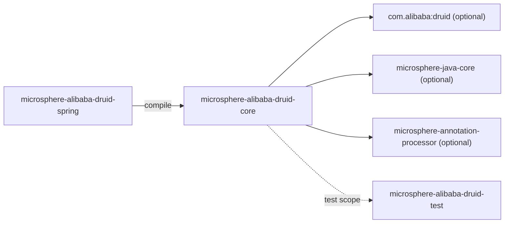
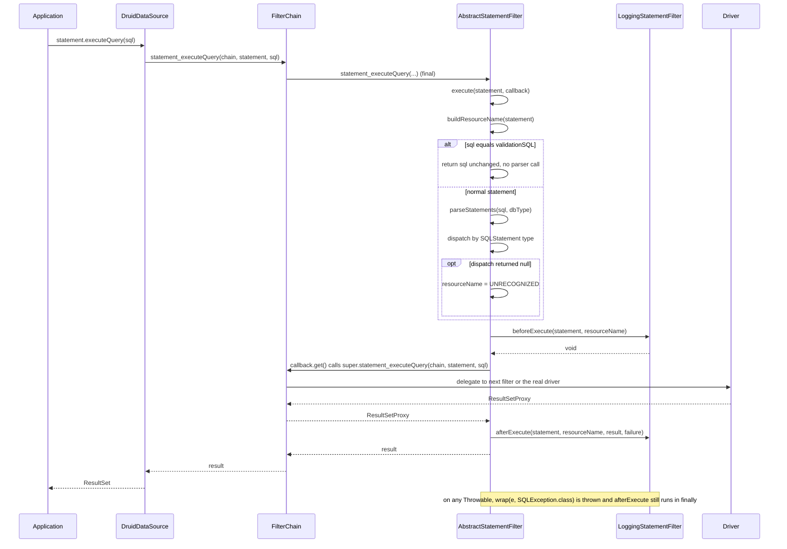
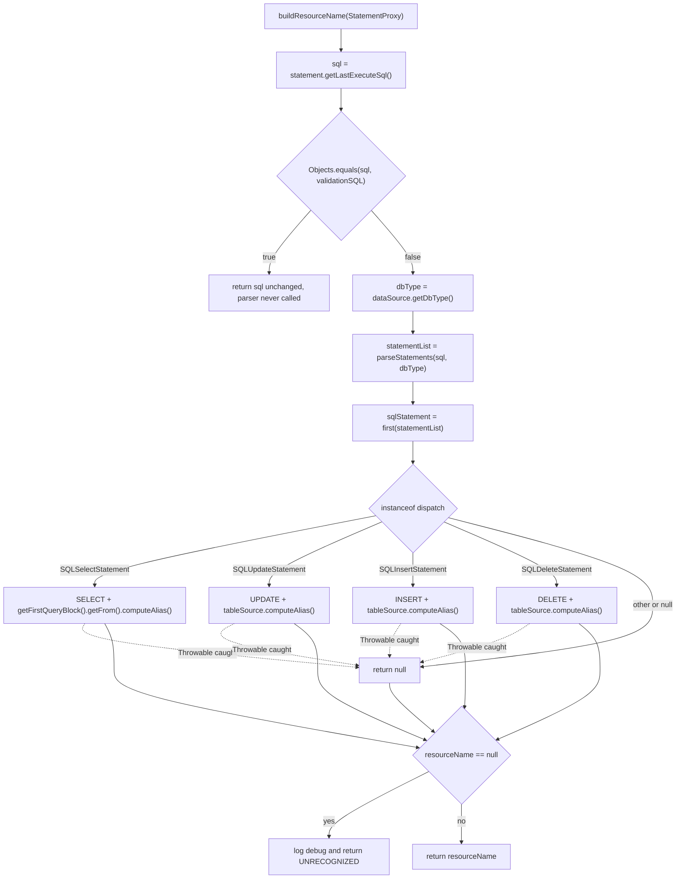
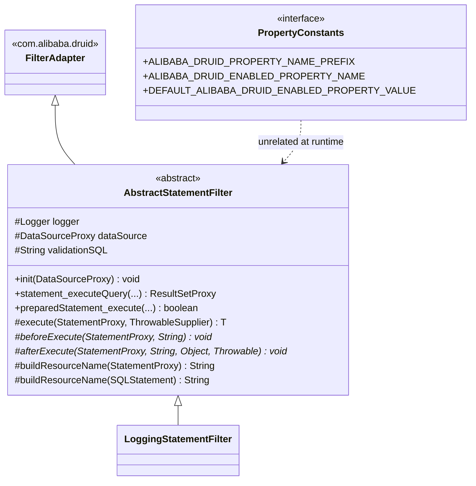

[中文](zh/microsphere-alibaba-druid-core.md)

# microsphere-alibaba-druid-core

> The foundation layer (L0): Druid `Filter` implementations and the `microsphere.alibaba.druid` property-name
> constants. Package root: `io.microsphere.alibaba.druid`. Java baseline: **JDK 17**.
> Repository home: [../../../README.md](../../../README.md) · Usage: [User Guide](../../user-guide/microsphere-alibaba-druid-core.md)

## Architecture position

`core` has **no compile dependency on any other reactor module** — it is the bottom of the stack. Its only
reactor relationship is a `test`-scope edge to `microsphere-alibaba-druid-test`, and everything it compiles
against is declared `optional`.



| Dependency | Scope | Why it is needed |
|---|---|---|
| `com.alibaba:druid` | optional | `Filter`, `FilterAdapter`, `FilterChain`, `StatementProxy`, `PreparedStatementProxy`, `ResultSetProxy`, `DataSourceProxy`, `DruidDataSource`, `SQLUtils` parser, `AutoLoad`. |
| `io.github.microsphere-projects:microsphere-java-core` | optional | `ThrowableSupplier`, `ListUtils.first`, `ExceptionUtils.wrap`, `io.microsphere.logging.Logger`/`LoggerFactory`, `@ConfigurationProperty`. |
| `microsphere-annotation-processor` | optional | Turns `@ConfigurationProperty` on `PropertyConstants` into configuration metadata at compile time. |
| `microsphere-alibaba-druid-test`, `junit-jupiter`, `h2`, `microsphere-logging-test`, `microsphere-logback`, `logback-classic` | test | See [microsphere-alibaba-druid-test](microsphere-alibaba-druid-test.md). |

Because `druid` is `optional`, consumers get **no transitive Druid**; the connection-pool library must be
declared by the application. That is deliberate — this project is an add-on, not a distributor.

## Source analysis

The module contains exactly three types.

### `io.microsphere.alibaba.druid.constants.PropertyConstants`

```java
public interface PropertyConstants {
    String ALIBABA_DRUID_PROPERTY_NAME_PREFIX = MICROSPHERE_PROPERTY_NAME_PREFIX + "alibaba.druid";
    String DEFAULT_ALIBABA_DRUID_ENABLED_PROPERTY_VALUE = "true";
    @ConfigurationProperty(type = boolean.class,
            defaultValue = DEFAULT_ALIBABA_DRUID_ENABLED_PROPERTY_VALUE,
            source = APPLICATION_SOURCE)
    String ALIBABA_DRUID_ENABLED_PROPERTY_NAME = ALIBABA_DRUID_PROPERTY_NAME_PREFIX + DOT + ENABLED_PROPERTY_NAME;
}
```

- Declared as an `interface`, so all members are implicitly `public static final` and the type cannot be
  instantiated — the Microsphere idiom for constant holders.
- Resolved values: prefix `microsphere.alibaba.druid`, enabled key `microsphere.alibaba.druid.enabled`, default
  `"true"`. The operands come from `io.microsphere.constants.PropertyConstants`
  (`MICROSPHERE_PROPERTY_NAME_PREFIX`, `ENABLED_PROPERTY_NAME`) and `io.microsphere.constants.SymbolConstants.DOT`,
  so every expression is a **compile-time** `String` constant — mandatory, because the values are used as
  annotation members in `@ConfigurationProperties(prefix = …)` (`AlibabaDruidProperties`) and
  `@ConditionalOnProperty(name = …)` (`ConditionalOnAlibabaDruidEnabled`).
- `@ConfigurationProperty` is metadata only; it is consumed by `microsphere-annotation-processor` at compile
  time and has no runtime behaviour.
- `PropertyConstantsTest#testConstants` pins the two literal strings. Treat a change here as a **breaking
  configuration change**: the user guide, the conditions, the properties class and the README samples all read
  these names.

### `io.microsphere.alibaba.druid.filter.AbstractStatementFilter`

```java
public abstract class AbstractStatementFilter extends FilterAdapter {
    protected final Logger logger = getLogger(getClass());
    protected DataSourceProxy dataSource;
    protected String validationSQL;

    @Override public final void init(DataSourceProxy dataSource);
    @Override public final boolean preparedStatement_execute(FilterChain chain, PreparedStatementProxy statement) throws SQLException;
    @Override public final ResultSetProxy preparedStatement_executeQuery(FilterChain chain, PreparedStatementProxy statement) throws SQLException;
    @Override public final int preparedStatement_executeUpdate(FilterChain chain, PreparedStatementProxy statement) throws SQLException;
    @Override public final ResultSetProxy statement_executeQuery(FilterChain chain, StatementProxy statement, String sql) throws SQLException;
    @Override public final boolean statement_execute(FilterChain chain, StatementProxy statement, String sql) throws SQLException;
    @Override public final boolean statement_execute(FilterChain chain, StatementProxy statement, String sql, int autoGeneratedKeys) throws SQLException;
    @Override public final boolean statement_execute(FilterChain chain, StatementProxy statement, String sql, int[] columnIndexes) throws SQLException;
    @Override public final boolean statement_execute(FilterChain chain, StatementProxy statement, String sql, String[] columnNames) throws SQLException;
    @Override public final int[] statement_executeBatch(FilterChain chain, StatementProxy statement) throws SQLException;
    @Override public final int statement_executeUpdate(FilterChain chain, StatementProxy statement, String sql) throws SQLException;
    @Override public final int statement_executeUpdate(FilterChain chain, StatementProxy statement, String sql, int autoGeneratedKeys) throws SQLException;
    @Override public final int statement_executeUpdate(FilterChain chain, StatementProxy statement, String sql, int[] columnIndexes) throws SQLException;
    @Override public final int statement_executeUpdate(FilterChain chain, StatementProxy statement, String sql, String[] columnNames) throws SQLException;

    protected <T> T execute(StatementProxy statement, ThrowableSupplier<T> callback) throws SQLException;
    protected abstract void beforeExecute(StatementProxy statement, String resourceName) throws Throwable;
    protected abstract void afterExecute(StatementProxy statement, String resourceName, Object result, Throwable failure);
    protected String buildResourceName(StatementProxy statement);
    protected String buildResourceName(SQLStatement sqlStatement);
    protected String buildResourceName(SQLSelectStatement selectStatement);
    protected String buildResourceName(SQLUpdateStatement updateStatement);
    protected String buildResourceName(SQLInsertStatement insertStatement);
    protected String buildResourceName(SQLDeleteStatement deleteStatement);
}
```

**Design intent.** The class is a *Template Method* welded onto Druid's *Chain of Responsibility*:

1. All thirteen Druid statement-execution callbacks are `final` and funnel into one
   `execute(statement, callback)`. A subclass therefore **cannot** forget to forward the chain and **cannot**
   override a single JDBC verb — intent must be expressed through the two hooks. Per-verb behaviour has to be
   derived from `statement.getLastExecuteSql()` or an `instanceof PreparedStatementProxy` test.
2. Each `final` callback calls `super.<sameMethod>(chain, …)`, which is `FilterAdapter`'s pass-through to
   `chain.<sameMethod>(…)` — i.e. the *next* filter of `FilterChainImpl`. This keeps the chain intact while still
   wrapping the call. Note the callback also captures `chain` and `statement` in the lambda, so the interception
   is purely additive.
3. `beforeExecute` declares `throws Throwable` (a hook may fail without breaking the JDBC `throws SQLException`
   contract); `afterExecute` declares no checked exception, so it is safe inside `finally`.

**`init(DataSourceProxy)` — behaviour and boundaries.**

```java
@Override
public final void init(DataSourceProxy dataSource) {
    this.dataSource = dataSource;
    if (dataSource instanceof DruidDataSource) {
        DruidDataSource druidDataSource = (DruidDataSource) dataSource;
        this.validationSQL = druidDataSource.getValidationQuery();
    }
    if (logger.isTraceEnabled()) {
        logger.trace("DataSourceProxy({}) was initialized with validation SQL : {}", this.dataSource, this.validationSQL);
    }
}
```

- Called by `DruidDataSource.init()` for every filter in `proxyFilters`. This is precisely why
  `DruidDataSourceBeanPostProcessor` must add filters **before** initialization (see
  [microsphere-alibaba-druid-spring](microsphere-alibaba-druid-spring.md)) — a filter added afterwards never
  receives `init()` and keeps `dataSource == null`.
- `validationSQL` stays `null` when the proxy is not a `DruidDataSource`.
  `AbstractStatementFilterTest#testInitOnMockDataSource` proves it with a JDK dynamic proxy
  (`newProxyInstance(getSystemClassLoader(), ofArray(DataSourceProxy.class), …)` that returns `null` for every
  method) and asserts `assertSame(dataSourceProxy, filter.dataSource)` plus `assertNull(filter.validationSQL)`.
- `logger` is created from `getClass()`, so each concrete subclass owns a logger named after itself — required by
  `microsphere-logging-test`'s `@LoggingLevelsClass(levels = {"TRACE", "INFO", "ERROR"})` level switching.
- The method is `final`: subclasses may not add their own initialization state; they must re-read the protected
  `dataSource` / `validationSQL` fields instead.

**`execute` — the interception core.**

```java
protected <T> T execute(StatementProxy statement, ThrowableSupplier<T> callback) throws SQLException {
    String resourceName = buildResourceName(statement);
    T result = null;
    Throwable failure = null;
    try {
        beforeExecute(statement, resourceName);
        result = callback.get();
    } catch (Throwable e) {
        failure = e;
        throw wrap(e, SQLException.class);
    } finally {
        if (logger.isTraceEnabled()) {
            logger.trace("Execute statement [value : {} , resource name : '{}'] : {}", statement.getLastExecuteSql(), resourceName, result, failure);
        }
        afterExecute(statement, resourceName, result, failure);
    }
    return result;
}
```

Implementation notes a reviewer must keep in mind:

- `buildResourceName(statement)` runs **outside** the `try`, so an unchecked failure there escapes before the
  hooks run. In practice naming catches `Throwable` internally and degrades to `"UNRECOGNIZED"`, but a filter used
  without `init()` would NPE on `dataSource.getDbType()`.
- `wrap(e, SQLException.class)` (`io.microsphere.util.ExceptionUtils`) adapts any `Throwable` to the declared
  `throws SQLException`: an existing `SQLException` is returned as-is (original instance preserved), anything else
  is re-thrown as a `SQLException` with `e` as its cause. `AbstractStatementFilterTest#testExecuteOnFailed` throws
  a plain `RuntimeException("For testing")` from the callback and asserts `assertThrows(SQLException.class, …)`.
- `beforeExecute` is **inside** the `try`: a hook failure aborts the SQL execution *and* is itself wrapped into
  `SQLException`. That is intended (a rejecting filter must stop the statement), but it means a filter cannot
  signal "skip me" by throwing.
- `afterExecute` runs in `finally` and receives both `result` and `failure`; on failure `result` is `null`. Since
  `finally` swallows nothing, an exception thrown from `afterExecute` **replaces** the pending `SQLException` —
  subclasses must never throw from the after hook.
- `failure` is assigned before the rethrow, so the `finally` block logs the real cause; `result` remains `null`
  on the failure path because the assignment never completed.
- `ThrowableSupplier` lets the lambda call `super.*` methods without re-declaring checked exceptions.

**`buildResourceName(StatementProxy)` — the naming algorithm.**

```java
protected String buildResourceName(StatementProxy statement) {
    String sql = statement.getLastExecuteSql();
    if (Objects.equals(sql, validationSQL)) {
        return sql;
    }
    String dbType = dataSource.getDbType();
    List<SQLStatement> statementList = parseStatements(sql, dbType);
    SQLStatement sqlStatement = first(statementList);
    String resourceName = buildResourceName(sqlStatement);
    if (resourceName == null) {
        if (logger.isDebugEnabled()) {
            logger.debug("The JDBC statement can't be recognized, sql : '{}' , dbType : '{}'", sql, dbType);
        }
        resourceName = "UNRECOGNIZED";
    }
    return resourceName;
}
```

- **Validation-SQL short-circuit**: if the executed SQL equals the data source's `validationQuery`, the raw SQL is
  returned and **no parsing happens**. This keeps connection-test/keep-alive traffic out of resource-name metrics
  and avoids per-heartbeat parser cost.
- `dbType` comes from the data source, so `SQLUtils.parseStatements(sql, dbType)` uses the correct dialect grammar
  (e.g. `h2` in the test fixture).
- `first(statementList)` (`io.microsphere.collection.ListUtils`) returns index 0 or `null` for an empty list — a
  multi-statement SQL is therefore named by its **first** statement only.
- **`UNRECOGNIZED` fallback**: any `null` from the type-dispatch path yields the literal `"UNRECOGNIZED"` plus a
  `DEBUG` log; the filter never throws for an unknown grammar.
- `Objects.equals(sql, validationSQL)` also matches when **both** are `null`; in that case the method returns
  `null` as the "resource name" (validation query unset and proxy reporting `null` SQL). Subclasses must tolerate a
  `null` resource name — the `LoggingStatementFilter` simply logs `'null'`.

Type dispatch overload:

```java
protected String buildResourceName(SQLStatement sqlStatement) {
    try {
        if (sqlStatement instanceof SQLSelectStatement) {
            return buildResourceName((SQLSelectStatement) sqlStatement);
        } else if (sqlStatement instanceof SQLUpdateStatement) {
            return buildResourceName((SQLUpdateStatement) sqlStatement);
        } else if (sqlStatement instanceof SQLInsertStatement) {
            return buildResourceName((SQLInsertStatement) sqlStatement);
        } else if (sqlStatement instanceof SQLDeleteStatement) {
            return buildResourceName((SQLDeleteStatement) sqlStatement);
        }
    } catch (Throwable e) {
        if (logger.isDebugEnabled()) {
            logger.debug("The JDBC statement can't be parsed, sql : '{}'", sqlStatement, e);
        }
    }
    return null;
}
```

- The `instanceof` cascade is an ordered, DML-only dispatch. DDL (`CREATE TABLE`, `DROP TABLE`), `MERGE`, `CALL`
  and vendor-specific statements are intentionally not covered and land in `UNRECOGNIZED` — which is exactly what
  happens to the `CREATE TABLE users` / `DROP TABLE users` statements issued by `AbstractAlibabaDruidTest`.
- `instanceof` also filters out `null` (a `null` argument matches no branch), so an empty parse result becomes
  `null`.
- The `catch (Throwable)` is load-bearing: `new SQLSelectStatement()` has no query block, so
  `getSelect()` / `getFirstQueryBlock()` NPEs.
  `AbstractStatementFilterTest#testBuildResourceNameOnNullPointerException` asserts the method returns `null` —
  malformed ASTs degrade to `UNRECOGNIZED`, they never crash the caller.

Naming overloads (single-table granularity; `SQLTableSource.computeAlias()` falls back to the table name when no
alias is present):

| Hook | Implementation | Result for |
|---|---|---|
| `buildResourceName(SQLSelectStatement)` | `"SELECT " + sqlSelect.getFirstQueryBlock().getFrom().computeAlias()` | `SELECT id, name FROM users` → `SELECT users` |
| `buildResourceName(SQLUpdateStatement)` | `"UPDATE " + updateStatement.getTableSource().computeAlias()` | `UPDATE users SET name = 'Z' WHERE id = 5` → `UPDATE users` |
| `buildResourceName(SQLInsertStatement)` | `"INSERT " + insertStatement.getTableSource().computeAlias()` (`SQLExprTableSource`) | `INSERT INTO users (id, name) VALUES (1, 'Mercy')` → `INSERT users` |
| `buildResourceName(SQLDeleteStatement)` | `"DELETE " + deleteStatement.getTableSource().computeAlias()` | `DELETE FROM users WHERE id = 1` → `DELETE users` |

| SQL | Resource name |
|---|---|
| `SELECT id, name FROM users` | `SELECT users` |
| `SELECT u.id FROM users u` | `SELECT u` |
| `UPDATE users SET name = 'Z' WHERE id = 5` | `UPDATE users` |
| `INSERT INTO users (id, name) VALUES (1, 'Mercy')` | `INSERT users` |
| `DELETE FROM users WHERE id = 1` | `DELETE users` |
| `CREATE TABLE users (id INT, name VARCHAR(50))` | `UNRECOGNIZED` |
| `SELECT 1` (== `validationQuery`) | `SELECT 1` |

Because the SELECT branch uses `getFirstQueryBlock()`, a `UNION` is named by its first branch, and a sub-query in
`FROM` is named by the outer block's table source.

### `io.microsphere.alibaba.druid.filter.LoggingStatementFilter`

```java
public class LoggingStatementFilter extends AbstractStatementFilter {
    @Override protected void beforeExecute(StatementProxy statement, String resourceName) throws Throwable;
    @Override protected void afterExecute(StatementProxy statement, String resourceName, Object result, Throwable failure);
}
```

- The reference implementation of both hooks and the only concrete filter the project ships.
- Both hooks are guarded by `logger.isDebugEnabled()` and log `statement.getLastExecuteSql()`, the resolved
  resource name, the result and the failure — nothing more. There is no timing or measurement, which is exactly
  the point: the class documents the hook contract and serves as the template for the metric/trace filters the
  repository README mentions (Sentinel, Resilience4j, Observability).
- The before-hook logs `"beforeExecute(statement : {} , resource name : '{}')"` with two arguments for three
  placeholders; the trailing placeholder stays empty. Harmless, but do not "fix" the message format blindly —
  downstream log-parsing examples in the user guide quote it verbatim.
- `LoggingStatementFilterTest` extends `AbstractFilterTest<LoggingStatementFilter>`, i.e. it runs the whole
  `AbstractAlibabaDruidTest` DML/DQL suite against a real H2 `DruidDataSource` with this filter registered, with
  `TRACE` and `DEBUG` levels switched on by `@LoggingLevelsClass`.

## SQL interception execution flow



## buildResourceName decision flow



## Class structure



## Design patterns

| Pattern | Where |
|---|---|
| Template Method | `AbstractStatementFilter` — 13 `final` JDBC-verb entry points, abstract `beforeExecute`/`afterExecute`. |
| Chain of Responsibility | every `final` override delegates through `super.*` to the next `FilterChain` link. |
| Strategy | the `buildResourceName(SQLXxxStatement)` overload family; overridable per statement type. |
| Null Object / graceful degradation | `"UNRECOGNIZED"` fallback, `catch (Throwable)` in the dispatch, `null`-tolerant hooks. |
| Constant interface | `PropertyConstants`. |
| Non-instantiable logger per subclass | `protected final Logger logger = getLogger(getClass())`. |

## Extension points

- **Metric/trace filters** (Sentinel resource entries, observation spans): extend `AbstractStatementFilter`, use
  the resource name as the metric dimension, and rely on the `validationSQL` short-circuit to exclude heartbeats.
- **Rejecting filters** (SQL firewall): throw from `beforeExecute`; the throwable surfaces as `SQLException` to
  the caller without ever reaching the driver.
- **Custom naming**: override `buildResourceName(StatementProxy)` (not the `SQLStatement` overload) to replace the
  whole naming strategy while keeping the interception behaviour; override the per-type overloads to change only
  one verb's name.
- **Non-statement interception** (`Connection`, `DataSource`, `ResultSet`): out of scope for this class — extend
  `FilterAdapter` directly, since `AbstractStatementFilter` only finalises statement verbs.
- **AutoLoad**: a filter annotated with `com.alibaba.druid.filter.AutoLoad` is picked up by Druid itself; the
  `spring` module deliberately skips registering such classes as Spring beans (see
  [microsphere-alibaba-druid-spring](microsphere-alibaba-druid-spring.md)).

## Testing strategy

| Test class | What it pins down |
|---|---|
| `PropertyConstantsTest` | Literal property prefix `microsphere.alibaba.druid` and enabled key `microsphere.alibaba.druid.enabled`. |
| `AbstractFilterTest<F extends Filter>` | Abstract base: `customize(DruidDataSource)` adds `createFilter()` to `getProxyFilters()` before `init()`, then inherits the full `AbstractAlibabaDruidTest` statement/prepared-statement suite. |
| `AbstractStatementFilterTest` | Anonymous subclass in `@BeforeEach`; `init()` with a mocked `DataSourceProxy` (fields asserted); `SQLException` wrapping when the callback throws; `null` naming for a malformed `SQLSelectStatement`. Annotated `@LoggingLevelsClass(levels = {"TRACE", "INFO", "ERROR"})` so the `trace`/`debug` branches execute. |
| `LoggingStatementFilterTest` | End-to-end hook execution through a real H2 `DruidDataSource` with `DEBUG` enabled. |

Run only this module (plus its reactor dependencies):

```bash
./mvnw --batch-mode -pl microsphere-alibaba-druid-core -am test -P spring-cloud-2025
```

`-am` is required: `core` consumes `microsphere-alibaba-druid-test` in `test` scope.

## current-line notes

- Compiled at `maven.compiler.source/target=17` (root pom `<java.version>17`), even though the sources stay
  Java 8-style on purpose. The resulting class files are JDK 17 bytecode, so the `0.2.x` artifacts **require
  JDK 17 or newer**; JDK 8 consumers must use the `0.1.x` line published from `release-1.x`.
- `core` reads no `META-INF/spring.factories` and has no Spring dependency at all; its classes are identical to
  the `0.1.x` line, so a change here is also a change for `release-1.x` (forward-port required).
- `microsphere-java-core` is `optional`, so the `ThrowableSupplier` / `ExceptionUtils.wrap` / `ListUtils.first`
  API level must stay compatible with the version managed by
  `microsphere-spring-cloud-dependencies:0.2.26`.

## Related

- [Developer Guide index](README.md)
- [microsphere-alibaba-druid-spring](microsphere-alibaba-druid-spring.md)
- [microsphere-alibaba-druid-test](microsphere-alibaba-druid-test.md)
- [User Guide — core](../../user-guide/microsphere-alibaba-druid-core.md)
- [Repository README](../../../README.md)

---

## 中文

[中文版：microsphere-alibaba-druid-core](zh/microsphere-alibaba-druid-core.md)
