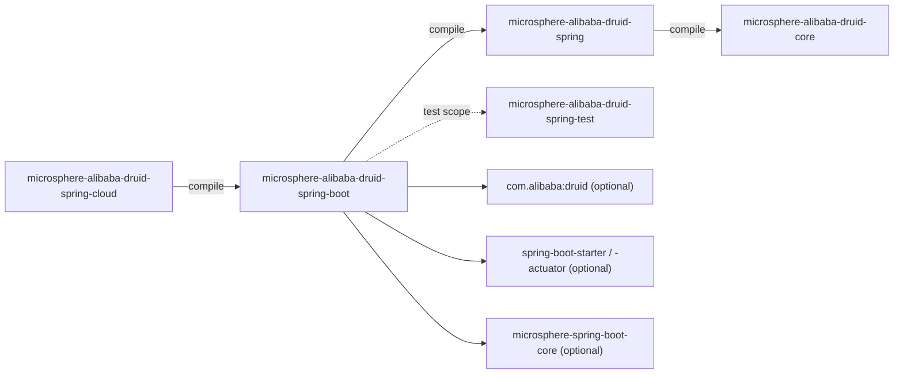
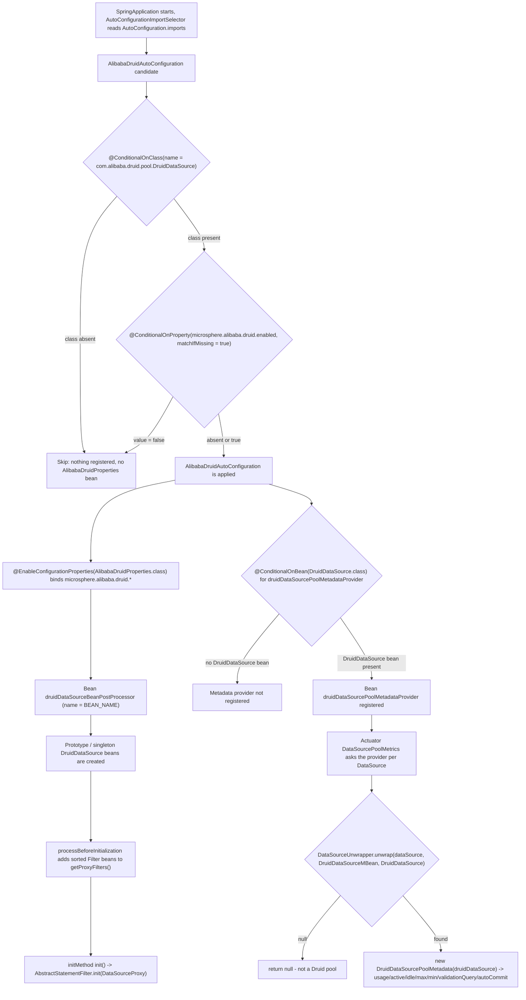

[中文](zh/microsphere-alibaba-druid-spring-boot.md)

# microsphere-alibaba-druid-spring-boot

> The Spring Boot layer (L2): turns the `spring` module's manual `@EnableAlibabaDruid` activation into
> auto-configuration, binds `microsphere.alibaba.druid.*` properties, and exposes Druid pool metrics to Actuator
> through a `DataSourcePoolMetadataProvider`.
> Package roots: `io.microsphere.alibaba.druid.spring.boot`, `...spring.boot.autoconfigure`,
> `...spring.boot.condition`, `...spring.boot.metadata`. Java baseline: **JDK 17**.
> Repository home: [../../../README.md](../../../README.md) · Usage: [User Guide](../../user-guide/microsphere-alibaba-druid-spring-boot.md)

## Architecture position

`spring-boot` depends on `spring` at `compile` scope (and therefore transitively on `core`), and adds **no** new
Druid interception or registration logic: it only re-packages the same `DruidDataSourceBeanPostProcessor` behind
properties and conditions, plus one Actuator adapter. Everything Spring Boot related is `optional`, so the module is a
drop-in for applications that already manage their own Boot version.



| Dependency | Scope | Why |
|---|---|---|
| `microsphere-alibaba-druid-spring` (`${revision}`) | compile | Supplies `DruidDataSourceBeanPostProcessor` (and `BEAN_NAME`), which the `@Bean` method returns. |
| `microsphere-alibaba-druid-core` | compile (transitive via `spring`) | `PropertyConstants` for the prefix / enabled property names. |
| `com.alibaba:druid` | optional | `DruidDataSource`, `DruidDataSourceMBean`, `Filter`. |
| `spring-boot-starter`, `spring-boot-starter-actuator` | optional | `@ConditionalOnProperty`, `@ConditionalOnClass`, `@ConditionalOnBean`, `@ConfigurationProperties`, `@EnableConfigurationProperties`, `DataSourcePoolMetadata`, `DataSourceUnwrapper`. |
| `spring-boot-configuration-processor`, `spring-boot-autoconfigure-processor` | optional | Compile-time generation of `spring-configuration-metadata.json` and the auto-configuration condition index. |
| `microsphere-spring-boot-core` | optional | Declared for the Boot helper layer; no `io.microsphere.spring.boot.*` type is imported by `src/main` of this module today. |
| `junit-jupiter`, `spring-boot-starter-test`, `microsphere-spring-boot-test`, `microsphere-alibaba-druid-spring-test` (`${revision}`), `microsphere-logback`, `h2`, `logback-classic` | test | See [Testing strategy](#testing-strategy). |

## Source analysis

The module contains exactly five production types.

### `io.microsphere.alibaba.druid.spring.boot.AlibabaDruidProperties`

```java
@ConfigurationProperties(prefix = ALIBABA_DRUID_PROPERTY_NAME_PREFIX)
public class AlibabaDruidProperties {

    private boolean enabled = true;

    private Filter filter = new Filter();

    public boolean isEnabled() { ... }
    public void setEnabled(boolean enabled) { ... }
    public Filter getFilter() { ... }
    public void setFilter(Filter filter) { ... }

    public static class Filter {

        private Class<? extends com.alibaba.druid.filter.Filter>[] classes = of(com.alibaba.druid.filter.Filter.class);

        public Class<? extends com.alibaba.druid.filter.Filter>[] getClasses() { ... }
        public void setClasses(Class<? extends com.alibaba.druid.filter.Filter>[] classes) { ... }
    }
}
```

- The prefix is **not** a literal: it reuses `PropertyConstants.ALIBABA_DRUID_PROPERTY_NAME_PREFIX` from `core`, so
  the properties class and the `@ConditionalOnProperty` key cannot drift apart. It resolves to
  `microsphere.alibaba.druid`.
- Bound keys and defaults:

| Property | Type | Default | Effect |
|---|---|---|---|
| `microsphere.alibaba.druid.enabled` | `boolean` | `true` | Gates the auto-configuration through `@ConditionalOnProperty(matchIfMissing = true)`. The field itself is also bound (Java default `true`) and read by `AlibabaDruidPropertiesTest`; the conditional reads the Environment directly, so the field is informational. |
| `microsphere.alibaba.druid.filter.classes` | `Class<? extends Filter>[]` | `[com.alibaba.druid.filter.Filter.class]` | The lookup keys handed to `DruidDataSourceBeanPostProcessor`. |

- `Filter` is a `public static` nested class, i.e. `microsphere.alibaba.druid.filter.classes` binds against a
  *nested* path, and the nested type's name (`Filter`) shadows the Druid type inside the outer class — which is why
  the field type is written fully qualified (`com.alibaba.druid.filter.Filter`) and the auto-configuration imports
  `io.microsphere.alibaba.druid.spring.boot.AlibabaDruidProperties.Filter` explicitly.
- The `classes` default `of(com.alibaba.druid.filter.Filter.class)` mirrors the `@EnableAlibabaDruid` and
  `DruidDataSourceBeanPostProcessor` defaults: with no configuration, *every* `Filter` bean in the context is added
  to every `DruidDataSource`.
- Binding a `Class[]` array from a comma-separated property works because Boot registers a `String` → `Class`
  converter; the integration test proves it with
  `microsphere.alibaba.druid.filter.classes=io.microsphere.alibaba.druid.filter.LoggingStatementFilter`.

### `io.microsphere.alibaba.druid.spring.boot.condition.ConditionalOnAlibabaDruidEnabled`

```java
@Target(TYPE)
@Retention(RUNTIME)
@Documented
@ConditionalOnProperty(name = ALIBABA_DRUID_ENABLED_PROPERTY_NAME, matchIfMissing = true)
public @interface ConditionalOnAlibabaDruidEnabled {
}
```

- A meta-annotation, not a `Condition` implementation: Boot's `@Conditional` (carried by
  `@ConditionalOnProperty`) is `@AliasFor`-friendly and is evaluated for the annotated class, so annotating a
  configuration class with this one annotation applies the property check.
- `matchIfMissing = true` makes the feature **on by default** — opting out requires an explicit
  `microsphere.alibaba.druid.enabled=false`.
- `name = ALIBABA_DRUID_ENABLED_PROPERTY_NAME` resolves to `microsphere.alibaba.druid.enabled`.
  **Known doc/code inconsistency**: the Javadoc first line of this annotation still reads
  `"microsphere.spring.boot.alibaba.druid.enabled"`, which is stale — the constant it references has no `spring.boot`
  segment. Trust the constant, not the comment (the tests use the real key).
- `@Target(TYPE)` only: it cannot be placed on a `@Bean` method, so it gates whole configuration classes.

### `io.microsphere.alibaba.druid.spring.boot.condition.ConditionalOnAlibabaDruidAvailable`

```java
@Target(TYPE)
@Retention(RUNTIME)
@Documented
@ConditionalOnAlibabaDruidEnabled
@ConditionalOnClass(name = {
        "com.alibaba.druid.pool.DruidDataSource"                   // Alibaba Druid API
})
public @interface ConditionalOnAlibabaDruidAvailable {
}
```

- A **composite** condition: `@Conditional` declarations are repeatable and inherited by meta-annotation
  resolution, so both the property check and the class check must pass (logical AND).
- `@ConditionalOnClass(name = ...)` uses the *string* form deliberately: the auto-configuration class imports
  `DruidDataSource` in its method bodies, and `name` avoids any class-loading of the absent Druid API during
  condition evaluation (the classic `NoClassDefFoundError` trap in auto-configuration).
- Because `druid` is `optional`, this is what makes the artifact safe on a classpath without Druid.

### `io.microsphere.alibaba.druid.spring.boot.autoconfigure.AlibabaDruidAutoConfiguration`

```java
@ConditionalOnAlibabaDruidAvailable
@EnableConfigurationProperties(AlibabaDruidProperties.class)
public class AlibabaDruidAutoConfiguration {

    @Bean(name = BEAN_NAME)
    public BeanPostProcessor druidDataSourceBeanPostProcessor(AlibabaDruidProperties alibabaDruidProperties) {
        Filter filter = alibabaDruidProperties.getFilter();
        return new DruidDataSourceBeanPostProcessor(filter.getClasses());
    }

    @Bean
    @ConditionalOnBean(DruidDataSource.class)
    public DataSourcePoolMetadataProvider druidDataSourcePoolMetadataProvider() {
        return dataSource -> {
            DruidDataSource druidDataSource = unwrap(dataSource, DruidDataSourceMBean.class, DruidDataSource.class);
            return druidDataSource == null ? null : new DruidDataSourcePoolMetadata(druidDataSource);
        };
    }
}
```

- `@Bean(name = BEAN_NAME)` (statically imported from `DruidDataSourceBeanPostProcessor`) is the de-duplication
  contract with the `spring` module: if the application *also* uses `@EnableAlibabaDruid`, both registrations target
  the bean name `druidDataSourceBeanPostProcessor`, so one post-processor wins instead of two stacking filters twice
  onto each data source.
- The declared return type is `BeanPostProcessor`, not the concrete class. That is standard for post-processor
  `@Bean` methods (Boot/Spring instantiates them early and only needs the interface), but it means type-based
  assertions must rely on the instantiated singleton — which is exactly what
  `assertThat(context).hasSingleBean(DruidDataSourceBeanPostProcessor.class)` does in the tests.
- No `@AutoConfiguration`, no `@Configuration`, no `@Order`, no `@AutoConfigureBefore/After`: on this line the class is
  a plain POJO configuration registered through `AutoConfiguration.imports`, and Boot's
  `AutoConfigurationImportSelector` treats every imported class as a configuration candidate. Ordering against
  `DataSourceAutoConfiguration` is therefore **not** declared — see [current-line notes](#current-line-notes).
- `@EnableConfigurationProperties(AlibabaDruidProperties.class)` registers the properties bean only when this
  auto-configuration is active, so a disabled feature also produces no `AlibabaDruidProperties` bean.
- `druidDataSourcePoolMetadataProvider` is a lambda: `DataSourcePoolMetadataProvider` is a single-abstract-method
  interface (`DataSourcePoolMetadata getDataSourcePoolMetadata(DataSource)`). Returning `null` from it is the
  documented "not my data source" answer, which is why the `unwrap` failure path returns `null` instead of throwing.
- `unwrap(dataSource, DruidDataSourceMBean.class, DruidDataSource.class)` (`DataSourceUnwrapper`) is what makes the
  provider work behind proxies: it walks `DataSourceUnwrapper`/`WrappedDataSource`/`WebLogicJdbcSupport`-style
  wrappers and JDBC proxies looking for a `DataSource` that is or unwraps to one of the two requested types
  (`DruidDataSourceMBean` is the JMX interface, so a raw Druid MBean also matches).
- `@ConditionalOnBean(DruidDataSource.class)` restricts the metadata provider to applications that actually declare a
  Druid data source bean. Caveat: `@ConditionalOnBean` on an auto-configuration method is evaluated against beans
  registered *so far*, so its behaviour depends on auto-configuration ordering — the reason the `spring-cloud`
  integration test still asserts the provider only when a `DruidDataSource` is present.

### `io.microsphere.alibaba.druid.spring.boot.metadata.DruidDataSourcePoolMetadata`

```java
public class DruidDataSourcePoolMetadata implements DataSourcePoolMetadata {

    private static final float ZERO = 0.0f;
    private static final float ONE = 1.0f;

    private final DruidDataSource dataSource;

    public DruidDataSourcePoolMetadata(DruidDataSource dataSource) { this.dataSource = dataSource; }

    @Override public Float getUsage() {
        int active = dataSource.getActiveCount();
        if (active == 0) {
            return ZERO;
        } else {
            int maxActive = dataSource.getMaxActive();
            if (active == maxActive) {
                return ONE;
            }
            return active / (maxActive * ONE);
        }
    }

    @Override public Integer getActive()   { return dataSource.getActiveCount(); }
    @Override public Integer getIdle()     { return dataSource.getMaxIdle(); }
    @Override public Integer getMax()      { return dataSource.getMaxActive(); }
    @Override public Integer getMin()      { return dataSource.getMinIdle(); }
    @Override public String getValidationQuery()  { return dataSource.getValidationQuery(); }
    @Override public Boolean getDefaultAutoCommit() { return dataSource.isDefaultAutoCommit(); }
}
```

- `getUsage()` is branch-short-circuited at the two boundaries (`0` active → `0.0f`, `active == maxActive` → `1.0f`)
  so Actuator reports clean 0 %/100 % values instead of computed floats.
- `active / (maxActive * ONE)` is an integer-vs-float trap fix: multiplying by the `1.0f` constant promotes `maxActive`
  to `float`, so the division is floating-point. Writing `active / maxActive` would truncate to `0`.
  `maxActive` is assumed `> 0`; Druid's default is `8`, and a `maxActive == 0` configuration with active connections
  would yield `Infinity`.
- The mapping to Druid is *configuration-oriented*, not instantaneous-observation-oriented, and two of the six getters
  are worth reading carefully before consuming them in a dashboard:
  `getIdle()` returns `getMaxIdle()` (the configured maximum idle count, **not** the current idle count), and
  `getMin()` returns `getMinIdle()`. `getActive()` is the only true live counter here.
- `getValidationQuery()` returns whatever `druid.validationQuery` holds — `null` for the H2 test fixture, which the
  unit test asserts.
- `getDefaultAutoCommit()` maps `isDefaultAutoCommit()`; Druid defaults to `true`.
- `DataSourcePoolMetadata` is the SPI Actuator's `DataSourcePoolMetricsAutoConfiguration` consumes, so this class is
  the only reason `druidDataSourceActiveConnections`-style metrics exist for Druid data sources.

## Auto-configuration registration

`src/main/resources/META-INF/spring/org.springframework.boot.autoconfigure.AutoConfiguration.imports` contains one
line:

```text
io.microsphere.alibaba.druid.spring.boot.autoconfigure.AlibabaDruidAutoConfiguration
```

There is **no** `META-INF/spring.factories` in `src/main/resources` of this module on this line — the legacy
`EnableAutoConfiguration` key is gone, and `spring-cloud` registers its own one-line imports file the same way.

## Auto-configuration condition evaluation flow



## Testing strategy

Four test classes cover the module, and they split along the usual "condition contract vs. real behaviour" line.

| Test | Kind | What it pins down |
|---|---|---|
| `AlibabaDruidAutoConfigurationTest` | `AutoConfigurationTest<AlibabaDruidAutoConfiguration>` (external, `ApplicationContextRunner`-based) | The inherited three tests: `testAutoConfiguredClasses` asserts a single bean for *each* of `{AlibabaDruidAutoConfiguration, DruidDataSourceBeanPostProcessor}`; `testOnGlobalDisabledProperty` re-runs with `microsphere.alibaba.druid.enabled=false` and asserts `doesNotHaveBean` for both; `testOnGlobalMissingClass` re-runs with `new FilteredClassLoader(DruidDataSource.class.getName())` and asserts the same. `@SpringBootTest(classes = {AlibabaDruidAutoConfigurationTest.class}, webEnvironment = NONE)` supplies the runner's `classes`, and the non-web environment is validated by the base class (`runner` must be an `ApplicationContextRunner`). |
| `AlibabaDruidAutoConfigurationIntegrationTest` | `@SpringBootTest(classes = {LoggingStatementFilter.class, DruidDataSourceTestConfiguration.class, itself}, webEnvironment = NONE, properties = {"microsphere.alibaba.druid.enabled=true", "microsphere.alibaba.druid.filter.classes=io.microsphere.alibaba.druid.filter.LoggingStatementFilter"})` + `@EnableAutoConfiguration`, extends `AbstractDruidSpringTest` | A real context: runs the full inherited `test()` DML/DQL suite through the auto-registered filter, asserts `AlibabaDruidProperties` and `LoggingStatementFilter` are injectable, `assertArrayEquals(of(LoggingStatementFilter.class), filter.getClasses())` (i.e. the `String` → `Class[]` binding worked), and `assertInstanceOf(DruidDataSourcePoolMetadata.class, dataSourcePoolMetadataProvider.getDataSourcePoolMetadata(dataSource))` — proving both the `@ConditionalOnBean` match and the `unwrap` path against the proxy `DataSource` handed out by `DruidDataSourceTestConfiguration`. |
| `AlibabaDruidPropertiesTest` | plain JUnit 5 unit test, no Spring | Default-value contract: `enabled` is `true`, `getFilter()` is non-null, `getFilter().getClasses()` contains `com.alibaba.druid.filter.Filter.class`, plus the setters round-trip. |
| `DruidDataSourcePoolMetadataTest` | `@AlibabaDruidTest` + `@AlibabaDruidRuntime private DruidDataSource druidDataSource;` | Metadata mapping against the H2 fixture pool: `getUsage()` non-null, `getActive()` = `0`, `getIdle()` = `8`, `getMax()` = `8`, `getMin()` = `0`, `getValidationQuery()` `null`, `getDefaultAutoCommit()` `true`. No Spring context at all — the JUnit 5 extension from the `test` module builds the pool. |

Reading the pair `AlibabaDruidAutoConfigurationTest` / `...IntegrationTest` together is the useful part: the first one
proves the conditions *turn the feature off* (property and classpath), the second proves the feature *works when on*.

## Design patterns

| Pattern | Where |
|---|---|
| Auto-configuration / Convention over Configuration | `AlibabaDruidAutoConfiguration` + `AutoConfiguration.imports`. |
| Composite `Condition` (decorated meta-annotation) | `ConditionalOnAlibabaDruidAvailable` = `ConditionalOnAlibabaDruidEnabled` ∧ `ConditionalOnClass`. |
| Adapter | `DruidDataSourcePoolMetadata` maps the Druid counters onto Boot's `DataSourcePoolMetadata` contract. |
| Strategy | The `DataSourcePoolMetadataProvider` lambda chooses per-`DataSource` whether Druid metadata applies. |
| Type Object / configuration bean | `AlibabaDruidProperties` with nested `Filter`. |
| Front controller over an existing SPI | `@Bean(name = BEAN_NAME)` delegating to the `spring` post-processor instead of duplicating it. |

## Extension points and cautions

- **Add a configurable filter selection**: extend `AlibabaDruidProperties.Filter` (e.g. an `ordered` flag) and pass the
  result into `new DruidDataSourceBeanPostProcessor(...)`; keep the `BEAN_NAME` so `@EnableAlibabaDruid` stays
  compatible.
- **Register extra filters by property instead of by bean**: the current design only injects *Spring-managed* filter
  beans. To instantiate a filter from `microsphere.alibaba.druid.filter.classes` directly you must add a bean of that
  type yourself (or use `@EnableAlibabaDruid` with `SPRING_FACTORIES`/`JAVA_SERVICE_PROVIDER`), otherwise the
  property merely narrows which bean types are looked up.
- **`@ConditionalOnBean` ordering**: without `@AutoConfigureAfter(DataSourceAutoConfiguration.class)` the metadata
  provider can be evaluated before a Boot-created data source bean is registered. If an application sees
  `druidDataSourcePoolMetadataProvider` missing while a `DruidDataSource` exists, this is the reason; adding explicit
  ordering is a backward-compatible change worth pairing with the `spring-cloud` module.
- **Disabling**: `microsphere.alibaba.druid.enabled=false` removes the post-processor *and* the properties bean *and*
  (transitively, via the same class-level condition) the metadata provider. Per-data-source opt-out is not supported —
  the post-processor matches all `DruidDataSource` beans.
- **Metric consumers** should note `getIdle()` is `maxIdle`, not the current idle count.
- Configuration metadata generation depends on the two optional annotation processors; if a downstream build excludes
  them, IDE completion for `microsphere.alibaba.druid.*` disappears while runtime behaviour is unchanged.

## current-line notes

- Boot-3-only registration: only `META-INF/spring/org.springframework.boot.autoconfigure.AutoConfiguration.imports`
  ships here. The `release-1.x` line keeps `META-INF/spring.factories` for Boot 2 compatibility, so changes to the
  auto-configuration class must be forward-ported to *both* registration files on that branch.
- The version numbers of Spring Boot / Spring Cloud are **not** declared in this repository: `spring-boot-starter`
  and friends resolve their versions from `microsphere-spring-cloud-dependencies:0.2.26`, imported by
  `microsphere-alibaba-druid-parent`, whose parent (`microsphere-spring-cloud-parent:0.2.26`) supplies the
  `spring-cloud-2022` … `spring-cloud-2025` profiles. See [the build section of the index](README.md#5-building-and-ci).
- `@since 1.0.0` appears in all five Javadoc blocks; those are lineage markers from the project's own history, not
  this artifact's Maven version (`${revision}` = `0.2.22-SNAPSHOT` while writing these docs).
- The module compiles against JDK 17 but uses no post-17 language features, matching the rest of the reactor.

## Related

- [Developer Guide index](README.md)
- [microsphere-alibaba-druid-spring](microsphere-alibaba-druid-spring.md)
- [microsphere-alibaba-druid-core](microsphere-alibaba-druid-core.md)
- [microsphere-alibaba-druid-spring-cloud](microsphere-alibaba-druid-spring-cloud.md)
- [microsphere-alibaba-druid-spring-test](microsphere-alibaba-druid-spring-test.md)
- [User Guide — spring-boot](../../user-guide/microsphere-alibaba-druid-spring-boot.md)
- [Repository README](../../../README.md)

---

## 中文

[中文版：microsphere-alibaba-druid-spring-boot](zh/microsphere-alibaba-druid-spring-boot.md)
