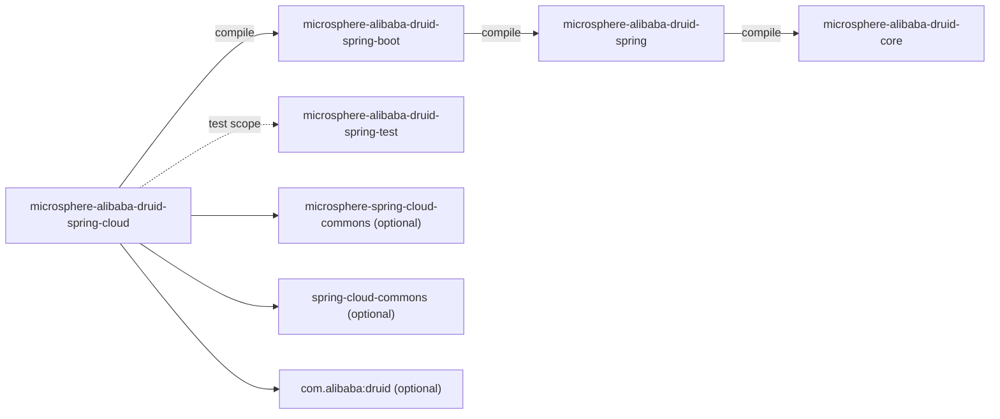
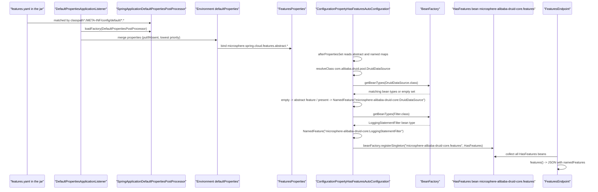

[中文](zh/microsphere-alibaba-druid-spring-cloud.md)

# microsphere-alibaba-druid-spring-cloud

> The Spring Cloud layer (L3): declares the Druid capabilities of this project to the Microsphere Spring Cloud
> *feature* mechanism so they show up in the `/actuator/features` endpoint, and contributes the top-level
> auto-configuration shell gated by the same `microsphere.alibaba.druid.enabled` switch.
> Package root: `io.microsphere.alibaba.druid.spring.cloud.autoconfigure`. Java baseline: **JDK 17**.
> Repository home: [../../../README.md](../../../README.md) · Usage: [User Guide](../../user-guide/microsphere-alibaba-druid-spring-cloud.md)

## Architecture position

`spring-cloud` sits on top of `spring-boot` (its only `compile` reactor dependency) and adds **no** runtime classes
beyond one conditional auto-configuration shell. Its real payload is a *resource*:
`META-INF/config/default/features.yaml`, consumed by `microsphere-spring-cloud-commons` rather than by this module's
own code.



| Dependency | Scope | Why |
|---|---|---|
| `microsphere-alibaba-druid-spring-boot` (`${revision}`) | compile | Reuses `ConditionalOnAlibabaDruidAvailable` and `AlibabaDruidProperties`; also brings the Boot auto-configuration so the shell never works alone. |
| `microsphere-spring-cloud-commons` | optional | `ConfigurationPropertyHasFeaturesAutoConfiguration`, `FeaturesProperties`, `FeaturesUtils`, `@ConditionalOnFeaturesAvailable` — the feature catalogue machinery. |
| `spring-cloud-commons` | optional | `HasFeatures`, `NamedFeature`, `FeaturesEndpoint` (Actuator contracts this module declares features for). |
| `com.alibaba:druid` | optional | The two feature classes listed in `features.yaml`. |
| `spring-boot-starter`, `spring-boot-starter-actuator` | optional | Auto-configuration infra plus the `/actuator/features` endpoint. |
| `spring-boot-configuration-processor`, `spring-boot-autoconfigure-processor`, `microsphere-annotation-processor` | optional | Compile-time metadata generation. |
| `junit-jupiter`, `spring-boot-starter-test`, `microsphere-spring-boot-test`, `microsphere-alibaba-druid-spring-test` (`${revision}`), `microsphere-logback`, `h2`, `logback-classic` | test | See [Testing strategy](#testing-strategy). |

## Source analysis

The module contains **one** production class and **two** resources.

### `io.microsphere.alibaba.druid.spring.cloud.autoconfigure.AlibabaDruidCloudAutoConfiguration`

```java
@ConditionalOnAlibabaDruidAvailable
public class AlibabaDruidCloudAutoConfiguration {
}
```

- The class body is intentionally empty: it has no `@Bean` methods, no fields and no logic. Everything it means is
  carried by its *existence* as an entry in
  `META-INF/spring/org.springframework.boot.autoconfigure.AutoConfiguration.imports` plus its condition.
- Its Javadoc states the intent: *"When Spring Cloud is on the classpath and Alibaba Druid is available, this
  auto-configuration registers Druid features with Spring Cloud Actuator."* The registration itself is **not** done
  here — it happens declaratively through `features.yaml` and externally through
  `ConfigurationPropertyHasFeaturesAutoConfiguration` in `microsphere-spring-cloud-commons`.
- `@ConditionalOnAlibabaDruidAvailable` is imported from the `spring-boot` module (the composite of
  `@ConditionalOnProperty(microsphere.alibaba.druid.enabled, matchIfMissing = true)` and
  `@ConditionalOnClass(name = "com.alibaba.druid.pool.DruidDataSource")`), so one property switches off the Boot and
  Cloud layers together.
- It does **not** add `@ConditionalOnClass(HasFeatures.class)`: Spring Cloud availability is enforced where the
  features are actually consumed (the `@ConditionalOnFeaturesAvailable` on
  `ConfigurationPropertyHasFeaturesAutoConfiguration` and `@ConditionalOnFeaturesEnabled` on the endpoint side). The
  practical consequence is that disabling features (`spring.cloud.features.enabled=false`) leaves this class applied
  while no `HasFeatures` bean appears.
- Since no bean is declared, an application that depends on this module activates nothing new from this class
  directly — it is a documented, greppable placeholder for the resource contribution and for future Spring
  Cloud-specific beans (e.g. a Druid-aware `@RefreshScope` listener).

### `src/main/resources/META-INF/spring/org.springframework.boot.autoconfigure.AutoConfiguration.imports`

```text
io.microsphere.alibaba.druid.spring.cloud.autoconfigure.AlibabaDruidCloudAutoConfiguration
```

Same Boot-3-only style as the `spring-boot` module: no `META-INF/spring.factories` on this line.

### `src/main/resources/META-INF/config/default/features.yaml`

```yaml
microsphere:
  spring:
    cloud:
      features:
        abstract:
          microsphere-alibaba-druid-core:
            - com.alibaba.druid.pool.DruidDataSource
            - com.alibaba.druid.filter.Filter
```

This is the substance of the module. Reading it against the external machinery:

| Path segment | Meaning |
|---|---|
| `microsphere.spring.cloud.features` | `FeaturesConstants.PROPERTY_NAME_PREFIX`, bound by `FeaturesProperties`. |
| `abstract` | `FeaturesConstants.ABSTRACT` — the *abstract* flavour: a list of feature **class names** per module (`Map<String, List<String>>`). The sibling key `named` would instead map `module → (feature-name → class-name)`. |
| `microsphere-alibaba-druid-core` | The **module name**, deliberately the `core` artifact name rather than `spring-cloud`: the advertised capability (a Druid data source and Druid filters) belongs to `core`, and the resulting feature names are qualified with it. |
| the two class names | `DruidDataSource` (the pooling capability) and `Filter` (the interception capability), written as strings so nothing is loaded when the library is absent. |

How those strings become endpoint output (external, `microsphere-spring-cloud-commons` +
`microsphere-spring-boot-core`):

1. `features.yaml` is *not* read by this module. `DefaultPropertiesApplicationListener` (an
   `ApplicationListener<ApplicationEnvironmentPreparedEvent>` at `LOWEST_PRECEDENCE - 1`, from
   `microsphere-spring-boot-core`) loads every `DefaultPropertiesPostProcessor` found through `spring.factories`;
   `SpringApplicationDefaultPropertiesPostProcessor` contributes the pattern
   `classpath*:/META-INF/config/default/*.*`, so this YAML is merged into the `defaultProperties` map — the
   lowest-priority Boot property source (`putIfAbsent`, so an application's own value always wins).
2. `ConfigurationPropertyHasFeaturesAutoConfiguration`
   (`@Configuration(proxyBeanMethods = false)` + `@ConditionalOnFeaturesAvailable` +
   `@AutoConfigureBefore(name = "org.springframework.cloud.client.CommonsClientAutoConfiguration")` +
   `@EnableConfigurationProperties(FeaturesProperties.class)`) runs in `afterPropertiesSet()`: it walks the
   `abstract` and `named` maps and, for each entry, resolves the class name
   (`ClassLoaderUtils.resolveClass`; unresolvable → `logger.warn` and skip, never a failure).
3. For an abstract feature class it asks the bean factory for matching bean types
   (`BEAN_FACTORY.getBeanTypes(beanFactory, featureClass)`):
   * **no** matching bean → the class is kept as a plain *abstract feature* (`Set<Class<?>>`), i.e. "this capability is
     on the classpath";
   * **one or more** matching beans → each bean type becomes a `NamedFeature` whose simple name is
     `ClassUtils.getSimpleName(beanType)`, qualified as `moduleName + ":" + simpleName`.
4. Named features are stored in a `TreeSet` with `NamedFeatureComparator.INSTANCE`, so the reported order is stable
   (which the integration test relies on).
5. Per module, one `HasFeatures` bean is created and registered as a **singleton** under
   `getHasFeaturesBeanName(moduleName)` = `moduleName + ".features"` — here `microsphere-alibaba-druid-core.features`.
6. Spring Cloud's `FeaturesEndpoint` aggregates every `HasFeatures` bean; Actuator serves it at `/actuator/features`
   when the endpoint is exposed.

Consequence for this project's test context: `DruidDataSource` matches the prototype bean from
`DruidDataSourceTestConfiguration`, and `Filter` matches the `LoggingStatementFilter` bean declared on the test class,
so **both** abstract entries are upgraded to named features and the module reports exactly two
`NamedFeature` objects. In an application that has Druid on the classpath but no filter bean, `Filter` would stay an
abstract feature instead.

## Cloud features activation flow



## Testing strategy

Two tests, again split into "condition contract" and "real behaviour".

| Test | Kind | What it pins down |
|---|---|---|
| `AlibabaDruidCloudAutoConfigurationTest` | `AutoConfigurationTest<AlibabaDruidCloudAutoConfiguration>` with `@SpringBootTest(classes = {AlibabaDruidCloudAutoConfigurationTest.class}, webEnvironment = NONE)`, an **empty** `configureAutoConfiguredClasses` override, disabled property `microsphere.alibaba.druid.enabled=false`, missing class `DruidDataSource.class` | The shell is applied/removed exactly like the Boot auto-configuration. Because `getAutoConfiguredClasses()` always prepends the generic auto-configuration class, the inherited `testAutoConfiguredClasses` still asserts a single `AlibabaDruidCloudAutoConfiguration` bean, while the empty override adds no extra expectations — an honest encoding of "this class contributes no beans". |
| `AlibabaDruidCloudAutoConfigurationIntegrationTest` | `@SpringBootTest(classes = {LoggingStatementFilter.class, DruidDataSourceTestConfiguration.class, itself}, webEnvironment = NONE, properties = {"microsphere.alibaba.druid.enabled=true", "management.endpoints.web.exposure.include=features", "spring.cloud.features.enabled=true", "microsphere.alibaba.druid.filter.classes=io.microsphere.alibaba.druid.filter.LoggingStatementFilter"})` + `@EnableAutoConfiguration`, extends `AbstractDruidSpringTest` | End-to-end feature catalogue: injects `Map<String, HasFeatures>` and `FeaturesEndpoint`, asserts the map is non-empty, fetches `"microsphere-alibaba-druid-core.features"`, asserts `namedFeatures.size() == 2`, then index 0 = name `"microsphere-alibaba-druid-core:DruidDataSource"` / type `DruidDataSource.class` and index 1 = `"microsphere-alibaba-druid-core:LoggingStatementFilter"` / type `LoggingStatementFilter.class`, and finally `assertNotNull(featuresEndpoint.features())`. The inherited `super.test()` from `AbstractDruidSpringTest` is *not* called here — only the feature assertions run, since the SQL behaviour is already covered in the Boot module. |

Why the assertions are written this way:

- The expected names encode the module key from `features.yaml`, so renaming the YAML key breaks the test — that is
  intentional coupling between a resource and a test.
- Asserting `LoggingStatementFilter.class` (not `Filter.class`) at index 1 is the executable proof of step 3 above:
  the abstract `Filter` entry was resolved against actual bean types.
- `spring.cloud.features.enabled=true` is set explicitly even though the external
  `@ConditionalOnFeaturesEnabled` uses `matchIfMissing = true`, making the test independent of that default.

## Design patterns

| Pattern | Where |
|---|---|
| Declarative configuration over code | `features.yaml` replaces what would otherwise be `@Bean HasFeatures` methods. |
| Marker / placeholder auto-configuration | The empty `AlibabaDruidCloudAutoConfiguration` shell gating a resource contribution. |
| Registry | `ConfigurationPropertyHasFeaturesAutoConfiguration` registers one `HasFeatures` singleton per module name. |
| Classpath-scanned default properties | `DefaultPropertiesApplicationListener` + `SpringApplicationDefaultPropertiesPostProcessor`. |
| Feature flag | `microsphere.alibaba.druid.enabled` (shared with `spring-boot`) and `spring.cloud.features.enabled` (external). |

## Extension points and cautions

- **Advertise another capability**: add a class name under `abstract.microsphere-alibaba-druid-core` (e.g.
  `com.alibaba.druid.pool.DruidDataSourceMBean`) — no code change needed. Prefer a *new module key*
  (e.g. `microsphere-alibaba-druid-spring`) when the capability is framework-specific, because the key becomes part
  of the reported feature names.
- **Rename the module key carefully**: `microsphere-alibaba-druid-core` appears verbatim in `features.yaml`, in the
  `HasFeatures` bean name (`…​.features`) and in every `NamedFeature` name (`…​:SimpleName`), and is asserted by the
  integration test. It is a public reporting contract.
- **Abstract vs. named is contextual**: the same YAML entry yields an abstract feature in an app without the bean and
  a named feature in an app with it. Dashboards should not assume a fixed count.
- **Do not add `@ConditionalOnClass` for Spring Cloud types here**: the class must stay compilable and loadable
  without them, and the features machinery already conditions itself (`@ConditionalOnFeaturesAvailable`). Adding a
  hard Spring Cloud condition would also change `AlibabaDruidCloudAutoConfigurationTest`, whose
  `FilteredClassLoader` check currently uses `DruidDataSource`.
- **Endpoint visibility** needs both `management.endpoints.web.exposure.include=features` and an Actuator web
  environment; the tests run with `webEnvironment = NONE` and call `featuresEndpoint.features()` directly.
- **Excluding the module** (`spring-boot-starter`/`spring-cloud-commons` are `optional`) removes the catalogue only if
  the JAR is absent; a present JAR still merges `features.yaml`, and unresolvable class names are downgraded to a
  warning, not an error.

## current-line notes

- Only `AutoConfiguration.imports` is published here, mirroring the `spring-boot` module; `release-1.x` carries the
  Boot-2 `spring.factories` variant as well.
- Spring Cloud versions are **inherited, not declared here**: `spring-cloud-commons` and
  `microsphere-spring-cloud-commons` resolve to the versions pinned by `microsphere-spring-cloud-dependencies:0.2.26`
  and the active `spring-cloud-2022` … `spring-cloud-2025` profile from `microsphere-spring-cloud-parent:0.2.26`
  (see [Building and CI](README.md#5-building-and-ci)). The `spring-cloud-2025` profile is `activeByDefault`, which is
  why the module compiles against Cloud 2025.0.3 / Boot 3.5.15 without any version in this repository.
- `NamedFeature` names use a colon separator (`getQualifierFeatureName`), so `microsphere-alibaba-druid-core:DruidDataSource`
  is one opaque string, not a YAML path.
- `@since 1.0.0` in the Javadoc is a lineage marker, not the artifact version (`${revision}` = `0.2.22-SNAPSHOT` when
  these docs were written).

## Related

- [Developer Guide index](README.md)
- [microsphere-alibaba-druid-spring-boot](microsphere-alibaba-druid-spring-boot.md)
- [microsphere-alibaba-druid-core](microsphere-alibaba-druid-core.md)
- [microsphere-alibaba-druid-spring](microsphere-alibaba-druid-spring.md)
- [microsphere-alibaba-druid-spring-test](microsphere-alibaba-druid-spring-test.md)
- [User Guide — spring-cloud](../../user-guide/microsphere-alibaba-druid-spring-cloud.md)
- [Repository README](../../../README.md)

---

## 中文

[中文版：microsphere-alibaba-druid-spring-cloud](zh/microsphere-alibaba-druid-spring-cloud.md)
