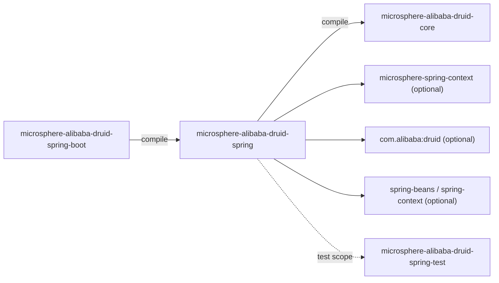
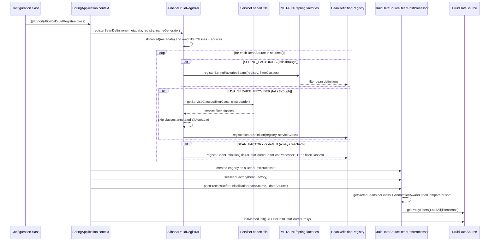
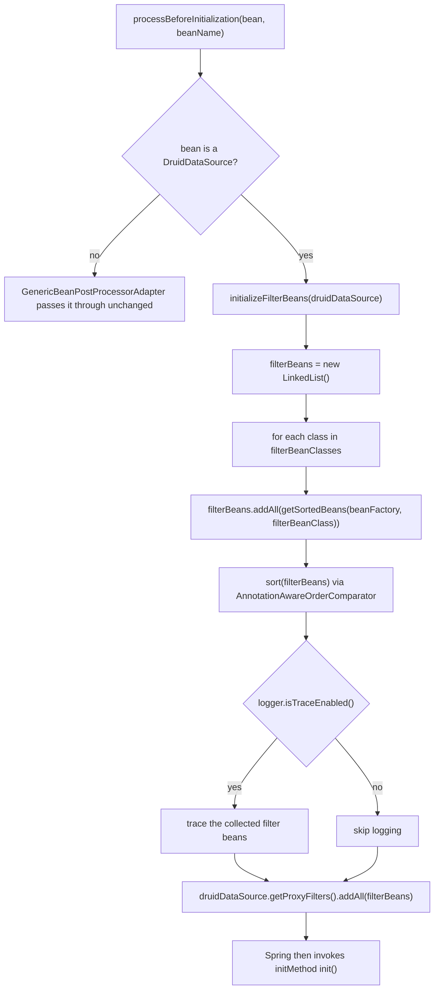

[中文](zh/microsphere-alibaba-druid-spring.md)

# microsphere-alibaba-druid-spring

> The Spring Framework layer (L1): discovers `com.alibaba.druid.filter.Filter` beans from several registries and
> injects them into every `DruidDataSource` before initialization.
> Package roots: `io.microsphere.alibaba.druid.spring.context.annotation`,
> `io.microsphere.alibaba.druid.spring.beans.factory.config`. Java baseline: **JDK 17**.
> Repository home: [../../../README.md](../../../README.md) · Usage: [User Guide](../../user-guide/microsphere-alibaba-druid-spring.md)

## Architecture position

`spring` is the only module with a hard (`compile`) dependency on `core`; it adds **no** interception logic of its
own — everything it does is discovery, registration and injection. Its own dependencies on Spring and Druid are
`optional`, so an application that does not use Spring Framework loses nothing.



| Dependency | Scope | Why |
|---|---|---|
| `microsphere-alibaba-druid-core` (`${revision}`) | compile | The `Filter` subclasses it registers; the only required reactor dependency. |
| `microsphere-spring-context` | optional | `BeanSource`, `AnnotatedBeanCapableImportBeanDefinitionRegistrar`, `GenericBeanPostProcessorAdapter`, `BeanRegistrar`, `AnnotationAttributes` helpers. |
| `com.alibaba:druid` | optional | `Filter`, `AutoLoad`, `DruidDataSource`. |
| `spring-beans`, `spring-context` | optional | `BeanDefinitionRegistry`, `ImportBeanDefinitionRegistrar`, `AnnotationAwareOrderComparator`, `BeansException`. |
| `spring-test` | optional | Used by `AbstractDruidSpringTest` transitively through `microsphere-alibaba-druid-spring-test`. |
| `microsphere-alibaba-druid-spring-test`, `junit-jupiter`, `h2`, `microsphere-spring-test`, `microsphere-logback`, `logback-classic` | test | See [spring-test](microsphere-alibaba-druid-spring-test.md). |

## Source analysis

### `io.microsphere.alibaba.druid.spring.context.annotation.EnableAlibabaDruid`

```java
@Target({TYPE, ANNOTATION_TYPE})
@Retention(RUNTIME)
@Documented
@Import(AlibabaDruidRegistrar.class)
public @interface EnableAlibabaDruid {

    Class<? extends Filter>[] filterClasses() default {Filter.class};

    BeanSource[] sources() default {BEAN_FACTORY, SPRING_FACTORIES};
}
```

- `@Target({TYPE, ANNOTATION_TYPE})` — the annotation can be used directly on a `@Configuration` class **or** as a
  meta-annotation on a project-specific composed annotation; `@Retention(RUNTIME)` is required for
  `AnnotationMetadata` attribute extraction, `@Documented` for Javadoc propagation.
- `@Import(AlibabaDruidRegistrar.class)` is the whole activation mechanism: no `@Bean` methods, no XML, no
  `spring.factories` entry. Because the registrar is imported, it participates in configuration-class parsing and
  therefore runs **before** any bean instance is created — which is what makes prototype-scoped data sources work.
- `filterClasses()` defaults to `{Filter.class}`, i.e. the Druid root interface: *every* filter found in the
  selected sources is eligible. Narrowing it (`@EnableAlibabaDruid(filterClasses = AbstractStatementFilter.class)`)
  is a **discovery** narrowing, not a runtime filter — the array is used as the lookup key against each source.
- `sources()` defaults to `{BEAN_FACTORY, SPRING_FACTORIES}`: filters that already exist as Spring beans plus
  filters declared in `META-INF/spring.factories`. `JAVA_SERVICE_PROVIDER` is **not** default — adding it opts into
  `ServiceLoader`-style discovery via `META-INF/services/<filterClass>`.
- `BeanSource` is the external Microsphere enum with constants `BEAN_FACTORY`, `SPRING_FACTORIES`,
  `JAVA_SERVICE_PROVIDER` (declared in that order in `io.microsphere.spring.beans.BeanSource`).

### `io.microsphere.alibaba.druid.spring.context.annotation.AlibabaDruidRegistrar`

```java
class AlibabaDruidRegistrar extends AnnotatedBeanCapableImportBeanDefinitionRegistrar<EnableAlibabaDruid> {

    @Override
    protected void registerBeanDefinitions(AnnotationMetadata metadata, BeanDefinitionRegistry registry,
                                           BeanNameGenerator importBeanNameGenerator,
                                           ResolvablePlaceholderAnnotationAttributes<EnableAlibabaDruid> annotationAttributes) {
        Class<? extends Filter>[] filterClasses = (Class<? extends Filter>[]) annotationAttributes.getClassArray("filterClasses");
        BeanSource[] sources = (BeanSource[]) annotationAttributes.get("sources");
        registerFilterBeans(registry, filterClasses, sources);
    }

    private void registerFilterBeans(BeanDefinitionRegistry registry, Class<? extends Filter>[] filterClasses, BeanSource[] sources) {
        for (BeanSource source : sources) {
            switch (source) {
                case SPRING_FACTORIES:
                    registerFiltersBySpringFactories(registry, filterClasses);
                case JAVA_SERVICE_PROVIDER:
                    registerFiltersByJavaServiceProvider(registry, filterClasses);
                case BEAN_FACTORY:
                default:
                    registerDruidDataSourceBeanPostProcessor(registry, filterClasses);
            }
        }
    }
    ...
}
```

**Package-private on purpose.** The class is not exported; `@EnableAlibabaDruid` is the only entry point. Extending
it from a consumer jar is impossible without redeclaring the annotation.

**The `switch` fall-through is intentional, not a missing `break`.** There are no `break` statements, so each case
runs *itself plus everything below it*:

| `source` value | Effect chain (top to bottom) |
|---|---|
| `SPRING_FACTORIES` | register Spring-factories filter beans → then register `META-INF/services` filter beans → then register `DruidDataSourceBeanPostProcessor` |
| `JAVA_SERVICE_PROVIDER` | register `META-INF/services` filter beans → then register `DruidDataSourceBeanPostProcessor` |
| `BEAN_FACTORY` | register `DruidDataSourceBeanPostProcessor` only (existing beans need no registration) |
| any future constant (`default`) | register `DruidDataSourceBeanPostProcessor` only |

Because the `for` loop iterates `sources()` in the order written on the annotation, `{BEAN_FACTORY, SPRING_FACTORIES,
JAVA_SERVICE_PROVIDER}` (the order used in `EnableAlibabaDruidTest`) executes the post-processor registration three
times and the two discovery mechanisms once each. Re-registration is safe: the post-processor bean definition is
registered under the fixed name `druidDataSourceBeanPostProcessor` with the same constructor argument, so the later
definitions simply override the earlier one. Do **not** "clean up" the fall-through without adding explicit
`registerDruidDataSourceBeanPostProcessor` calls — `BEAN_FACTORY` alone would otherwise never install the
post-processor and no filter would ever reach `DruidDataSource`.

**Per-source helpers.**

```java
private void registerFiltersBySpringFactories(BeanDefinitionRegistry registry, Class<? extends Filter>[] filterClasses) {
    registerSpringFactoriesBeans(registry, filterClasses);
}

private void registerFiltersByJavaServiceProvider(BeanDefinitionRegistry registry, Class<? extends Filter>[] filterClasses) {
    for (Class<? extends Filter> filterClass : filterClasses) {
        Set<? extends Class<? extends Filter>> serviceClasses = getServiceClasses(filterClass, classLoader);
        for (Class<? extends Filter> serviceClass : serviceClasses) {
            if (serviceClass.isAnnotationPresent(AutoLoad.class)) {
                // Any filter class annotated @AutoLoad will be added into DruidDataSource automatically,
                // so it will be ignored here.
                continue;
            }
            registerBeanDefinition(registry, serviceClass);
        }
    }
}

private void registerDruidDataSourceBeanPostProcessor(BeanDefinitionRegistry registry, Class<? extends Filter>[] filterClasses) {
    String beanName = BEAN_NAME;
    Class<?> beanClass = DruidDataSourceBeanPostProcessor.class;
    Object argument = filterClasses;
    registerBeanDefinition(registry, beanName, beanClass, argument);
}
```

- `registerSpringFactoriesBeans(...)` (external `io.microsphere.spring.beans.factory.support.BeanRegistrar`) reads
  `META-INF/spring.factories`, takes each `filterClasses` entry as the **property key**, and registers every listed
  implementation class as a Spring bean. In this module's test fixture the key is
  `io.microsphere.alibaba.druid.filter.AbstractStatementFilter`, so only that exact key yields `TestStatementFilter`.
- `getServiceClasses(filterClass, classLoader)` (external `io.microsphere.util.ServiceLoaderUtils`) reads
  `META-INF/services/<filterClass>` and **loads** the listed classes (fail-fast: an unloadable or non-assignable
  name throws `IllegalStateException`). No instantiation happens here — `@AutoLoad` filtering therefore works on
  the class, not on an instance.
- `@AutoLoad` classes are skipped deliberately: Druid itself adds `AutoLoad` filters to data sources, so registering
  them as Spring beans too would add them twice.
- `registerBeanDefinition(registry, serviceClass)` creates a generic bean definition with an auto-generated bean
  name; `registerBeanDefinition(registry, beanName, beanClass, argument)` creates one with the fixed name
  `druidDataSourceBeanPostProcessor` and passes `filterClasses` as the **constructor argument**, which is how the
  annotation's `filterClasses` reaches the post-processor.
- The base class also gates the whole registrar behind `isEnabled(metadata)` (a per-importing-class / global
  enabled property resolved from the annotation type, default `true`) and resolves placeholders in the annotation
  attributes before this method is called. `classLoader` is inherited from the same base class.

### `io.microsphere.alibaba.druid.spring.beans.factory.config.DruidDataSourceBeanPostProcessor`

```java
public class DruidDataSourceBeanPostProcessor extends GenericBeanPostProcessorAdapter<DruidDataSource>
        implements BeanFactoryAware {

    private static final Logger logger = getLogger(DruidDataSourceBeanPostProcessor.class);

    public static final String BEAN_NAME = "druidDataSourceBeanPostProcessor";

    private final Class<? extends Filter>[] filterBeanClasses;

    private BeanFactory beanFactory;

    public DruidDataSourceBeanPostProcessor() { this(of(Filter.class)); }

    public DruidDataSourceBeanPostProcessor(Class<? extends Filter>[] filterBeanClasses) { ... }

    @Override protected void processBeforeInitialization(DruidDataSource druidDataSource, String beanName) throws BeansException {
        initializeFilterBeans(druidDataSource);
    }

    protected void initializeFilterBeans(DruidDataSource druidDataSource) {
        List<Filter> filterBeans = new LinkedList<>();
        for (Class<? extends Filter> filterBeanClass : filterBeanClasses) {
            filterBeans.addAll(getSortedBeans(this.beanFactory, filterBeanClass));
        }
        sort(filterBeans);
        if (logger.isTraceEnabled()) { ... }
        druidDataSource.getProxyFilters().addAll(filterBeans);
    }

    @Override public void setBeanFactory(BeanFactory beanFactory) throws BeansException { this.beanFactory = beanFactory; }
}
```

- `GenericBeanPostProcessorAdapter<DruidDataSource>` (external) does the type discrimination: `processBeforeInitialization`
  is only called for beans whose type matches the resolved generic parameter, so non-Druid data sources are
  untouched. This is why the class never implements `BeanPostProcessor` methods directly.
- `BEAN_NAME` is the shared contract with the Boot layer: `AlibabaDruidAutoConfiguration#druidDataSourceBeanPostProcessor`
  is declared `@Bean(name = BEAN_NAME)`, so manual `@EnableAlibabaDruid` registration and auto-configuration
  collapse into **one** bean definition instead of stacking two.
- The no-arg constructor is equivalent to `new DruidDataSourceBeanPostProcessor(of(Filter.class))` — "add every
  filter bean". The array constructor is the one used by the registrar and by Boot.
- `initializeFilterBeans` collects, **then** sorts: `getSortedBeans` orders per class, and
  `AnnotationAwareOrderComparator.sort(filterBeans)` re-orders the merged list, so `@Order` /
  `Ordered` / `PriorityOrdered` on a filter bean controls its position in the Druid `FilterChain`.
- The result is appended with `getProxyFilters().addAll(...)`: filters are **added**, never removed or replaced, and
  duplicates are possible if two post-processors are registered (avoid by keeping the single `BEAN_NAME`).
- `BeanFactoryAware` is required because filter lookup happens per data source instance at creation time, not at
  registrar time.
- Since it is a `BeanPostProcessor`, Spring instantiates it **eagerly**, before regular beans; filter classes must
  therefore not depend on lazily-created infrastructure, or their beans will be created too early (the standard
  Spring "is not eligible for getting processed by all BeanPostProcessors" warning).

## @EnableAlibabaDruid registration flow



### Post-processor decision detail



## Test fixtures as behavioural specification

The `src/test` tree of this module is the executable specification of the three sources:

| Fixture | Content | What it proves |
|---|---|---|
| `src/test/resources/META-INF/spring.factories` | `io.microsphere.alibaba.druid.filter.AbstractStatementFilter=\` + `io.microsphere.alibaba.druid.filter.TestStatementFilter` | The `SPRING_FACTORIES` branch registers `TestStatementFilter` only when `filterClasses` contains the exact key type `AbstractStatementFilter`. |
| `src/test/resources/META-INF/services/io.microsphere.alibaba.druid.filter.AbstractStatementFilter` | `io.microsphere.alibaba.druid.filter.AutoLoadFilter`, `io.microsphere.alibaba.druid.filter.LoadFilter` | The `JAVA_SERVICE_PROVIDER` branch reads the service file named after `filterClasses` entries. |
| `AutoLoadFilter` | `@AutoLoad class AutoLoadFilter extends AbstractStatementFilter` with empty hooks | Proves the `isAnnotationPresent(AutoLoad.class) → continue` skip path. |
| `LoadFilter` | plain `extends AbstractStatementFilter` with empty hooks | Proves the non-`@AutoLoad` service class becomes a Spring bean. |
| `TestStatementFilter` | hooks calling `assertNotNull(statement)` | Any assertion failure inside a real statement execution means the filter really reached `beforeExecute`/`afterExecute`. |
| `EnableAlibabaDruidTest` | `@SpringJUnitConfig({LoggingStatementFilter.class, DruidDataSourceTestConfiguration.class, EnableAlibabaDruidTest.class})` + `@EnableAlibabaDruid(filterClasses = AbstractStatementFilter.class, sources = {BEAN_FACTORY, SPRING_FACTORIES, JAVA_SERVICE_PROVIDER})`, extends `AbstractDruidSpringTest` | All three sources active at once; the inherited `test()` runs the whole DML/DQL suite, so every registered filter is initialised and exercised. |
| `DruidDataSourceBeanPostProcessorTest` | `@SpringLoggingTest`, `@ExtendWith(SpringExtension.class)`, `@ContextConfiguration({LoggingStatementFilter.class, DruidDataSourceTestConfiguration.class, DruidDataSourceBeanPostProcessor.class, ...})`, extends `AbstractDruidSpringTest` | Registers the post-processor **as a plain bean class** (no `@EnableAlibabaDruid`), proving the constructor-injection path works standalone. |

Note the shared data-source plumbing: `DruidDataSourceTestConfiguration` declares
`@Bean(initMethod = "init", destroyMethod = "close") @Scope(SCOPE_PROTOTYPE)`, so each `getBean(DruidDataSource.class)`
creates a fresh pool, the `init` callback runs as part of Spring's initialization, and the post-processor hook fires
*before* that callback — the exact ordering `AbstractStatementFilter#init` depends on.

## Design patterns

| Pattern | Where |
|---|---|
| `@Import` + `ImportBeanDefinitionRegistrar` | `EnableAlibabaDruid` → `AlibabaDruidRegistrar`. |
| Template Method (registry level) | `AnnotatedBeanCapableImportBeanDefinitionRegistrar` fixes the enabled-check and attribute-resolution steps; the subclass supplies only the registration body. |
| Strategy / multi-source discovery | `BeanSource[]` + `switch` fall-through. |
| Bean Post Processor | `DruidDataSourceBeanPostProcessor` mutating a bean before its init callback. |
| Type-safe generic dispatch | `GenericBeanPostProcessorAdapter<DruidDataSource>`. |
| Null Object | `of(Filter.class)` default constructor — "accept everything" instead of `null`. |

## Extension points

- **New discovery source**: add a `case` **above** `BEAN_FACTORY` in `registerFilterBeans` so the fall-through still
  installs the post-processor; adding a case *after* `default:` would silently do nothing.
- **Custom injection timing**: subclass `DruidDataSourceBeanPostProcessor` and override
  `initializeFilterBeans(DruidDataSource)`; register it under `BEAN_NAME` to stay compatible with the Boot layer.
- **Per-data-source filters**: do not use this post-processor (it targets *all* `DruidDataSource` beans) — add
  filters explicitly with `getProxyFilters().add(...)` before calling `init()`.
- **Filter ordering**: annotate the filter bean with `@Order`/`Ordered`; `AnnotationAwareOrderComparator.sort`
  guarantees the relative chain order.

## current-line notes

- The module has **no** `spring.factories` in `src/main/resources`: only the *test* resources carry one, and that
  file is a fixture for the `SPRING_FACTORIES` discovery branch, not an auto-configuration registration.
- On this line the sources are compiled with `maven.compiler.source/target=17`, so `switch` fall-through on an
  enum remains legal but is not the modern idiom; it is preserved deliberately for byte-level parity with
  `release-1.x`. Any change here must be forward-ported to that branch.
- `spring-beans`/`spring-context` are `optional`: nothing in the module pulls Spring in transitively, which lets the
  `core`-only story (plain JDBC) stay clean.

## Related

- [Developer Guide index](README.md)
- [microsphere-alibaba-druid-core](microsphere-alibaba-druid-core.md)
- [microsphere-alibaba-druid-spring-boot](microsphere-alibaba-druid-spring-boot.md)
- [microsphere-alibaba-druid-spring-test](microsphere-alibaba-druid-spring-test.md)
- [User Guide — spring](../../user-guide/microsphere-alibaba-druid-spring.md)
- [Repository README](../../../README.md)

---

## 中文

[中文版：microsphere-alibaba-druid-spring](zh/microsphere-alibaba-druid-spring.md)
