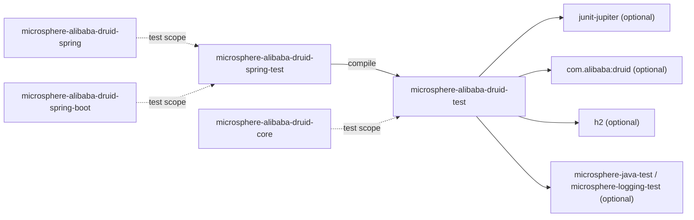
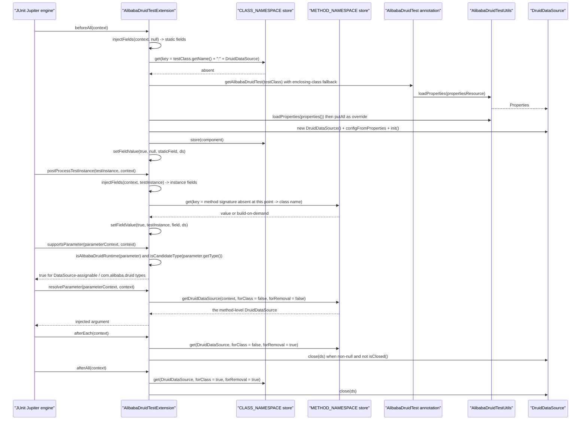

[中文](zh/microsphere-alibaba-druid-test.md)

# microsphere-alibaba-druid-test

> The support layer (T0): a framework-free JUnit 5 testing toolkit for Druid — it boots a real `DruidDataSource`
> against in-memory H2, injects it into fields/parameters, and provides an executable DML/DQL statement suite that
> every filter implementation is expected to survive.
> Package roots: `io.microsphere.alibaba.druid.test`, `io.microsphere.alibaba.druid.test.junit.jupiter`.
> Java baseline: **JDK 17**.
> Repository home: [../../../README.md](../../../README.md) · Usage: [User Guide](../../user-guide/microsphere-alibaba-druid-test.md)

## Architecture position

`test` has **no `compile` dependency on any reactor module** — it talks to Druid, H2 and JUnit only. That is what lets
`core` depend on it (test scope) without creating a cycle. The Spring-aware layer `spring-test` then extends this
module at `compile` scope, and every other module of the reactor consumes it through `test` scope.



| Dependency | Scope | Why |
|---|---|---|
| `org.junit.jupiter:junit-jupiter` | optional | The extension API (`ExtensionContext`, `Store`, `Namespace`, `ParameterResolver`, …). `optional` on purpose: a test-support artifact must not force a JUnit version on consumers. |
| `com.alibaba:druid` | optional | `DruidDataSource.configFromProperties`, `init`, `isClosed`, `getProxyFilters`. |
| `com.h2database:h2` | optional | The in-memory database the shipped `h2.properties` targets. |
| `microsphere-java-test`, `microsphere-logging-test` | optional | Microsphere assertion/logging test helpers used by the module's own tests. |
| `microsphere-annotation-processor` | optional | Compile-time metadata processor, consistent across the reactor. |
| `ch.qos.logback:logback-classic` | optional | Declared optional (not test-scoped) so consumers that *do* want a binder can rely on it. |
| `microsphere-logback` | test | Logging binder used only while running this module's own tests. |

## Source analysis

Five production types: two reusable bases (`AlibabaDruidTestUtils`, `AbstractAlibabaDruidTest`) and a JUnit 5
extension triple (`@AlibabaDruidTest`, `@AlibabaDruidRuntime`, `AlibabaDruidTestExtension`).

### `io.microsphere.alibaba.druid.test.AlibabaDruidTestUtils`

```java
public abstract class AlibabaDruidTestUtils {

    public static final String H2_PROPERTIES_RESOURCE = "META-INF/druid/h2.properties";
    public static final String DEFAULT_PROPERTIES_RESOURCE = H2_PROPERTIES_RESOURCE;
    public static final String PACKAGE_NAME_PREFIX = "com.alibaba.druid.";

    @Nonnull public static Properties getDefaultProperties() throws IOException { return loadProperties(DEFAULT_PROPERTIES_RESOURCE); }
    @Nonnull public static Properties loadProperties(String resourceName) throws IOException { ... }
    @Nonnull public static Properties loadProperties(String[] keyValuePairs) throws IOException { ... }
    @Nonnull static Properties properties(String content) throws IOException { ... }
    @Nonnull public static DruidDataSource buildDefaultDruidDataSource() throws IOException { ... }
    @Nonnull public static DruidDataSource buildDruidDataSource(Properties properties) { ... }

    private AlibabaDruidTestUtils() {}
}
```

- `public abstract class` + `private` constructor: the Microsphere idiom for a non-instantiable, non-extendable
  utility holder.
- The three constants are load-bearing beyond this class: `DEFAULT_PROPERTIES_RESOURCE` is the *annotation default*
  of `@AlibabaDruidTest.propertiesResource()`, and `PACKAGE_NAME_PREFIX` is the classifier used by
  `AlibabaDruidTestExtension.isAlibabaDruidClass`.
- `loadProperties(String)` reads via `ClassLoaderUtils.getResource` + `IOUtils.copyToString` with
  `CharsetUtils.DEFAULT_CHARSET` in a try-with-resources; a missing resource therefore surfaces as `NullPointerException`
  (documented in the `@throws RuntimeException` notes) rather than a friendly message.
- `loadProperties(String[])` joins the entries with `SeparatorConstants.LINE_SEPARATOR` and parses them as properties
  text — this is why `@AlibabaDruidTest(properties = {"druid.name=mysql", ...})` accepts `"key=value"` strings.
- `properties(String)` is **package-private**: the parsing primitive is hidden, only the two `loadProperties`
  overloads are public API.
- `buildDruidDataSource(Properties)` calls `DruidDataSource.configFromProperties` and returns an **uninitialised**
  data source: `init()` is deliberately left to the caller (`AbstractAlibabaDruidTest.init` or
  `AlibabaDruidTestExtension.buildDruidDataSource`), so filters can still be added beforehand.
- `buildDefaultDruidDataSource()` declares `throws IOException` while `buildDruidDataSource(Properties)` declares
  none: only the resource-reading step can fail.

### `src/main/resources/META-INF/druid/h2.properties`

```properties
druid.name=h2
druid.url=jdbc:h2:mem:test_mem
druid.username=sa
druid.password=
druid.driverClassName=org.h2.Driver
```

- The `druid.` prefix is what `configFromProperties` expects; it strips it and applies the remainder as bean
  properties of `DruidDataSource` (so `druid.url` → `setUrl`).
- `jdbc:h2:mem:test_mem` is a **named** in-memory database, so several data sources in one JVM share the `users`
  table unless it is dropped — the reason `AbstractAlibabaDruidTest` creates *and* drops the table per test.
- `druid.password=` is intentionally empty; H2 accepts the `sa`/empty pair.
- No pool sizing keys are set, so Druid defaults apply — that is where the `8` asserted by
  `DruidDataSourcePoolMetadataTest` (`maxActive`, `maxIdle`) comes from.

### `io.microsphere.alibaba.druid.test.AbstractAlibabaDruidTest`

```java
public abstract class AbstractAlibabaDruidTest {

    private DruidDataSource dataSource;

    @BeforeEach public void init() throws Throwable {
        DruidDataSource dataSource = buildDruidDataSource();
        customize(dataSource);
        dataSource.init();
        this.dataSource = dataSource;
        initData();
    }

    protected DruidDataSource buildDruidDataSource() throws IOException { return buildDefaultDruidDataSource(); }
    protected void customize(DruidDataSource dataSource) {}
    protected DruidDataSource getDruidDataSource() { return this.dataSource; }

    @Test public void test() throws Throwable {
        testExecuteStatement();
        testExecutePreparedStatement();
    }

    @AfterEach public void destroy() throws Throwable {
        destroyData();
        DruidDataSource dataSource = getDruidDataSource();
        dataSource.close();
    }
}
```

- This class is a **test template, not a base class utility**: it is picked up by inheritance (`extends
  AbstractAlibabaDruidTest`), and because its `test()` method carries `@Test`, every subclass inherits a real test —
  which is exactly how the `core` filter tests and the Boot/Cloud integration tests exercise SQL.
- The `@BeforeEach` ordering is the extension point that matters: `buildDruidDataSource()` → `customize(dataSource)` →
  `init()`. `customize` is the hook for adding `com.alibaba.druid.filter.Filter` instances to
  `getProxyFilters()` **before** `init()`, because Druid builds its filter chain during `init`.
- `buildDruidDataSource()` is overridable twice over: to change the *properties* (subclasses of the Spring variant
  return a container-managed bean) or to reuse an already-injected instance (see `AlibabaDruidTestExtensionTest.FieldTest`).
- `initData()` creates `users (id INT, name VARCHAR(50))` with `NO_GENERATED_KEYS`; `destroyData()` drops it, and
  `destroy()` closes the pool. Each test therefore runs against a fresh table on a fresh pool.
- `testExecuteStatement()` walks the JDBC `Statement` API exhaustively on purpose: four `executeUpdate` overloads
  (`String`, `String, String[]`, `String, int[]`, `String, int`), `addBatch` twice + `assertArrayEquals(new int[]{1, 1},
  executeBatch())`, `executeQuery`, an `UPDATE`, four `execute` overloads and a final `DELETE FROM users`.
- `testExecutePreparedStatement()` walks `prepareStatement(String)`, `prepareStatement(String, int)` with
  `TYPE_FORWARD_ONLY` and `prepareStatement(String, int, int)` with `CONCUR_UPDATABLE`.
  Every overload family member is hit because each one is a **separate `final` override** in
  `AbstractStatementFilter` — a missed overload would be a silent interception hole, and this suite is what detects it.
- The three helpers `executeStatement` / `executePreparedStatement` / `executeConnection` are nested template methods:
  `executeStatement` and `executePreparedStatement` both delegate to `executeConnection`, which opens a connection from
  `getDruidDataSource()` and closes it in `finally`; the middle layers close their statement in `finally`.
  Everything declares `throws Throwable` because `ThrowableConsumer` is used, not `Consumer`.

### `io.microsphere.alibaba.druid.test.junit.jupiter.AlibabaDruidTest`

```java
@Target(TYPE)
@Retention(RUNTIME)
@ExtendWith(AlibabaDruidTestExtension.class)
@Inherited
public @interface AlibabaDruidTest {

    String[] properties() default {};

    String propertiesResource() default DEFAULT_PROPERTIES_RESOURCE;

    String[] filters() default {};
}
```

- `@ExtendWith(...)` is the entire registration mechanism — one annotation on a test class installs five JUnit
  callbacks. `@Inherited` lets a base test class carry the annotation for all of its subclasses.
- `properties()` overrides `propertiesResource()` **per key** (`properties.putAll(overridenProperties)` in the
  extension), so a test can keep the H2 URL and change one property.
- **Caveat (real, not hypothetical)**: `filters()` is declared and documented (`@see
  DruidDataSource#setFilters(String)`) but the extension never reads it — nothing in `AlibabaDruidTestExtension`
  calls `alibabaDruidTest.filters()`. Setting `@AlibabaDruidTest(filters = {"log", "stat"})` currently has **no
  effect**. Use `AbstractAlibabaDruidTest#customize` or the Spring post-processor instead, and expect this to be
  implemented (or removed) in a future revision.
- The Javadoc of `properties()` contains a malformed closing tag (`</prev>`); harmless, but it is why some Javadoc
  renders look odd.

### `io.microsphere.alibaba.druid.test.junit.jupiter.AlibabaDruidRuntime`

```java
@Target(value = {FIELD, PARAMETER})
@Retention(RUNTIME)
public @interface AlibabaDruidRuntime {
}
```

- A pure marker: no members, so the *declared type* of the field/parameter decides everything.
- `@Target({FIELD, PARAMETER})` — deliberately **no** `METHOD`: the extension injects, it does not produce.
- The Javadoc table documents the supported matrix (`DataSource`, `ConnectionPoolDataSource`, `DataSourceProxy`,
  `DruidDataSource` × static field / instance field / method parameter), all "Y".
- There is no `@Documented`/`@Inherited` here; `@Inherited` on the *class* annotation is what propagates the
  extension, and the fields are discovered by reflection per class.

### `io.microsphere.alibaba.druid.test.junit.jupiter.AlibabaDruidTestExtension`

```java
class AlibabaDruidTestExtension implements BeforeAllCallback, AfterAllCallback, TestInstancePostProcessor,
        AfterEachCallback, ParameterResolver {

    private static final Namespace METHOD_NAMESPACE = create(AlibabaDruidTestExtension.class, "METHOD");
    private static final Namespace CLASS_NAMESPACE = create(AlibabaDruidTestExtension.class, "CLASS");

    static List<Class<?>> candidateTypes = findAllClasses(DruidDataSource.class, AlibabaDruidTestExtension::isAlibabaDruidClass);

    @Override public void beforeAll(ExtensionContext context)              { injectFields(context, null); }
    @Override public void postProcessTestInstance(Object ti, ExtensionContext c) { injectFields(c, ti); }
    @Override public void afterEach(ExtensionContext context)              { close(get(context, DruidDataSource.class, false, true)); }
    @Override public void afterAll(ExtensionContext context)               { close(get(context, DruidDataSource.class, true, true)); }
    @Override public boolean supportsParameter(ParameterContext pc, ExtensionContext ec) { return isCandidateParameter(pc.getParameter()); }
    @Override public @Nullable Object resolveParameter(ParameterContext pc, ExtensionContext ec) { return execute(() -> getDruidDataSource(ec, false, false)); }
}
```

- **Package-private**, like `AlibabaDruidRegistrar` in the `spring` module: only `@AlibabaDruidTest` reaches it, and
  all its helpers are `static` so the (single, stateless) extension instance carries no per-test state — the state is
  in the JUnit `Store`.
- `candidateTypes` is computed **once** at class-initialisation time: `findAllClasses(DruidDataSource.class,
  isAlibabaDruidClass)` scans the class hierarchy starting at `DruidDataSource` and keeps classes that either
  implement `DataSource` **or** whose type name starts with `com.alibaba.druid.`. The field is package-private and
  non-`final` (test-visible seam, but effectively immutable at runtime).
- `isAlibabaDruidClass` accepts `DataSource` subtypes and anything in the Druid package, which is why `Connection` or
  `Statement` fields are *not* injectable: they are neither `DataSource`-assignable nor `com.alibaba.druid.*`.
- `getStore(context, forClass)` selects `context.getStore(EXTENSION_CONTEXT, namespace)`: the store scope
  `EXTENSION_CONTEXT` pins the data to the extension instance rather than the context hierarchy, and the two
  namespaces separate class-level from method-level entries.
- `buildKey(context, componentClass)` is `StringJoiner(":")` of **either** `MethodUtils.getSignature(method)` (when
  `context.getTestMethod()` is present) **or** `testClass.getName()` (at class level), followed by
  `componentClass.getName()`. Because the second part is always `DruidDataSource.class.getName()` in practice,
  the effective key granularity comes from the first part — one data source per test method, one per test class.
- `getDruidDataSource(context, forClass, forRemoval)` is the lazy accessor: `get` from the store; if absent,
  `buildDruidDataSource(context)` and `store(...)`. This is why *one* pool is shared by all `@AlibabaDruidRuntime`
  members of the same scope, and why a `DataSource`-typed field and a `DruidDataSource`-typed field receive the very
  same instance.
- `injectField` uses `FieldUtils.setFieldValue(true, testInstance, field, value)` — the leading `true` forces
  accessibility, so `private` fields work; passing `null` as the target is how static fields are written.
- `close(...)` is `null`-safe **and** `isClosed()`-guarded, which makes the double `close(druidDataSource)` call in
  `AlibabaDruidTestExtensionTest.StaticFieldTest` a deliberate idempotency check rather than a mistake.
- `resolveParameter` wraps the call in `ThrowableSupplier.execute(...)`, converting the checked
  `SQLException`/`IOException` of the builder into the unchecked exception JUnit expects.
- The two removal paths are asymmetric by design: `afterEach` takes `forClass = false, forRemoval = true` (method
  pool closed and evicted per test) and `afterAll` takes `forClass = true, forRemoval = true` (class pool for static
  fields). `supportsParameter`/`resolveParameter` use `forClass = false, forRemoval = false`, so several injected
  parameters in one method still share the method-level pool.

## AlibabaDruidTest extension lifecycle



## Store, namespace and key layout

| Callback | `forClass` | `forRemoval` | Namespace | Key first segment | Consequence |
|---|---|---|---|---|---|
| `beforeAll` (static fields) | `true` | `false` | `CLASS_NAMESPACE` | test class name | one pool for all static fields of the class |
| `postProcessTestInstance` (instance fields) | `false` | `false` | `METHOD_NAMESPACE` | method signature when present, else class name | instance fields get the method pool during execution, otherwise the class-level one |
| `resolveParameter` | `false` | `false` | `METHOD_NAMESPACE` | method signature | all injected parameters of one method share a pool |
| `afterEach` | `false` | `true` | `METHOD_NAMESPACE` | method signature | the method pool is evicted and closed after each test |
| `afterAll` | `true` | `true` | `CLASS_NAMESPACE` | test class name | the static pool is evicted and closed once |

Both namespaces are `Namespace.create(AlibabaDruidTestExtension.class, "METHOD" | "CLASS")` and both stores are
obtained with `StoreScope.EXTENSION_CONTEXT`.

## Testing strategy

The module tests itself, and `core` depends on it — so this is the foundation of the whole test pyramid here.

| Test | What it pins down |
|---|---|
| `AlibabaDruidTestUtilsTest` | `testConstans` (note the typo in the method name) asserts the three public constants, `testGetDefaultProperties` asserts every H2 value including `druid.password` being the empty string, `testLoadProperties` covers the `String[]` overload only (`loadProperties(ofArray("name = value"))`); the `String` resource overload is exercised indirectly through `getDefaultProperties()`. |
| `DefaultAlibabaDruidTest` | An **empty** `extends AbstractAlibabaDruidTest`: proof that inheriting the template alone yields a green run, i.e. the default H2 pool plus the default statement suite is self-consistent. |
| `AlibabaDruidTestExtensionTest` | `@AlibabaDruidTest` on the outer class with three `@Nested` scenarios: `FieldTest` (`@DisplayName("Test : Field Injection")`, extends `AbstractAlibabaDruidTest` and overrides `buildDruidDataSource()` to return the injected `@AlibabaDruidRuntime DruidDataSource` field — so the template reuses the extension's pool instead of building a second one, and its inherited `test()` runs against it), `StaticFieldTest` (two `private static` `@AlibabaDruidRuntime` fields + a doubled `close(druidDataSource)` to verify `isClosed()`-safe closing), `ParameterTest` (two injected parameters, `DruidDataSource` and `DataSource`, asserting both non-null). Plus `testIsCandidateParameter` (`Object.equals(Object)` parameter must be rejected) and `testGetAlibabaDruidTest` (the annotation is resolvable from the class itself). |

Two structural details worth knowing when editing these tests on this line:

- On the **current** line the static-field and parameter cases live inside `@Nested` classes, whereas the `1.x` line
  declares them on the top-level test class. `@Nested` classes inherit the extension through `@Inherited` on the
  outer class plus `getAlibabaDruidTest`'s `getEnclosingClass()` fallback — that fallback exists precisely for this
  arrangement, so do not remove it while refactoring.
- `FieldTest` both extends `AbstractAlibabaDruidTest` **and** relies on injection, which means its `@BeforeEach init()`
  calls `buildDruidDataSource()` → the overridden method → the field. If the extension has not yet injected (e.g. the
  annotation was dropped), the field is `null` and `init()` fails with an NPE — a loud, intentional signal.

## Design patterns

| Pattern | Where |
|---|---|
| Template Method | `AbstractAlibabaDruidTest` (`init`/`test`/`destroy` skeleton, `buildDruidDataSource`/`customize` hooks) and its nested `execute*` helpers. |
| JUnit 5 Extension SPI (observer + resolver) | `AlibabaDruidTestExtension` implementing five callback interfaces. |
| Marker annotation + composed annotation | `@AlibabaDruidRuntime` (marker), `@AlibabaDruidTest` (`@ExtendWith` composed). |
| Object Pool / lazy holder with scoped cache | the `Store`-based `getDruidDataSource` build-once-per-scope behaviour. |
| Registry by reflection | `candidateTypes` populated through `findAllClasses`. |
| Utility holder (non-instantiable) | `AlibabaDruidTestUtils` abstract class with a private constructor. |

## Extension points and cautions

- **Different database**: either point `propertiesResource` at your own resource or use `properties` to override only
  what differs; both feed `configFromProperties`, so the whole `druid.*` vocabulary is available.
- **Filters under test**: `AbstractAlibabaDruidTest#customize` (`dataSource.getProxyFilters().add(...)`) is the working
  path. The `@AlibabaDruidTest(filters = ...)` attribute is currently **not** consumed — see its caveat above.
- **More injectable types**: `candidateTypes` is a package-private mutable field; widening `isAlibabaDruidClass`
  (e.g. to accept `Connection`) is possible inside this package but changes the marker annotation's documented matrix.
- **Static vs. instance pool lifetime**: a static field's pool survives across the class's methods and is closed only
  in `afterAll`, while instance-field/parameter pools are closed in `afterEach`. Mixing both in one class (as the
  nested tests do) means two pools — keep test isolation in mind when asserting on shared `test_mem` data.
- **Do not call `init()` twice**: `buildDruidDataSource(Properties)` returns an uninitialised pool, whereas
  `AlibabaDruidTestExtension.buildDruidDataSource(AlibabaDruidTest)` returns an **initialised** one. When overriding
  `AbstractAlibabaDruidTest#buildDruidDataSource` to return an injected pool, the base `init()` calls `init()` again;
  Druid tolerates it (`inited` guard) but do not rely on that for custom pools.
- **H2 state leaks**: because `jdbc:h2:mem:test_mem` is named, a test that creates data in another table and does not
  clean up can affect sibling tests in the same JVM/fork.

## Related

- [Developer Guide index](README.md)
- [microsphere-alibaba-druid-core](microsphere-alibaba-druid-core.md)
- [microsphere-alibaba-druid-spring-test](microsphere-alibaba-druid-spring-test.md)
- [microsphere-alibaba-druid-spring-boot](microsphere-alibaba-druid-spring-boot.md)
- [User Guide — test](../../user-guide/microsphere-alibaba-druid-test.md)
- [Repository README](../../../README.md)

---

## 中文

[中文版：microsphere-alibaba-druid-test](zh/microsphere-alibaba-druid-test.md)
