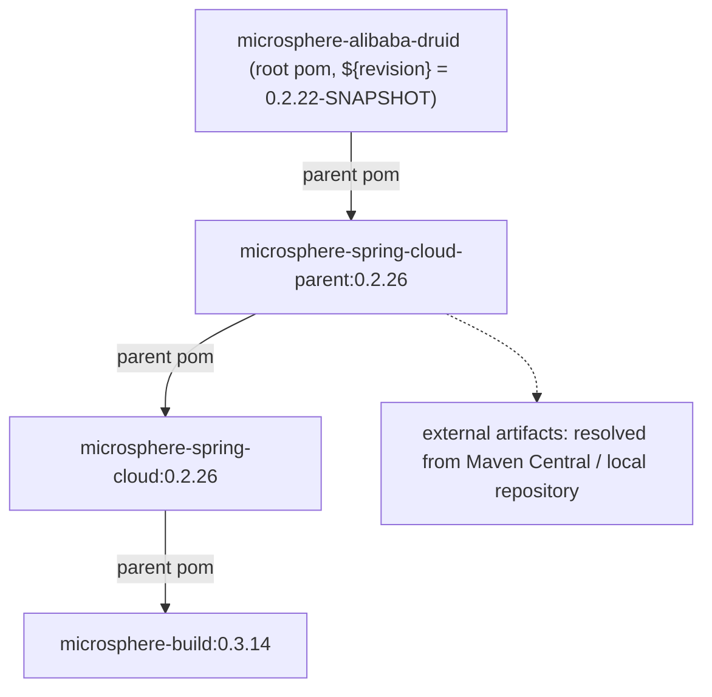
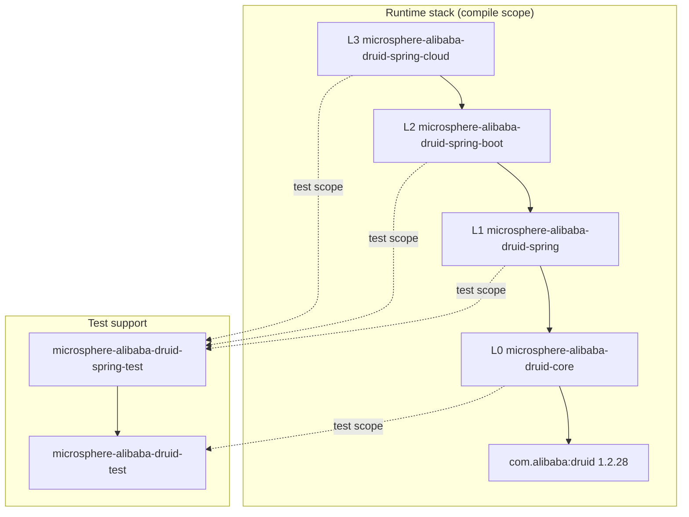
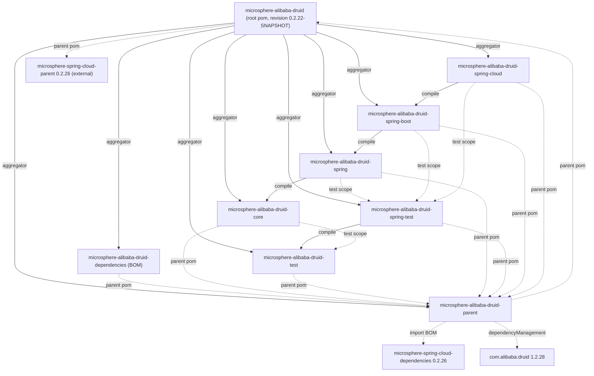

[English](../README.md)

# 开发者文档 —— current 线（`release` 分支，`0.2.x`）

本文档记录 Microsphere Alibaba Druid 在 **current** 文档线上的**内部设计**：分层结构、全仓库模块依赖图、
每一个公开类型的源码级行为、所使用的设计模式、复杂控制流、测试策略以及贡献者必须遵守的扩展点约定。

它**不是**使用手册。安装、配置属性与示例配方请见[用户文档](../../user-guide/zh/README.md)。

- 项目主页：[../../../../README.md](../../../../README.md)
- 旧版本线（`0.1.x` / `release-1.x`）：[1.x 开发者文档](../../../1.x/developer-guide/README.md)

---

## 1. 本版本线的版本事实

| 事实 | 取值 | 声明位置 |
|---|---|---|
| 最新已发布版本 | `0.2.21` | [../../../../README.md](../../../../README.md) 与 `release-notes.md` |
| 在研版本 | `0.2.22-SNAPSHOT` | 根 pom 的 `<revision>` |
| Java 基线 | `17` | 根 pom `<java.version>`，覆盖自 `microsphere-build:0.3.14` 继承的 `maven.compiler.source/target` |
| Alibaba Druid | `1.2.28` | `microsphere-alibaba-druid-parent` 的属性 `druid.version` |
| Microsphere Spring Cloud BOM | `0.2.26` | `microsphere-alibaba-druid-parent` 的属性 `microsphere-spring-cloud.version`（导入的 BOM） |
| Spring Boot / Spring Cloud 版本 | **不在本仓库声明** | 由外部父链按 `spring-cloud-*` profile 继承（见 §5） |

`main` 工作树中的 Java 源码与 `release` 分支逐字节一致；相对于 `release-1.x`，唯一结构性差异是打包与版本，
最明显的是本线**只**提供 `META-INF/spring/org.springframework.boot.autoconfigure.AutoConfiguration.imports`
（Boot 3 风格），而 `spring-boot` / `spring-cloud` 中**没有** `spring.factories` 自动配置注册。

### 1.1 外部父链（继承而来，不属于本仓库）



四个 `spring-cloud-*` profile、`test` 与 `coverage` profile、编译器插件配置、flatten-maven-plugin 配置，
以及 JUnit / Spring / Microsphere 的依赖版本，全部来自这条父链，**而非**本仓库中的文件。切勿在本地重复声明。

---

## 2. 架构与分层

项目是一条严格的纵向技术栈。每个运行时层只依赖它下面一层；测试模块挂在栈的侧面，通过 `test` 作用域边接回栈中。

| 层 | 模块 | 职责 |
|---|---|---|
| L0 | `microsphere-alibaba-druid-core` | Druid `Filter` SPI 实现：`AbstractStatementFilter` 拦截模板、`LoggingStatementFilter`、`microsphere.alibaba.druid.*` 属性名常量。零 Spring 依赖。 |
| L1 | `microsphere-alibaba-druid-spring` | Spring Framework 集成：`@EnableAlibabaDruid` + `AlibabaDruidRegistrar`（多来源 `Filter` 发现）、`DruidDataSourceBeanPostProcessor`（在 `init()` 前注入 filter）。 |
| L2 | `microsphere-alibaba-druid-spring-boot` | Boot 自动配置（`AlibabaDruidAutoConfiguration`）、`AlibabaDruidProperties`、组合式 `@Conditional` 注解、Actuator `DruidDataSourcePoolMetadata`。 |
| L3 | `microsphere-alibaba-druid-spring-cloud` | Spring Cloud 打包：带条件的空壳自动配置 + `META-INF/config/default/features.yaml` 特性目录。 |
| 支撑 | `microsphere-alibaba-druid-test` | 非 Spring 测试基础设施：`DruidDataSource` 构造器、`AbstractAlibabaDruidTest` 模板、`@AlibabaDruidTest` JUnit 5 扩展。 |
| 支撑 | `microsphere-alibaba-druid-spring-test` | Spring 感知测试基础设施：`AbstractDruidSpringTest`、prototype 作用域的 `DruidDataSourceTestConfiguration`。 |
| 构建 | `microsphere-alibaba-druid-parent`、`microsphere-alibaba-druid-dependencies`、根 pom | 属性/版本管理、BOM、聚合。 |



改动任何代码前必须内化两个结论：

- `core` 对 Spring 一无所知：`new DruidDataSource()` + `getProxyFilters().add(new LoggingStatementFilter())`
  + `init()` 在完全没有容器时即可工作。
- `spring` 及以上层**不**新增拦截逻辑——它们只*发现*、*注册*并*注入* filter。

---

## 3. 模块依赖图（全仓库）

实线边 = 反应堆模块之间的 `compile` 作用域；虚线边 = `parent` 继承、BOM 导入或 `test` 作用域。



### 3.1 各模块作用域表

| 模块 | 必需（`compile`） | `optional`（编译期、不传递） | `test` 作用域 |
|---|---|---|---|
| core | — | `microsphere-annotation-processor`、`microsphere-java-core`、`druid` | `junit-jupiter`、`h2`、`microsphere-alibaba-druid-test`、`microsphere-logging-test`、`microsphere-logback`、`logback-classic` |
| test | — | `microsphere-annotation-processor`、`junit-jupiter`、`microsphere-java-test`、`microsphere-logging-test`、`druid`、`h2`、`logback-classic` | `microsphere-logback` |
| spring | `microsphere-alibaba-druid-core` | `microsphere-annotation-processor`、`microsphere-spring-context`、`druid`、`spring-beans`、`spring-context`、`spring-test` | `junit-jupiter`、`h2`、`microsphere-alibaba-druid-spring-test`、`microsphere-spring-test`、`microsphere-logback`、`logback-classic` |
| spring-test | `microsphere-alibaba-druid-test` | `junit-jupiter`、`spring-test`、`spring-context`、`microsphere-spring-test`、`microsphere-spring-context`、`druid`、`h2`、`logback-classic` | `microsphere-logback` |
| spring-boot | `microsphere-alibaba-druid-spring` | `microsphere-annotation-processor`、`microsphere-spring-boot-core`、`druid`、`spring-boot-starter`、`spring-boot-starter-actuator`、`spring-boot-configuration-processor`、`spring-boot-autoconfigure-processor` | `junit-jupiter`、`spring-boot-starter-test`、`microsphere-spring-boot-test`、`microsphere-alibaba-druid-spring-test`、`microsphere-logback`、`h2`、`logback-classic` |
| spring-cloud | `microsphere-alibaba-druid-spring-boot` | `microsphere-annotation-processor`、`microsphere-spring-cloud-commons`、`druid`、`spring-cloud-commons`、`spring-boot-starter`、`spring-boot-starter-actuator`、`spring-boot-configuration-processor`、`spring-boot-autoconfigure-processor` | `junit-jupiter`、`spring-boot-starter-test`、`microsphere-spring-boot-test`、`microsphere-alibaba-druid-spring-test`、`microsphere-logback`、`h2`、`logback-classic` |
| parent | — | — | —（管理 `druid:1.2.28`，导入 `microsphere-spring-cloud-dependencies:0.2.26`） |
| dependencies（BOM） | — | — | —（以 `${revision}` 管理六个反应堆产物） |

### 3.2 值得理解的 `test` 作用域边

- `core` → `microsphere-alibaba-druid-test`（`${revision}`，`test`）：`AbstractFilterTest` 继承
  `AbstractAlibabaDruidTest`。合法且**不是**环——`test` 对 `core` 没有 compile 依赖，Maven 反应堆会把 `test`
  排在 `core` 之前。
- `spring`、`spring-boot`、`spring-cloud` → `microsphere-alibaba-druid-spring-test`（`${revision}`，`test`）：
  所有 Spring 测试都继承 `AbstractDruidSpringTest` 并导入 `DruidDataSourceTestConfiguration`。
- `spring-test` → `test` 是 **compile** 边（Spring 测试基类继承非 Spring 测试基类），这也是
  `microsphere-alibaba-druid-test` 作为普通产物发布的原因。
- `test` 与 `spring-test` 中所有第三方依赖都是 `optional`，下游使用者必须自备 JUnit、Druid、Spring Test 与 H2。

---

## 4. 复杂流程速览

| 流程 | 图类型 | 文档位置 |
|---|---|---|
| SQL 语句拦截（`final` 覆写 → `execute` 模板 → `beforeExecute`/回调/`finally afterExecute`、`wrap(e, SQLException.class)`） | 时序图 | [core —— SQL interception execution flow](microsphere-alibaba-druid-core.md#sql-interception-execution-flow) |
| `buildResourceName()` 决策（validation SQL 短路、类型分派、`UNRECOGNIZED` 回退） | 流程图 | [core —— buildResourceName decision flow](microsphere-alibaba-druid-core.md#buildresourcename-decision-flow) |
| `@EnableAlibabaDruid` 注册（`switch` fall-through）+ `BeanPostProcessor` 注入 | 时序图 + 流程图 | [spring —— @EnableAlibabaDruid registration flow](microsphere-alibaba-druid-spring.md#enablealibabadruid-registration-flow) |
| Boot 自动配置条件评估（`@ConditionalOnAlibabaDruidAvailable`、`@ConditionalOnBean`） | 流程图 | [spring-boot —— Auto-configuration condition evaluation flow](microsphere-alibaba-druid-spring-boot.md#auto-configuration-condition-evaluation-flow) |
| Spring Cloud 特性目录 → `NamedFeature` bean | 时序图 | [spring-cloud —— Cloud features activation flow](microsphere-alibaba-druid-spring-cloud.md#cloud-features-activation-flow) |
| `@AlibabaDruidTest` JUnit 5 扩展生命周期（Store / Namespace / ParameterResolver） | 时序图 | [test —— AlibabaDruidTest extension lifecycle](microsphere-alibaba-druid-test.md#alibabadruidtest-extension-lifecycle) |

---

## 5. 构建与 CI

### 5.1 本地构建

要求：**JDK 17+**（编译基线为 `17`）、Maven 3.6+（可用 `./mvnw`），并且网络或本地仓库能解析外部父链产物。

```bash
# full reactor against one Spring Cloud generation
./mvnw --batch-mode clean verify -P spring-cloud-2025

# other generations
./mvnw --batch-mode clean verify -P spring-cloud-2022
./mvnw --batch-mode clean verify -P spring-cloud-2023
./mvnw --batch-mode clean verify -P spring-cloud-2024

# skip tests, only resolve/flatten the reactor
./mvnw --batch-mode clean install -DskipTests

# one module plus its reactor dependencies
./mvnw --batch-mode -pl microsphere-alibaba-druid-spring -am test -P spring-cloud-2025
```

`spring-cloud-2025` 在外部父 pom 中是 `activeByDefault`，因此裸跑 `mvn verify` 会基于 Spring Boot `3.5.15` /
Spring Cloud `2025.0.3` 构建。这些 profile 及其锁定的版本属于**继承**内容：

| Profile | Spring Boot | Spring Cloud | 继承来源 |
|---|---|---|---|
| `spring-cloud-2022` | `3.0.13` | `2022.0.5` | `microsphere-spring-cloud-parent:0.2.26` |
| `spring-cloud-2023` | `3.3.13` | `2023.0.6` | `microsphere-spring-cloud-parent:0.2.26` |
| `spring-cloud-2024` | `3.4.13` | `2024.0.3` | `microsphere-spring-cloud-parent:0.2.26` |
| `spring-cloud-2025`（默认） | `3.5.15` | `2025.0.3` | `microsphere-spring-cloud-parent:0.2.26` |

这四组版本对属于父 POM，而不是本仓库——不要把它们说成 “microsphere-alibaba-druid 的版本”，也不要在本地 pom 中锁定。

版本管理对 CI 友好：每个模块都声明 `<version>${revision}</version>`，`<revision>0.2.22-SNAPSHOT</revision>`
只存在于根 pom，`flatten-maven-plugin` 配置（继承自 `microsphere-build:0.3.14`）发布解析后的 pom——
发布版本只需改一个属性。

### 5.2 CI 矩阵（`.github/workflows/maven-build.yml`）

| 维度 | 取值 |
|---|---|
| 触发 | `push`：`main`、`dev` · `pull_request`：`main`、`dev`、`release` |
| 运行器 | `ubuntu-latest` |
| JDK 矩阵 | `17`、`21`、`25`（distribution `temurin`，`actions/setup-java@v6.0.1`） |
| Profile 矩阵 | `spring-cloud-2022`、`spring-cloud-2023`、`spring-cloud-2024`、`spring-cloud-2025` |
| 命令 | `mvn --batch-mode --update-snapshots --file pom.xml -Drevision=0.0.1-SNAPSHOT test --activate-profiles test,coverage,<profile>` |
| 覆盖率 | `codecov/codecov-action@v7.1.1`，slug `microsphere-projects/microsphere-alibaba-druid` |
| 检出 | `actions/checkout@v7.0.1`，workflow 声明 `permissions: contents: read` |

注意 CI 专用的 `-Drevision=0.0.1-SNAPSHOT`：它覆盖反应堆版本，使构建永不与真实已发布产物冲突，同时 `${revision}`
仍保证反应堆内部依赖一致。只有 `3 × 4 = 12` 个作业全部通过才算绿色，因此任何条件判断或反射代码必须同时能在
JDK 17 **与** JDK 25 上运行，并兼容 Boot `3.0.x` **到** `3.5.x`。

---

## 6. 所用设计模式

| 模式 | 位置 | 说明 |
|---|---|---|
| 模板方法 | `AbstractStatementFilter`、`AbstractAlibabaDruidTest`、`AnnotatedBeanCapableImportBeanDefinitionRegistrar` | `final` 入口方法、抽象 `beforeExecute`/`afterExecute` 钩子、可覆写的 `customize(...)` 空实现。 |
| 责任链 | Druid `FilterChain` 与 `AbstractStatementFilter` 的组合 | 每个 `final` 覆写都委托给 `super.<sameMethod>(chain, ...)`，即链中下一个 filter。 |
| Bean 后置处理器（钩子） | `DruidDataSourceBeanPostProcessor#processBeforeInitialization` | 在 `DruidDataSource.init()` 调用 `Filter.init(DataSourceProxy)` 之前修改 `getProxyFilters()`。 |
| `@Import` + `ImportBeanDefinitionRegistrar` | `@EnableAlibabaDruid` → 包级私有 `AlibabaDruidRegistrar` | 注册表级注册，而非 `@Bean` 方法。 |
| 多来源 bean 发现（策略） | `BeanSource.{BEAN_FACTORY, SPRING_FACTORIES, JAVA_SERVICE_PROVIDER}` + `switch` fall-through | 同一个 `filterClasses` 数组在多个注册表上解析。 |
| 组合式 `@Conditional` 元注解 | `ConditionalOnAlibabaDruidAvailable` = `ConditionalOnAlibabaDruidEnabled` + `@ConditionalOnClass(name = …)` | 被 `AlibabaDruidAutoConfiguration` 与 `AlibabaDruidCloudAutoConfiguration` 逐字复用。 |
| 适配器 | `DruidDataSourcePoolMetadata`、`AlibabaDruidAutoConfiguration#druidDataSourcePoolMetadataProvider` | 把 Druid 池计数映射为 Boot `DataSourcePoolMetadata`；lambda provider 通过 `DataSourceUnwrapper` 拆代理。 |
| 建造者 / 工厂方法 | `AlibabaDruidTestUtils.buildDefaultDruidDataSource()`、`buildDruidDataSource(Properties)` | 不可实例化的工具类。 |
| 空对象 / 优雅降级 | `"UNRECOGNIZED"` 资源名、命名分派中的 `catch (Throwable)`、`close(null)` 容错 | 命名问题绝不让 JDBC 调用崩溃。 |
| JUnit 5 扩展 | `AlibabaDruidTestExtension` | `BeforeAllCallback`、`AfterAllCallback`、`TestInstancePostProcessor`、`AfterEachCallback`、`ParameterResolver`、`Store` + `Namespace` + `StoreScope.EXTENSION_CONTEXT`。 |
| 声明式特性目录 | `META-INF/config/default/features.yaml` | 纯数据的 Spring Cloud 集成；`spring-cloud` 中无 Java 逻辑。 |
| 不可实例化工具类 / 常量接口 | `AlibabaDruidTestUtils`（`abstract` + `private` 构造器）、`PropertyConstants`（interface） | Microsphere 惯用法。 |

---

## 7. 贡献者约定

- **JDK 17 源码级别** —— record、sealed 类型、`switch` 表达式、文本块、`ServiceLoader.stream()` 语法上可用，
  但现有代码刻意保持 Java 8 时代的惯用写法以保证可移植性；不要随手引入更新 API，它们仍需在
  `maven.compiler.source/target=17` 下编译。
- **Optional 优先的依赖** —— 不属于模块自身契约的一律 `<optional>true</optional>`；版本只来自
  `microsphere-alibaba-druid-parent` 或外部父链。
- **反应堆内部依赖显式写 `${revision}`**（Maven 3.6 + flatten 工作流的要求）。
- 每个文件都有 **Apache License 2.0 头**；每个类型都有 `@author <a href="mailto:mercyblitz@gmail.com">Mercy<a/>`
  与 `@since`。
- **Javadoc 含 `Example Usage` 块** —— 保持可编译，测试用例与之互相印证。
- **只有 Boot 3 注册方式**：新增自动配置写入其所在模块的
  `META-INF/spring/org.springframework.boot.autoconfigure.AutoConfiguration.imports`。本线没有 `spring.factories`——
  加回去等于恢复 1.x 的双注册契约。
- **拦截保持无状态** —— `AbstractStatementFilter` 实例被数据源的所有连接共享；只允许缓存随数据源而来的
  `init()` 状态（`dataSource`、`validationSQL`）。
- **属性名属于公开 API** —— 修改 `PropertyConstants` 中的 `microsphere.alibaba.druid.*` 对
  `@ConditionalOnProperty`、`@ConfigurationProperties` 及所有示例文档都是破坏性变更。

---

## 8. 模块文档索引

| 文档 | 内容 |
|---|---|
| [microsphere-alibaba-druid-core](microsphere-alibaba-druid-core.md) | `AbstractStatementFilter` 模板、`LoggingStatementFilter`、`PropertyConstants`、资源名算法与流程图。 |
| [microsphere-alibaba-druid-spring](microsphere-alibaba-druid-spring.md) | `@EnableAlibabaDruid`、`AlibabaDruidRegistrar` 的 fall-through 语义、`DruidDataSourceBeanPostProcessor`、测试固件（`spring.factories`、`META-INF/services`）。 |
| [microsphere-alibaba-druid-spring-boot](microsphere-alibaba-druid-spring-boot.md) | `AlibabaDruidAutoConfiguration`、`AlibabaDruidProperties`、组合条件、`DruidDataSourcePoolMetadata`、`AutoConfiguration.imports`。 |
| [microsphere-alibaba-druid-spring-cloud](microsphere-alibaba-druid-spring-cloud.md) | 空壳 `AlibabaDruidCloudAutoConfiguration`、`features.yaml` 机制、`NamedFeature` 断言。 |
| [microsphere-alibaba-druid-test](microsphere-alibaba-druid-test.md) | `AbstractAlibabaDruidTest`、`AlibabaDruidTestUtils`、`@AlibabaDruidTest` / `@AlibabaDruidRuntime` / `AlibabaDruidTestExtension`、`META-INF/druid/h2.properties`。 |
| [microsphere-alibaba-druid-spring-test](microsphere-alibaba-druid-spring-test.md) | `AbstractDruidSpringTest`、`DruidDataSourceTestConfiguration`、prototype 作用域的理由。 |
| [microsphere-alibaba-druid-parent](microsphere-alibaba-druid-parent.md) | 属性/版本管理、外部父链、JDK 17 基线、profile。 |
| [microsphere-alibaba-druid-dependencies](microsphere-alibaba-druid-dependencies.md) | BOM 结构以及 `import` 真正带来什么。 |

## Related

- [用户文档（current）](../../user-guide/zh/README.md)
- [1.x 线开发者文档](../../../1.x/developer-guide/README.md)
- [项目 README](../../../../README.md)
- [Alibaba Druid](https://github.com/alibaba/druid)

---

## English

同目录的英文原版位于 [../README.md](../README.md)，逐模块英文文档见上表中去掉 `zh/` 前缀的路径。
