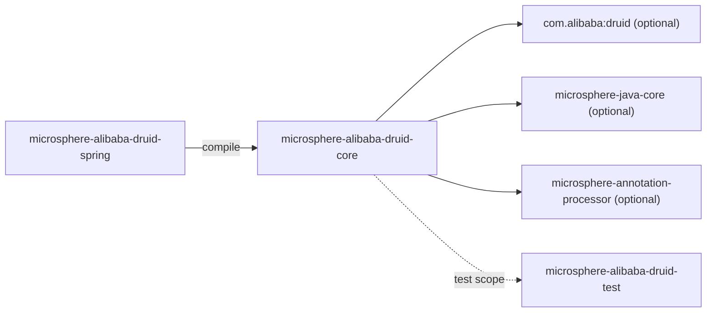
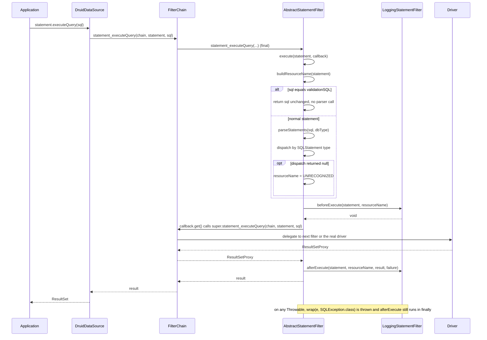
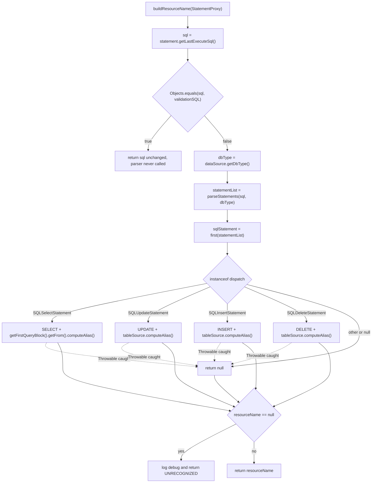
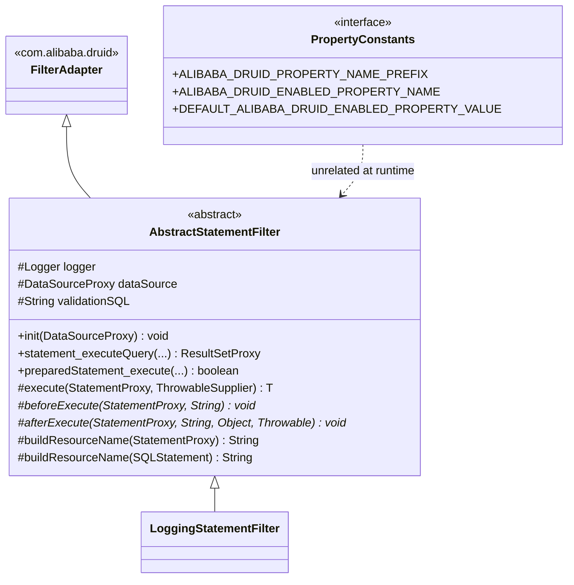

[English](../microsphere-alibaba-druid-core.md)

# microsphere-alibaba-druid-core

> 基础层（L0）：Druid `Filter` 实现与 `microsphere.alibaba.druid` 属性名常量。包根：`io.microsphere.alibaba.druid`。
> Java 基线：**JDK 17**。
> 项目主页：[../../../../README.md](../../../../README.md) · 使用方式：[用户文档](../../user-guide/zh/microsphere-alibaba-druid-core.md)

## 架构位置

`core` **对任何其他反应堆模块都没有 compile 依赖**——它位于栈底。它唯一的反应堆关系是一条指向
`microsphere-alibaba-druid-test` 的 `test` 作用域边，并且它编译期依赖的一切都被声明为 `optional`。



| 依赖 | 作用域 | 为什么需要 |
|---|---|---|
| `com.alibaba:druid` | optional | `Filter`、`FilterAdapter`、`FilterChain`、`StatementProxy`、`PreparedStatementProxy`、`ResultSetProxy`、`DataSourceProxy`、`DruidDataSource`、`SQLUtils` 解析器、`AutoLoad`。 |
| `io.github.microsphere-projects:microsphere-java-core` | optional | `ThrowableSupplier`、`ListUtils.first`、`ExceptionUtils.wrap`、`io.microsphere.logging.Logger`/`LoggerFactory`、`@ConfigurationProperty`。 |
| `microsphere-annotation-processor` | optional | 编译期把 `PropertyConstants` 上的 `@ConfigurationProperty` 转换为配置元数据。 |
| `microsphere-alibaba-druid-test`、`junit-jupiter`、`h2`、`microsphere-logging-test`、`microsphere-logback`、`logback-classic` | test | 见 [microsphere-alibaba-druid-test](microsphere-alibaba-druid-test.md)。 |

由于 `druid` 是 `optional`，使用者**不会**传递性地拿到 Druid；连接池库必须由应用自行声明。这是刻意的设计——
本项目是增强件，不是分发版。

## 源码分析

本模块恰好包含三个类型。

### `io.microsphere.alibaba.druid.constants.PropertyConstants`

```java
public interface PropertyConstants {
    String ALIBABA_DRUID_PROPERTY_NAME_PREFIX = MICROSPHERE_PROPERTY_NAME_PREFIX + "alibaba.druid";
    String DEFAULT_ALIBABA_DRUID_ENABLED_PROPERTY_VALUE = "true";
    @ConfigurationProperty(type = boolean.class,
            defaultValue = DEFAULT_ALIBABA_DRUID_ENABLED_PROPERTY_VALUE,
            source = APPLICATION_SOURCE)
    String ALIBABA_DRUID_ENABLED_PROPERTY_NAME = ALIBABA_DRUID_PROPERTY_NAME_PREFIX + DOT + ENABLED_PROPERTY_NAME;
}
```

- 以 `interface` 声明，因此所有成员隐式为 `public static final`，且该类型无法被实例化——这是 Microsphere 存放
  常量的惯用法。
- 解析结果：前缀 `microsphere.alibaba.druid`，启用键 `microsphere.alibaba.druid.enabled`，默认值 `"true"`。操作数
  来自 `io.microsphere.constants.PropertyConstants`（`MICROSPHERE_PROPERTY_NAME_PREFIX`、`ENABLED_PROPERTY_NAME`）
  与 `io.microsphere.constants.SymbolConstants.DOT`，因此每个表达式都是**编译期** `String` 常量——这是必须的，
  因为这些值要作为注解成员用于 `@ConfigurationProperties(prefix = …)`（`AlibabaDruidProperties`）与
  `@ConditionalOnProperty(name = …)`（`ConditionalOnAlibabaDruidEnabled`）。
- `@ConfigurationProperty` 只是元数据，由 `microsphere-annotation-processor` 在编译期消费，没有运行期行为。
- `PropertyConstantsTest#testConstants` 锁定了两个字面量。修改这里应视为**破坏性配置变更**：用户文档、条件注解、
  属性类与 README 示例都读取这些名字。

### `io.microsphere.alibaba.druid.filter.AbstractStatementFilter`

```java
public abstract class AbstractStatementFilter extends FilterAdapter {
    protected final Logger logger = getLogger(getClass());
    protected DataSourceProxy dataSource;
    protected String validationSQL;

    @Override public final void init(DataSourceProxy dataSource);
    @Override public final boolean preparedStatement_execute(FilterChain chain, PreparedStatementProxy statement) throws SQLException;
    @Override public final ResultSetProxy preparedStatement_executeQuery(FilterChain chain, PreparedStatementProxy statement) throws SQLException;
    @Override public final int preparedStatement_executeUpdate(FilterChain chain, PreparedStatementProxy statement) throws SQLException;
    @Override public final ResultSetProxy statement_executeQuery(FilterChain chain, StatementProxy statement, String sql) throws SQLException;
    @Override public final boolean statement_execute(FilterChain chain, StatementProxy statement, String sql) throws SQLException;
    @Override public final boolean statement_execute(FilterChain chain, StatementProxy statement, String sql, int autoGeneratedKeys) throws SQLException;
    @Override public final boolean statement_execute(FilterChain chain, StatementProxy statement, String sql, int[] columnIndexes) throws SQLException;
    @Override public final boolean statement_execute(FilterChain chain, StatementProxy statement, String sql, String[] columnNames) throws SQLException;
    @Override public final int[] statement_executeBatch(FilterChain chain, StatementProxy statement) throws SQLException;
    @Override public final int statement_executeUpdate(FilterChain chain, StatementProxy statement, String sql) throws SQLException;
    @Override public final int statement_executeUpdate(FilterChain chain, StatementProxy statement, String sql, int autoGeneratedKeys) throws SQLException;
    @Override public final int statement_executeUpdate(FilterChain chain, StatementProxy statement, String sql, int[] columnIndexes) throws SQLException;
    @Override public final int statement_executeUpdate(FilterChain chain, StatementProxy statement, String sql, String[] columnNames) throws SQLException;

    protected <T> T execute(StatementProxy statement, ThrowableSupplier<T> callback) throws SQLException;
    protected abstract void beforeExecute(StatementProxy statement, String resourceName) throws Throwable;
    protected abstract void afterExecute(StatementProxy statement, String resourceName, Object result, Throwable failure);
    protected String buildResourceName(StatementProxy statement);
    protected String buildResourceName(SQLStatement sqlStatement);
    protected String buildResourceName(SQLSelectStatement selectStatement);
    protected String buildResourceName(SQLUpdateStatement updateStatement);
    protected String buildResourceName(SQLInsertStatement insertStatement);
    protected String buildResourceName(SQLDeleteStatement deleteStatement);
}
```

**设计意图。** 该类是把*模板方法*焊接到 Druid *责任链*上的产物：

1. 全部十三个 Druid 语句执行回调都是 `final`，并汇入唯一的 `execute(statement, callback)`。因此子类**不可能**忘记
   向后传递链，也**不可能**只覆写某一个 JDBC 动词——意图必须通过两个钩子表达。若要区分动词，只能依据
   `statement.getLastExecuteSql()` 或对 `PreparedStatementProxy` 做 `instanceof` 判断。
2. 每个 `final` 回调都调用 `super.<sameMethod>(chain, …)`，也就是 `FilterAdapter` 对
   `chain.<sameMethod>(…)` 的透传——即 `FilterChainImpl` 中的*下一个* filter。这样既包装了调用又保持了链的完整。
   注意回调的 lambda 也捕获了 `chain` 与 `statement`，所以拦截是纯粹附加的。
3. `beforeExecute` 声明 `throws Throwable`（钩子可以失败而不破坏 JDBC 的 `throws SQLException` 契约）；
   `afterExecute` 不声明受检异常，因此在 `finally` 中调用是安全的。

**`init(DataSourceProxy)` 的行为与边界。**

```java
@Override
public final void init(DataSourceProxy dataSource) {
    this.dataSource = dataSource;
    if (dataSource instanceof DruidDataSource) {
        DruidDataSource druidDataSource = (DruidDataSource) dataSource;
        this.validationSQL = druidDataSource.getValidationQuery();
    }
    if (logger.isTraceEnabled()) {
        logger.trace("DataSourceProxy({}) was initialized with validation SQL : {}", this.dataSource, this.validationSQL);
    }
}
```

- 由 `DruidDataSource.init()` 为 `proxyFilters` 中的每个 filter 调用。这正是
  `DruidDataSourceBeanPostProcessor` 必须在初始化**之前**添加 filter 的原因（见
  [microsphere-alibaba-druid-spring](microsphere-alibaba-druid-spring.md)）——事后加入的 filter 永远收不到 `init()`，
  `dataSource` 保持为 `null`。
- 当代理不是 `DruidDataSource` 时 `validationSQL` 保持 `null`。
  `AbstractStatementFilterTest#testInitOnMockDataSource` 用 JDK 动态代理证明了这点
  （`newProxyInstance(getSystemClassLoader(), ofArray(DataSourceProxy.class), …)`，所有方法返回 `null`），并断言
  `assertSame(dataSourceProxy, filter.dataSource)` 与 `assertNull(filter.validationSQL)`。
- `logger` 由 `getClass()` 创建，因此每个具体子类拥有以自身命名的 logger——这是
  `microsphere-logging-test` 的 `@LoggingLevelsClass(levels = {"TRACE", "INFO", "ERROR"})` 级别切换所要求的。
- 该方法是 `final`：子类不能在此加入自己的初始化状态，只能改为读取受保护字段 `dataSource` / `validationSQL`。

**`execute`——拦截核心。**

```java
protected <T> T execute(StatementProxy statement, ThrowableSupplier<T> callback) throws SQLException {
    String resourceName = buildResourceName(statement);
    T result = null;
    Throwable failure = null;
    try {
        beforeExecute(statement, resourceName);
        result = callback.get();
    } catch (Throwable e) {
        failure = e;
        throw wrap(e, SQLException.class);
    } finally {
        if (logger.isTraceEnabled()) {
            logger.trace("Execute statement [value : {} , resource name : '{}'] : {}", statement.getLastExecuteSql(), resourceName, result, failure);
        }
        afterExecute(statement, resourceName, result, failure);
    }
    return result;
}
```

评审时必须记住的实现要点：

- `buildResourceName(statement)` 在 `try` **之外**执行，因此其中的非受检失败会在钩子运行之前逃逸。实践中命名逻辑内部
  会 `catch (Throwable)` 并降级为 `"UNRECOGNIZED"`，但未调用 `init()` 的 filter 会在 `dataSource.getDbType()` 上抛 NPE。
- `wrap(e, SQLException.class)`（`io.microsphere.util.ExceptionUtils`）把任意 `Throwable` 适配到声明的
  `throws SQLException`：若已是 `SQLException` 则原样返回（保留原实例），否则以 `e` 为 cause 重新抛出 `SQLException`。
  `AbstractStatementFilterTest#testExecuteOnFailed` 从回调抛出普通 `RuntimeException("For testing")`，并断言
  `assertThrows(SQLException.class, …)`。
- `beforeExecute` 在 `try` **之内**：钩子失败会中止 SQL 执行，*并且*自身被包装为 `SQLException`。这是有意的
  （拒绝型 filter 必须拦住语句），但也意味着 filter 无法通过抛异常来表达“跳过我”。
- `afterExecute` 在 `finally` 中执行，同时接收 `result` 与 `failure`；失败时 `result` 为 `null`。由于 `finally`
  不吞异常，从 after 钩子抛出的异常会**替换**待抛出的 `SQLException`——子类绝不能在 after 钩子里抛异常。
- `failure` 在重新抛出之前完成赋值，因此 `finally` 记录到的是真实原因；失败路径上赋值语句未完成，`result` 保持 `null`。
- `ThrowableSupplier` 让 lambda 可以直接调用 `super.*` 方法而无需重复声明受检异常。

**`buildResourceName(StatementProxy)`——命名算法。**

```java
protected String buildResourceName(StatementProxy statement) {
    String sql = statement.getLastExecuteSql();
    if (Objects.equals(sql, validationSQL)) {
        return sql;
    }
    String dbType = dataSource.getDbType();
    List<SQLStatement> statementList = parseStatements(sql, dbType);
    SQLStatement sqlStatement = first(statementList);
    String resourceName = buildResourceName(sqlStatement);
    if (resourceName == null) {
        if (logger.isDebugEnabled()) {
            logger.debug("The JDBC statement can't be recognized, sql : '{}' , dbType : '{}'", sql, dbType);
        }
        resourceName = "UNRECOGNIZED";
    }
    return resourceName;
}
```

- **validation SQL 短路**：当执行的 SQL 等于数据源的 `validationQuery` 时直接返回原始 SQL，**完全不做解析**。
  这把连接测试/保活流量排除在资源名指标之外，也省掉了每次心跳的解析开销。
- `dbType` 取自数据源，因此 `SQLUtils.parseStatements(sql, dbType)` 使用正确的方言语法（测试固件里是 `h2`）。
- `first(statementList)`（`io.microsphere.collection.ListUtils`）返回索引 0 元素或空列表时的 `null`——因此多语句
  SQL 只以**第一条**语句命名。
- **`UNRECOGNIZED` 回退**：类型分派路径返回的任何 `null` 都会得到字面量 `"UNRECOGNIZED"` 并记录 `DEBUG` 日志；
  filter 绝不会因为无法识别的语法而抛异常。
- `Objects.equals(sql, validationSQL)` 在两者**均为** `null` 时也成立；此时方法把 `null` 当作“资源名”返回
  （未设置校验查询且代理上报 `null` SQL）。子类必须容忍 `null` 资源名——`LoggingStatementFilter` 就只是把
  `'null'` 打进日志。

类型分派重载：

```java
protected String buildResourceName(SQLStatement sqlStatement) {
    try {
        if (sqlStatement instanceof SQLSelectStatement) {
            return buildResourceName((SQLSelectStatement) sqlStatement);
        } else if (sqlStatement instanceof SQLUpdateStatement) {
            return buildResourceName((SQLUpdateStatement) sqlStatement);
        } else if (sqlStatement instanceof SQLInsertStatement) {
            return buildResourceName((SQLInsertStatement) sqlStatement);
        } else if (sqlStatement instanceof SQLDeleteStatement) {
            return buildResourceName((SQLDeleteStatement) sqlStatement);
        }
    } catch (Throwable e) {
        if (logger.isDebugEnabled()) {
            logger.debug("The JDBC statement can't be parsed, sql : '{}'", sqlStatement, e);
        }
    }
    return null;
}
```

- 这串 `instanceof` 是有序、只覆盖 DML 的分派。DDL（`CREATE TABLE`、`DROP TABLE`）、`MERGE`、`CALL` 与厂商特有
  语句被有意排除，落到 `UNRECOGNIZED`——`AbstractAlibabaDruidTest` 执行的 `CREATE TABLE users` /
  `DROP TABLE users` 正是如此。
- `instanceof` 同时过滤了 `null`（`null` 不匹配任何分支），因此空的解析结果会变成 `null`。
- `catch (Throwable)` 是承重的：`new SQLSelectStatement()` 没有查询块，`getSelect()` / `getFirstQueryBlock()` 会 NPE。
  `AbstractStatementFilterTest#testBuildResourceNameOnNullPointerException` 断言该方法返回 `null`——畸形 AST 降级为
  `UNRECOGNIZED`，绝不拖垮调用方。

命名重载（单表粒度；`SQLTableSource.computeAlias()` 在无别名时回退为表名）：

| 钩子 | 实现 | 结果示例 |
|---|---|---|
| `buildResourceName(SQLSelectStatement)` | `"SELECT " + sqlSelect.getFirstQueryBlock().getFrom().computeAlias()` | `SELECT id, name FROM users` → `SELECT users` |
| `buildResourceName(SQLUpdateStatement)` | `"UPDATE " + updateStatement.getTableSource().computeAlias()` | `UPDATE users SET name = 'Z' WHERE id = 5` → `UPDATE users` |
| `buildResourceName(SQLInsertStatement)` | `"INSERT " + insertStatement.getTableSource().computeAlias()`（`SQLExprTableSource`） | `INSERT INTO users (id, name) VALUES (1, 'Mercy')` → `INSERT users` |
| `buildResourceName(SQLDeleteStatement)` | `"DELETE " + deleteStatement.getTableSource().computeAlias()` | `DELETE FROM users WHERE id = 1` → `DELETE users` |

| SQL | 资源名 |
|---|---|
| `SELECT id, name FROM users` | `SELECT users` |
| `SELECT u.id FROM users u` | `SELECT u` |
| `UPDATE users SET name = 'Z' WHERE id = 5` | `UPDATE users` |
| `INSERT INTO users (id, name) VALUES (1, 'Mercy')` | `INSERT users` |
| `DELETE FROM users WHERE id = 1` | `DELETE users` |
| `CREATE TABLE users (id INT, name VARCHAR(50))` | `UNRECOGNIZED` |
| `SELECT 1`（等于 `validationQuery`） | `SELECT 1` |

由于 SELECT 分支使用 `getFirstQueryBlock()`，`UNION` 以其第一个分支命名，而 `FROM` 中的子查询以外层块的表来源命名。

### `io.microsphere.alibaba.druid.filter.LoggingStatementFilter`

```java
public class LoggingStatementFilter extends AbstractStatementFilter {
    @Override protected void beforeExecute(StatementProxy statement, String resourceName) throws Throwable;
    @Override protected void afterExecute(StatementProxy statement, String resourceName, Object result, Throwable failure);
}
```

- 两个钩子的参考实现，也是本项目唯一提供的具体 filter。
- 两个钩子都由 `logger.isDebugEnabled()` 守卫，记录 `statement.getLastExecuteSql()`、解析出的资源名、结果与失败原因——
  仅此而已。这里没有计时或度量，而这正是重点：该类示范了钩子契约，也是 README 提到的指标/链路 filter（Sentinel、
  Resilience4j、Observability）的模板。
- before 钩子的日志 `"beforeExecute(statement : {} , resource name : '{}')"` 有两个占位符对应三个实参位；末尾的
  占位符保持为空。这无害，但请不要贸然“修正”消息格式——用户文档中的日志示例逐字引用了它。
- `LoggingStatementFilterTest` 继承 `AbstractFilterTest<LoggingStatementFilter>`，即在注册了该 filter 的真实 H2
  `DruidDataSource` 上跑完整个 `AbstractAlibabaDruidTest` 的 DML/DQL 用例，并由 `@LoggingLevelsClass` 打开 `TRACE`
  与 `DEBUG`。

## SQL interception execution flow



## buildResourceName decision flow



## 类结构



## 设计模式

| 模式 | 位置 |
|---|---|
| 模板方法 | `AbstractStatementFilter`——13 个 `final` JDBC 动词入口，抽象 `beforeExecute`/`afterExecute`。 |
| 责任链 | 每个 `final` 覆写通过 `super.*` 传递给下一个 `FilterChain` 环节。 |
| 策略 | `buildResourceName(SQLXxxStatement)` 重载族；可按语句类型分别覆写。 |
| 空对象 / 优雅降级 | `"UNRECOGNIZED"` 回退、分派中的 `catch (Throwable)`、容忍 `null` 的钩子。 |
| 常量接口 | `PropertyConstants`。 |
| 每子类独立且不可逃逸的 logger | `protected final Logger logger = getLogger(getClass())`。 |

## 扩展点

- **指标/链路 filter**（Sentinel 资源条目、observation span）：继承 `AbstractStatementFilter`，把资源名用作指标维度，
  并依赖 `validationSQL` 短路排除心跳。
- **拒绝型 filter**（SQL 防火墙）：在 `beforeExecute` 抛异常；该异常以 `SQLException` 形式呈现给调用方，请求根本
  到不了驱动。
- **自定义命名**：覆写 `buildResourceName(StatementProxy)`（而不是 `SQLStatement` 那个重载）可替换整套命名策略同时
  保留拦截行为；只改某个动词的名字则覆写对应的类型重载。
- **非语句拦截**（`Connection`、`DataSource`、`ResultSet`）：不在本类职责内——请直接继承 `FilterAdapter`，因为
  `AbstractStatementFilter` 只 finalize 了语句动词。
- **AutoLoad**：带有 `com.alibaba.druid.filter.AutoLoad` 的 filter 由 Druid 自身装载；`spring` 模块刻意不会把这类
  类注册成 Spring bean（见 [microsphere-alibaba-druid-spring](microsphere-alibaba-druid-spring.md)）。

## 测试策略

| 测试类 | 锁定的行为 |
|---|---|
| `PropertyConstantsTest` | 字面量属性前缀 `microsphere.alibaba.druid` 与启用键 `microsphere.alibaba.druid.enabled`。 |
| `AbstractFilterTest<F extends Filter>` | 抽象基类：`customize(DruidDataSource)` 在 `init()` 之前把 `createFilter()` 加入 `getProxyFilters()`，随后继承完整的 `AbstractAlibabaDruidTest` 语句/预语句用例。 |
| `AbstractStatementFilterTest` | 在 `@BeforeEach` 中构造匿名子类；用 mock 的 `DataSourceProxy` 验证 `init()`（断言字段）；回调抛异常时包装为 `SQLException`；畸形 `SQLSelectStatement` 命名返回 `null`。类上标注 `@LoggingLevelsClass(levels = {"TRACE", "INFO", "ERROR"})` 使 `trace`/`debug` 分支被执行。 |
| `LoggingStatementFilterTest` | 在真实 H2 `DruidDataSource` 且开启 `DEBUG` 的条件下端到端执行钩子。 |

只构建该模块（连同其反应堆依赖）：

```bash
./mvnw --batch-mode -pl microsphere-alibaba-druid-core -am test -P spring-cloud-2025
```

必须带 `-am`：`core` 在 `test` 作用域使用 `microsphere-alibaba-druid-test`。

## current 线说明

- 以 `maven.compiler.source/target=17`（根 pom `<java.version>17`）编译，尽管源码刻意保持 Java 8 风格。产出的
  class 文件是 JDK 17 字节码，因此 `0.2.x` 产物**要求 JDK 17 及以上**；仍需 JDK 8 的使用者必须使用
  `release-1.x` 发布的 `0.1.x` 线。
- `core` 不读取任何 `META-INF/spring.factories`，也完全不依赖 Spring；其类与 `0.1.x` 线一致，因此这里的改动同样
  影响 `release-1.x`（需要前向移植）。
- `microsphere-java-core` 是 `optional`，因此 `ThrowableSupplier` / `ExceptionUtils.wrap` / `ListUtils.first` 的
  API 水平必须与 `microsphere-spring-cloud-dependencies:0.2.26` 所管理的版本保持兼容。

## Related

- [开发者文档索引](README.md)
- [microsphere-alibaba-druid-spring](microsphere-alibaba-druid-spring.md)
- [microsphere-alibaba-druid-test](microsphere-alibaba-druid-test.md)
- [用户文档 —— core](../../user-guide/zh/microsphere-alibaba-druid-core.md)
- [项目 README](../../../../README.md)

---

## English

[English version: microsphere-alibaba-druid-core](../microsphere-alibaba-druid-core.md)
