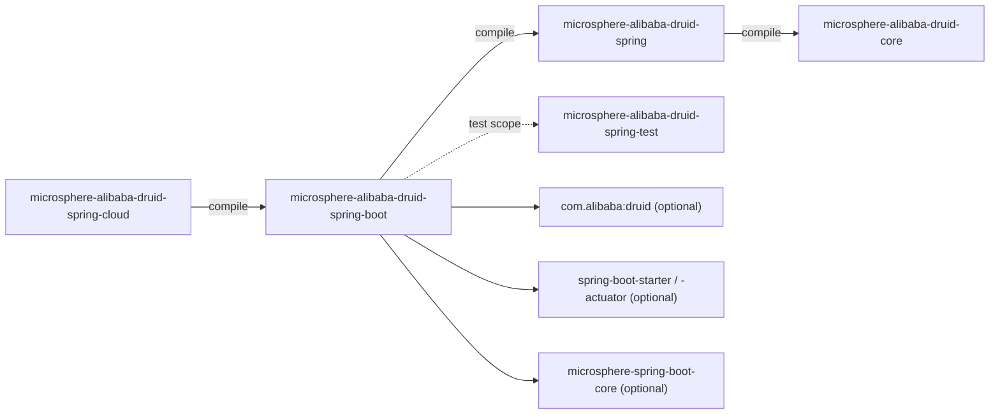
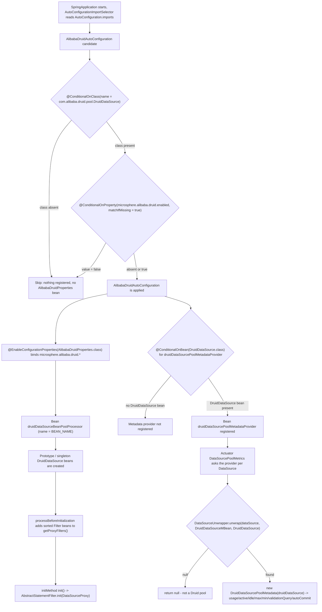

[English](../microsphere-alibaba-druid-spring-boot.md)

# microsphere-alibaba-druid-spring-boot

> Spring Boot 层（L2）：把 `spring` 模块需要手工 `@EnableAlibabaDruid` 的激活方式变成自动配置，绑定
> `microsphere.alibaba.druid.*` 属性，并通过 `DataSourcePoolMetadataProvider` 把 Druid 连接池指标暴露给 Actuator。
> 包根：`io.microsphere.alibaba.druid.spring.boot`、`...spring.boot.autoconfigure`、`...spring.boot.condition`、
> `...spring.boot.metadata`。Java 基线：**JDK 17**。
> 项目主页：[../../../../README.md](../../../../README.md) · 使用方式：[用户文档](../../user-guide/zh/microsphere-alibaba-druid-spring-boot.md)

## 架构位置

`spring-boot` 在 `compile` 作用域依赖 `spring`（因而传递性依赖 `core`），并且**不**新增 Druid 拦截或注册逻辑：
它只是把同一个 `DruidDataSourceBeanPostProcessor` 用属性和条件重新包装一层，再加一个 Actuator 适配器。
所有 Spring Boot 相关依赖都是 `optional`，因此对于自行管理 Boot 版本的应用它是一个可直接替换的组件。



| 依赖 | 作用域 | 为什么需要 |
|---|---|---|
| `microsphere-alibaba-druid-spring` (`${revision}`) | compile | 提供 `@Bean` 方法返回的 `DruidDataSourceBeanPostProcessor`（以及 `BEAN_NAME`）。 |
| `microsphere-alibaba-druid-core` | compile（经 `spring` 传递） | 前缀 / 启用属性名来自 `PropertyConstants`。 |
| `com.alibaba:druid` | optional | `DruidDataSource`、`DruidDataSourceMBean`、`Filter`。 |
| `spring-boot-starter`、`spring-boot-starter-actuator` | optional | `@ConditionalOnProperty`、`@ConditionalOnClass`、`@ConditionalOnBean`、`@ConfigurationProperties`、`@EnableConfigurationProperties`、`DataSourcePoolMetadata`、`DataSourceUnwrapper`。 |
| `spring-boot-configuration-processor`、`spring-boot-autoconfigure-processor` | optional | 编译期生成 `spring-configuration-metadata.json` 与自动配置条件索引。 |
| `microsphere-spring-boot-core` | optional | 为 Boot 辅助层而声明；本模块当前 `src/main` 没有 import 任何 `io.microsphere.spring.boot.*` 类型。 |
| `junit-jupiter`、`spring-boot-starter-test`、`microsphere-spring-boot-test`、`microsphere-alibaba-druid-spring-test` (`${revision}`)、`microsphere-logback`、`h2`、`logback-classic` | test | 见[测试策略](#测试策略)。 |

## 源码分析

本模块恰好包含五个生产类型。

### `io.microsphere.alibaba.druid.spring.boot.AlibabaDruidProperties`

```java
@ConfigurationProperties(prefix = ALIBABA_DRUID_PROPERTY_NAME_PREFIX)
public class AlibabaDruidProperties {

    private boolean enabled = true;

    private Filter filter = new Filter();

    public boolean isEnabled() { ... }
    public void setEnabled(boolean enabled) { ... }
    public Filter getFilter() { ... }
    public void setFilter(Filter filter) { ... }

    public static class Filter {

        private Class<? extends com.alibaba.druid.filter.Filter>[] classes = of(com.alibaba.druid.filter.Filter.class);

        public Class<? extends com.alibaba.druid.filter.Filter>[] getClasses() { ... }
        public void setClasses(Class<? extends com.alibaba.druid.filter.Filter>[] classes) { ... }
    }
}
```

- 前缀**不是**字面量：它复用 `core` 里的 `PropertyConstants.ALIBABA_DRUID_PROPERTY_NAME_PREFIX`，因此属性类与
  `@ConditionalOnProperty` 的键不可能漂移。解析结果为 `microsphere.alibaba.druid`。
- 绑定的键与默认值：

| 属性 | 类型 | 默认值 | 作用 |
|---|---|---|---|
| `microsphere.alibaba.druid.enabled` | `boolean` | `true` | 通过 `@ConditionalOnProperty(matchIfMissing = true)` 把关自动配置。该字段本身也会被绑定（Java 默认值 `true`）并由 `AlibabaDruidPropertiesTest` 读取；条件判断直接读取 Environment，所以字段更多是信息性的。 |
| `microsphere.alibaba.druid.filter.classes` | `Class<? extends Filter>[]` | `[com.alibaba.druid.filter.Filter.class]` | 传给 `DruidDataSourceBeanPostProcessor` 的查找键。 |

- `Filter` 是 `public static` 嵌套类，也就是说 `microsphere.alibaba.druid.filter.classes` 绑定的是*嵌套*路径，并且该
  嵌套类型名（`Filter`）在外层类内部遮蔽了 Druid 的同名类型——这就是字段类型写全限定名
  （`com.alibaba.druid.filter.Filter`）、而自动配置类显式
  `import io.microsphere.alibaba.druid.spring.boot.AlibabaDruidProperties.Filter` 的原因。
- `classes` 的默认值 `of(com.alibaba.druid.filter.Filter.class)` 与 `@EnableAlibabaDruid`、
  `DruidDataSourceBeanPostProcessor` 的默认值保持一致：不做任何配置时，上下文里*每一个* `Filter` bean 都会被加进
  每一个 `DruidDataSource`。
- 逗号分隔的属性能绑定成 `Class[]`，是因为 Boot 注册了 `String` → `Class` 转换器；集成测试用
  `microsphere.alibaba.druid.filter.classes=io.microsphere.alibaba.druid.filter.LoggingStatementFilter` 证明了这一点。

### `io.microsphere.alibaba.druid.spring.boot.condition.ConditionalOnAlibabaDruidEnabled`

```java
@Target(TYPE)
@Retention(RUNTIME)
@Documented
@ConditionalOnProperty(name = ALIBABA_DRUID_ENABLED_PROPERTY_NAME, matchIfMissing = true)
public @interface ConditionalOnAlibabaDruidEnabled {
}
```

- 它是元注解，而不是 `Condition` 实现类：Boot 的 `@Conditional`（由 `@ConditionalOnProperty` 携带）会对被注解的类生效，
  因此一个注解即可完成属性检查。
- `matchIfMissing = true` 让该特性**默认开启**——要关闭必须显式写 `microsphere.alibaba.druid.enabled=false`。
- `name = ALIBABA_DRUID_ENABLED_PROPERTY_NAME` 解析为 `microsphere.alibaba.druid.enabled`。
  **已知的文档与代码不一致**：该注解 Javadoc 首行仍写着
  `"microsphere.spring.boot.alibaba.druid.enabled"`，这是过时的——它引用的常量里并没有 `spring.boot` 段。
  请以常量为准（测试用的就是真实的键）。
- 只有 `@Target(TYPE)`：不能标注在 `@Bean` 方法上，所以它把关的是整个配置类。

### `io.microsphere.alibaba.druid.spring.boot.condition.ConditionalOnAlibabaDruidAvailable`

```java
@Target(TYPE)
@Retention(RUNTIME)
@Documented
@ConditionalOnAlibabaDruidEnabled
@ConditionalOnClass(name = {
        "com.alibaba.druid.pool.DruidDataSource"                   // Alibaba Druid API
})
public @interface ConditionalOnAlibabaDruidAvailable {
}
```

- 这是一个**组合**条件：`@Conditional` 声明可重复，并通过元注解解析被继承，因此属性检查与类检查必须同时通过（逻辑与）。
- `@ConditionalOnClass(name = ...)` 刻意使用*字符串*形式：自动配置类的方法体里 import 了 `DruidDataSource`，
  用 `name` 可避免条件评估阶段加载并不存在的 Druid 类（自动配置中经典的 `NoClassDefFoundError` 陷阱）。
- 由于 `druid` 是 `optional`，正是它保证了 classpath 上没有 Druid 时该构件依然安全。

### `io.microsphere.alibaba.druid.spring.boot.autoconfigure.AlibabaDruidAutoConfiguration`

```java
@ConditionalOnAlibabaDruidAvailable
@EnableConfigurationProperties(AlibabaDruidProperties.class)
public class AlibabaDruidAutoConfiguration {

    @Bean(name = BEAN_NAME)
    public BeanPostProcessor druidDataSourceBeanPostProcessor(AlibabaDruidProperties alibabaDruidProperties) {
        Filter filter = alibabaDruidProperties.getFilter();
        return new DruidDataSourceBeanPostProcessor(filter.getClasses());
    }

    @Bean
    @ConditionalOnBean(DruidDataSource.class)
    public DataSourcePoolMetadataProvider druidDataSourcePoolMetadataProvider() {
        return dataSource -> {
            DruidDataSource druidDataSource = unwrap(dataSource, DruidDataSourceMBean.class, DruidDataSource.class);
            return druidDataSource == null ? null : new DruidDataSourcePoolMetadata(druidDataSource);
        };
    }
}
```

- `@Bean(name = BEAN_NAME)`（从 `DruidDataSourceBeanPostProcessor` 静态导入）是与 `spring` 模块的去重契约：
  如果应用*同时*使用 `@EnableAlibabaDruid`，两处注册都指向 bean 名 `druidDataSourceBeanPostProcessor`，
  因此只有一个后处理器生效，而不会两个后处理器各自把 filter 重复加到同一个数据源上。
- 声明的返回类型是 `BeanPostProcessor` 而非具体类。这是后处理器 `@Bean` 方法的常规写法（Spring 会提前实例化它们，
  只需要接口），但这意味着基于类型的断言必须依赖已实例化的单例——测试里的
  `assertThat(context).hasSingleBean(DruidDataSourceBeanPostProcessor.class)` 正是如此。
- 没有 `@AutoConfiguration`、没有 `@Configuration`、没有 `@Order`、也没有 `@AutoConfigureBefore/After`：在该线上这个类
  是一个普通 POJO 配置类，通过 `AutoConfiguration.imports` 注册，Boot 的 `AutoConfigurationImportSelector`
  会把每个导入类当作配置候选。因此与 `DataSourceAutoConfiguration` 的顺序**没有**声明——见
  [current 线说明](#current-线说明)。
- `@EnableConfigurationProperties(AlibabaDruidProperties.class)` 只在自动配置真正生效时才注册属性 bean，
  所以特性被关闭时也不会产生 `AlibabaDruidProperties` bean。
- `druidDataSourcePoolMetadataProvider` 是一个 lambda：`DataSourcePoolMetadataProvider` 是函数式接口
  （`DataSourcePoolMetadata getDataSourcePoolMetadata(DataSource)`）。返回 `null` 是该接口约定的"这不是我的数据源"
  答复，这也是 `unwrap` 失败路径返回 `null` 而不抛异常的原因。
- `unwrap(dataSource, DruidDataSourceMBean.class, DruidDataSource.class)`（`DataSourceUnwrapper`）是让该 provider
  在代理之下仍能工作的关键：它会顺着 `DataSourceUnwrapper`/`WrappedDataSource` 之类的包装器与 JDBC 代理逐层查找，
  直到找到本身就是、或可解包为所请求两种类型之一的 `DataSource`（`DruidDataSourceMBean` 是 JMX 接口，因此裸的 Druid
  MBean 也能匹配）。
- `@ConditionalOnBean(DruidDataSource.class)` 把 metadata provider 限定在确实声明了 Druid 数据源 bean 的应用上。
  注意：自动配置方法上的 `@ConditionalOnBean` 只对*此前已注册*的 bean 求值，所以它的行为依赖自动配置顺序——
  `spring-cloud` 的集成测试也因此只在存在 `DruidDataSource` 时才断言该 provider。

### `io.microsphere.alibaba.druid.spring.boot.metadata.DruidDataSourcePoolMetadata`

```java
public class DruidDataSourcePoolMetadata implements DataSourcePoolMetadata {

    private static final float ZERO = 0.0f;
    private static final float ONE = 1.0f;

    private final DruidDataSource dataSource;

    public DruidDataSourcePoolMetadata(DruidDataSource dataSource) { this.dataSource = dataSource; }

    @Override public Float getUsage() {
        int active = dataSource.getActiveCount();
        if (active == 0) {
            return ZERO;
        } else {
            int maxActive = dataSource.getMaxActive();
            if (active == maxActive) {
                return ONE;
            }
            return active / (maxActive * ONE);
        }
    }

    @Override public Integer getActive()   { return dataSource.getActiveCount(); }
    @Override public Integer getIdle()     { return dataSource.getMaxIdle(); }
    @Override public Integer getMax()      { return dataSource.getMaxActive(); }
    @Override public Integer getMin()      { return dataSource.getMinIdle(); }
    @Override public String getValidationQuery()  { return dataSource.getValidationQuery(); }
    @Override public Boolean getDefaultAutoCommit() { return dataSource.isDefaultAutoCommit(); }
}
```

- `getUsage()` 在两个边界上做了短路（`0` 个活跃连接 → `0.0f`，`active == maxActive` → `1.0f`），
  让 Actuator 上报干净的 0 %/100 %，而不是计算出的浮点数。
- `active / (maxActive * ONE)` 是修正整数除法陷阱的写法：乘以 `1.0f` 常量会把 `maxActive` 提升为 `float`，
  从而执行浮点除法。若写成 `active / maxActive` 会被截断成 `0`。这里假定 `maxActive > 0`：Druid 默认值是 `8`，
  若 `maxActive == 0` 且存在活跃连接，结果会是 `Infinity`。
- 到 Druid 的映射偏向*配置值*而非*瞬时观测值*，其中两个 getter 在接入监控大盘前值得仔细确认：
  `getIdle()` 返回的是 `getMaxIdle()`（配置的最大空闲连接数，**不是**当前空闲数），`getMin()` 返回 `getMinIdle()`。
  六个方法里只有 `getActive()` 是真正的实时计数。
- `getValidationQuery()` 返回 `druid.validationQuery` 的值——H2 测试夹具下是 `null`，单元测试对此有断言。
- `getDefaultAutoCommit()` 映射 `isDefaultAutoCommit()`；Druid 默认为 `true`。
- `DataSourcePoolMetadata` 正是 Actuator 的 `DataSourcePoolMetricsAutoConfiguration` 消费的 SPI，
  所以这个类是 Druid 数据源拥有 `druidDataSourceActiveConnections` 一类指标的唯一原因。

## 自动配置注册

`src/main/resources/META-INF/spring/org.springframework.boot.autoconfigure.AutoConfiguration.imports` 只有一行：

```text
io.microsphere.alibaba.druid.spring.boot.autoconfigure.AlibabaDruidAutoConfiguration
```

本模块 `src/main/resources` 中**没有** `META-INF/spring.factories`——旧的 `EnableAutoConfiguration` 键已不存在，
`spring-cloud` 同样以一份单行 imports 文件注册自己。

## Auto-configuration condition evaluation flow



## 测试策略

四个测试类覆盖本模块，并按"条件契约 vs 真实行为"自然分层。

| 测试 | 类型 | 钉死了什么 |
|---|---|---|
| `AlibabaDruidAutoConfigurationTest` | `AutoConfigurationTest<AlibabaDruidAutoConfiguration>`（外部，基于 `ApplicationContextRunner`） | 继承来的三个测试：`testAutoConfiguredClasses` 对 `{AlibabaDruidAutoConfiguration, DruidDataSourceBeanPostProcessor}` 中*每个*类型断言存在唯一 bean；`testOnGlobalDisabledProperty` 追加 `microsphere.alibaba.druid.enabled=false` 重跑并断言两者 `doesNotHaveBean`；`testOnGlobalMissingClass` 用 `new FilteredClassLoader(DruidDataSource.class.getName())` 重跑并做同样断言。`@SpringBootTest(classes = {AlibabaDruidAutoConfigurationTest.class}, webEnvironment = NONE)` 提供 runner 的 `classes`，而非 web 环境这一事实由基类校验（`runner` 必须是 `ApplicationContextRunner`）。 |
| `AlibabaDruidAutoConfigurationIntegrationTest` | `@SpringBootTest(classes = {LoggingStatementFilter.class, DruidDataSourceTestConfiguration.class, itself}, webEnvironment = NONE, properties = {"microsphere.alibaba.druid.enabled=true", "microsphere.alibaba.druid.filter.classes=io.microsphere.alibaba.druid.filter.LoggingStatementFilter"})` + `@EnableAutoConfiguration`，继承 `AbstractDruidSpringTest` | 真实上下文：完整跑一遍继承来的 `test()` DML/DQL 用例（filter 由自动配置注册），断言可注入 `AlibabaDruidProperties` 与 `LoggingStatementFilter`，`assertArrayEquals(of(LoggingStatementFilter.class), filter.getClasses())`（即 `String` → `Class[]` 绑定成功），并用 `assertInstanceOf(DruidDataSourcePoolMetadata.class, dataSourcePoolMetadataProvider.getDataSourcePoolMetadata(dataSource))` —— 同时证明 `@ConditionalOnBean` 命中，以及针对 `DruidDataSourceTestConfiguration` 交出的代理 `DataSource` 的 `unwrap` 路径有效。 |
| `AlibabaDruidPropertiesTest` | 纯 JUnit 5 单元测试，无 Spring | 默认值契约：`enabled` 为 `true`，`getFilter()` 非空，`filter.getClasses()` 非空，外加 setter 往返（`setEnabled(false)`、`setFilter(filter)` 后 `assertSame`、`setClasses(ofArray(Filter.class))` 后 `assertArrayEquals`）。 |
| `DruidDataSourcePoolMetadataTest` | `@AlibabaDruidTest` + `@AlibabaDruidRuntime private DruidDataSource druidDataSource;` | 针对 H2 夹具连接池的元数据映射：`getUsage()` 非空、`getActive()` = `0`、`getIdle()` = `8`、`getMax()` = `8`、`getMin()` = `0`、`getValidationQuery()` 为 `null`、`getDefaultAutoCommit()` 为 `true`。完全没有 Spring 上下文——连接池由 `test` 模块的 JUnit 5 扩展构建。 |

把 `AlibabaDruidAutoConfigurationTest` 与 `...IntegrationTest` 这一对放在一起读才最有价值：前者证明条件能*关闭*特性
（属性与 classpath），后者证明特性开启后*确实可用*。

## 设计模式

| 模式 | 位置 |
|---|---|
| 自动配置 / 约定优于配置 | `AlibabaDruidAutoConfiguration` + `AutoConfiguration.imports`。 |
| 组合 `Condition`（装饰型元注解） | `ConditionalOnAlibabaDruidAvailable` = `ConditionalOnAlibabaDruidEnabled` ∧ `ConditionalOnClass`。 |
| 适配器 | `DruidDataSourcePoolMetadata` 把 Druid 计数映射到 Boot 的 `DataSourcePoolMetadata` 契约。 |
| 策略 | `DataSourcePoolMetadataProvider` 的 lambda 逐个 `DataSource` 判断是否适用 Druid 元数据。 |
| 类型对象 / 配置 bean | `AlibabaDruidProperties` 及嵌套 `Filter`。 |
| 既有 SPI 之上的门面 | `@Bean(name = BEAN_NAME)` 委托给 `spring` 的后处理器而不是复制它。 |

## 扩展点与注意事项

- **增加可配置的 filter 选择**：扩展 `AlibabaDruidProperties.Filter`（例如加一个 `ordered` 开关），
  再把结果传给 `new DruidDataSourceBeanPostProcessor(...)`；保留 `BEAN_NAME` 才能与 `@EnableAlibabaDruid` 保持兼容。
- **按属性注册 filter**：当前设计只注入*受 Spring 管理*的 filter bean。若想直接由
  `microsphere.alibaba.druid.filter.classes` 实例化 filter，必须自己提供该类型的 bean（或改用带
  `SPRING_FACTORIES`/`JAVA_SERVICE_PROVIDER` 的 `@EnableAlibabaDruid`），否则该属性只是收窄了查找的 bean 类型。
- **`@ConditionalOnBean` 的顺序问题**：没有 `@AutoConfigureAfter(DataSourceAutoConfiguration.class)` 时，
  metadata provider 可能在 Boot 创建的数据源 bean 注册之前就被求值。若应用里明明存在 `DruidDataSource` 却看不到
  `druidDataSourcePoolMetadataProvider`，原因就在这里；补上显式顺序是向后兼容的改动，值得与 `spring-cloud` 模块一起做。
- **关闭方式**：`microsphere.alibaba.druid.enabled=false` 会移除后处理器*以及*属性 bean，并且（经由同一个类级条件）
  移除 metadata provider。不支持按数据源逐个豁免——后处理器匹配*所有* `DruidDataSource` bean。
- **指标消费方**应记住 `getIdle()` 是 `maxIdle`，不是当前空闲数。
- 配置元数据的生成依赖那两个 optional 注解处理器；如果下游构建排除了它们，`microsphere.alibaba.druid.*` 的 IDE 补全
  会消失，而运行时行为不变。

## current 线说明

- 仅 Boot 3 的注册方式：这里只发布
  `META-INF/spring/org.springframework.boot.autoconfigure.AutoConfiguration.imports`。`release-1.x` 线为了兼容
  Boot 2 仍保留 `META-INF/spring.factories`，因此对自动配置类的改动必须在该分支上同步到*两份*注册文件。
- Spring Boot / Spring Cloud 的版本号**不是**本仓库声明的：`spring-boot-starter` 等的版本由
  `microsphere-alibaba-druid-parent` 导入的 `microsphere-spring-cloud-dependencies:0.2.26` 决定，
  而其父 POM（`microsphere-spring-cloud-parent:0.2.26`）提供了 `spring-cloud-2022` … `spring-cloud-2025` 这些
  profile。见[索引文档的构建章节](README.md#5-building-and-ci)。
- 五个类型的 Javadoc 里都写着 `@since 1.0.0`；那是项目自身历史的血统标记，与本构件的 Maven 版本无关
  （撰写本文档时 `${revision}` = `0.2.22-SNAPSHOT`）。
- 本模块以 JDK 17 编译，但没有使用 17 之后的语言特性，与反应堆其他模块保持一致。

## 相关文档

- [开发者文档索引](README.md)
- [microsphere-alibaba-druid-spring](microsphere-alibaba-druid-spring.md)
- [microsphere-alibaba-druid-core](microsphere-alibaba-druid-core.md)
- [microsphere-alibaba-druid-spring-cloud](microsphere-alibaba-druid-spring-cloud.md)
- [microsphere-alibaba-druid-spring-test](microsphere-alibaba-druid-spring-test.md)
- [用户文档 —— spring-boot](../../user-guide/zh/microsphere-alibaba-druid-spring-boot.md)
- [项目 README](../../../../README.md)

---

## English

[English version: microsphere-alibaba-druid-spring-boot](../microsphere-alibaba-druid-spring-boot.md)
