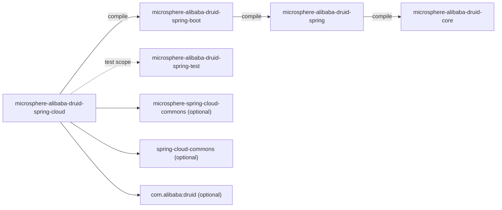
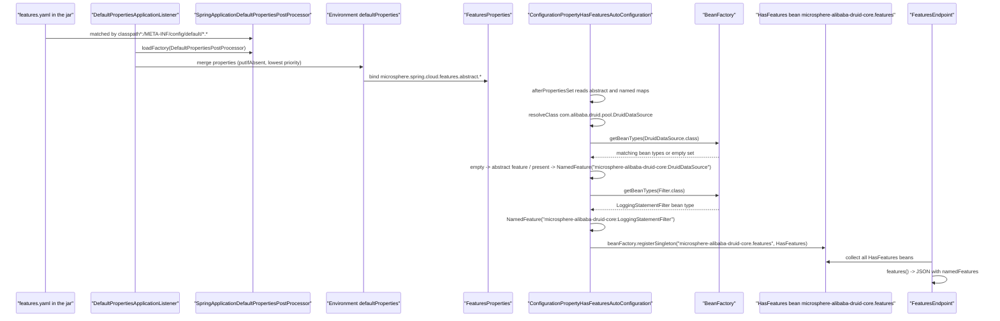

[English](../microsphere-alibaba-druid-spring-cloud.md)

# microsphere-alibaba-druid-spring-cloud

> Spring Cloud 层（L3）：通过 Microsphere Spring Cloud 的*特性（feature）*机制声明本项目的 Druid 能力，
> 使它们出现在 `/actuator/features` 端点中；同时提供一个最顶层的自动配置外壳，由同一个
> `microsphere.alibaba.druid.enabled` 开关把关。
> 包根：`io.microsphere.alibaba.druid.spring.cloud.autoconfigure`。Java 基线：**JDK 17**。
> 项目主页：[../../../../README.md](../../../../README.md) · 使用方式：[用户文档](../../user-guide/zh/microsphere-alibaba-druid-spring-cloud.md)

## 架构位置

`spring-cloud` 位于 `spring-boot` 之上（它唯一的 `compile` 反应堆依赖），除一个带条件的自动配置外壳之外**不**新增
任何运行时类。它真正的产物是一份*资源*：`META-INF/config/default/features.yaml`，由
`microsphere-spring-cloud-commons` 消费，而不是由本模块自己的代码消费。



| 依赖 | 作用域 | 为什么需要 |
|---|---|---|
| `microsphere-alibaba-druid-spring-boot` (`${revision}`) | compile | 复用 `ConditionalOnAlibabaDruidAvailable` 与 `AlibabaDruidProperties`；同时引入 Boot 的自动配置，因为这个外壳从来不是独立工作的。 |
| `microsphere-spring-cloud-commons` | optional | `ConfigurationPropertyHasFeaturesAutoConfiguration`、`FeaturesProperties`、`FeaturesUtils`、`@ConditionalOnFeaturesAvailable`——特性目录的机器。 |
| `spring-cloud-commons` | optional | `HasFeatures`、`NamedFeature`、`FeaturesEndpoint`（本模块声明特性所面向的 Actuator 契约）。 |
| `com.alibaba:druid` | optional | `features.yaml` 中列出的两个特性类。 |
| `spring-boot-starter`、`spring-boot-starter-actuator` | optional | 自动配置基础设施，以及 `/actuator/features` 端点。 |
| `spring-boot-configuration-processor`、`spring-boot-autoconfigure-processor`、`microsphere-annotation-processor` | optional | 编译期元数据生成。 |
| `junit-jupiter`、`spring-boot-starter-test`、`microsphere-spring-boot-test`、`microsphere-alibaba-druid-spring-test` (`${revision}`)、`microsphere-logback`、`h2`、`logback-classic` | test | 见[测试策略](#测试策略)。 |

## 源码分析

本模块只有**一个**生产类与**两份**资源。

### `io.microsphere.alibaba.druid.spring.cloud.autoconfigure.AlibabaDruidCloudAutoConfiguration`

```java
@ConditionalOnAlibabaDruidAvailable
public class AlibabaDruidCloudAutoConfiguration {
}
```

- 类体是刻意留空的：没有 `@Bean` 方法、没有字段、没有逻辑。它的全部含义由其*存在本身*承载——作为
  `META-INF/spring/org.springframework.boot.autoconfigure.AutoConfiguration.imports` 里的一行，加上它的条件。
- 它的 Javadoc 阐明了意图：*"当 Spring Cloud 在 classpath 上且 Alibaba Druid 可用时，该自动配置会把 Druid 特性
  注册到 Spring Cloud Actuator。* 注册动作**不是**在这里完成的——它通过 `features.yaml` 声明式地、并通过外部
  `microsphere-spring-cloud-commons` 里的 `ConfigurationPropertyHasFeaturesAutoConfiguration` 完成。
- `@ConditionalOnAlibabaDruidAvailable` 是从 `spring-boot` 模块 import 过来的
  （`@ConditionalOnProperty(microsphere.alibaba.druid.enabled, matchIfMissing = true)` 与
  `@ConditionalOnClass(name = "com.alibaba.druid.pool.DruidDataSource")` 的组合），因此一个属性就能同时关掉 Boot 层
  与 Cloud 层。
- 它**没有**再加 `@ConditionalOnClass(HasFeatures.class)`：Spring Cloud 的可用性是在特性真正被消费的地方把关的
  （`ConfigurationPropertyHasFeaturesAutoConfiguration` 上的 `@ConditionalOnFeaturesAvailable`，以及端点侧的
  `@ConditionalOnFeaturesEnabled`）。实际后果是：关闭特性（`spring.cloud.features.enabled=false`）时这个类仍然生效，
  只是不会出现任何 `HasFeatures` bean。
- 由于没有声明任何 bean，依赖本模块的应用并不会因为这个类而新增什么——它是一个有文档、可检索的占位符，
  代表资源贡献以及未来的 Spring Cloud 专属 bean（例如 Druid 感知的 `@RefreshScope` 监听器）。

### `src/main/resources/META-INF/spring/org.springframework.boot.autoconfigure.AutoConfiguration.imports`

```text
io.microsphere.alibaba.druid.spring.cloud.autoconfigure.AlibabaDruidCloudAutoConfiguration
```

与 `spring-boot` 模块一样采用仅 Boot 3 的风格：该线上没有 `META-INF/spring.factories`。

### `src/main/resources/META-INF/config/default/features.yaml`

```yaml
microsphere:
  spring:
    cloud:
      features:
        abstract:
          microsphere-alibaba-druid-core:
            - com.alibaba.druid.pool.DruidDataSource
            - com.alibaba.druid.filter.Filter
```

这份文件才是本模块的实质内容。对照外部机制逐段解读：

| 路径片段 | 含义 |
|---|---|
| `microsphere.spring.cloud.features` | `FeaturesConstants.PROPERTY_NAME_PREFIX`，由 `FeaturesProperties` 绑定。 |
| `abstract` | `FeaturesConstants.ABSTRACT`——*抽象*特性：每个模块名下一份**特性类全名**列表（`Map<String, List<String>>`）。兄弟键 `named` 则是 `module → (feature-name → class-name)`。 |
| `microsphere-alibaba-druid-core` | **模块名**，刻意使用 `core` 的构件名而不是 `spring-cloud`：被声明的能力（Druid 数据源与 Druid filter）属于 `core`，最终的特性名也以它为限定前缀。 |
| 两个类名 | `DruidDataSource`（连接池能力）与 `Filter`（拦截能力），以字符串书写，因此在缺少该库时不会触发任何类加载。 |

这些字符串如何变成端点输出（外部：`microsphere-spring-cloud-commons` + `microsphere-spring-boot-core`）：

1. `features.yaml` **不是**由本模块读取的。`DefaultPropertiesApplicationListener`（来自
   `microsphere-spring-boot-core`，是一个 `ApplicationListener<ApplicationEnvironmentPreparedEvent>`，
   order 为 `LOWEST_PRECEDENCE - 1`）会加载所有通过 `spring.factories` 发现的 `DefaultPropertiesPostProcessor`；
   `SpringApplicationDefaultPropertiesPostProcessor` 提供了模式
   `classpath*:/META-INF/config/default/*.*`，于是这份 YAML 被合并进 `defaultProperties` 映射——Boot 中优先级最低的
   属性源（`putIfAbsent`，因此应用自己的取值永远胜出）。
2. `ConfigurationPropertyHasFeaturesAutoConfiguration`
   （`@Configuration(proxyBeanMethods = false)` + `@ConditionalOnFeaturesAvailable` +
   `@AutoConfigureBefore(name = "org.springframework.cloud.client.CommonsClientAutoConfiguration")` +
   `@EnableConfigurationProperties(FeaturesProperties.class)`）在 `afterPropertiesSet()` 中执行：它遍历 `abstract`
   与 `named` 两个映射，并逐个解析类名（`ClassLoaderUtils.resolveClass`；解析不到则 `logger.warn` 后跳过，绝不失败）。
3. 对一个抽象特性类，它会询问 bean 工厂是否存在匹配的类型
   （`BEAN_FACTORY.getBeanTypes(beanFactory, featureClass)`）：
   * **没有**匹配的 bean → 该类保留为普通的*抽象特性*（放进 `Set<Class<?>>`），即"这个能力在 classpath 上"；
   * **有一个或多个**匹配的 bean → 每个 bean 类型都会变成一个 `NamedFeature`，其简单名取自
     `ClassUtils.getSimpleName(beanType)`，并限定为 `moduleName + ":" + simpleName`。
4. named 特性存放在使用 `NamedFeatureComparator.INSTANCE` 的 `TreeSet` 中，因此上报顺序稳定
   （集成测试正是依赖这一点）。
5. 每个模块创建一个 `HasFeatures`，并以**单例**方式注册在
   `getHasFeaturesBeanName(moduleName)` = `moduleName + ".features"` 之下——这里是
   `microsphere-alibaba-druid-core.features`。
6. Spring Cloud 的 `FeaturesEndpoint` 会聚合所有 `HasFeatures` bean；端点被暴露时 Actuator 在 `/actuator/features`
   提供输出。

对本项目测试上下文的推论：`DruidDataSource` 匹配 `DruidDataSourceTestConfiguration` 的那个 prototype bean，
`Filter` 匹配测试类上声明的 `LoggingStatementFilter` bean，于是**两条**抽象条目都被升级为 named 特性，
该模块恰好上报两个 `NamedFeature`。反之，若某个应用 classpath 上有 Druid 但没有 filter bean，`Filter` 就会停留在
抽象特性。

## Cloud features activation flow



## 测试策略

两个测试，依旧按"条件契约"与"真实行为"划分。

| 测试 | 类型 | 钉死了什么 |
|---|---|---|
| `AlibabaDruidCloudAutoConfigurationTest` | `AutoConfigurationTest<AlibabaDruidCloudAutoConfiguration>`，`@SpringBootTest(classes = {AlibabaDruidCloudAutoConfigurationTest.class}, webEnvironment = NONE)`，`configureAutoConfiguredClasses` 覆写为**空实现**，禁用属性 `microsphere.alibaba.druid.enabled=false`，缺失类 `DruidDataSource.class` | 该外壳的生效/失效与 Boot 自动配置完全一致。由于 `getAutoConfiguredClasses()` 总会把泛型自动配置类放在首位，继承来的 `testAutoConfiguredClasses` 仍然断言存在唯一的 `AlibabaDruidCloudAutoConfiguration` bean，而空覆写没有追加任何额外期望——这正是"本类不贡献任何 bean"的诚实表达。 |
| `AlibabaDruidCloudAutoConfigurationIntegrationTest` | `@SpringBootTest(classes = {LoggingStatementFilter.class, DruidDataSourceTestConfiguration.class, itself}, webEnvironment = NONE, properties = {"microsphere.alibaba.druid.enabled=true", "management.endpoints.web.exposure.include=features", "spring.cloud.features.enabled=true", "microsphere.alibaba.druid.filter.classes=io.microsphere.alibaba.druid.filter.LoggingStatementFilter"})` + `@EnableAutoConfiguration`，继承 `AbstractDruidSpringTest` | 特性目录的端到端验证：注入 `Map<String, HasFeatures>` 与 `FeaturesEndpoint`，断言 map 非空，取出 `"microsphere-alibaba-druid-core.features"`，断言 `namedFeatures.size() == 2`，随后校验索引 0 = 名称 `"microsphere-alibaba-druid-core:DruidDataSource"` / 类型 `DruidDataSource.class`，索引 1 = `"microsphere-alibaba-druid-core:LoggingStatementFilter"` / 类型 `LoggingStatementFilter.class`，最后 `assertNotNull(featuresEndpoint.features())`。注意这里**没有**调用继承来的 `super.test()`——只跑特性相关断言，因为 SQL 行为已在 Boot 模块覆盖。 |

断言为何这样写：

- 期望名称里内嵌了 `features.yaml` 的模块键，因此改动 YAML 里的键名会让测试失败——这是资源与测试之间刻意的耦合。
- 索引 1 断言的是 `LoggingStatementFilter.class`（而不是 `Filter.class`），这正是上文第 3 步的可执行证明：
  抽象的 `Filter` 条目被按真实 bean 类型解析了。
- 尽管外部 `@ConditionalOnFeaturesEnabled` 使用了 `matchIfMissing = true`，测试仍显式写出
  `spring.cloud.features.enabled=true`，使其不依赖那个默认值。

## 设计模式

| 模式 | 位置 |
|---|---|
| 声明式配置优于代码 | `features.yaml` 取代了本应写成的 `@Bean HasFeatures` 方法。 |
| 标记 / 占位自动配置 | 空的 `AlibabaDruidCloudAutoConfiguration` 外壳，为一项资源贡献把关。 |
| 注册表 | `ConfigurationPropertyHasFeaturesAutoConfiguration` 按模块名注册每个 `HasFeatures` 单例。 |
| classpath 扫描的默认属性 | `DefaultPropertiesApplicationListener` + `SpringApplicationDefaultPropertiesPostProcessor`。 |
| 特性开关 | `microsphere.alibaba.druid.enabled`（与 `spring-boot` 共享）以及 `spring.cloud.features.enabled`（外部）。 |

## 扩展点与注意事项

- **声明新的能力**：在 `abstract.microsphere-alibaba-druid-core` 下加一个类名（例如
  `com.alibaba.druid.pool.DruidDataSourceMBean`）即可，无需改代码。若能力与框架相关，更宜使用**新的模块键**
  （例如 `microsphere-alibaba-druid-spring`），因为这个键会成为上报特性名的一部分。
- **谨慎对待模块键的重命名**：`microsphere-alibaba-druid-core` 原样出现在 `features.yaml`、`HasFeatures` 的 bean 名
  （`…​.features`）以及每一个 `NamedFeature` 名（`…​:SimpleName`）中，并被集成测试断言。它是一个对外上报契约。
- **抽象 vs. named 取决于上下文**：同一条 YAML 记录，在没有对应 bean 的应用里是抽象特性，在有对应 bean 的应用里是
  named 特性。监控面板不应假定数量固定。
- **不要在这里为 Spring Cloud 类型添加 `@ConditionalOnClass`**：该类必须在缺少这些依赖时依然可编译、可加载，
  而且特性机器自身已经有条件（`@ConditionalOnFeaturesAvailable`）。硬加 Spring Cloud 条件还会牵连
  `AlibabaDruidCloudAutoConfigurationTest`——它的 `FilteredClassLoader` 检查目前用的是 `DruidDataSource`。
- **端点可见性**同时需要 `management.endpoints.web.exposure.include=features` 与 Actuator 的 web 环境；
  测试以 `webEnvironment = NONE` 运行并直接调用 `featuresEndpoint.features()`。
- **排除该模块**（`spring-boot-starter`/`spring-cloud-commons` 都是 `optional`）只有在 JAR 真正不存在时才会移除特性目录；
  JAR 存在时 `features.yaml` 仍会被合并，而解析不到的类名只会降级为警告，不会报错。

## current 线说明

- 这里同样只发布 `AutoConfiguration.imports`，与 `spring-boot` 模块保持一致；`release-1.x` 还带有 Boot 2 的
  `spring.factories` 变体。
- Spring Cloud 的版本号**是继承而来、并非本模块声明**：`spring-cloud-commons` 与
  `microsphere-spring-cloud-commons` 的取值由 `microsphere-alibaba-druid-parent` 导入的
  `microsphere-spring-cloud-dependencies:0.2.26` 以及 `microsphere-spring-cloud-parent:0.2.26` 中启用的
  `spring-cloud-2022` … `spring-cloud-2025` profile 决定（见[构建与 CI](README.md#5-building-and-ci)）。
  由于 `spring-cloud-2025` profile 是 `activeByDefault`，本模块默认即以 Cloud 2025.0.3 / Boot 3.5.15 编译，
  而本仓库里没有任何版本号。
- `NamedFeature` 的名字使用冒号分隔（`getQualifierFeatureName`），因此 `microsphere-alibaba-druid-core:DruidDataSource`
  是一个不可拆分的字符串，而不是 YAML 路径。
- Javadoc 中的 `@since 1.0.0` 是血统标记，不是构件版本（撰写本文档时 `${revision}` = `0.2.22-SNAPSHOT`）。

## 相关文档

- [开发者文档索引](README.md)
- [microsphere-alibaba-druid-spring-boot](microsphere-alibaba-druid-spring-boot.md)
- [microsphere-alibaba-druid-core](microsphere-alibaba-druid-core.md)
- [microsphere-alibaba-druid-spring](microsphere-alibaba-druid-spring.md)
- [microsphere-alibaba-druid-spring-test](microsphere-alibaba-druid-spring-test.md)
- [用户文档 —— spring-cloud](../../user-guide/zh/microsphere-alibaba-druid-spring-cloud.md)
- [项目 README](../../../../README.md)

---

## English

[English version: microsphere-alibaba-druid-spring-cloud](../microsphere-alibaba-druid-spring-cloud.md)
