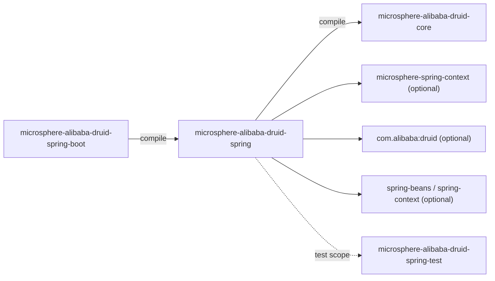
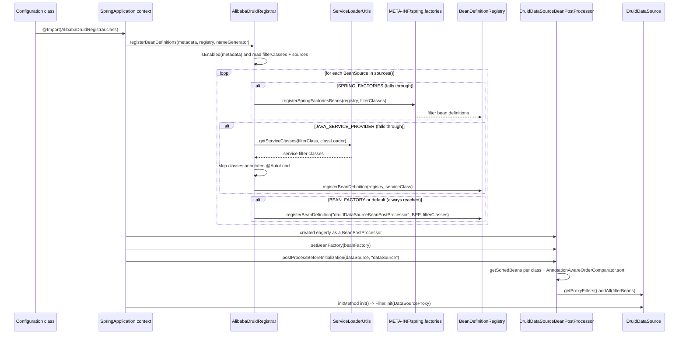
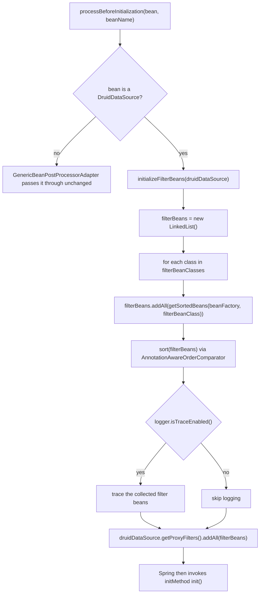

[English](../microsphere-alibaba-druid-spring.md)

# microsphere-alibaba-druid-spring

> Spring Framework 层（L1）：从多个注册源发现 `com.alibaba.druid.filter.Filter` bean，并在初始化之前把它们注入到
> 每一个 `DruidDataSource`。包根：`io.microsphere.alibaba.druid.spring.context.annotation`、
> `io.microsphere.alibaba.druid.spring.beans.factory.config`。Java 基线：**JDK 17**。
> 项目主页：[../../../../README.md](../../../../README.md) · 使用方式：[用户文档](../../user-guide/zh/microsphere-alibaba-druid-spring.md)

## 架构位置

`spring` 是唯一对 `core` 存在硬（`compile`）依赖的模块；它**不**新增任何拦截逻辑——它做的一切都是发现、注册与注入。
它对 Spring 与 Druid 自身的依赖都是 `optional`，因此不使用 Spring Framework 的应用不会损失任何东西。



| 依赖 | 作用域 | 为什么需要 |
|---|---|---|
| `microsphere-alibaba-druid-core` (`${revision}`) | compile | 它注册的 `Filter` 子类；唯一必需的反应堆依赖。 |
| `microsphere-spring-context` | optional | `BeanSource`、`AnnotatedBeanCapableImportBeanDefinitionRegistrar`、`GenericBeanPostProcessorAdapter`、`BeanRegistrar`、`AnnotationAttributes` 等工具。 |
| `com.alibaba:druid` | optional | `Filter`、`AutoLoad`、`DruidDataSource`。 |
| `spring-beans`、`spring-context` | optional | `BeanDefinitionRegistry`、`ImportBeanDefinitionRegistrar`、`AnnotationAwareOrderComparator`、`BeansException`。 |
| `spring-test` | optional | 由 `AbstractDruidSpringTest` 通过 `microsphere-alibaba-druid-spring-test` 间接使用。 |
| `microsphere-alibaba-druid-spring-test`、`junit-jupiter`、`h2`、`microsphere-spring-test`、`microsphere-logback`、`logback-classic` | test | 见 [microsphere-alibaba-druid-spring-test](microsphere-alibaba-druid-spring-test.md)。 |

## 源码分析

### `io.microsphere.alibaba.druid.spring.context.annotation.EnableAlibabaDruid`

```java
@Target({TYPE, ANNOTATION_TYPE})
@Retention(RUNTIME)
@Documented
@Import(AlibabaDruidRegistrar.class)
public @interface EnableAlibabaDruid {

    Class<? extends Filter>[] filterClasses() default {Filter.class};

    BeanSource[] sources() default {BEAN_FACTORY, SPRING_FACTORIES};
}
```

- `@Target({TYPE, ANNOTATION_TYPE})`——该注解既可以直接标注在 `@Configuration` 类上，**也**可以作为元注解出现在项目自
  定义的组合注解上；`@Retention(RUNTIME)` 是抽取 `AnnotationMetadata` 属性的必要条件，`@Documented` 用于 Javadoc 传递。
- `@Import(AlibabaDruidRegistrar.class)` 就是完整的激活机制：没有 `@Bean` 方法、没有 XML、也没有 `spring.factories`
  条目。由于注册器是被 `@Import` 进来的，它参与配置类解析，因此运行在任何 bean 实例创建**之前**——这正是原型（prototype）
  作用域数据源能够生效的原因。
- `filterClasses()` 默认 `{Filter.class}`，即 Druid 的根接口：所选来源中发现的*每一个* filter 都符合条件。收窄它
  （`@EnableAlibabaDruid(filterClasses = AbstractStatementFilter.class)`）是一种**发现范围**的收窄，而不是运行时过滤器
  ——该数组被用作对每个来源查询时的键。
- `sources()` 默认 `{BEAN_FACTORY, SPRING_FACTORIES}`：已作为 Spring bean 存在的 filter，加上声明在
  `META-INF/spring.factories` 中的 filter。`JAVA_SERVICE_PROVIDER` **不是**默认值——显式加上它才会启用
  `ServiceLoader` 风格的 `META-INF/services/<filterClass>` 发现。
- `BeanSource` 是外部 Microsphere 枚举，常量依次为 `BEAN_FACTORY`、`SPRING_FACTORIES`、`JAVA_SERVICE_PROVIDER`
  （在 `io.microsphere.spring.beans.BeanSource` 中按此顺序声明）。

### `io.microsphere.alibaba.druid.spring.context.annotation.AlibabaDruidRegistrar`

```java
class AlibabaDruidRegistrar extends AnnotatedBeanCapableImportBeanDefinitionRegistrar<EnableAlibabaDruid> {

    @Override
    protected void registerBeanDefinitions(AnnotationMetadata metadata, BeanDefinitionRegistry registry,
                                           BeanNameGenerator importBeanNameGenerator,
                                           ResolvablePlaceholderAnnotationAttributes<EnableAlibabaDruid> annotationAttributes) {
        Class<? extends Filter>[] filterClasses = (Class<? extends Filter>[]) annotationAttributes.getClassArray("filterClasses");
        BeanSource[] sources = (BeanSource[]) annotationAttributes.get("sources");
        registerFilterBeans(registry, filterClasses, sources);
    }

    private void registerFilterBeans(BeanDefinitionRegistry registry, Class<? extends Filter>[] filterClasses, BeanSource[] sources) {
        for (BeanSource source : sources) {
            switch (source) {
                case SPRING_FACTORIES:
                    registerFiltersBySpringFactories(registry, filterClasses);
                case JAVA_SERVICE_PROVIDER:
                    registerFiltersByJavaServiceProvider(registry, filterClasses);
                case BEAN_FACTORY:
                default:
                    registerDruidDataSourceBeanPostProcessor(registry, filterClasses);
            }
        }
    }
    ...
}
```

**刻意保持包级私有。** 该类不对外导出；`@EnableAlibabaDruid` 是唯一入口。使用者 jar 若不重新声明注解就无法继承它。

**`switch` 的 fall-through 是有意为之，不是漏写 `break`。** 这里没有任何 `break` 语句，因此每个 case 都会执行
*它自己以及它下面的全部语句*：

| `source` 取值 | 效果链（自上而下） |
|---|---|
| `SPRING_FACTORIES` | 注册 spring.factories 中的 filter bean → 接着注册 `META-INF/services` 中的 filter bean → 接着注册 `DruidDataSourceBeanPostProcessor` |
| `JAVA_SERVICE_PROVIDER` | 注册 `META-INF/services` 中的 filter bean → 接着注册 `DruidDataSourceBeanPostProcessor` |
| `BEAN_FACTORY` | 只注册 `DruidDataSourceBeanPostProcessor`（已存在的 bean 无需注册） |
| 未来任何常量（`default`） | 只注册 `DruidDataSourceBeanPostProcessor` |

由于 `for` 循环按注解上书写的顺序遍历 `sources()`，`EnableAlibabaDruidTest` 使用的
`{BEAN_FACTORY, SPRING_FACTORIES, JAVA_SERVICE_PROVIDER}` 会执行三次后处理器注册、两种发现机制各一次。
重复注册是安全的：后处理器的 bean 定义始终以固定名 `druidDataSourceBeanPostProcessor` 注册、构造参数相同，因此后面的定义
只是覆盖前面的。**不要**在没补上显式 `registerDruidDataSourceBeanPostProcessor` 调用的前提下去"清理"这段 fall-through——
否则单靠 `BEAN_FACTORY` 永远不会安装后处理器，任何 filter 也就永远到不了 `DruidDataSource`。

**逐来源的辅助方法。**

```java
private void registerFiltersBySpringFactories(BeanDefinitionRegistry registry, Class<? extends Filter>[] filterClasses) {
    registerSpringFactoriesBeans(registry, filterClasses);
}

private void registerFiltersByJavaServiceProvider(BeanDefinitionRegistry registry, Class<? extends Filter>[] filterClasses) {
    for (Class<? extends Filter> filterClass : filterClasses) {
        Set<? extends Class<? extends Filter>> serviceClasses = getServiceClasses(filterClass, classLoader);
        for (Class<? extends Filter> serviceClass : serviceClasses) {
            if (serviceClass.isAnnotationPresent(AutoLoad.class)) {
                // Any filter class annotated @AutoLoad will be added into DruidDataSource automatically,
                // so it will be ignored here.
                continue;
            }
            registerBeanDefinition(registry, serviceClass);
        }
    }
}

private void registerDruidDataSourceBeanPostProcessor(BeanDefinitionRegistry registry, Class<? extends Filter>[] filterClasses) {
    String beanName = BEAN_NAME;
    Class<?> beanClass = DruidDataSourceBeanPostProcessor.class;
    Object argument = filterClasses;
    registerBeanDefinition(registry, beanName, beanClass, argument);
}
```

- `registerSpringFactoriesBeans(...)`（外部 `io.microsphere.spring.beans.factory.support.BeanRegistrar`）读取
  `META-INF/spring.factories`，把 `filterClasses` 的每一项当作**属性键**，并把它列出的每个实现类注册为 Spring bean。
  本模块测试资源里的键是 `io.microsphere.alibaba.druid.filter.AbstractStatementFilter`，因此只有该精确键才会产出
  `TestStatementFilter`。
- `getServiceClasses(filterClass, classLoader)`（外部 `io.microsphere.util.ServiceLoaderUtils`）读取
  `META-INF/services/<filterClass>` 并**加载**列出的类（快速失败：无法加载或类型不可赋值会抛
  `IllegalStateException`）。此处不做实例化——所以 `@AutoLoad` 的甄别作用在类上而不是实例上。
- 带 `@AutoLoad` 的类被刻意跳过：Druid 自己会把 `AutoLoad` filter 加入数据源，若再注册为 Spring bean 就会被添加两次。
- `registerBeanDefinition(registry, serviceClass)` 创建一个 bean 名自动生成的通用 bean 定义；
  `registerBeanDefinition(registry, beanName, beanClass, argument)` 以固定名 `druidDataSourceBeanPostProcessor` 创建，
  并把 `filterClasses` 作为**构造参数**传入——注解的 `filterClasses` 就是这样传递给后处理器的。
- 基类还会用 `isEnabled(metadata)` 把关整个注册器（按导入类 / 全局解析的启用属性，默认为 `true`），并在调用该方法前
  解析注解属性里的占位符。`classLoader` 同样继承自基类。

### `io.microsphere.alibaba.druid.spring.beans.factory.config.DruidDataSourceBeanPostProcessor`

```java
public class DruidDataSourceBeanPostProcessor extends GenericBeanPostProcessorAdapter<DruidDataSource>
        implements BeanFactoryAware {

    private static final Logger logger = getLogger(DruidDataSourceBeanPostProcessor.class);

    public static final String BEAN_NAME = "druidDataSourceBeanPostProcessor";

    private final Class<? extends Filter>[] filterBeanClasses;

    private BeanFactory beanFactory;

    public DruidDataSourceBeanPostProcessor() { this(of(Filter.class)); }

    public DruidDataSourceBeanPostProcessor(Class<? extends Filter>[] filterBeanClasses) { ... }

    @Override protected void processBeforeInitialization(DruidDataSource druidDataSource, String beanName) throws BeansException {
        initializeFilterBeans(druidDataSource);
    }

    protected void initializeFilterBeans(DruidDataSource druidDataSource) {
        List<Filter> filterBeans = new LinkedList<>();
        for (Class<? extends Filter> filterBeanClass : filterBeanClasses) {
            filterBeans.addAll(getSortedBeans(this.beanFactory, filterBeanClass));
        }
        sort(filterBeans);
        if (logger.isTraceEnabled()) { ... }
        druidDataSource.getProxyFilters().addAll(filterBeans);
    }

    @Override public void setBeanFactory(BeanFactory beanFactory) throws BeansException { this.beanFactory = beanFactory; }
}
```

- `GenericBeanPostProcessorAdapter<DruidDataSource>`（外部）负责类型甄别：只有类型与解析出的泛型参数匹配的 bean 才会回调
  `processBeforeInitialization`，因此非 Druid 数据源不受影响。这就是该类从不直接实现 `BeanPostProcessor` 方法的原因。
- `BEAN_NAME` 是与 Boot 层共享的契约：`AlibabaDruidAutoConfiguration#druidDataSourceBeanPostProcessor` 声明为
  `@Bean(name = BEAN_NAME)`，因此手工 `@EnableAlibabaDruid` 注册与自动配置会合并为**一个** bean 定义，而不会堆叠成两个。
- 无参构造等价于 `new DruidDataSourceBeanPostProcessor(of(Filter.class))`——"添加所有 filter bean"。注册器与 Boot 使用的是
  数组构造器。
- `initializeFilterBeans` 是**先收集再排序**：`getSortedBeans` 按每个类型分别排序，
  `AnnotationAwareOrderComparator.sort(filterBeans)` 再对合并后的列表整体重排，因此 filter bean 上的 `@Order` /
  `Ordered` / `PriorityOrdered` 决定了它在 Druid `FilterChain` 中的位置。
- 结果通过 `getProxyFilters().addAll(...)` 追加：filter 只被**添加**，从不被移除或替换；若注册了两个后处理器就可能出现
  重复（通过保持单一 `BEAN_NAME` 来规避）。
- 需要 `BeanFactoryAware`，因为 filter 的查找发生在每个数据源实例创建时，而不是注册器执行时。
- 由于它本身是 `BeanPostProcessor`，Spring 会**提前**实例化它，早于常规 bean；因此 filter 类不能依赖延迟创建的基础设施，
  否则那些 bean 会被过早创建（即 Spring 经典的 "is not eligible for getting processed by all BeanPostProcessors" 警告）。

## @EnableAlibabaDruid registration flow



### 后处理器决策细节



## 测试夹具即行为规格

本模块的 `src/test` 目录树就是三种来源的可执行规格：

| 夹具 | 内容 | 证明了什么 |
|---|---|---|
| `src/test/resources/META-INF/spring.factories` | `io.microsphere.alibaba.druid.filter.AbstractStatementFilter=\` + `io.microsphere.alibaba.druid.filter.TestStatementFilter` | 只有当 `filterClasses` 含精确键类型 `AbstractStatementFilter` 时，`SPRING_FACTORIES` 分支才会注册 `TestStatementFilter`。 |
| `src/test/resources/META-INF/services/io.microsphere.alibaba.druid.filter.AbstractStatementFilter` | `io.microsphere.alibaba.druid.filter.AutoLoadFilter`、`io.microsphere.alibaba.druid.filter.LoadFilter` | `JAVA_SERVICE_PROVIDER` 分支按 `filterClasses` 每一项命名读取服务文件。 |
| `AutoLoadFilter` | `@AutoLoad class AutoLoadFilter extends AbstractStatementFilter`，回调方法为空 | 证明 `isAnnotationPresent(AutoLoad.class) → continue` 的跳过路径。 |
| `LoadFilter` | 普通的 `extends AbstractStatementFilter`，回调方法为空 | 证明非 `@AutoLoad` 的服务类会成为 Spring bean。 |
| `TestStatementFilter` | 回调中调用 `assertNotNull(statement)` | 真实语句执行中出现的任何断言失败，都说明该 filter 确实到达了 `beforeExecute`/`afterExecute`。 |
| `EnableAlibabaDruidTest` | `@SpringJUnitConfig({LoggingStatementFilter.class, DruidDataSourceTestConfiguration.class, EnableAlibabaDruidTest.class})` + `@EnableAlibabaDruid(filterClasses = AbstractStatementFilter.class, sources = {BEAN_FACTORY, SPRING_FACTORIES, JAVA_SERVICE_PROVIDER})`，继承 `AbstractDruidSpringTest` | 三种来源同时生效；继承来的 `test()` 会跑完整 DML/DQL 用例，因此每个注册的 filter 都被初始化并执行到。 |
| `DruidDataSourceBeanPostProcessorTest` | `@SpringLoggingTest`、`@ExtendWith(SpringExtension.class)`、`@ContextConfiguration({LoggingStatementFilter.class, DruidDataSourceTestConfiguration.class, DruidDataSourceBeanPostProcessor.class, ...})`，继承 `AbstractDruidSpringTest` | 把后处理器**作为普通 bean 类**注册（不使用 `@EnableAlibabaDruid`），证明构造注入路径可独立工作。 |

注意共享的数据源装配：`DruidDataSourceTestConfiguration` 声明的是
`@Bean(initMethod = "init", destroyMethod = "close") @Scope(SCOPE_PROTOTYPE)`，所以每次
`getBean(DruidDataSource.class)` 都会新建一个连接池，`init` 回调作为 Spring 初始化流程的一部分执行，而后处理器钩子发生在
该回调*之前*——正是 `AbstractStatementFilter#init` 所依赖的顺序。

## 设计模式

| 模式 | 位置 |
|---|---|
| `@Import` + `ImportBeanDefinitionRegistrar` | `EnableAlibabaDruid` → `AlibabaDruidRegistrar`。 |
| 模板方法（注册器层面） | `AnnotatedBeanCapableImportBeanDefinitionRegistrar` 固定了启用检查与属性解析步骤，子类只提供注册主体。 |
| 策略 / 多来源发现 | `BeanSource[]` + `switch` fall-through。 |
| Bean 后处理器 | `DruidDataSourceBeanPostProcessor` 在 bean 的 init 回调之前修改该 bean。 |
| 类型安全的泛型分派 | `GenericBeanPostProcessorAdapter<DruidDataSource>`。 |
| 空对象（Null Object） | `of(Filter.class)` 默认构造——用"全部接受"代替 `null`。 |

## 扩展点

- **新增发现来源**：在 `registerFilterBeans` 里把新的 `case` 加在 `BEAN_FACTORY` **之上**，让 fall-through 仍然安装
  后处理器；把 case 加在 `default:` *之后* 会静默地什么都不做。
- **自定义注入时机**：继承 `DruidDataSourceBeanPostProcessor` 并覆写 `initializeFilterBeans(DruidDataSource)`；
  若要保持与 Boot 层兼容，请以 `BEAN_NAME` 注册。
- **按数据源定制 filter**：不要用这个后处理器（它作用于*所有* `DruidDataSource` bean）——在调用 `init()` 之前用
  `getProxyFilters().add(...)` 显式添加。
- **filter 顺序**：在 filter bean 上加 `@Order`/`Ordered`；`AnnotationAwareOrderComparator.sort` 保证链上的相对顺序。

## current 线说明

- 本模块 `src/main/resources` 中**没有** `spring.factories`：只有*测试*资源里有一份，而那份文件是 `SPRING_FACTORIES`
  发现分支的夹具，不是自动配置注册。
- 在该线上源码以 `maven.compiler.source/target=17` 编译，因此对枚举做 `switch` fall-through 依然合法，但它不是现代写法；
  这里是为了与 `release-1.x` 保持字节级对等而刻意保留的。此处的任何改动都必须前向合并（forward-port）到那个分支。
- `spring-beans`/`spring-context` 是 `optional`：模块内没有任何东西传递性地引入 Spring，这让"只用 `core`"（纯 JDBC）
  的场景保持干净。

## 相关文档

- [开发者文档索引](README.md)
- [microsphere-alibaba-druid-core](microsphere-alibaba-druid-core.md)
- [microsphere-alibaba-druid-spring-boot](microsphere-alibaba-druid-spring-boot.md)
- [microsphere-alibaba-druid-spring-test](microsphere-alibaba-druid-spring-test.md)
- [用户文档 —— spring](../../user-guide/zh/microsphere-alibaba-druid-spring.md)
- [项目 README](../../../../README.md)

---

## English

[English version: microsphere-alibaba-druid-spring](../microsphere-alibaba-druid-spring.md)
