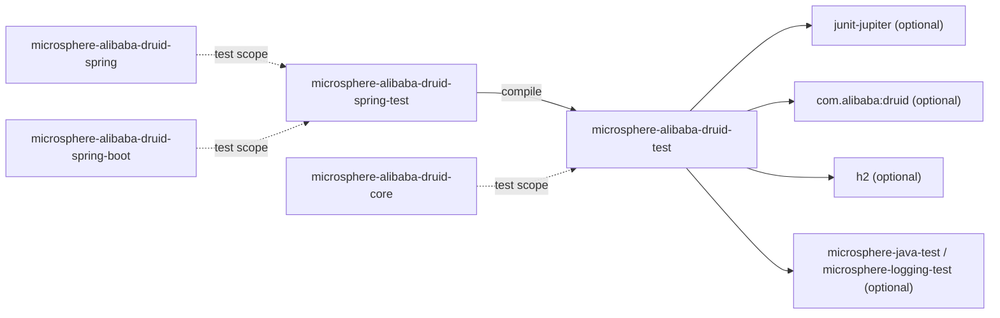
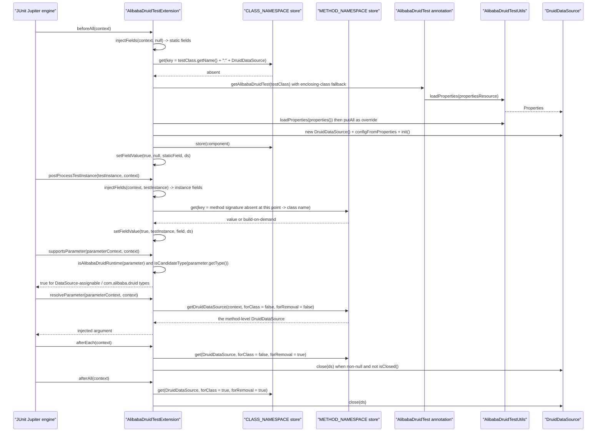

[English](../microsphere-alibaba-druid-test.md)

# microsphere-alibaba-druid-test

> 支撑层（T0）：一套不依赖任何框架的 Druid JUnit 5 测试工具——它针对内存版 H2 启动一个真实的 `DruidDataSource`，
> 把它注入到字段/参数中，并提供一份可执行的 DML/DQL 语句用例集，任何 filter 实现都必须能通过它。
> 包根：`io.microsphere.alibaba.druid.test`、`io.microsphere.alibaba.druid.test.junit.jupiter`。Java 基线：**JDK 17**。
> 项目主页：[../../../../README.md](../../../../README.md) · 使用方式：[用户文档](../../user-guide/zh/microsphere-alibaba-druid-test.md)

## 架构位置

`test` **对任何反应堆模块都没有 `compile` 依赖**——它只与 Druid、H2、JUnit 打交道。正因如此，`core` 才能在
test 作用域依赖它而不形成环。随后 Spring 感知的 `spring-test` 层在 compile 作用域扩展本模块，
而反应堆里的其他模块全部通过 test 作用域消费它。



| 依赖 | 作用域 | 为什么需要 |
|---|---|---|
| `org.junit.jupiter:junit-jupiter` | optional | 扩展 API（`ExtensionContext`、`Store`、`Namespace`、`ParameterResolver` 等）。刻意用 `optional`：测试支撑构件不该把某个 JUnit 版本强加给使用者。 |
| `com.alibaba:druid` | optional | `DruidDataSource.configFromProperties`、`init`、`isClosed`、`getProxyFilters`。 |
| `com.h2database:h2` | optional | 内置 `h2.properties` 面向的内存数据库。 |
| `microsphere-java-test`、`microsphere-logging-test` | optional | 本模块自身测试使用的 Microsphere 断言 / 日志测试助手。 |
| `microsphere-annotation-processor` | optional | 编译期元数据处理器，与整个反应堆保持一致。 |
| `ch.qos.logback:logback-classic` | optional | 声明为 optional（而不是 test 作用域），以便确实需要日志绑定的使用者可以依赖它。 |
| `microsphere-logback` | test | 仅在运行本模块自身测试时使用的日志绑定。 |

## 源码分析

五个生产类型：两个可复用的基类（`AlibabaDruidTestUtils`、`AbstractAlibabaDruidTest`）与一组 JUnit 5 扩展三件套
（`@AlibabaDruidTest`、`@AlibabaDruidRuntime`、`AlibabaDruidTestExtension`）。

### `io.microsphere.alibaba.druid.test.AlibabaDruidTestUtils`

```java
public abstract class AlibabaDruidTestUtils {

    public static final String H2_PROPERTIES_RESOURCE = "META-INF/druid/h2.properties";
    public static final String DEFAULT_PROPERTIES_RESOURCE = H2_PROPERTIES_RESOURCE;
    public static final String PACKAGE_NAME_PREFIX = "com.alibaba.druid.";

    @Nonnull public static Properties getDefaultProperties() throws IOException { return loadProperties(DEFAULT_PROPERTIES_RESOURCE); }
    @Nonnull public static Properties loadProperties(String resourceName) throws IOException { ... }
    @Nonnull public static Properties loadProperties(String[] keyValuePairs) throws IOException { ... }
    @Nonnull static Properties properties(String content) throws IOException { ... }
    @Nonnull public static DruidDataSource buildDefaultDruidDataSource() throws IOException { ... }
    @Nonnull public static DruidDataSource buildDruidDataSource(Properties properties) { ... }

    private AlibabaDruidTestUtils() {}
}
```

- `public abstract class` + `private` 构造器：Microsphere 里表示"不可实例化、不可继承"工具类的惯用法。
- 三个常量的作用远超本类：`DEFAULT_PROPERTIES_RESOURCE` 是 `@AlibabaDruidTest.propertiesResource()` 的*注解默认值*，
  `PACKAGE_NAME_PREFIX` 则是 `AlibabaDruidTestExtension.isAlibabaDruidClass` 使用的判定前缀。
- `loadProperties(String)` 通过 `ClassLoaderUtils.getResource` + `IOUtils.copyToString`（使用
  `CharsetUtils.DEFAULT_CHARSET`）在 try-with-resources 中读取；因此资源不存在时表现为 `NullPointerException`
  （在 `@throws RuntimeException` 注释里有说明），而不是一条友好的错误信息。
- `loadProperties(String[])` 用 `SeparatorConstants.LINE_SEPARATOR` 拼接数组项，再按 properties 文本解析——这就是
  `@AlibabaDruidTest(properties = {"druid.name=mysql", ...})` 能接受 `"key=value"` 字符串的原因。
- `properties(String)` 是**包级私有**的：解析原语被隐藏，对外只暴露两个 `loadProperties` 重载。
- `buildDruidDataSource(Properties)` 调用 `DruidDataSource.configFromProperties` 并返回一个**未初始化**的数据源：
  `init()` 刻意交由调用方（`AbstractAlibabaDruidTest.init` 或
  `AlibabaDruidTestExtension.buildDruidDataSource`）执行，从而保留先添加 filter 的机会。
- `buildDefaultDruidDataSource()` 声明 `throws IOException`，而 `buildDruidDataSource(Properties)` 不声明任何异常：
  只有读取资源这一步可能失败。

### `src/main/resources/META-INF/druid/h2.properties`

```properties
druid.name=h2
druid.url=jdbc:h2:mem:test_mem
druid.username=sa
druid.password=
druid.driverClassName=org.h2.Driver
```

- `druid.` 前缀正是 `configFromProperties` 期望的格式：它会剥掉前缀，把剩余部分作为 `DruidDataSource` 的 bean
  属性应用（于是 `druid.url` → `setUrl`）。
- `jdbc:h2:mem:test_mem` 是一个**具名**内存库，因此同一个 JVM 内多个数据源会共享 `users` 表，除非显式删除——
  这正是 `AbstractAlibabaDruidTest` 在每个测试建表又删表的原因。
- `druid.password=` 是刻意留空的；H2 接受 `sa`/空密码这一组。
- 没有设置任何连接池容量键，因此使用 Druid 默认值——`DruidDataSourcePoolMetadataTest` 断言的 `8`
  （`maxActive`、`maxIdle`）就来自这里。

### `io.microsphere.alibaba.druid.test.AbstractAlibabaDruidTest`

```java
public abstract class AbstractAlibabaDruidTest {

    private DruidDataSource dataSource;

    @BeforeEach public void init() throws Throwable {
        DruidDataSource dataSource = buildDruidDataSource();
        customize(dataSource);
        dataSource.init();
        this.dataSource = dataSource;
        initData();
    }

    protected DruidDataSource buildDruidDataSource() throws IOException { return buildDefaultDruidDataSource(); }
    protected void customize(DruidDataSource dataSource) {}
    protected DruidDataSource getDruidDataSource() { return this.dataSource; }

    @Test public void test() throws Throwable {
        testExecuteStatement();
        testExecutePreparedStatement();
    }

    @AfterEach public void destroy() throws Throwable {
        destroyData();
        DruidDataSource dataSource = getDruidDataSource();
        dataSource.close();
    }
}
```

- 这个类是**测试模板**，不是普通的基类工具：它靠继承生效（`extends AbstractAlibabaDruidTest`），而它的 `test()`
  带着 `@Test`，因此每个子类都自动继承一个真实测试——`core` 的 filter 测试与 Boot/Cloud 的集成测试正是这样跑 SQL 的。
- `@BeforeEach` 的顺序才是最关键的扩展点：`buildDruidDataSource()` → `customize(dataSource)` → `init()`。
  `customize` 就是在 `init()` **之前**往 `getProxyFilters()` 里添加 `com.alibaba.druid.filter.Filter` 实例的钩子，
  因为 Druid 在 `init` 期间构建 filter 链。
- `buildDruidDataSource()` 可被双重意义上覆写：既可以改变*属性来源*（Spring 变体的子类返回容器管理的数据源），
  也可以复用已注入的实例（见 `AlibabaDruidTestExtensionTest.FieldTest`）。
- `initData()` 以 `NO_GENERATED_KEYS` 执行 `CREATE TABLE users (id INT, name VARCHAR(50))`；`destroyData()` 删表，
  `destroy()` 关闭连接池。于是每个测试都在全新连接池上的全新表里运行。
- `testExecuteStatement()` 有意穷尽 JDBC `Statement` API：四个 `executeUpdate` 重载（`String`、`String, String[]`、
  `String, int[]`、`String, int`）、两次 `addBatch` + `assertArrayEquals(new int[]{1, 1}, executeBatch())`、
  `executeQuery`、一次 `UPDATE`、四个 `execute` 重载，最后 `DELETE FROM users`。
- `testExecutePreparedStatement()` 覆盖 `prepareStatement(String)`、带 `TYPE_FORWARD_ONLY` 的
  `prepareStatement(String, int)`、带 `CONCUR_UPDATABLE` 的 `prepareStatement(String, int, int)`。
  每个重载家族的每一个成员都要命中，因为在 `AbstractStatementFilter` 里它们是**各自独立的 `final` 覆写**——
  漏掉一个重载就是一个静默的拦截漏洞，而这套用例就是用来发现它的。
- 三个助手方法 `executeStatement` / `executePreparedStatement` / `executeConnection` 是嵌套的模板方法：
  前两者都委托给 `executeConnection`，后者从 `getDruidDataSource()` 取连接并在 `finally` 中关闭；
  中间层再在 `finally` 中关闭语句。所有方法都声明 `throws Throwable`，因为用的是 `ThrowableConsumer` 而不是 `Consumer`。

### `io.microsphere.alibaba.druid.test.junit.jupiter.AlibabaDruidTest`

```java
@Target(TYPE)
@Retention(RUNTIME)
@ExtendWith(AlibabaDruidTestExtension.class)
@Inherited
public @interface AlibabaDruidTest {

    String[] properties() default {};

    String propertiesResource() default DEFAULT_PROPERTIES_RESOURCE;

    String[] filters() default {};
}
```

- `@ExtendWith(...)` 就是全部注册机制——测试类上一个注解即安装五个 JUnit 回调。`@Inherited` 让基类上的注解对全部子类生效。
- `properties()` 会按**逐个键**覆盖 `propertiesResource()`（扩展里的 `properties.putAll(overridenProperties)`），
  因此测试可以保留 H2 URL 而只改一个属性。
- **注意事项（真实存在，非假设）**：`filters()` 有声明也有文档（`@see DruidDataSource#setFilters(String)`），
  但扩展从不读取它——`AlibabaDruidTestExtension` 里没有任何地方调用 `alibabaDruidTest.filters()`。
  目前写 `@AlibabaDruidTest(filters = {"log", "stat"})` **不产生任何效果**。请改用
  `AbstractAlibabaDruidTest#customize` 或 Spring 的后处理器，并预期该属性在后续版本中被实现或被移除。
- `properties()` 的 Javadoc 里有一个错误的闭合标签（`</prev>`）；无害，但这就是某些 Javadoc 渲染看着别扭的原因。

### `io.microsphere.alibaba.druid.test.junit.jupiter.AlibeaDruidRuntime` 之正名：`AlibabaDruidRuntime`

```java
@Target(value = {FIELD, PARAMETER})
@Retention(RUNTIME)
public @interface AlibabaDruidRuntime {
}
```

- 纯标记注解：没有成员，因此一切由字段/参数的*声明类型*决定。
- `@Target({FIELD, PARAMETER})`——刻意**不含** `METHOD`：扩展负责注入，不负责产出。
- Javadoc 里的表格给出了受支持的矩阵（`DataSource`、`ConnectionPoolDataSource`、`DataSourceProxy`、
  `DruidDataSource` × 静态字段 / 实例字段 / 方法参数），全部为 "Y"。
- 这里没有 `@Documented`/`@Inherited`；传播扩展靠的是*类*注解上的 `@Inherited`，字段则由每个类的反射发现。

### `io.microsphere.alibaba.druid.test.junit.jupiter.AlibabaDruidTestExtension`

```java
class AlibabaDruidTestExtension implements BeforeAllCallback, AfterAllCallback, TestInstancePostProcessor,
        AfterEachCallback, ParameterResolver {

    private static final Namespace METHOD_NAMESPACE = create(AlibabaDruidTestExtension.class, "METHOD");
    private static final Namespace CLASS_NAMESPACE = create(AlibabaDruidTestExtension.class, "CLASS");

    static List<Class<?>> candidateTypes = findAllClasses(DruidDataSource.class, AlibabaDruidTestExtension::isAlibabaDruidClass);

    @Override public void beforeAll(ExtensionContext context)              { injectFields(context, null); }
    @Override public void postProcessTestInstance(Object ti, ExtensionContext c) { injectFields(c, ti); }
    @Override public void afterEach(ExtensionContext context)              { close(get(context, DruidDataSource.class, false, true)); }
    @Override public void afterAll(ExtensionContext context)               { close(get(context, DruidDataSource.class, true, true)); }
    @Override public boolean supportsParameter(ParameterContext pc, ExtensionContext ec) { return isCandidateParameter(pc.getParameter()); }
    @Override public @Nullable Object resolveParameter(ParameterContext pc, ExtensionContext ec) { return execute(() -> getDruidDataSource(ec, false, false)); }
}
```

- 与 `spring` 模块的 `AlibabaDruidRegistrar` 一样是**包级私有**：只有 `@AlibabaDruidTest` 能触达它，并且它的全部
  辅助方法都是 `static`，所以（唯一的、无状态的）扩展实例不携带任何按测试而异的状态——状态在 JUnit 的 `Store` 里。
- `candidateTypes` 在类初始化时**一次性**算出：`findAllClasses(DruidDataSource.class, isAlibabaDruidClass)`
  从 `DruidDataSource` 开始扫描类层次，保留实现了 `DataSource` **或**类型名以 `com.alibaba.druid.` 开头的类。
  该字段是包级私有且非 `final`（便于测试的接缝，但运行时事实上不可变）。
- `isAlibabaDruidClass` 接受 `DataSource` 子类型以及 Druid 包下的任意类型，这也解释了为什么 `Connection` 或
  `Statement` 字段*不能*被注入：它们既不是 `DataSource` 的子类型，也不属于 `com.alibaba.druid.*`。
- `getStore(context, forClass)` 取的是 `context.getStore(EXTENSION_CONTEXT, namespace)`：store scope
  `EXTENSION_CONTEXT` 把数据钉在扩展实例上而非上下文层级上，两个 namespace 则区分开类级与方法级条目。
- `buildKey(context, componentClass)` 是用 `StringJoiner(":")` 拼出的：第一段取自 `MethodUtils.getSignature(method)`
  （当 `context.getTestMethod()` 存在时）或 `testClass.getName()`（类级），第二段恒为 `componentClass.getName()`。
  由于第二段在实践中始终是 `DruidDataSource.class.getName()`，真正的键粒度来自第一段——每个测试方法一个数据源，
  每个测试类一个数据源。
- `getDruidDataSource(context, forClass, forRemoval)` 是惰性访问器：先从 store `get`；不存在则 `buildDruidDataSource(context)`
  并 `store(...)`。这就是同一个作用域内*所有* `@AlibabaDruidRuntime` 成员共享同一个连接池的原因，也是
  `DataSource` 类型字段与 `DruidDataSource` 类型字段拿到的是同一个实例的原因。
- `injectField` 使用 `FieldUtils.setFieldValue(true, testInstance, field, value)`——首个 `true` 强制可访问，
  因此 `private` 字段也能注入；把 `null` 作为目标对象写入，就是静态字段的注入方式。
- `close(...)` 既对 `null` 安全，又带 `isClosed()` 守卫，所以
  `AlibabaDruidTestExtensionTest.StaticFieldTest` 里连着两次 `close(druidDataSource)` 是一次刻意的幂等性校验，
  而不是笔误。
- `resolveParameter` 用 `ThrowableSupplier.execute(...)` 包裹调用，把构建过程的受检异常 `SQLException`/`IOException`
  转换成 JUnit 期望的非受检异常。
- 两条移除路径刻意不对称：`afterEach` 用 `forClass = false, forRemoval = true`（方法级连接池在每个测试后被关闭并清出），
  `afterAll` 用 `forClass = true, forRemoval = true`（服务于静态字段的类级连接池）。
  `supportsParameter`/`resolveParameter` 使用 `forClass = false, forRemoval = false`，因此同一方法里的多个注入参数
  仍然共享方法级连接池。

## AlibabaDruidTest extension lifecycle



## Store、Namespace 与键的布局

| 回调 | `forClass` | `forRemoval` | Namespace | 键首段 | 结果 |
|---|---|---|---|---|---|
| `beforeAll`（静态字段） | `true` | `false` | `CLASS_NAMESPACE` | 测试类名 | 该类所有静态字段共享一个连接池 |
| `postProcessTestInstance`（实例字段） | `false` | `false` | `METHOD_NAMESPACE` | 有方法时用方法签名，否则用类名 | 实例字段在执行期取方法池，否则取类级池 |
| `resolveParameter` | `false` | `false` | `METHOD_NAMESPACE` | 方法签名 | 同一方法的所有注入参数共享一个连接池 |
| `afterEach` | `false` | `true` | `METHOD_NAMESPACE` | 方法签名 | 方法池在每个测试后被清出并关闭 |
| `afterAll` | `true` | `true` | `CLASS_NAMESPACE` | 测试类名 | 静态池被清出并关闭一次 |

两个 namespace 都由 `Namespace.create(AlibabaDruidTestExtension.class, "METHOD" | "CLASS")` 创建，
两个 store 都以 `StoreScope.EXTENSION_CONTEXT` 获取。

## 测试策略

本模块会自测，而 `core` 又依赖它——因此它是整条测试金字塔的地基。

| 测试 | 钉死了什么 |
|---|---|
| `AlibabaDruidTestUtilsTest` | `testConstans`（注意方法名拼写有误）断言三个公开常量；`testGetDefaultProperties` 断言每一个 H2 属性值，包括 `druid.password` 是空串；`testLoadProperties` 只覆盖 `String[]` 重载（`loadProperties(ofArray("name = value"))`）；`String` 资源重载通过 `getDefaultProperties()` 被间接覆盖。 |
| `DefaultAlibabaDruidTest` | 一个**空**的 `extends AbstractAlibabaDruidTest`：证明仅靠继承模板就能跑绿，即默认 H2 连接池 + 默认语句用例集是自洽的。 |
| `AlibabaDruidTestExtensionTest` | 外层类带 `@AlibabaDruidTest`，内含三个 `@Nested` 场景：`FieldTest`（`@DisplayName("Test : Field Injection")`，继承 `AbstractAlibabaDruidTest` 并覆写 `buildDruidDataSource()` 返回被注入的 `@AlibabaDruidRuntime DruidDataSource` 字段——于是模板复用扩展创建的池而不再新建第二个，其继承来的 `test()` 正是针对它运行）、`StaticFieldTest`（两个 `private static` 的 `@AlibabaDruidRuntime` 字段 + 连着两次 `close(druidDataSource)` 以验证 `isClosed()` 安全关闭）、`ParameterTest`（注入 `DruidDataSource` 与 `DataSource` 两个参数并断言非空）。另有 `testIsCandidateParameter`（`Object.equals(Object)` 的参数必须被拒绝）与 `testGetAlibabaDruidTest`（注解可从类本身解析到）。 |

在该线上修改这些测试时需要注意的两个结构性细节：

- **current** 线把静态字段与参数注入的用例放在 `@Nested` 内部类里，而 `1.x` 线是把它们声明在顶层测试类上。
  `@Nested` 类通过外层类注解上的 `@Inherited` 以及 `getAlibabaDruidTest` 的 `getEnclosingClass()` 回退逻辑继承扩展
  ——该回退正是为这种组织方式而存在的，重构时不要顺手删掉它。
- `FieldTest` 既继承 `AbstractAlibabaDruidTest` **又**依赖注入，这意味着它的 `@BeforeEach init()` 会调用
  `buildDruidDataSource()` → 被覆写的方法 → 该字段。如果扩展尚未注入（例如注解被去掉了），字段就是 `null`，
  `init()` 会以 NPE 失败——这是一个响亮而刻意的信号。

## 设计模式

| 模式 | 位置 |
|---|---|
| 模板方法 | `AbstractAlibabaDruidTest`（`init`/`test`/`destroy` 骨架 + `buildDruidDataSource`/`customize` 钩子）以及层层嵌套的 `execute*` 助手。 |
| JUnit 5 扩展 SPI（观察者 + 解析器） | `AlibabaDruidTestExtension` 一次实现五个回调接口。 |
| 标记注解 + 组合注解 | `@AlibabaDruidRuntime`（标记）、`@AlibabaDruidTest`（组合了 `@ExtendWith`）。 |
| 对象池 / 带作用域缓存的惰性持有者 | 基于 `Store` 的 `getDruidDataSource`"每作用域构建一次"行为。 |
| 反射式注册表 | 由 `findAllClasses` 填充的 `candidateTypes`。 |
| 工具类持有者（不可实例化） | `AlibabaDruidTestUtils`：抽象类 + 私有构造器。 |

## 扩展点与注意事项

- **换数据库**：把 `propertiesResource` 指向你自己的资源，或用 `properties` 只覆盖有差异的项；两者最终都喂给
  `configFromProperties`，因此整套 `druid.*` 词汇都可用。
- **测试中的 filter**：可用路径是 `AbstractAlibabaDruidTest#customize`（`dataSource.getProxyFilters().add(...)`）。
  `@AlibabaDruidTest(filters = ...)` 属性目前**未被消费**——见上文注意事项。
- **增加可注入类型**：`candidateTypes` 是包级私有的可变字段；在本包内放宽 `isAlibabaDruidClass`（例如接受
  `Connection`）是可行的，但会改变标记注解文档化的矩阵。
- **静态池与实例池的生命周期差异**：静态字段的池在该类的方法之间存活，只在 `afterAll` 关闭；而实例字段/参数用的池
  在 `afterEach` 关闭。同一个类里混用两者（正如那些 `@Nested` 测试）意味着存在两个池——在对共享的 `test_mem` 数据
  做断言时要把隔离性考虑进去。
- **不要调用两次 `init()`**：`buildDruidDataSource(Properties)` 返回未初始化的池，而
  `AlibabaDruidTestExtension.buildDruidDataSource(AlibabaDruidTest)` 返回**已初始化**的池。若覆写
  `AbstractAlibabaDruidTest#buildDruidDataSource` 以返回注入的池，基类的 `init()` 会再 `init()` 一次；
  Druid 能容忍（`inited` 守卫），但自定义池不要指望这一点。
- **H2 状态泄漏**：由于 `jdbc:h2:mem:test_mem` 是具名内存库，某个在其他表里建了数据却没清理的测试，
  可能影响同一 JVM/fork 中的兄弟测试。

## 相关文档

- [开发者文档索引](README.md)
- [microsphere-alibaba-druid-core](microsphere-alibaba-druid-core.md)
- [microsphere-alibaba-druid-spring-test](microsphere-alibaba-druid-spring-test.md)
- [microsphere-alibaba-druid-spring-boot](microsphere-alibaba-druid-spring-boot.md)
- [用户文档 —— test](../../user-guide/zh/microsphere-alibaba-druid-test.md)
- [项目 README](../../../../README.md)

---

## English

[English version: microsphere-alibaba-druid-test](../microsphere-alibaba-druid-test.md)
