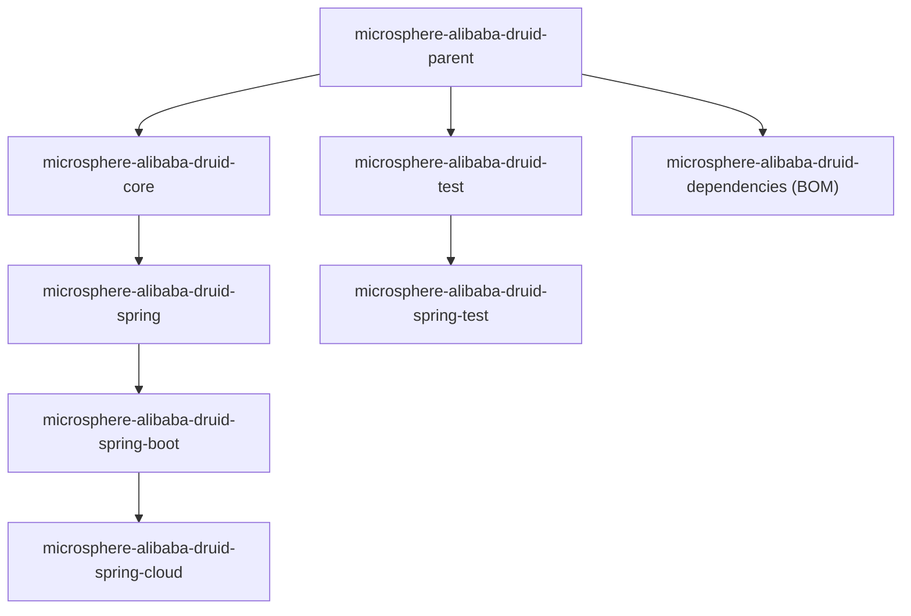

# Microsphere Alibaba Druid — 用户文档

[English](../README.md)

本文档面向 `current` 文档线（`release` 分支）上 Microsphere Alibaba Druid 的**使用者**，即 `0.2.x` 构件。它告诉你在
`pom.xml` 里该写什么、该用哪些类与注解、该配置哪些属性。设计动机与内部机制由[开发者文档](../../developer-guide/zh/README.md)
说明。

Microsphere Alibaba Druid 构建在 [Alibaba Druid](https://github.com/alibaba/druid)（一个高性能 JDBC 连接池）之上，额外
提供了 SQL **语句拦截**支持（`AbstractStatementFilter`）、Spring / Spring Boot / Spring Cloud 集成、供 Actuator 使用的
连接池指标，以及一组测试工具。

## 本文档包含的文档

| 文档 | 模块 | 提供的能力 |
|---|---|---|
| [microsphere-alibaba-druid-core.md](microsphere-alibaba-druid-core.md) | `microsphere-alibaba-druid-core` | `AbstractStatementFilter` / `LoggingStatementFilter` 与 `microsphere.alibaba.druid` 属性名常量 |
| [microsphere-alibaba-druid-spring.md](microsphere-alibaba-druid-spring.md) | `microsphere-alibaba-druid-spring` | `@EnableAlibabaDruid` 与 `DruidDataSourceBeanPostProcessor`：把 `Filter` Bean 注入每个 `DruidDataSource` |
| [microsphere-alibaba-druid-spring-boot.md](microsphere-alibaba-druid-spring-boot.md) | `microsphere-alibaba-druid-spring-boot` | 自动配置、`AlibabaDruidProperties` 与 `DruidDataSourcePoolMetadata`（Actuator 连接池指标） |
| [microsphere-alibaba-druid-spring-cloud.md](microsphere-alibaba-druid-spring-cloud.md) | `microsphere-alibaba-druid-spring-cloud` | Spring Cloud 自动配置，以及 `features.yaml` 声明的 `/actuator/features` 条目 |
| [microsphere-alibaba-druid-test.md](microsphere-alibaba-druid-test.md) | `microsphere-alibaba-druid-test` | `AbstractAlibabaDruidTest`、`AlibabaDruidTestUtils`、`@AlibabaDruidTest`、`@AlibabaDruidRuntime` |
| [microsphere-alibaba-druid-spring-test.md](microsphere-alibaba-druid-spring-test.md) | `microsphere-alibaba-druid-spring-test` | 用于 Spring 测试的 `AbstractDruidSpringTest` 与 `DruidDataSourceTestConfiguration` |
| [microsphere-alibaba-druid-parent.md](microsphere-alibaba-druid-parent.md) | `microsphere-alibaba-druid-parent` | 父 POM：Druid `1.2.28` 版本管理，以及 Microsphere Spring Cloud BOM 的导入 |
| [microsphere-alibaba-druid-dependencies.md](microsphere-alibaba-druid-dependencies.md) | `microsphere-alibaba-druid-dependencies` | Bill of Materials（BOM）：它钉住版本的构件清单 |

## 快速开始

### 1. 导入 BOM

`microsphere-alibaba-druid-dependencies` 是本项目的 Bill of Materials。导入之后就再也不用为 Microsphere Alibaba Druid
的构件写版本号。

```xml
<properties>
    <microsphere-alibaba-druid.version>0.2.21</microsphere-alibaba-druid.version>
</properties>

<dependencyManagement>
    <dependencies>
        <dependency>
            <groupId>io.github.microsphere-projects</groupId>
            <artifactId>microsphere-alibaba-druid-dependencies</artifactId>
            <version>${microsphere-alibaba-druid.version}</version>
            <type>pom</type>
            <scope>import</scope>
        </dependency>
    </dependencies>
</dependencyManagement>
```

Gradle 写法：

```kotlin
implementation(platform("io.github.microsphere-projects:microsphere-alibaba-druid-dependencies:0.2.21"))
```

> 该 BOM 只钉住本仓库模块的版本。Druid 本身（`com.alibaba:druid`）以及 Spring Boot / Spring Cloud 的版本来自
> `microsphere-alibaba-druid-parent`，因此请在应用中把 `com.alibaba:druid` 与你使用的 H2/MySQL 驱动作为普通依赖声明。
> 参见 [microsphere-alibaba-druid-dependencies.md](microsphere-alibaba-druid-dependencies.md) 与
> [microsphere-alibaba-druid-parent.md](microsphere-alibaba-druid-parent.md)。

### 2. 添加一个模块

Spring Boot 应用通常只需要 Spring Boot 模块，它会传递引入 `core`、`spring`，而不会额外带入其他内容：

```xml
<dependencies>
    <dependency>
        <groupId>io.github.microsphere-projects</groupId>
        <artifactId>microsphere-alibaba-druid-spring-boot</artifactId>
    </dependency>

    <dependency>
        <groupId>com.alibaba</groupId>
        <artifactId>druid</artifactId>
    </dependency>

    <dependency>
        <groupId>com.h2database</groupId>
        <artifactId>h2</artifactId>
        <scope>runtime</scope>
    </dependency>
</dependencies>
```

各模块把 Druid / Spring / Spring Boot 声明为**可选**依赖，因此它们*不会*被传递引入 —— 需要你自己添加。

### 3. 最小 Spring Boot 应用

```java
@SpringBootApplication
public class DruidDemoApplication {

    public static void main(String[] args) {
        SpringApplication.run(DruidDemoApplication.class, args);
    }
}
```

`src/main/resources/application.properties`：

```properties
spring.datasource.type=com.alibaba.druid.pool.DruidDataSource
spring.datasource.url=jdbc:h2:mem:test_mem
spring.datasource.driver-class-name=org.h2.Driver

microsphere.alibaba.druid.enabled=true
microsphere.alibaba.druid.filter.classes=io.microsphere.alibaba.druid.filter.LoggingStatementFilter

management.endpoints.web.exposure.include=health,features
```

到这里就够了：`AlibabaDruidAutoConfiguration` 注册的 `DruidDataSourceBeanPostProcessor` 会在每个 `DruidDataSource` 初始化
之前把匹配的 `Filter` Bean 注入进去，而 `DataSourcePoolMetadataProvider` 则把 Druid 连接池暴露给 Spring Boot Actuator
指标。

### 4. 加入你自己的 SQL 拦截逻辑

继承 `AbstractStatementFilter`（见 [microsphere-alibaba-druid-core.md](microsphere-alibaba-druid-core.md)），把它声明为
Spring Bean，并写进 `microsphere.alibaba.druid.filter.classes` —— 或者在原生 Spring 应用中使用 `@EnableAlibabaDruid`
（见 [microsphere-alibaba-druid-spring.md](microsphere-alibaba-druid-spring.md)）。

## 配置属性汇总

| 属性 | 类型 | 默认值 | 定义位置 | 消费方 |
|---|---|---|---|---|
| `microsphere.alibaba.druid.enabled` | `boolean` | `true` | `PropertyConstants`（core） | `@ConditionalOnAlibabaDruidEnabled`、`AlibabaDruidProperties` |
| `microsphere.alibaba.druid.filter.classes` | `Class<? extends com.alibaba.druid.filter.Filter>[]` | `[com.alibaba.druid.filter.Filter]` | `AlibabaDruidProperties.Filter`（spring-boot） | `AlibabaDruidAutoConfiguration` |

## 模块结构



运行期模块的编译期依赖链：`core` → `spring` → `spring-boot` → `spring-cloud`。测试模块为 `test` → `spring-test`。

## 版本信息

| 项目 | 值 |
|---|---|
| 文档线 | `current`（由 `release` 分支生成） |
| 最新已发布版本 | `0.2.21` |
| `main` 工作树版本 | `0.2.22-SNAPSHOT`（开发版，未发布） |
| Java | `17` 及以上（根 `pom.xml` 中 `<java.version>17</java.version>`） |
| CI JDK 矩阵 | `17`、`21`、`25`（`.github/workflows/maven-build.yml`） |
| Alibaba Druid | `1.2.28`，由 `microsphere-alibaba-druid-parent` 管理 |
| 所有构件的 groupId | `io.github.microsphere-projects` |
| 自动配置注册方式 | Boot 3 风格的 `META-INF/spring/org.springframework.boot.autoconfigure.AutoConfiguration.imports` |

## 兼容范围

`current` 文档线兼容 **Spring Cloud `2022.0.x` – `2025.0.x`**（因此也即 Spring Boot `3.0.x` – `3.5.x`）。构建会在四个
profile 上验证：

| Profile | Spring Boot | Spring Cloud |
|---|---|---|
| `spring-cloud-2022` | `3.0.13` | `2022.0.5` |
| `spring-cloud-2023` | `3.3.13` | `2023.0.6` |
| `spring-cloud-2024` | `3.4.13` | `2024.0.3` |
| `spring-cloud-2025` | `3.5.15` | `2025.0.3` |

> 这些具体的 Boot/Cloud 版本**继承自外部父 POM 链**
> `io.github.microsphere-projects:microsphere-spring-cloud-parent:0.2.26`，并非本仓库声明。

仍在使用 JDK 8 或 Spring Cloud `Hoxton` – `2021.0.x`？请改用 `1.x` 文档线：[1.x 用户文档](../../../1.x/user-guide/README.md)。

## 相关文档

- [项目 README（仓库根）](../../../../README.md)
- [开发者文档](../../developer-guide/zh/README.md) —— 同一批模块的架构与内部实现

## English

- [English User Guide](../README.md)
